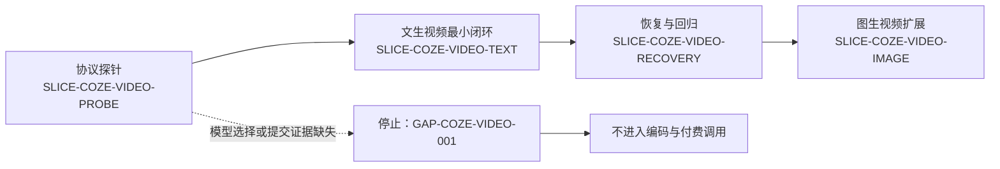
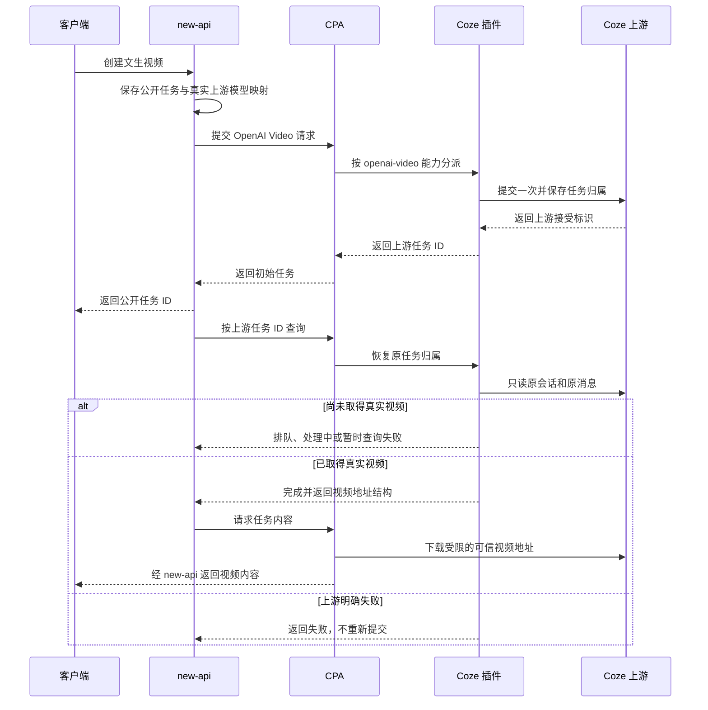

# new-api 经 CPA 调用 Coze 视频生成模型需求与方案

结论：建议沿用 new-api 已有的视频任务入口，CPA 把视频请求交给 Coze 插件，插件提交后立即返回任务，再按原任务查询和下载；影响：客户端可提交视频、查看进度并取回文件，现有聊天和生图链路不应改变；范围：本期先打通文生视频的创建、查询、完成和下载，并保留账号、任务和计费关系；非范围：本期不做图生视频、视频编辑、管理面板、生产发布和容器重启；变化：Coze 视频模型从只能被列出，变为可通过标准视频接口实际调用，但当前还没有实现；完成标准：本地环境能创建一个真实短视频，重启后仍能查询，重复查询不重复生成或扣费，客户端能下载可播放的视频；术语说明：异步任务是提交后先拿到编号、稍后再查结果的处理方式，它让视频生成不占用一次长连接；验证状态：已核对三层当前源码，方案方向成立，Coze 的真实视频提交和返回样本尚未取得，因此当前仅供评审，不能据此开工。

## 文档信息

| 项目 | 内容 |
| --- | --- |
| 来源 | 用户提出“new-api -> CPA -> coze 插件，先出一个生成视频的方案” |
| 维护对象 | `coze-provider` 的视频生成接入；当前项目只保存方案与后续插件实现 |
| 当前状态 | `blocked`：等待 Coze 视频上游协议探针，不是实施授权 |
| 流程深度 | `FULL`：跨三个服务、外部系统、任务状态和费用边界 |
| 当前优先闭环 | `SLICE-COZE-VIDEO-TEXT`：文生视频的创建、查询、完成、下载 |
| 用户开工授权 | 否；本轮只允许方案与文档，不允许代码、跨项目写入、付费生成、发布或生产重启 |
| 图片资产决策 | `N/A + 原因：本轮是接口与异步任务方案，没有 UI、原型或外观证据需要位图；证据：范围限定为标准视频接口与 Mermaid 流程/时序图` |
| 数据库变更 | `N/A + 原因：推荐复用插件本地任务 sidecar，不新增业务表；证据：任务只保存插件与上游关联信息，正式落点在协议探针后冻结` |

### 当前计划最终方案简要说明

推荐让 new-api 继续提供 OpenAI Video 任务接口，CPA 在主视频入口按注册的 `openai-video` 模型能力分派给插件，Coze 插件用可恢复的本地任务记录把上游异步回复映射成视频任务。首个闭环只做文生视频；正式字段与代码任务必须等真实协议样本关闭 `GAP-COZE-VIDEO-001` 后再冻结。

图片资产决策：N/A。原因：本轮是接口与异步任务方案，没有 UI、原型或外观证据需要位图。证据：范围限定为标准视频接口与 Mermaid 流程/时序图。

## 需求来源与证据台账

| ID | 当前证据 | 已确认事实 | 不能据此推断的内容 |
| --- | --- | --- | --- |
| `SRC-COZE-VIDEO-001` | 用户当前需求 | 目标是贯通三层并实际取得视频 | 不能推断允许改码、付费生成或发布 |
| `SRC-COZE-VIDEO-002` | `coze/main.go:293-295`、`coze/models.go:88-95` | 插件执行器当前只有聊天与生图格式；视频目录类型仍是 `video` | 模型可见不代表视频可执行 |
| `SRC-COZE-VIDEO-003` | `coze/claw.go:397-424`、`431-449`、`505-519` | 提交返回用户消息 ID；可按会话查询；回复可按原消息 ID 配对 | 未证明视频模型选择、视频参数、状态和视频附件字段 |
| `SRC-COZE-VIDEO-004` | `coze/executor.go:30-48`、`322-408` | 聊天上下文有 5 分钟上限，生图会等待晚到附件 | 视频不能复用一次聊天长等或把任意附件当视频 |
| `SRC-COZE-VIDEO-005` | CPA `server_routes.go:62-108` | `/openai/v1/videos` 有创建、查询、内容下载；`/v1/videos` 走 xAI 语义 | 不应把 Coze 直接送入 xAI 转换和模型归一 |
| `SRC-COZE-VIDEO-006` | CPA `openai_videos_handlers.go:149-223`、`692-713`、`773-880` | 当前只接受 xAI/Sora；创建会构造 xAI 请求；查询和内容有进程内账号绑定 | Coze 需要能力分派与重启后仍可用的任务归属，不能原样复用白名单和内存绑定 |
| `SRC-COZE-VIDEO-007` | new-api `plugins/tasks/sora/plugin.js:1-27`、`85-166` | 现有 OpenAI 渠道可复用任务创建、查询、内容下载与按秒/尺寸用量事实 | 不应新建 Coze 渠道或把真实 Coze 模型伪装为 Sora |
| `SRC-COZE-VIDEO-008` | new-api `model/task_model_alias.go:120-156`、`middleware/task_plugin.go:341-363` | 客户端可先用 Sora 已声明模型进入任务插件，再由渠道映射传递真实上游模型 | 任意 Coze 名称不会自动命中 Sora 插件 |
| `SRC-COZE-VIDEO-009` | new-api `model/channel.go:521-529`、`relay/channel/task/jsplugin/adaptor.go:206-210`、`pkg/jsplugin/request.go:12-32` | 渠道地址原样保留，插件在该地址后拼 `/v1/videos`，只校验目标主机 | 优先用 `<CPA 根地址>/openai`，但仍需真实出站路径验证，不能宣称已完成联调 |
| `SRC-COZE-VIDEO-010` | `doc/5-tests/2026-10-18_164500_Coze对话链路协议补全.md:76-135` | 历史真实对话样本含 `video_option:null`，`task/events` 的任务 ID 与消息 ID 不同 | `video_option` 结构未知，不能猜字段或混用任务体系 |
| `SRC-COZE-VIDEO-011` | 知识库《CPA 媒体端点图像视频支持边界》《Coze 插件生图上游契约与无水印可行性》 | 历史结论提示模型格式、宿主白名单和 new-api 路径是主要断点 | 未验证的视频机制不能当当前事实；以当前源码为准 |
| `SRC-COZE-VIDEO-012` | `PROJECT_HISTORY.md` 的 `coze-provider 0.2.0` 事件 | 历史真实模型发现证明两类目录需合并，视频族可被列出 | 不能证明视频生成参数或消息返回格式 |

## 决策冻结

| ID | 决策 | 依据与影响 | 状态 |
| --- | --- | --- | --- |
| `DEC-COZE-VIDEO-001` | 采用标准异步视频任务，不在聊天正文中返回链接 | 保留任务状态、恢复、查询、下载和计费，满足完整链路目标 | 方案建议，待评审 |
| `DEC-COZE-VIDEO-002` | new-api 复用 OpenAI 渠道和 Sora 任务插件 | 现有创建、查询、内容、任务 ID 与用量机制可复用 | 源码证据 |
| `DEC-COZE-VIDEO-003` | CPA 优先承接 `/openai/v1/videos` 系列 | 路径与 new-api 的 `<CPA>/openai` + `/v1/videos` 对齐 | 源码证据，待真实出站验证 |
| `DEC-COZE-VIDEO-004` | CPA 在主视频入口按模型能力分派，不为 Coze 添加外围特判 | 内建 xAI/Sora 保留原转换；插件模型保留原名进入 `openai-video` 执行链 | 方案建议，待授权 |
| `DEC-COZE-VIDEO-005` | 插件任务归属持久化，查询不重新提交、不换账号 | 防止重启丢任务、重复生成和重复扣费 | 强制业务规则 |
| `DEC-COZE-VIDEO-006` | 首期只承诺文生视频 | 先关闭模型选择、提交、状态、附件这一条最小链路 | 当前范围 |
| `DEC-COZE-VIDEO-007` | 具体上游字段、超时、轮询间隔、文件类型和模型参数尚未冻结 | 必须以真实视频探针为证据，禁止从生图或聊天推断 | P0 阻断 |

### 方案比选

| 路线 | 收益 | 主要代价 | 结论 |
| --- | --- | --- | --- |
| 标准异步视频任务 | 客户端可用同一任务查询与下载；能恢复和核算 | 三层都要补齐职责，插件要保存任务 | 推荐 |
| 聊天正文返回视频链接 | 初期开发较少 | 没有统一任务、恢复、状态与计费，签名地址还可能泄漏 | 不满足本需求 |
| 单次请求等待视频完成 | 表面调用简单 | 视频时长可能超过聊天上下文和网关限制，断线难恢复 | 否决 |
| 新建 new-api Coze 渠道 | 名称直观 | 重复任务系统，现有 Coze 渠道只适配聊天 | 否决 |

## 目标与非目标

### 本期目标

- 客户端通过 new-api 创建文生视频任务，取得 new-api 的公开任务 ID。
- 同一公开任务可查询排队、处理中、成功或失败；成功后可经 new-api 下载视频。
- Coze 的任务关联在 CPA 重启后仍能恢复，查询不会创建第二条上游生成任务。
- 失败语义能区分“尚未完成”“暂时查不到”“上游明确失败”“已完成但下载失败”。
- 现有聊天、生图、账号调度与其他视频提供方行为不回退。

### 明确非目标

- `BOUND-COZE-VIDEO-001`：图生视频、参考图上传和视频参数扩展放第二阶段，不进入首闭环。
- `BOUND-COZE-VIDEO-002`：视频 edits、extensions、remix 不在范围。
- `BOUND-COZE-VIDEO-003`：不新增自定义平行业务接口，不修改现有客户端路径。
- `BOUND-COZE-VIDEO-004`：不做管理面板、不使用生产环境取证、不发布、不重启生产 CPA。
- `BOUND-COZE-VIDEO-005`：不顺手处理 QoderWork 当前工作树改动、历史模型目录缺陷或其他插件问题。

## 角色、权限与责任

| 角色 | 负责 | 禁止事项 |
| --- | --- | --- |
| 客户端 | 用 new-api 的公开模型和任务 ID 创建、查询、下载 | 不接触 Coze Cookie、会话 ID 或消息 ID |
| new-api | 公开任务、上游映射、轮询、用量事实、内容代理 | 不把公开任务 ID 当上游 ID，不把 Coze 模型伪称 Sora |
| CPA | 保留 OpenAI 视频契约，按能力路由并维护兼容 | 不把 Coze 送入 xAI 参数转换，不依赖进程内绑定作为唯一真相 |
| Coze 插件 | 提交、记录任务归属、查询原会话、识别视频、返回结果地址 | 已接受任务不重提、不换号、不把图片或缩略图当视频 |
| 实施者 | 取得授权后在 local 环境按正式计划实施与验证 | 不把本方案当开工许可，不连接生产、不记录签名地址或 Cookie |
| 用户 | 评审方案；决定是否授权协议探针和后续跨项目修改 | 付费动作、生产动作和范围扩大须另行明确授权 |

## 功能需求与规则要求

| ID | 触发与输入 | 处理与输出 | 异常、权限与验收意图 |
| --- | --- | --- | --- |
| `REQ-COZE-VIDEO-001` | 客户端提交模型、提示词及已支持的时长、尺寸 | new-api 创建公开任务；CPA 返回上游任务 ID；插件只提交一次 | 参数未确认前拒绝映射；验收见 `AC-COZE-VIDEO-001` |
| `REQ-COZE-VIDEO-002` | 客户端查询公开任务 | new-api 用保存的上游 ID 查询；插件在原账号、原会话查回复 | 暂时查不到不得直接判失败；验收见 `AC-COZE-VIDEO-002` |
| `REQ-COZE-VIDEO-003` | 上游仍在排队或生成 | 返回 `queued` 或 `in_progress`，不返回虚假进度 | 不能用 HTTP 200、正文结束或任意附件冒充完成；验收见 `AC-COZE-VIDEO-002` |
| `REQ-COZE-VIDEO-004` | 上游返回真实视频产物 | 保存结果地址并返回 `completed` 与 CPA 所需的视频地址结构 | 只有真实视频文件或可信终态才能完成；验收见 `AC-COZE-VIDEO-003` |
| `REQ-COZE-VIDEO-005` | 客户端下载视频 | new-api 经 CPA 内容接口代理到真实文件，只暴露 new-api 的公开任务与签名能力地址 | 下载失败不等于生成失败；验收见 `AC-COZE-VIDEO-004` |
| `REQ-COZE-VIDEO-006` | CPA 或插件进程重启 | 从持久任务记录恢复上游账号、会话、消息与模型归属 | 不得因内存绑定丢失而重新生成；验收见 `AC-COZE-VIDEO-005` |
| `REQ-COZE-VIDEO-007` | 任务已接受后发生查询、超时或下载异常 | 保持原任务可再查；不切换账号重新提交 | 防止重复扣费；验收见 `AC-COZE-VIDEO-006` |
| `REQ-COZE-VIDEO-008` | 请求缺少提示词、模型不受支持、参数超出已证实范围 | 在提交上游前返回请求错误，不产生上游任务 | 不能靠换号掩盖参数或权限问题；验收见 `AC-COZE-VIDEO-007` |
| `REQ-COZE-VIDEO-009` | 聊天或生图请求继续使用原路径 | 保留原输入输出格式、状态、附件与错误语义 | 现有功能回归通过；验收见 `AC-COZE-VIDEO-008` |

### 业务规则与优先级

- `RULE-COZE-VIDEO-001`：公开任务 ID、CPA 上游任务 ID、Coze 消息 ID 是三种标识，只有第一种可给客户端；Coze 消息 ID 不进入客户端响应。
- `RULE-COZE-VIDEO-002`：模型映射顺序固定为“客户端公开模型命中 new-api 任务插件，再经渠道映射得到真实 Coze 模型，CPA 保留真实模型名”。
- `RULE-COZE-VIDEO-003`：任务创建前先确定账号；任务记录至少关联任务 ID、账号 ID、会话 ID、消息 ID、真实模型、创建时间、状态与结果。记录不得包含 Cookie 或签名地址的明文日志副本。
- `RULE-COZE-VIDEO-004`：任务存储建议采用插件本地原子 JSON sidecar，文件名与目录在正式实施计划中冻结；不引入数据库表，不依赖 CPA 的 3 小时内存绑定。
- `RULE-COZE-VIDEO-005`：状态映射以实测为准。映射候选为 `queued/pending -> queued`，`processing/running/in_progress -> in_progress`，`done/succeeded/success/completed -> completed`，`failed/error/expired/cancelled/canceled -> failed`；未知状态不能默认成功。
- `RULE-COZE-VIDEO-006`：真实视频地址必须来自已证实字段并限制可信 Coze 域名；禁止任意地址下载，签名 URL 属临时凭据，不写日志、证据或回复。
- `RULE-COZE-VIDEO-007`：结果地址需要过期时，通过原任务重新获取下载信息；不能重新生成视频。
- `RULE-COZE-VIDEO-008`：任务记录清理时间必须不早于上游签名产物和客户端可下载窗口；具体保留期、孤儿记录和并发锁在正式计划中冻结，不能在本方案中假定永久保存。

## 数据与外部契约

### 客户端契约保持不变

| 动作 | new-api 对外入口 | 外部结果 |
| --- | --- | --- |
| 创建 | `POST /v1/videos` | 公开任务 ID、初始状态 |
| 查询 | `GET /v1/videos/{公开任务 ID}` | 任务状态、进度（只有真实进度才返回）、错误 |
| 内容 | `GET|HEAD /v1/videos/{公开任务 ID}/content` | 可下载的视频内容；HEAD 的兼容性须验证 |
| new-api 到 CPA | `{CPA 根地址}/openai/v1/videos` 系列 | 复用 OpenAI Video 形态；Base URL 配置为 `{CPA 根地址}/openai` |
| CPA 到插件 | `SourceFormat=openai-video`、真实 `RequestedModel`、原始请求和上下文 | 创建、查询、内容请求均可辨认；具体元数据在正式计划核对 |

### 模型配置方向

new-api 使用 OpenAI 渠道。公开模型可沿用 Sora 插件已经声明的名称，例如 `sora-2`，渠道 `model_mapping` 再将上游模型改成实测支持的真实 Coze ID。下面的 JSON 只说明映射结构，不指定最终 Coze 模型：

```json
{
  "sora-2": "<经协议探针确认的真实 Coze 视频模型 ID>"
}
```

`sora-2` 在这里只是进入现有视频任务协议的公开入口，不能出现在 CPA 对上游的模型选择中。最终模型目录、计费名称、时长与尺寸枚举必须来自真实模型能力样本；不能沿用 xAI 的 1 至 15 秒限制或默认尺寸。

### 插件任务记录建议

| 字段 | 用途 | 约束 |
| --- | --- | --- |
| 上游任务 ID | CPA 与 new-api 查询、下载的关联键 | 创建后不可变，不使用公开任务 ID 代替 |
| 账号 ID | 恢复原账号与原凭据 | 不因查询失败换号 |
| 会话 ID、消息 ID | 查询对应 Coze 回复 | 只对客户端隐藏；不能与其他任务混用 |
| 真实模型、请求摘要 | 排查模型和参数映射 | 不记录 Cookie、完整签名地址或敏感正文日志 |
| 创建、更新时间、状态 | 恢复与状态机 | 未知状态保持未知或处理中，不推断完成 |
| 结果元数据 | 记录已证实视频文件与过期信息 | 日志与证据只留脱敏元数据 |

### 失败语义

| 情况 | 任务结论 | 是否允许重新生成 |
| --- | --- | --- |
| 尚未出现回复或可信状态 | 保持排队/处理中 | 否 |
| 一次查询网络失败或超时 | 保留原任务，等待下次查询 | 否 |
| 上游明确拒绝或未接受 | 创建失败 | 只能按原请求级错误处理，不得换号重提已接受任务 |
| 上游明确失败 | `failed`，返回脱敏原因 | 否 |
| 只有正文、图片、缩略图或未知附件 | 不完成 | 否 |
| 已取得真实视频但下载失败 | 保留生成结果，报告下载错误 | 否 |
| 任务记录丢失或归属冲突 | 阻断查询，报告不可恢复错误 | 否 |

## 状态、流程与时序

### 业务切片与依赖

| 切片 | 用户价值 | 范围与依赖 | 当前状态 |
| --- | --- | --- | --- |
| `SLICE-COZE-VIDEO-PROBE` | 明确真实上游如何生成和交付视频 | 只取协议证据；必须先获付费与 local 环境授权 | 当前阻断点 |
| `SLICE-COZE-VIDEO-TEXT` | 客户端创建、查询并下载文生视频 | 依赖协议探针；当前优先业务闭环 | 仅方案，未实施 |
| `SLICE-COZE-VIDEO-RECOVERY` | 重启可查询，异常不重复扣费，旧功能不回退 | 依赖最小文生链路；与首闭环分开验证 | 仅方案，未实施 |
| `SLICE-COZE-VIDEO-IMAGE` | 使用参考图生成视频 | 依赖独立上传与图生契约；不阻塞文生闭环 | 明确后置 |

图形目的：说明各切片的依赖与停止边界；关联 ID：`SLICE-COZE-VIDEO-*`、`GAP-COZE-VIDEO-001`。



图形目的：说明推荐调用顺序和异常时的只读查询边界；关联 ID：`REQ-COZE-VIDEO-001` 至 `007`、`RULE-COZE-VIDEO-002` 与 `005`。



异常边界：查询失败不能触发重新提交；内容下载只认已证实的视频字段和可信域名；没有真实终态或视频文件时，不进入完成分支。

## 非功能要求、风险与阻断

| 类别 | 要求 | 验证意图 |
| --- | --- | --- |
| 性能与超时 | 创建只等待上游接受，不等待视频生成；查询请求各自有短超时和独立轮询边界 | 不复用 5 分钟聊天执行上下文，避免长连接和网关超时 |
| 可靠性 | 任务归属可恢复，写入不破坏其他任务；重复创建/查询的幂等语义以正式计划为准 | 重启、并发查询、断线后都能区分原任务 |
| 费用 | 已接受任务严禁查询失败后重提；协议探针先用最低成本、最短视频 | 对照生成次数与积分变化，异常时不盲目重试 |
| 安全 | 限制视频地址域名、重定向和响应大小；日志脱敏；不暴露上游标识与 Cookie | 防止 SSRF、签名地址泄漏与大文件异常 |
| 可观测性 | 记录任务 ID、阶段、状态、耗时和脱敏错误，不记录凭据 | 能区分提交失败、轮询失败、上游失败和下载失败 |
| 兼容 | 旧聊天、生图、内建视频模型、现有公开路径不改变 | 现有能力与目标接口的契约回归 |
| 回滚 | 代码按三仓独立回退；新任务 sidecar 可停用新路由，旧文件先备份再处理 | 不删除旧聊天、生图与历史任务数据 |
| 运营 | 先 local 验证，发布和生产部署另行授权；安装默认热重载，非必要不重启 | 不触碰生产配置表和在线流量 |

### 反方批判结论

**需补充再放行。** 推荐路线在三层现有能力上有源码依据，但上游字段未证实时，最可能失败在“请求看似成功却实际调用普通聊天模型”“把非视频附件误判为完成”“重启或查询异常后重复生成”三处。协议探针、任务归属恢复和防重测试是放行条件，不能将它们推迟为上线后的修复。

### 主要风险台账

| ID | 风险与影响 | 处置与停止条件 |
| --- | --- | --- |
| `GAP-COZE-VIDEO-001`（P0） | 没有真实视频提交与响应样本，无法冻结模型选择、参数、状态与附件 | 先取证；缺任一关键字段即停止，不进入正式计划与编码 |
| `GAP-COZE-VIDEO-002`（P1） | CPA 查询/下载若依赖进程内绑定，重启后可能选错模型或账号 | 正式设计必须证明任务归属可恢复，否则不放行 |
| `GAP-COZE-VIDEO-003`（P1） | new-api 与 CPA 对失败重试和计费事实的配置尚未实测 | 在 local 做重复查询与计费对照；无法证明不重复生成则停止 |
| `GAP-COZE-VIDEO-004`（P1） | 修改 CPA/new-api 的授权与版本基线未获得 | 两仓保持只读；需要修改时按目标路径、文件、操作、基线逐项授权 |
| `GAP-COZE-VIDEO-005`（P2） | Coze 视频地址的域名、有效期与文件类型未知 | 探针记录脱敏元数据；无法限制下载源则不放行内容代理 |
| `GAP-COZE-VIDEO-006`（P2） | local 的 Coze 凭据、CPA/new-api 启动配置和 apifox 项目入口尚未在本任务中确认 | 只用 local 配置发现并确认；缺失即环境阻断，不回退生产或 test |

## 受限计划与推进顺序

当前推荐方案可用于评审，但不能形成零决策正式实施计划。缺少的是上游协议真实样本、跨项目写入授权和 local 测试入口，不是再读几份代码就能补齐的事实。

1. 先完成本需求与受限方案评审，冻结“标准异步视频任务”和“先做文生视频”的方向。
2. 用户明确授权后，只用 local 配置做一次最低成本协议探针。先记录模型选择和请求，再观察原消息的状态与视频附件；探针不追求产出交付功能。
3. 将真实字段、失败样本、地址约束和清理结果回填本需求，关闭 P0/P1 前置缺口。
4. 再形成正式实施总览、实施周期和逐任务卡，明确三仓文件/符号、测试命令、清理与回滚；取得对应跨项目写入授权后才允许实现。
5. 文生视频闭环与恢复回归通过后，才单独评审图生视频。

正式实施文档将包含：方案摘要、来源与边界、实施周期总览、逐周期最小任务、代码落点目录树、接口契约、任务存储、真实测试安排、失败/停止条件、回滚、跨会话执行入口、外部项目 `EXT-*` 清单和 `FEAS-*` 探针结论。受限方案见 [受限方案](../3-实施/2026-10-25_025849_new-api经CPA调用Coze视频生成模型_受限方案.md)。

### 测试要求预埋与样本分布

本轮没有代码或运行行为变更，真实功能测试为 `N/A + 原因：当前仅需求与方案文档；证据：三仓源码未修改，未启动服务，未产生视频`。以下仅作为后续实施的验证入口，不表示已经执行。

1. **本地 `test/` 单元测试**：适用。按被测源码镜像覆盖模型分派、任务状态、持久化恢复、视频附件识别、地址白名单和防重复提交；测试数据使用脱敏真实协议样本与负向变异样本。
2. **apifox 接口用例**：适用。覆盖创建、排队、处理中、成功、失败、重复查询、内容 GET/HEAD、重启后查询和错误参数；保存 caseId 与断言总数/失败数，写接口还须核对生成次数与积分变化。通用四级交易样本 `N/A + 原因：视频异步任务不是订单/交易接口，不套用历史订单状态；证据：本需求样本为任务状态和真实短视频`。
3. **页面自动化点击测试**：适用性为 `N/A + 原因：首闭环不新增或修改页面、组件、样式和管理面板；证据：已检索 `new-api/web` 与 `coze/panel.html`，本方案未选择其视频管理或页面调用作为入口。若后续将视频能力接入 new-api 既有播放页面，必须按触发规则补真实点击、Network、控制台与进程收口证据`。
4. **真实端到端**：使用 local CPA/new-api 和经授权的 local Coze 账号，最短且最低成本生成一个可播放小视频；覆盖创建后重启、重复查询不重复扣费、真实下载与旧聊天/生图回归。非 local 环境不得用于补证据。
5. **范围外与停止条件**：图生视频、remix 和生产流量不进入首轮。缺少真实协议、local 配置不可用、需要未授权付费、下载域名无法约束、重复生成风险未消除，任一出现即停止。

## 追踪契约

### 追踪矩阵

需求到验证意图的映射如下。`AC-*` 是后续实施计划必须冻结的完成条件，不是已经通过的验收结果；`CYCLE/TASK/TEST/EVIDENCE` 在正式实施阶段建立，当前阻断于 `GAP-COZE-VIDEO-001`。

| 上游 | 验收意图 ID | 必须得到的真实证据 | 当前状态 |
| --- | --- | --- | --- |
| `REQ-COZE-VIDEO-001` | `AC-COZE-VIDEO-001` | 创建一次只产生一个上游任务，返回公开与上游 ID 的正确关联 | 未实施 |
| `REQ-COZE-VIDEO-002`、`003` | `AC-COZE-VIDEO-002` | 排队、处理中、暂时查询失败、明确失败的样本与状态映射 | 未实施 |
| `REQ-COZE-VIDEO-004` | `AC-COZE-VIDEO-003` | 真实视频附件与可信终态，非视频附件不会误判完成 | 未实施 |
| `REQ-COZE-VIDEO-005` | `AC-COZE-VIDEO-004` | GET/HEAD 内容路径和真实可播放文件，下载失败不重提 | 未实施 |
| `REQ-COZE-VIDEO-006` | `AC-COZE-VIDEO-005` | 创建后重启 CPA/插件，仍能按原账号和会话查询 | 未实施 |
| `REQ-COZE-VIDEO-007` | `AC-COZE-VIDEO-006` | 多次查询与异常恢复后，上游生成次数和积分消耗不增加 | 未实施 |
| `REQ-COZE-VIDEO-008` | `AC-COZE-VIDEO-007` | 无效参数在提交前失败，无上游生成记录 | 未实施 |
| `REQ-COZE-VIDEO-009` | `AC-COZE-VIDEO-008` | 旧聊天、生图与内建视频提供方回归 | 未实施 |
| `RULE-COZE-VIDEO-001` 至 `008` | `AC-COZE-VIDEO-001` 至 `008` | 每条规则至少有一个正例和一个防误用反例 | 待正式测试映射 |

## 普通模型零决策执行契约

### 未决决策

`unresolved_decisions`：存在 `GAP-COZE-VIDEO-001`（P0）及 `GAP-COZE-VIDEO-002` 至 `004`（P1），需求状态必须为 `blocked`。这些不是可以交给实施模型选择的默认值。

普通模型只能继续只读核对本方案与真实协议样本，不能自行决定 Coze 请求字段、模型、任务存储目录、轮询频率、下载域名、错误码、保留期或重试策略。协议探针未关闭 P0、跨项目写入未获授权、正式计划未落盘前，禁止编码、改码、重构、测试实施或连续执行。

## 任务阻断收口

- 阻断记录 ID：`BLK-COZE-VIDEO-001`
- 任务状态：blocked
- 阻断阶段：实施前的协议确认与计划阶段
- 阻断依据与证据：`COZE_VIDEO_UPSTREAM_CONTRACT_MISSING`；证据为 `SRC-COZE-VIDEO-003`、`004`、`010` 与 `GAP-COZE-VIDEO-001`，现有样本只有异步聊天与生图，不含真实视频提交和返回
- 已尝试与停止边界：已只读核对三仓源码、历史对话样本和知识库；公开搜索未提供可采信的本链路契约。停止是因为继续需要可能产生费用的真实生成，以及尚未授权的 local 环境使用
- 影响：不能宣布视频链路已实现，不能放行正式计划、编码、付费测试或生产交付；方案文档本身可以评审
- 解决计划：1. 责任方：用户与实施者；前置条件：用户授权本记录中的 local 协议探针与费用边界；动作：用最低成本短视频取得模型选择、提交、状态与附件证据；完成判据：关键字段和至少一个失败/等待样本可回读；验证入口：本需求第“数据与外部契约”和“测试要求预埋”节。2. 责任方：实施者；前置条件：探针证据完整；动作：回填同一需求并制定正式计划；完成判据：P0/P1 关闭且任务、测试、回滚可独立执行；验证入口：`implementation-planning-rules` 与文档机器门禁。3. 责任方：用户；前置条件：正式计划已评审；动作：逐项授权 CPA/new-api 的目标修改；完成判据：授权范围、操作、基线和回滚明确；验证入口：跨项目写入边界检查
- 恢复后重入点：从本需求的协议探针开始，再进入正式实施计划；不得在缺口未关闭时跳到编码
- 去重键：`COZE_VIDEO_UPSTREAM_CONTRACT_MISSING + SRC-COZE-VIDEO-003/004/010`
- 用户授权操作：请直接回复：`同意授权` 或 请直接回复：`暂不授权`；`同意授权` 仅授权最近一条、唯一有效、仍未解除的 `BLK-COZE-VIDEO-001` 记录列明的恢复动作，即 local 协议探针与方案回填，不包含跨项目编码、发布或生产操作；授权后必须执行原恢复步骤并通过原验证入口，验证失败保持阻断；授权不构成跨任务、跨会话或未来写入的通用许可

## 执行附录

### 基线与跨项目只读边界

| 项目 | 地址与基线 | 本轮允许/禁止 |
| --- | --- | --- |
| 当前插件仓 | `F:/cpa-plugin`，`ad459c695346d4f406e9e9656d8e5936621946fe` | 允许本需求与方案文档；未修改 Coze 代码 |
| CPA | `F:/CLIProxyAPI`，`main@7417cfb1bbfb794417764f8cd974a637a0779ddd` | 只读；仓库 `https://github.com/luode0320/CLIProxyAPI.git`，LICENSE 为 MIT |
| new-api | `F:/new-api`，`main@3e78ca63fc745d9c39e5cdc8cf5d2b4b6718e79a` | 只读；仓库 `https://github.com/luode0320/new-api.git`，LICENSE 为 AGPLv3，NOTICE 有署名要求 |

外部项目代码引用：`EXT-COZE-VIDEO-CPA` 与 `EXT-COZE-VIDEO-NEWAPI` 仅用于只读对照，不允许复制或修改。新会话先检查地址、基线和文件/符号；不一致即停止。`coze-provider` 当前代码修改只允许发生在本仓，CPA 与 new-api 的修改需要独立授权。后续实施不得把这些只读证据当作跨项目写入许可。

### local 探针准备与清理约束

- 只允许从本任务明确确认的 `local` 配置读取连接信息；不得使用 `test`、`prod`、`staging`、`pre`、`release` 配置。未发现 local 凭据时记录环境阻断，不能用生产账号补证据。
- 当前未读取任何 Cookie、令牌或签名地址。探针不得输出其原值；只保存字段结构、脱敏 ID、文件类型、状态、域名和计时。
- 真实视频探针可能扣除 Coze 积分，必须先获得 `BLK-COZE-VIDEO-001` 的明确授权；只生成一次最低成本、最短可配置视频，不做批量生成。
- 探针代码只能是一次性取证资产，不改生产主路径；不能把它当作交付实现。执行后关闭临时服务与进程，删除临时文件，回读确认；生成的远端任务记录与本地任务文件按授权边界处理，不能擅自删除用户既有会话或文件。
- 若提交后无法确认上游是否接受，不得再次提交；先按原账号、原会话只读查询。探针异常时保留脱敏证据并停止。

### 本轮验证记录

- 源码与配置证据均为只读读取；未启动 CPA、new-api、Coze 或浏览器，未产生生成费用。
- `PROJECT_HISTORY.md` 的计数锚点结构经 `check_memory_anchors.py` 验证为 `ok=true`，20 个历史事件与 20 个锚点匹配；该维护不表示视频功能已测试。
- `validate_engineering_docs.py --profile requirement`：`valid=true`、`status=PASS`，无错误；新文档未进入 HEAD，标题基线检查按工具提示跳过。`check_punctuation.py --lang zh`：`punctuation: ok`。两张 Mermaid 经 `mmdc 11.16.0` 与隔离 Chrome 真实解析，均生成非空 SVG；解析只证明图形语法有效。
- 受限方案按 `implementation_overview` 校验为 `valid=true`、`status=PASS`，标点检查通过；三张 Mermaid 真实解析通过。结构与图形校验不构成视频功能验证。
- `6-review`：`N/A + 原因：本轮没有生产代码或真实功能测试；证据：仅有需求、受限方案与记忆锚点维护`。文档校验不冒充真实功能测试。

## 追踪附录

### 决策维度覆盖表

当前仍在需求前置缺口阶段，未进入需要用户选择实现层方案的正式 Plan Mode 环节。下表用于记录已经证实的方向与缺口，未发起选择框，也不以推荐项替代用户决定。

| 维度 | 状态 | 结论 / 依据 |
| --- | --- | --- |
| 架构 / 技术路线 | 已确定（方案建议） | 标准异步任务；`DEC-COZE-VIDEO-001` 至 `004` |
| 代码落点 | 前置缺口 | 已确定三层职责，精确文件/符号待正式计划；`EXT` 只读证据 |
| 实现方式 | 前置缺口 | 提交、查询和下载可确定，Coze 字段待 `GAP-COZE-VIDEO-001` |
| 命名 | 前置缺口 | 公开模型可复用 Sora 入口；真实 Coze ID 待探针 |
| 注释 | N/A | 本轮无代码生成或修改；证据为三仓源码只读 |
| 日志 | 已确定（约束） | 不输出 Cookie、签名 URL；任务阶段和错误须可分辨 |
| 错误处理 | 已确定（约束） | 已接受任务不重提；具体错误码待真实样本 |
| 数据模型 | 前置缺口 | sidecar 方向已选，原子写入、锁与保留期待正式计划 |
| 接口契约 | 部分已确定 | 客户端 OpenAI Video 已核实；Coze 上游契约待 P0 探针 |
| 依赖与库 | 已确定（方向） | 复用现有任务系统与 HTTP 能力，不预设新增依赖 |
| 测试策略 / 样本 | 前置缺口 | 需要真实短视频、负向附件与异常样本；见测试预埋 |
| 配置 / 环境 | 前置缺口 | local 入口待确认，禁止使用非 local 环境 |
| 兼容 / 迁移 / 版本 | 已确定（边界） | 三仓基线已记录；不得改变旧聊天、生图与公开路径 |
| 性能 / 并发 | 前置缺口 | 长等与重复提交已排除；轮询与锁待实测 |
| 安全 / 权限 | 已确定（红线） | 只读兄弟仓、local 连接、下载域名限制、付费授权 |
| 回滚 / 灰度 / 发布 | 已确定（边界） | 本轮不发布、不重启；后续三仓独立回退并另行授权 |

### 待用户选择清单

空。当前没有发起实现层多选；`GAP-COZE-VIDEO-001` 是必须通过真实证据关闭的上游缺口，不是用户偏好多选。用户只需决定是否按 `BLK-COZE-VIDEO-001` 授权受限探针；在缺口关闭前不生成正式实施计划。

### 来源到需求与证据的回指

- `SRC-COZE-VIDEO-002` 至 `012` -> `DEC-COZE-VIDEO-001` 至 `007` -> `REQ/RULE/BOUND/SLICE`。
- `REQ-COZE-VIDEO-001` 至 `009` -> `AC-COZE-VIDEO-001` 至 `008` -> `GAP-COZE-VIDEO-001` 阻断 -> 后续 `CYCLE/TASK/TEST/EVIDENCE`。
- `EXT-COZE-VIDEO-CPA` -> `SRC-COZE-VIDEO-005`、`006`；`EXT-COZE-VIDEO-NEWAPI` -> `SRC-COZE-VIDEO-007`、`008`、`009`。两者本轮仅用于方案核对，后续任务引用必须重新验证。
- 图片素材清单：`N/A + 原因：无位图资产；证据：图片资产决策与全文无 Markdown 图片引用`。
- 变更追踪：`v0.1` 首次形成需求、推荐路线与受限方案；后续 Coze 协议探针、范围变化和授权结果必须更新本文件，不新建平行需求入口。
