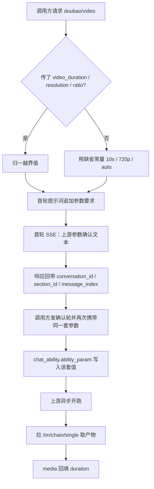
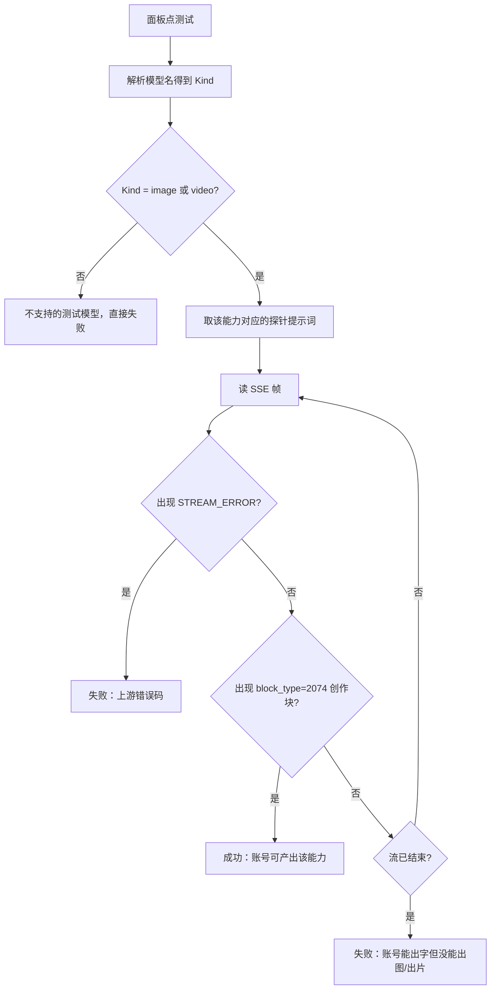
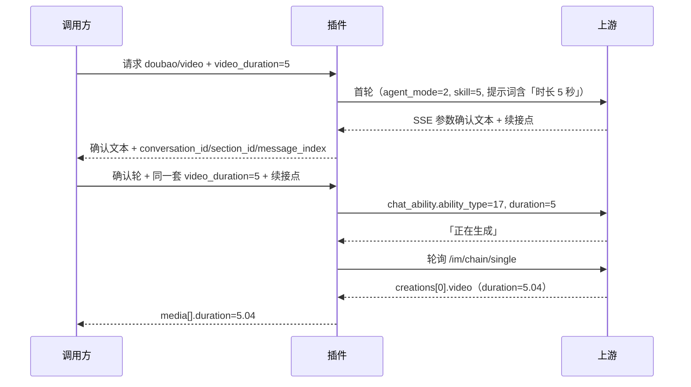

# doubao 视频参数可配置与面板测试判据收紧

结论：把视频确认轮的四个参数从写死的常量改为调用方可传，并让首轮提示词与确认轮 `chat_ability` 使用同一套值；同时把面板「测试」的成功判据从「有任意输出」收紧为「看到对应能力的创作块」。影响：使用 `doubao/video` 的调用方，以及依赖面板「测试」判断账号可用性的运维操作；对 `doubao/image` 的行为是收紧判定，不再把纯文本回复当成功。范围：`doubao/video` 的 `duration` / `resolution` / `ratio` 可传与回显、`media` 回填 `duration`、面板测试按能力换探针提示词并区分创作块输出。非范围：不改视频两段式的协议形态（首轮仍只回参数确认、确认轮才开跑）、不改模型目录、不改账号池与冷却策略、不新增数据库或配置项。变化：调用方可以要求「5 秒 / 1080p / 9:16」并真的拿到该规格的影片；调用方也能从 `media[].duration` 读到实际时长；面板测试不再把「账号能聊天」误报成「账号能生图」。完成标准：调用方不传参数时行为与 0.1.27 完全一致；传了参数时首轮确认文本与确认轮 `ability_param` 的取值一致；`media[].duration` 与产物真实时长一致；图片/视频模式下测试必须看到 `block_type=2074` 创作块才判成功，且失败文案说明「账号能出字但没能出图」。术语说明：「确认轮」指携带 `conversation_id`/`section_id`/`last_message_index` 的第二段请求，靠 `chat_ability.ability_type=17` 把确认文本升级成异步视频任务；「创作块」指上游 `block_type=2074` 的生成结果块，图片与视频都靠它下发产物。验证状态：文档已落盘，尚未编码；本轮已核对 `protocol.go`、`completion.go`、`creation.go`、`creation_parse.go`、`creation_render.go`、`active_ping.go` 六份现存代码并取得生产实测证据。

## 0. 文档信息

| 项 | 内容 |
| --- | --- |
| 需求标题 | doubao 视频参数可配置与面板测试判据收紧 |
| 版本与状态 | v0.1 / 已确认 |
| 需求来源 | 用户 m15710 提问「下面推进什么」→ m15748 采纳「按 1 → 2 → 3 推进」；推荐内容基于 0.1.27 生产实测与代码核对 |
| 修订记录 | 2026-11-17 21:30 v0.1 建立；范围与验收标准首次冻结 |

## 1. 引言

### 1.1 文档目的

本文档定义三件事做到什么算完成：视频确认参数由调用方决定且首轮/确认轮一致、`media` 回填真实时长、面板「测试」按能力区分成功。不描述低层实现细节，实现落点与 `AC-*` 由 `implementation-planning-rules` 在实施总览中冻结。

### 1.2 产品范围

- 需求目标：消除「上游对用户承诺 5 秒、插件实际提交 10 秒」的偏差，并让面板测试不再产生假阳性。
- 背景动因：0.1.27 生产实测暴露两处偏差（见 2.5 证据 `SRC-001` / `SRC-002`）。
- 纳入范围：`doubao/video` 参数可传与回显、`media[].duration`、面板测试提示词与成功判据。
- 排除范围：视频两段式协议形态、模型目录、账号池/冷却、签到与额度（0.1.26 已删）、数据库与配置项。

### 1.3 术语与缩写

- `chat_ability`：确认轮顶层字段，`ability_type=17` 表示视频生成，`ability_param` 是字符串套 JSON 的参数包。
- 能力别名：插件对外暴露的模型名 `doubao/image` / `doubao/video`，`generationMode.Kind` 取值 `image` / `video`。
- 创作块：上游 `block_type=2074` 的内容块，图片与视频产物都只从它解析。

### 1.4 参考资料

- `F:\cpa-plugin\doc\2-需求\2026-11-16_234500_doubao插件改造为图片与视频专用需求.md`（上一轮需求，已闭环）
- `F:\cpa-plugin\doc\5-tests\2026-11-14_173500_doubao签到与活动赠送额度验证.md` 第 27、28 节（视频两段式取证与生产复验）
- `F:\cpa-plugin\doc\4-bugs\2026-11-17_024000_doubao视频首轮误入异步回灌根因与修复.md`

### 1.5 文档导读

第 2 章给现状与证据；第 3 章给三条功能需求与图形化表达；第 4 章给验证方式；第 5 章给口径详解；第 6 章给追踪矩阵。

## 2. 产品概览

### 2.1 产品视角

插件只做图片与视频两件事（0.1.26 起）。两条链路的产物形态不同：图片是同步产物，同一次 `/chat/completion` 的 SSE 内 `block_type=2074` 到齐；视频是异步产物，确认轮只回「正在生成」，成品要主动拉 `/im/chain/single`。现存三处待改点：

| 位置 | 现状 | 影响 |
| --- | --- | --- |
| `F:\cpa-plugin\doubao\protocol.go:104-107` | `videoConfirmRatio` / `videoConfirmModel` / `videoConfirmResolution` / `videoConfirmDuration` 全是常量 | 调用方无法指定规格 |
| `F:\cpa-plugin\doubao\completion.go:320` | 确认轮固定用上述四个常量组装 `chat_ability` | 与首轮确认文本可能矛盾 |
| `F:\cpa-plugin\doubao\creation_render.go:62-87` | `mediaExtension` 只输出 `url`/`type`/`key`/`model`/`width`/`height` | 调用方看不到视频实际时长 |
| `F:\cpa-plugin\doubao\active_ping.go:31-37` | 探针提示词为对话式（「你好」「今天几号」等） | 图片/视频模式下发出的是纯对话请求 |
| `F:\cpa-plugin\doubao\active_ping.go:247-317` | `activeTestOutput` / `contentOutput` 把「有正文/有思考/有创作块」一律算命中 | 能聊天就算活跃成功 |

### 2.2 产品功能摘要

1. 调用方可在请求体里指定视频的 `duration`、`resolution`、`ratio`。
2. 首轮提示词带上这套参数，使上游确认文本与实际提交一致。
3. 确认轮把同一套参数写进 `chat_ability.ability_param`。
4. 响应 `media[].duration` 回填产物真实时长。
5. 面板测试按 `generationMode.Kind` 选探针提示词。
6. 面板测试对图片/视频要求看到创作块才算成功。
7. 失败文案要说明「账号能出字但没能出图/出片」。

### 2.3 约束条件

- 插件无状态：确认轮是独立 HTTP 请求，首轮算出的参数无法在服务端保留，必须由调用方在确认轮再次传入。
- 上游对时长的合法区间有限：实测「3 秒」被上游协商成 4 秒并明确告知「低于最低时长」。
- 视频产物等待 1~5 分钟，测试路径不能等完整产物（面板测试只验证「这个账号此刻能不能产出创作块」）。

### 2.4 用户与角色特征

- 调用方（客户端/SDK）：需要按业务场景指定视频规格，并据此做展示与计费。
- 运维操作（面板）：需要点「测试」就知道「这个账号现在能不能生图/生视频」，而不是「能不能聊天」。

### 2.5 假设与依赖

| ID | 假设/证据 | 来源 |
| --- | --- | --- |
| `SRC-001` | 生产实测：调用方要求「5 秒」，上游首轮确认文本写「时长：5 秒」，但确认轮 `ability_param.duration` 恒 10 | 0.1.27 生产复验（测试文档 28.6） |
| `SRC-002` | 生产实测：`media[]` 只有 `url`/`type`/`width`/`height`，无 `duration`；而上游产物里 `video.duration=10.08` | 0.1.27 生产复验 |
| `SRC-003` | 面板测试对 `doubao/image` 发「你好」，拿回文本即报「活跃成功」 | 代码核对 `active_ping.go:31-37` + `:205-209` |
| `SRC-004` | 用户在 0.1.26 已确认「调用方显式发第二次确认」的两段式模式，续接点由调用方携带 | 用户决策（2026-11-16） |

### 2.6 需求分配与波次

三块工作按依赖排序：`REQ-FUNC-001`（参数可传）→ `REQ-FUNC-002`（`media` 回填时长，依赖 001 的字段定义）→ `REQ-FUNC-003`（面板测试判据，与 001/002 无代码依赖但共享测试文件）。当前优先闭环是 `REQ-FUNC-001`。

## 3. 需求定义

### 3.1 外部接口需求

请求体新增三个可选平铺字段（与既有 `conversation_id` / `section_id` / `last_message_index` 同层）：

| 字段 | 类型 | 缺省 | 说明 |
| --- | --- | --- | --- |
| `video_duration` | int（秒） | 沿用常量 10 | 目标时长；上游可能协商上调 |
| `video_resolution` | string | 沿用常量 `720p` | 目标清晰度 |
| `video_ratio` | string | 沿用常量 `auto` | 画幅比例，如 `16:9` / `9:16` / `auto` |

响应 `media[]` 新增 `duration`（float，秒）；仅视频条目带该字段。

### 3.2 功能需求

#### `REQ-FUNC-001` 视频确认参数可由调用方指定

- 需求陈述（shall）：调用方传入的 `video_duration` / `video_resolution` / `video_ratio` 必须同时作用于首轮提示词与确认轮 `chat_ability`；未传时行为与 0.1.27 完全一致。
- 触发条件/输入：`model` 解析为 `doubao/video` 的请求。
- 处理规则：首轮把非缺省参数组织成一句参数要求追加到提示词末尾；确认轮把同一套值写进 `ability_param`。
- 输出/结果：首轮确认文本与确认轮 `ability_param` 取值一致。
- 异常分支：参数越界（如时长非正）按缺省处理，不报错，避免一个可选字段打断整条链路。
- 验收标准：`AC-001`。

#### `REQ-FUNC-002` `media` 回填视频真实时长

- 需求陈述（shall）：视频条目的 `media[]` 必须带 `duration`，取值来自产物 `video.duration`。
- 触发条件/输入：解析到视频产物。
- 处理规则：`creationAsset` 新增 `Duration` 字段，`assetFromVideo` 从 `video.Duration` 填充，`mediaExtension` 输出。
- 输出/结果：`media[].duration` 为浮点秒数；图片条目不带该字段。
- 异常分支：上游未给时长时省略该字段，不输出 0。
- 验收标准：`AC-002`。

#### `REQ-FUNC-003` 面板测试按能力判定成功

- 需求陈述（shall）：面板测试必须按 `generationMode.Kind` 选择探针提示词，并对 `image`/`video` 要求看到创作块才判成功。
- 触发条件/输入：面板 `POST /test-active`，`model` 为 `doubao/image` 或 `doubao/video`。
- 处理规则：探针池按能力分组；成功判定区分「文本/思考输出」与「创作块输出」，后者才算通过。
- 输出/结果：通过时文案带能力名；失败时文案说明「账号能出字但没能出图/出片」。
- 异常分支：上游从未返回创作块且无错误帧时，按失败处理而不是超时。
- 验收标准：`AC-003`。

### 3.3 质量需求

- 缺省路径零行为变化：不传任何新字段时，请求体与 0.1.27 逐字节一致（除一次性标识）。
- 参数越界不得抛错：越界值是调用方输入，属可恢复，按缺省处理并继续。

### 3.4 合规与边界

无合规事项。边界：三字段只对 `doubao/video` 生效，`doubao/image` 忽略它们（不报错）。

### 3.5 数据与实现约束

数据库：`N/A`，原因：本需求不涉及任何持久化结构；证据：改动面为内存中的请求/响应结构体。

新增文件：无（全部在既有文件内改动）。改动落点目录树：

```text
doubao/
├── protocol.go          # 三个视频参数字段与缺省常量；越界归一
├── completion.go        # 首轮提示词拼参数要求；确认轮 ability_param 用同一套值
├── completion_test.go   # 首轮提示词带参数、缺省不带
├── request_test.go      # 确认轮 ability_param 取值与首轮一致
├── executor.go          # chatRequest 新增三个可选字段
├── creation.go          # creationAsset 新增 Duration
├── creation_parse.go    # assetFromVideo 填充 Duration
├── creation_test.go     # 视频解析带时长
├── creation_render.go   # mediaExtension 输出 duration
├── active_ping.go       # 探针池按能力分组 + 创作块判定
└── active_ping_test.go  # 图片/视频必须看到创作块；文本回复判失败
```

### 3.6 图形化需求表达

**图 1（`REQ-FUNC-001` 数据流）：调用方参数如何进入两段请求**



**图 2（`REQ-FUNC-003` 判定路径）：面板测试如何从帧里判定成功**



**时序图（两段式与参数一致性）**



图片资产决策：`N/A`，原因：本需求为协议字段与判定逻辑调整，无可视化界面产物需要设计稿；证据：改动集中在请求/响应结构体与测试判定函数，面板 UI 无新增区块。

## 4. 验证

### 4.1 验证策略

- 代码级：`go test`（经 `scripts/cgo-shim-build.py doubao`），覆盖参数归一、提示词拼装、`ability_param` 一致性、`media.duration`、创作块判定。
- 接口级：本仓库无 apifox 接入，`N/A`，原因：插件是宿主内进程，无独立 HTTP 服务可录入；证据：全部对外接口由宿主 `/v1/chat/completions` 代理。
- 页面级：面板测试按钮的真实点击在真机环节覆盖，`N/A` 单独自动化。
- 真机：`doubao/video` 传 `video_duration=5` 走完两段式并核对产物时长。

### 4.2 可验收标准映射

| 需求 | 验收条件 | 验证入口 | 预期结果 |
| --- | --- | --- | --- |
| `REQ-FUNC-001` | `AC-001` | `completion_test.go` / `request_test.go` 单测 + 真机两段式 | 首轮提示词含参数；确认轮 `ability_param.duration` 与传入值相等；不传时为 10 |
| `REQ-FUNC-002` | `AC-002` | `creation_test.go` 单测 + 真机 | 视频条目 `media[].duration > 0`；图片条目无该键 |
| `REQ-FUNC-003` | `AC-003` | `active_ping_test.go` 单测 + 面板真机点击 | 仅回文本的帧序列判失败且文案含「没能出图」；带创作块的帧序列判成功 |

### 4.3 风险与阻断项

| 风险 | 说明 | 缓解 |
| --- | --- | --- |
| 上游协商时长 | 传 3 秒仍可能被上调到 4 秒 | 文档明确「目标时长」，`media.duration` 给真实值 |
| 参数无法跨请求保留 | 插件无状态 | 确认轮由调用方再次传入（`SRC-004` 已确认该模式） |
| 面板测试等不到创作块 | 视频产物需 1~5 分钟 | 测试只等创作块首帧（上游在流内先下发 `block_type=2074` 占位帧），不等成品地址 |

### 4.4 待确认项与下一步

无 `P0`/`P1` 待决项。`DEC-001`（参数来源选调用方显式传而非解析上游自然语言文本）标记为 `P2` 默认决策，理由与证据见 5.3，授权人为用户 m15748 采纳的推进方向，本版本有效。下一步：移交 `implementation-planning-rules` 冻结 `AC-001`~`AC-003` 与文件落点。

## 5. 执行附录

### 5.1 核心指标说明

- `duration`：视频成品时长，秒，浮点。来源为产物 `creations[].video.duration`。与请求的 `video_duration` 可能不等（上游协商）。
- 探针提示词：面板测试实际发出去的文本。图片组要求「画一张……」；视频组要求「生成一段……短视频」。

### 5.2 核心术语补充

| 术语 | 说明 | 易混点 |
| --- | --- | --- |
| `chat_ability` | 确认轮顶层字段，`ability_type=17` 为视频 | 首轮不带该字段；带了就等于直接开跑 |
| `ability_param` | 字符串套 JSON | 拆成对象会与抓包不一致，上游按字符串解析 |
| 创作块 | `block_type=2074` | 与文本块 `10000`、思考块 `10040` 不同；只有它带产物 |

### 5.3 核心逻辑与判定规则

**`DEC-001` 参数来源选择**：调用方显式传，而非从上游确认文本解析。理由三条 —— ① 上游确认文本是自然语言，实测出现过「你要求的 3 秒低于最低时长」这种协商语句，正则解析会随文案改版失效；② 调用方本来就要发确认轮并携带续接点，多带三个标量字段没有额外成本；③ 插件无状态，解析结果也无处保存，仍要靠调用方回传。

**参数归一规则**：`video_duration <= 0` 或 `> 60` 视为无效，回落到常量 10；`video_resolution` 与 `video_ratio` trim 后为空则回落到常量。全部无效输入按缺省处理，不返回错误。

**创作块判定规则**：一帧算「产出创作块」当且仅当它携带 `block_type=2074` 且内容能被 `collectCreationAssets` 解析出至少一条资产（含只有 `status` 的占位帧）。仅文本块或思考块不算。

### 5.4 正文图示索引

- 流程图 1：3.6 节「调用方参数如何进入两段请求」。
- 流程图 2：3.6 节「面板测试如何从帧里判定成功」。
- 时序图：3.6 节「两段式与参数一致性」。

### 5.5 执行细节

真机验证命令见实施总览的真实测试章节；本节只记录口径：真机验证使用生产账号，`ZACCT` / `ZPROMPT` 环境变量注入，两段式之间不设人工干预。

## 6. 追踪附录

### 6.1 来源、决策与证据追踪

| 来源 | 决策 | 需求 | 验收 | 证据落点 |
| --- | --- | --- | --- | --- |
| `SRC-001` 生产实测时长偏差 | `DEC-001` 参数由调用方传 | `REQ-FUNC-001` | `AC-001` | 测试文档 28.6 + 本轮单测 |
| `SRC-002` `media` 无时长 | 无（直接实现） | `REQ-FUNC-002` | `AC-002` | `creation_test.go` |
| `SRC-003` 面板假阳性 | 无（直接实现） | `REQ-FUNC-003` | `AC-003` | `active_ping_test.go` |
| `SRC-004` 两段式由调用方携带续接点 | `DEC-001` 复用同一模式 | `REQ-FUNC-001` | `AC-001` | 需求文档 2.5 |

### 6.2 图片素材清单

`N/A`，原因：本需求不产生也不引用任何图片素材；证据：3.6 节图片资产决策为 `N/A`，无 `IMG-*` 条目。

### 6.3 变更追踪

| 版本 | 变化 | 影响 |
| --- | --- | --- |
| v0.1 | 首次建立，冻结三条功能需求 | 无历史结论失效 |
