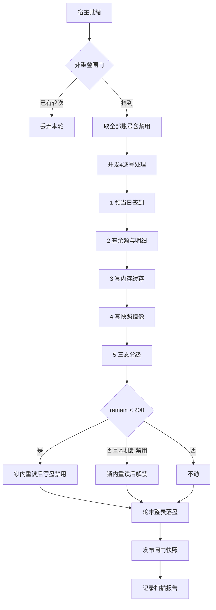

# 需求实施总览：coze 积分巡检持久化与低额自动禁用

结论：把扣子插件现有的「5 分钟内存积分刷新」升级为「1 小时持久化巡检」，同一轮内完成签到、查余额、落盘快照与三态分级，剩余积分低于 200 分时写盘禁用并保留凭据，签到或消耗回升到 200 分以上自动解禁；影响：coze-provider 的全部账号路由、面板展示与签到链路；范围：coze/ 目录内的积分巡检、快照持久化、分级处置、管理路由与面板；非范围：宿主 CPA 本体、其他 10 个插件、coze 对话与生图链路；变化：面板打开不再触发上游请求，积分跨重启保持，低额账号自动下线且可自愈；完成标准：积分快照落盘可跨重启读取、面板零上游渲染、低额账号自动禁用且签到到账后自动恢复、全部变异反证被捕获；术语说明：sidecar 指插件自有的 `data/coze-credits.json` 积分快照文件，不写进宿主 auth 文件；验证状态：设计已完成并经用户裁定三个决策点，代码实现与真实测试进行中。

## 1. 当前计划最终方案简要说明

- 推荐方案一句话结论：用一套 1 小时巡检循环替代现有 5 分钟刷新循环，积分落 sidecar 快照，低于单一阈值 200 分写盘禁用，纯积分判据自动恢复。
- 主落点 / 主路径：`coze/credit_sweep.go`（编排）+ `coze/credit_snapshot.go`（持久化）+ `coze/credit_grade.go`（分级处置）三个新文件，配合 `policy.go` / `management.go` / `authfile.go` 的最小改动。
- 为什么先走这条路线：coze 已有的积分缓存与闸门语义可以完全复用，缺口只在「持久化」与「分级处置」两层；新增第二套循环会带来双倍上游压力与「谁负责签到」的歧义，合并成一个循环是唯一不产生双轨的形态。

## 2. 基本信息

- 对应需求文档：本实施总览即需求来源（用户在会话中直接提出并完成三处裁定）
- 来源对象标识（需求或 Bug）：coze 积分巡检与低额自动禁用
- 当前实施文档命名主干：2026-10-25_001650_coze积分巡检与低额自动禁用
- 对应需求与实施计划全量顺序实施方案：N/A（单来源对象，非新项目启动）
- 实施计划完成条件（`AC-*`）所在章节：第 5 节各最小任务的「任务完成条件」
- 对应 `6-review` 风格回归记录：收口时创建 `doc/6-review/2026-10-25_*_coze积分巡检与低额自动禁用_6-review.md`
- agent 理解的问题 / 目标：coze 积分只在内存里活 5 分钟，热重载即丢；面板每次打开都并发打上游；低额账号只被挡请求不落盘，且禁用号被续期与签到双重跳过，导致「等签到恢复」根本无法发生。
- 当前计划范围：coze/ 目录内积分巡检全链路
- 明确不在范围：宿主 CPA、其他插件、coze 对话/生图协议、workbuddy 侧任何改动
- 当前优先闭环：周期 1（持久化骨架 + 面板零上游 + 手动扫描）
- 关键假设 / 待确认点：无（三个决策点已由用户裁定：合并 1 小时、单阈值 200、续期+签到+纯积分恢复）
- 跨会话执行入口：本文件
- 主项目地址、仓库类型与代码基线：F:\cpa-plugin，Git 仓库，main 分支，基线 coze VERSION 0.5.6
- local 环境与依赖入口：Windows 无 CGO，验证走 `python scripts/cgo-shim-build.py coze`
- 外部项目代码引用：N/A + 原因：本轮只在 coze 目录内实现，未引用任何外部项目代码 + 证据：落点清单全部位于 F:\cpa-plugin\coze\
- 当前状态：实施中
- 是否已获得开始实施授权：是（用户 2026-10-25 明确回复「开始执行」）

## 2.1 决策维度覆盖表

| 维度 | 状态 | 结论 / 依据 / 用户所选项 / 未决原因 |
| --- | --- | --- |
| 架构 / 技术路线 | 已弹窗且用户已选 | 合并为 1 小时一轮，替代现有 5 分钟循环 |
| 代码落点（目录 / 包 / 文件） | 已确定 | 全部在 coze/ 目录，新增 3 个文件、删除 1 个、修改 8 个 |
| 实现方式 | 已确定 | sidecar 快照 + 结构化 StoredAuth 标记 + 锁内读改写 |
| 命名 | 已确定 | 沿用 coze 现有 `credit*` 前缀，与 workbuddy 同构但独立实现 |
| 注释 | 已确定 | 遵循 comment-rules：中文元信息 + 步骤编号 |
| 日志 | 已确定 | 走 `hostLogf`，中文正文，不打印凭据 |
| 错误处理 / 异常 | 已确定 | 单号失败保留上一轮快照，不降级不禁用 |
| 数据模型 / 表 / 字段 | 已确定 | sidecar JSON + StoredAuth 三个标记字段 |
| 接口契约 | 已确定 | `/accounts` 改读快照、新增 `POST /refresh-all` |
| 依赖与库 | 已确定 | 不新增依赖 |
| 测试策略 / 样本 | 已确定 | cgo-shim + 12 条用例 + 变异反证 |
| 其它相关维度 | 已确定 | 无 |

## 2.2 待用户选择清单

无（所有真实不确定决策点已由用户选定）。

## 2.3 跨会话独立执行与外部项目代码引用清单

- 新会话接手第一步：读本文件第 3、5 节，按周期顺序检查已完成的 TASK
- 主项目地址与项目根：F:\cpa-plugin
- 主项目代码基线：main 分支，coze VERSION 0.5.6
- 计划源文件与版本：本文件
- 依赖安装、local 配置和服务启动入口：无需安装；验证 `python scripts/cgo-shim-build.py coze`
- 中断点核验顺序：`git status` → `python scripts/cgo-shim-build.py coze` → 本文件第 5 节任务状态
- 外部项目代码引用：N/A + 原因：未引用外部项目 + 证据：全部落点在 coze/ 目录

## 3. 实施周期总览

- 总周期说明：三个周期，每个周期独立可验证、可交付
- 本次计划拆分的子任务周期数：3
- 周期拆分原则：按「能否独立验收」切分，而非按前后端分层
- 周期排序说明：周期 1 是持久化骨架（无它则后续全部悬空），周期 2 是分级处置（依赖周期 1 的快照），周期 3 是收口
- 周期 1：
  - 周期序号 / 期次定位：第一期
  - 周期目标：积分快照落盘、面板零上游渲染、手动触发扫描可用
  - 本周期包含的最小任务：TASK-001、TASK-002、TASK-003
  - 周期内最小任务执行顺序：TASK-001 → TASK-002 → TASK-003
  - 进入条件：无
  - 收口条件：快照跨重启可读、面板 `/accounts` 零上游、手动扫描能触发一轮
  - 完成标志：`cgo-shim-build.py coze` 全绿 + 用例通过
  - 与前后周期衔接：为周期 2 提供快照读写与扫描编排骨架
- 周期 2：
  - 周期序号 / 期次定位：第二期
  - 周期目标：低额自动禁用、积分回升自动解禁、禁用号维持续期与签到
  - 本周期包含的最小任务：TASK-004、TASK-005
  - 周期内最小任务执行顺序：TASK-004 → TASK-005
  - 进入条件：周期 1 收口
  - 收口条件：状态机五种情形全部正确、两条防串权规则成立
  - 完成标志：状态机用例 + 变异反证全部通过
  - 与前后周期衔接：为周期 3 提供可回归的完整行为
- 周期 3：
  - 周期序号 / 期次定位：第三期
  - 周期目标：签到态持久化、旧循环下线、文档与发布收口
  - 本周期包含的最小任务：TASK-006、TASK-007
  - 周期内最小任务执行顺序：TASK-006 → TASK-007
  - 进入条件：周期 2 收口
  - 收口条件：全量变异反证、6-review PASS、CHANGELOG 与版本就绪
  - 完成标志：发布链路可执行
  - 与前后周期衔接：无后续周期
- 总体真实测试安排：
  - 真实测试安排是否默认必需：是（涉及可执行行为变更）
  - 覆盖哪些最小任务：全部
  - 公共测试环境 / 依赖：Windows 本机，`python scripts/cgo-shim-build.py coze`
  - 公共样本 / 数据来源：临时目录夹具 + httptest 假上游
  - 总体通过标准：build + vet + test 全绿，gofmt 干净，面板脚本 `node --check` PASS

## 4. 阶段计划

- 阶段 1：
  - 阶段名称：持久化骨架
  - 阶段目标：让积分数据拥有磁盘真相源
  - 只做这一件事：新增快照读写与安装根推导
  - 输入条件：无
  - 输出产物：`credit_snapshot.go`
  - 验证门槛：快照往返读写用例通过
- 阶段 2：
  - 阶段名称：扫描编排
  - 阶段目标：把刷新循环升级为全量巡检
  - 只做这一件事：新增 sweep 循环与报告
  - 输入条件：阶段 1
  - 输出产物：`credit_sweep.go`，`credit_loop.go` 删除
  - 验证门槛：非重叠、顺序、失败隔离用例通过
- 阶段 3：
  - 阶段名称：分级处置
  - 阶段目标：低额禁用与自动解禁
  - 只做这一件事：新增分级判定与锁内读改写
  - 输入条件：阶段 2
  - 输出产物：`credit_grade.go`
  - 验证门槛：状态机五情形 + 防串权两规则用例通过
- 阶段 4：
  - 阶段名称：接口与面板
  - 阶段目标：面板零上游、手动扫描可用
  - 只做这一件事：改管理路由与面板渲染
  - 输入条件：阶段 3
  - 输出产物：`management.go`、`active_ping.go`、`panel.html`
  - 验证门槛：面板脚本语法 PASS + 接口用例通过
- 阶段 5：
  - 阶段名称：收口
  - 阶段目标：签到态持久化与发布就绪
  - 只做这一件事：签到态反推、文档、6-review
  - 输入条件：阶段 4
  - 输出产物：`daily_credit*.go`、CHANGELOG、README
  - 验证门槛：全量变异反证 + STYLE: PASS

## 5. 最小任务清单

### 最小任务 1
- 任务名：积分快照持久化骨架
- 所属周期：第一期
- 周期内顺序：1
- 所属阶段：阶段 1
- 本任务只做这一件事：新增 sidecar 快照的读写与安装根推导
- 垂直切片目标：写入快照 → 进程重启 → 能读回同一条数据
- 输入条件：无
- 实现产出：`coze/credit_snapshot.go`
- 真实测试是否必需：是
- 真实测试入口：`python scripts/cgo-shim-build.py coze`
- 真实测试依赖环境：Windows + Go 工具链 + cgo-shim
- 真实测试样本 / 数据来源：`t.TempDir()` 临时目录
- 真实测试通过标准：写入后重新载入能读回同值；损坏文件按空处理不 panic
- 测试点：往返读写、版本不匹配按空、缺失文件按空、`-1` 未知语义
- `6-review` 风格回归点：函数中文元信息、步骤编号、文件头说明
- 任务完成条件：上述测试点全绿
- 任务停止 / 结束条件：测试全绿即停，不扩展到分级
- 阻断条件：cgo-shim 不可用
- 前置依赖：无
- 下一任务依赖：提供快照 API
- 预计触达文件数：1

### 最小任务 2
- 任务名：配置项与阈值升级
- 所属周期：第一期
- 周期内顺序：2
- 所属阶段：阶段 1
- 本任务只做这一件事：红线 200、周期 3600、采信窗口 90m、ConfigFields 补登
- 垂直切片目标：改配置 → 运行时读到新值 → 管理端可见该键
- 输入条件：无
- 实现产出：`coze/policy.go`、`coze/main.go`
- 真实测试是否必需：是
- 真实测试入口：`python scripts/cgo-shim-build.py coze`
- 真实测试依赖环境：同上
- 真实测试样本 / 数据来源：`config_yaml` 夹具
- 真实测试通过标准：默认值断言 + 显式 0 关闭 + ConfigFields 登记断言
- 测试点：默认 200、显式 0 关闭、键已登记、采信窗口 90m 边界
- `6-review` 风格回归点：常量注释说明「为什么是 200」
- 任务完成条件：上述测试点全绿
- 任务停止 / 结束条件：测试全绿即停
- 阻断条件：无
- 前置依赖：无
- 下一任务依赖：分级判定消费新阈值
- 预计触达文件数：2

### 最小任务 3
- 任务名：扫描编排与手动触发
- 所属周期：第一期
- 周期内顺序：3
- 所属阶段：阶段 2
- 本任务只做这一件事：新增 1 小时巡检循环与 `POST /refresh-all`
- 垂直切片目标：调接口 → 起一轮扫描 → 报告可读
- 输入条件：TASK-001
- 实现产出：`coze/credit_sweep.go`、`coze/management.go`（路由部分）
- 真实测试是否必需：是
- 真实测试入口：`python scripts/cgo-shim-build.py coze`
- 真实测试依赖环境：同上
- 真实测试样本 / 数据来源：注入式 deps 假实现
- 真实测试通过标准：非重叠生效、签到先于查余额、单号失败隔离、报告字段正确
- 测试点：非重叠丢弃、claim 先于 fetch、失败保留旧快照、报告计数
- `6-review` 风格回归点：循环注释说明抖动与周期理由
- 任务完成条件：上述测试点全绿
- 任务停止 / 结束条件：测试全绿即停
- 阻断条件：无
- 前置依赖：TASK-001
- 下一任务依赖：为分级提供调用点
- 预计触达文件数：2

### 最小任务 4
- 任务名：分级判定与自动禁用
- 所属周期：第二期
- 周期内顺序：1
- 所属阶段：阶段 3
- 本任务只做这一件事：新增三态分级与锁内读改写
- 垂直切片目标：扫描发现低额 → 写盘禁用 → 下次扫描积分回升 → 自动解禁
- 输入条件：TASK-001、TASK-002、TASK-003
- 实现产出：`coze/credit_grade.go`、`coze/authfile.go`
- 真实测试是否必需：是
- 真实测试入口：`python scripts/cgo-shim-build.py coze`
- 真实测试依赖环境：同上
- 真实测试样本 / 数据来源：临时账号目录夹具
- 真实测试通过标准：状态机五情形正确 + 防串权两规则成立
- 测试点：199/200/201 边界、未知不禁用、非本机制不动、人工禁用清标记、锁内重读
- `6-review` 风格回归点：状态机注释说明串权风险
- 任务完成条件：上述测试点全绿
- 任务停止 / 结束条件：测试全绿即停
- 阻断条件：无
- 前置依赖：TASK-001、TASK-002、TASK-003
- 下一任务依赖：为管理路由提供清标记能力
- 预计触达文件数：2

### 最小任务 5
- 任务名：禁用号维持续期与签到
- 所属周期：第二期
- 周期内顺序：2
- 所属阶段：阶段 3
- 本任务只做这一件事：让禁用号继续续期与签到
- 垂直切片目标：账号被禁 → 4 小时后仍续期 → 次日签到到账 → 自动解禁
- 输入条件：TASK-004
- 实现产出：`coze/renew_loop.go`、`coze/credit_sweep.go`
- 真实测试是否必需：是
- 真实测试入口：`python scripts/cgo-shim-build.py coze`
- 真实测试依赖环境：同上
- 真实测试样本 / 数据来源：临时账号目录夹具
- 真实测试通过标准：禁用号出现在续期目标与扫描目标中
- 测试点：renewTargets 含禁用号、扫描含禁用号
- `6-review` 风格回归点：注释说明「解禁唯一途径」
- 任务完成条件：上述测试点全绿
- 任务停止 / 结束条件：测试全绿即停
- 阻断条件：无
- 前置依赖：TASK-004
- 下一任务依赖：无
- 预计触达文件数：2

### 最小任务 6
- 任务名：签到态从明细反推
- 所属周期：第三期
- 周期内顺序：1
- 所属阶段：阶段 5
- 本任务只做这一件事：签到态改为从快照明细反推
- 垂直切片目标：进程重启后面板仍正确显示「今日已领」
- 输入条件：TASK-001
- 实现产出：`coze/daily_credit.go`、`coze/daily_credit_manage.go`
- 真实测试是否必需：是
- 真实测试入口：`python scripts/cgo-shim-build.py coze`
- 真实测试依赖环境：同上
- 真实测试样本 / 数据来源：积分摘要夹具
- 真实测试通过标准：无内存态时仍能从明细判定已领
- 测试点：有当日条目判已领、无条目判未领、旧日期条目不判已领
- `6-review` 风格回归点：注释说明为什么不再单独存状态
- 任务完成条件：上述测试点全绿
- 任务停止 / 结束条件：测试全绿即停
- 阻断条件：无
- 前置依赖：TASK-001
- 下一任务依赖：无
- 预计触达文件数：2

### 最小任务 7
- 任务名：文档收口与发布
- 所属周期：第三期
- 周期内顺序：2
- 所属阶段：阶段 5
- 本任务只做这一件事：CHANGELOG、README、版本 bump、6-review、发布
- 垂直切片目标：版本号 bump → CI → 生产热重载 → 面板可用
- 输入条件：TASK-001~006
- 实现产出：`coze/CHANGELOG.md`、`coze/README.md`、`coze/VERSION`、`coze/main.go`
- 真实测试是否必需：是
- 真实测试入口：`python scripts/cgo-shim-build.py coze` + 发布链路
- 真实测试依赖环境：CI + 生产 CPA
- 真实测试样本 / 数据来源：真实 9 账号池
- 真实测试通过标准：热重载 active_version 命中、面板 200、快照落盘可读
- 测试点：全量回归 + 生产验收
- `6-review` 风格回归点：STYLE: PASS
- 任务完成条件：生产验收通过
- 任务停止 / 结束条件：验收通过即停
- 阻断条件：生产不可达
- 前置依赖：全部前序任务
- 下一任务依赖：无
- 预计触达文件数：4

## 6. 现状与落点

- 涉及目录：`coze/`
- 涉及文件 / 模块：积分链路（credits.go / credit_loop.go / policy.go）、账号落盘（authfile.go）、管理路由（management.go / active_ping.go）、签到（daily_credit*.go）、面板（panel.html）、配置（main.go）
- 复用点：`creditSummary` 结构、`creditsCache`、`publishCreditPool`、`hostLogf`、`writeAuthFileDirect` 的原子写
- 需要新增的内容：快照持久化、分级处置、扫描编排、安装根推导

代码落点目录树：

```text
coze/
├── credit_snapshot.go        新增  快照结构、sidecar 原子读写、安装根推导、内存镜像
├── credit_grade.go           新增  三态分级、锁内读改写、禁用与解禁、标记读写
├── credit_sweep.go           新增  1h 巡检编排、非重叠闸门、扫描报告
├── credit_loop.go            删除  职责被 credit_sweep.go 完全接管
├── authfile.go               修改  StoredAuth 加三标记 + 锁内读改写入口
├── main.go                   修改  配置项默认值、ConfigFields 补登、启动 sweep
├── policy.go                 修改  阈值 200、采信窗口 90m
├── management.go             修改  /accounts 读快照、新增 /refresh-all、setAccountDisabled 清标记
├── active_ping.go            修改  force 刷新补写快照与分级
├── daily_credit.go           修改  签到态从明细反推
├── daily_credit_manage.go    修改  视图改用反推结果
├── renew_loop.go             修改  renewTargets 不再跳过禁用号
└── panel.html                修改  扫描报告、自动禁用徽标、立即扫描按钮
```

## 7. 方案选择

- 方案 A：新增独立的 1 小时扫描循环，保留现有 5 分钟刷新循环（双循环）
- 方案 B：把现有 5 分钟循环整体升级为 1 小时全量巡检（单循环）
- 方案 C：不落盘，仅扩大内存缓存 TTL
- 推荐方案与原因：方案 B。方案 A 上游请求翻倍且「谁负责签到」有歧义；方案 C 无法跨重启，热重载即丢，不满足需求。方案 B 唯一不产生双轨。

## 8. 实施步骤

1. 第一步：新增 `credit_snapshot.go`
   - 所属周期：第一期
   - 所属阶段：阶段 1
   - 对应最小任务：TASK-001
   - 本步只做：快照读写与安装根推导
2. 第二步：升级配置与阈值
   - 所属周期：第一期
   - 所属阶段：阶段 1
   - 对应最小任务：TASK-002
   - 本步只做：200 阈值、3600 周期、90m 窗口、ConfigFields
3. 第三步：新增 `credit_sweep.go` 并接 `/refresh-all`
   - 所属周期：第一期
   - 所属阶段：阶段 2
   - 对应最小任务：TASK-003
   - 本步只做：巡检编排与手动触发
4. 第四步：新增 `credit_grade.go`
   - 所属周期：第二期
   - 所属阶段：阶段 3
   - 对应最小任务：TASK-004
   - 本步只做：分级与锁内读改写
5. 第五步：禁用号维持续期与签到
   - 所属周期：第二期
   - 所属阶段：阶段 3
   - 对应最小任务：TASK-005
   - 本步只做：移除两处 Disabled 跳过
6. 第六步：签到态反推
   - 所属周期：第三期
   - 所属阶段：阶段 5
   - 对应最小任务：TASK-006
   - 本步只做：改判定来源
7. 第七步：文档与发布
   - 所属周期：第三期
   - 所属阶段：阶段 5
   - 对应最小任务：TASK-007
   - 本步只做：CHANGELOG、README、版本、6-review、发布

## 9. 真实测试安排

- 真实测试总表：

| 用例 | 锁定行为 | 变异反证 |
|---|---|---|
| 阈值边界 | 199 禁用 / 200 不禁用 / 201 不禁用 | `<` 改 `<=` 必 FAIL |
| 签到先于余额 | claim 后 remain=1500 不得被禁用 | claim 移到 fetch 后必 FAIL |
| 未知积分 | -1 与无快照永不禁用 | 把未知当 0 必 FAIL |
| 失败隔离 | 单号失败保留旧快照 | 失败写空必 FAIL |
| 人工禁用保护 | 无标记号永不被自动解禁 | 删归属判定必 FAIL |
| 人工禁用清标记 | 人工禁用/启用都清标记 | 删清零必 FAIL |
| 锁内重读 | 扫描中被人工禁用不得覆盖 | 删重读必 FAIL |
| 禁用号续期 | renewTargets 含禁用号 | 加回 Disabled 跳过必 FAIL |
| 禁用号扫描 | 扫描含禁用号 | 加回跳过必 FAIL |
| 快照缺失 | 面板显示未知而非 0 | 缺失填 0 必 FAIL |
| 采信窗口 | 89m 可信 / 91m 不可信 | 改回 15m 必 FAIL |
| 禁用号不路由 | 池快照不含禁用号 | 去掉 usable 判定必 FAIL |

- 免测任务及理由：无
- 步骤 1 真实测试：快照往返、损坏容错
- 步骤 2 真实测试：默认值与 ConfigFields 断言
- 步骤 3 真实测试：非重叠、顺序、隔离、报告
- 步骤 4 真实测试：状态机五情形 + 防串权
- 步骤 5 真实测试：目标集合包含禁用号
- 步骤 6 真实测试：反推判定
- 步骤 7 真实测试：全量回归 + 生产验收

## 10. 图形化执行路径



## 10.1 图片资产决策、生成与引用

- 图片资产决策：N/A + 原因：本任务为后端逻辑与既有面板的字段级改造，无 UI 原型、视觉对比或空间布局类证据需求 + 证据：面板改动仅为徽标文案与按钮，无新增视觉结构。

## 10.2 可行性探针与假设清单

- `FEAS-*` 1：
  - 假设内容：coze 可通过工作目录向上查找 `plugins/` 目录定位 CPA 安装根
  - 影响面：任务级
  - 探针级别：L1 只读
  - 验证方式：读取 workbuddy/usage_feed.go 的既有实现作为同构依据
  - 结论：只读证据
  - 证据：workbuddy/usage_feed.go:100-134 已实现同款推导并被生产使用
  - 关联 `TASK-*`：TASK-001
- `FEAS-*` 2：
  - 假设内容：禁用账号仍能被 `listAllAuthFiles` 读到并参与续期与积分查询
  - 影响面：任务级
  - 探针级别：L1 只读
  - 验证方式：读 listHostAuthFiles 与 listAllAuthFiles 的过滤条件
  - 结论：只读证据
  - 证据：coze/authfile.go:261-356 只按文件名前缀过滤，不按 disabled 过滤；Disabled 仅在扫描目标筛选处被跳过
  - 关联 `TASK-*`：TASK-005
- 探针执行记录：本轮为 L1 只读证据，无 L2 探针，无临时资源需清理
- 未验证假设处置：无方向级未验证假设

## 11. 风险与阻断项

- 风险：全池被自动禁用导致 `auth_unavailable`——这是正确行为（确实无可用号），但面板必须能看出原因，由扫描报告与徽标覆盖
- 风险：用户误配过高阈值导致全池禁用——面板显式展示阈值与禁用数
- 风险：签到与扫描耦合导致签到失败影响整轮——签到失败只记错误，不阻断余额查询与分级
- 依赖：cgo-shim 工具链
- 任务停止 / 结束条件总表：任一任务测试不绿即停并回写计划，不进入下一任务

## 12. 数据库变更 SQL（按需必填）

N/A：本插件不使用数据库，快照为本地 JSON sidecar 文件。

## 13. 自审结论

- 覆盖度检查：用户三项需求（1 小时检查、持久化、面板持久化展示+手动刷新）与追加需求（低于 200 禁用、签到恢复）全部有对应任务
- 实施周期检查：三周期各自独立可验收
- 最小任务闭环检查：每个任务都有实现、真实测试、6-review 三类信息
- 阶段单一目标检查：五个阶段各承载一个清晰目标
- 占位词检查：无 TBD / 待补充
- 可执行性检查：全部落点已给出具体文件
- 图文一致性检查：流程图与第 8 节步骤命名一致
- 用户确认状态：已确认（2026-10-25「开始执行」）

## 执行附录

- local 环境：Windows 本机，`python scripts/cgo-shim-build.py coze`
- 清理与回滚：新增文件可整体删除；被删的 `credit_loop.go` 可从 git 恢复

## 追踪附录

- `SRC(用户需求) -> DEC(三处裁定) -> AC(各任务完成条件) -> CYCLE(1/2/3) -> TASK(001~007) -> TEST(12 条用例) -> EVIDENCE(cgo-shim 输出 + 变异反证)`
