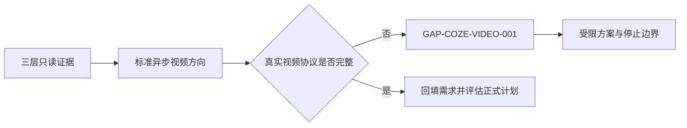
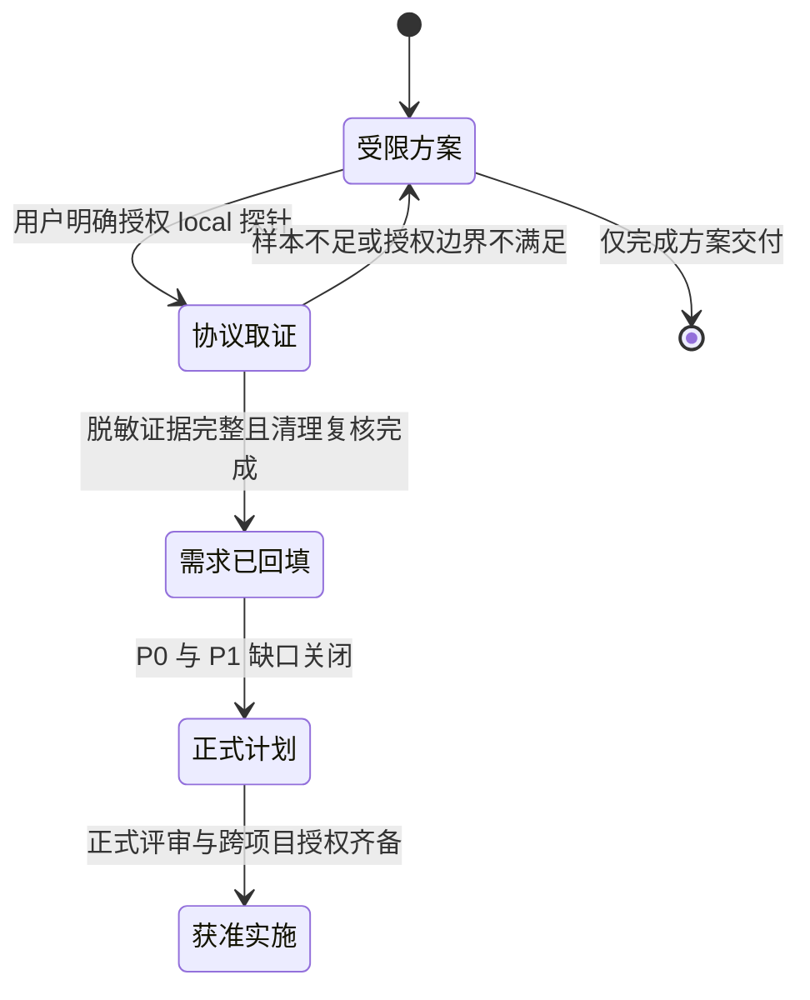
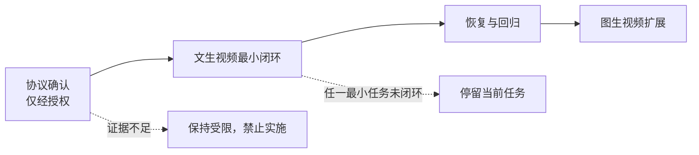

# new-api 经 CPA 调用 Coze 视频生成模型受限方案

结论：建议复用现有视频任务能力，不在聊天里直接返回视频链接；影响：方案评审已有依据，但还不能据此修改三个项目；范围：本文只记录已证实事实、缺失证据、恢复顺序和正式实施计划的结构；非范围：不包含代码改动、真实生成、跨项目写入、发布、生产连接和容器重启；变化：把方案方向和开工条件分开，避免把推测当成接口事实；完成标准：需求与受限方案均已落盘，文档校验有真实结果，未证实的上游行为均明确标为缺口；术语说明：受限方案是前置证据不足时用于说明方向和停止边界的文档，不是施工指令；验证状态：当前只有源码只读证据，真实视频提交、生成、下载和重启恢复均未执行。

## 当前计划最终方案简要说明

推荐让 new-api 继续承载公开视频任务，CPA 在现有 OpenAI 视频入口按模型能力交给 Coze 插件，插件保存任务归属并支持原任务查询与下载。首个业务闭环只做文生视频；真实 Coze 协议尚未取得，因此本文是受限方案，不是正式实施计划。

图片资产决策：N/A。原因：本文没有界面、截图或视觉产物。证据：全文只使用 Mermaid 表达证据、状态和阶段关系。

## 文档信息

| 项目 | 内容 |
| --- | --- |
| 来源对象 | [需求主文档](../2-需求/2026-10-25_025849_new-api经CPA调用Coze视频生成模型.md) |
| 文档定位 | 受限方案，只用于方案评审、阻断交接和恢复导航 |
| 当前优先闭环 | `SLICE-COZE-VIDEO-PROBE`：取得真实上游协议证据 |
| 实施授权 | 否；用户只要求先出方案 |
| 跨项目权限 | `F:/CLIProxyAPI` 与 `F:/new-api` 只读 |
| 图片资产决策 | `N/A + 原因：本文没有界面、截图或视觉产物；证据：全文只使用 Mermaid 表达证据、状态和阶段关系` |
| 数据库变更 | `N/A + 原因：当前未进入实现，推荐任务 sidecar 也未冻结；证据：RULE-COZE-VIDEO-004 只记录方向` |
| 全量顺序实施方案 | `N/A + 原因：本轮是单一需求的受限规划，未开始多需求实施排序；证据：当前只有 REQ-COZE-VIDEO-20261025 一个来源对象` |

## Agent 对当前问题的理解

用户希望客户端经 new-api、CPA 和 Coze 插件实际生成视频，而不是只在插件模型目录里看到视频模型。当前理解的目标包括创建任务、查询状态、下载视频、异常后不重复生成，以及保留现有聊天和生图能力。

本轮范围是方案与文档。明确不在范围的是编码、真实生成、管理面板、生产部署、图生视频和视频编辑。关键待确认点不是技术路线偏好，而是 Coze 如何选中视频模型、接受哪些参数、如何报告状态、通过哪个字段交付视频。

## 当前不可形成正式实施计划的原因

1. `GAP-COZE-VIDEO-001`：缺少真实视频提交和响应样本，无法冻结模型、参数、状态与附件识别。
2. `GAP-COZE-VIDEO-002`：CPA 的进程内任务绑定尚未证明能满足重启恢复，任务归属设计不能定稿。
3. `GAP-COZE-VIDEO-003`：new-api 的轮询、计费与失败重试尚未在 local 链路上实测。
4. `GAP-COZE-VIDEO-004`：CPA 和 new-api 的写入授权、目标文件与版本复核尚未完成。
5. `GAP-COZE-VIDEO-006`：local 凭据、服务启动配置和接口测试入口尚未确认，不能给出可执行的真实测试命令。

这些缺口会改变文件、接口、任务记录和验证方式。继续写成正式任务会让执行者自行猜测，不符合零决策交接要求。

## 已完成侦察证据

| 证据 ID | 来源与证据 | 能支持的结论 | 不能支持的结论 |
| --- | --- | --- | --- |
| `EVIDENCE-COZE-VIDEO-L1-001` | `SRC-COZE-VIDEO-002` | Coze 执行器尚无 `openai-video` 输入输出能力 | 不能据此确定视频上游字段 |
| `EVIDENCE-COZE-VIDEO-L1-002` | `SRC-COZE-VIDEO-003`、`004`、`010` | Coze 聊天是异步提交，回复可与原消息配对 | 不能把普通聊天附件直接等同于视频产物 |
| `EVIDENCE-COZE-VIDEO-L1-003` | `SRC-COZE-VIDEO-005`、`006` | CPA 已有 OpenAI 视频路由，但当前模型与绑定逻辑有边界 | 不能宣称 Coze 已可被现有视频入口执行 |
| `EVIDENCE-COZE-VIDEO-L1-004` | `SRC-COZE-VIDEO-007`、`008`、`009` | new-api 有可复用任务插件和模型映射机制 | 不能宣称真实出站、计费和 HEAD 已联调通过 |
| `EVIDENCE-COZE-VIDEO-L1-005` | `EXT-COZE-VIDEO-CPA`、`EXT-COZE-VIDEO-NEWAPI` | 两仓路径、基线和许可证已有只读登记 | 不构成交叉项目写入或复制许可 |

## 前置缺口

| 缺口 | 必须取得的事实 | 关闭判据 | 未关闭时的停止边界 |
| --- | --- | --- | --- |
| `GAP-COZE-VIDEO-001` | 模型选择、提交字段、状态、视频附件、失败与等待样本 | 脱敏真实样本可回读，字段与状态映射无猜测 | 不创建视频执行任务 |
| `GAP-COZE-VIDEO-002` | 任务归属在 CPA 或插件重启后的恢复方式 | 同一原任务恢复查询，不发生第二次提交 | 不采用内存绑定作为唯一事实源 |
| `GAP-COZE-VIDEO-003` | 轮询、重复查询、失败与计费事实 | 查询次数与生成次数分离，积分消耗不因查询增加 | 不承诺幂等和计费正确 |
| `GAP-COZE-VIDEO-004` | 两仓写入范围、操作、基线和回滚授权 | 用户逐项明确授权且基线复核一致 | 两仓保持只读 |
| `GAP-COZE-VIDEO-005` | 视频地址域名、文件类型、有效期和下载限制 | 可限制下载源并识别真实视频，签名信息不脱敏外泄 | 不开放内容代理 |
| `GAP-COZE-VIDEO-006` | local 凭据、服务与接口测试入口 | 配置归属证明为 local，服务可达且清理可执行 | 不回退 test 或生产 |

## 建议流转顺序

1. 先评审本需求和推荐方向，保持三仓代码不变。
2. 用户仅针对 `BLK-COZE-VIDEO-001` 明确授权后，使用 local 配置执行最低成本协议探针。
3. 将脱敏样本、失败语义、地址约束与清理结果回填同一需求主文档。
4. 关闭影响方向和任务设计的 P0/P1 缺口，再编写正式实施总览、实施周期和独立任务卡。
5. 逐项取得 CPA 与 new-api 的跨项目写入授权，按正式任务执行真实测试与 `6-review`。
6. 文生视频与恢复回归通过后，再单独评审图生视频。

图形目的：说明当前证据为何只能导向受限方案；关联 ID：`EVIDENCE-COZE-VIDEO-L1-001` 至 `005`、`GAP-COZE-VIDEO-001`。

## 实施周期总览

当前没有获准执行的实施周期，也没有 `CYCLE-*` 或 `TASK-*`。下表只是正式计划的预期分期，不表示阶段已经开始。

| 预期分期 | 唯一目标 | 进入条件 | 收口条件 |
| --- | --- | --- | --- |
| 协议确认 | 证明视频模型如何提交、等待、失败和交付 | 用户授权 local 协议探针与费用边界 | 真实样本回填，P0 协议缺口关闭 |
| 文生视频最小闭环 | 创建、查询、完成和下载一个真实文生视频 | 正式计划与三仓相应授权齐备 | 对应最小任务各自完成真实测试与 `6-review` |
| 恢复与回归 | 验证重启恢复、防重、异常、计费和旧能力 | 文生视频闭环已有真实结果 | 原任务可恢复，查询不新增生成，旧能力不回退 |
| 图生视频扩展 | 独立确认参考图上传与图生参数 | 文生与恢复闭环完成，另获范围授权 | 图生协议与真实结果独立验证 |

## 阶段计划

受限阶段只做证据核对和文档交接，不拆实施动作。正式阶段必须遵循“一个最小任务完成后，先做该任务真实测试与 `6-review`，再进入下一任务”，不允许把三仓改动连续写完再统一验证。

图形目的：说明文档从受限状态升级为正式实施计划所需的状态变化；关联 ID：`BLK-COZE-VIDEO-001`、`GAP-COZE-VIDEO-001` 至 `006`。

## 最小任务清单

`N/A + 原因：当前是受限方案，关键字段、文件改动与测试入口未冻结，不能编造最小任务；证据：GAP-COZE-VIDEO-001 至 006 尚未关闭`。本文不创建 `TASK-*`，也不把协议探针写成可自动执行的开工任务。

图形目的：说明正式计划获批后各预期分期的依赖，不代表本轮已执行；关联 ID：`SLICE-COZE-VIDEO-PROBE/TEXT/RECOVERY/IMAGE`。

## 现状与落点

| 层级 | 已核对的文件/符号 | 当前职责与缺口 | 本轮操作 |
| --- | --- | --- | --- |
| Coze 插件 | `coze/main.go`、`coze/models.go`、`coze/claw.go`、`coze/executor.go` | 模型目录、聊天提交、回复配对和生图等待已有基础；视频执行与任务恢复未实现 | 只读 |
| CPA | `internal/api/server_routes.go`、`sdk/api/handlers/openai/openai_videos_handlers.go`、`sdk/pluginapi/types.go`、`internal/pluginhost/executor_route.go` | 视频入口、模型限制、插件路由与内存绑定已定位 | 只读 |
| new-api | `plugins/tasks/sora/plugin.js`、`model/task_model_alias.go`、`middleware/task_plugin.go`、`relay/channel/task/jsplugin/adaptor.go` | 任务创建、模型映射、查询与内容路径可复用；真实链路未验证 | 只读 |

代码落点目录树：`N/A + 原因：受限阶段未冻结任何代码新增或修改；证据：上表只记录只读文件/符号，三仓源码均无本轮改动`。新增文件目录树只包含本文档，且已于当前路径落盘，不含程序或测试代码。

## 真实测试安排

本轮真实功能测试为 `N/A + 原因：没有代码或运行行为变化，未启动服务，也未生成视频；证据：本轮只有需求、受限方案和文档校验`。文档结构、标点与 Mermaid 解析只验证文档质量，不算功能测试。

后续正式计划必须独立写明 local 服务入口、测试命令、真实短视频样本、负向附件、断言总数与失败数、生成次数和积分对照、写接口清理、进程关闭及回滚。当前这些运行时前提未确认，因此本文不提供伪造的测试命令或通过结论。

页面自动化点击测试为 `N/A + 原因：首闭环没有页面或管理面板改动；证据：需求 BOUND-COZE-VIDEO-003/004 与本方案范围一致`。接口测试、单元测试与真实端到端测试均须在正式计划中逐项给出，不得用本段的适用性说明替代执行。

## 风险与阻断项

反方批判结论为“需补充证据再放行”。最大的风险不是三层能否拼出请求，而是普通聊天返回被误当视频完成、进程重启后丢失任务归属、查询失败后再次生成。任一风险未得到真实反例验证，都不能进入交付。

| 风险 | 影响 | 当前处置 |
| --- | --- | --- |
| 上游字段猜测 | 请求可能落入普通聊天，或参数被静默忽略 | `GAP-COZE-VIDEO-001` 阻断实施 |
| 非视频附件误判 | 图片、缩略图或正文链接被当完成 | 必须取得真实视频与负向样本 |
| 任务绑定只在内存 | 重启后无法查询，可能重新生成 | `GAP-COZE-VIDEO-002` 阻断任务设计定稿 |
| 下载源不受限 | 产生 SSRF 或签名地址泄漏 | `GAP-COZE-VIDEO-005` 未关闭前不开放内容代理 |
| 跨项目越权 | 改动兄弟项目或影响既有工作树 | 保持只读，逐项授权并保护他人改动 |

## 任务完成、停止与最大推进边界

本方案文档的完成条件是：需求与受限方案均已落盘；证据、缺口、恢复顺序、授权边界和预期结构完整；文档校验结果如实记录。它不代表视频功能完成。

停止条件包括：需要真实付费才能继续、缺少 local 配置、上游字段仍靠猜测、跨项目修改未获授权、下载来源无法限制、重复生成风险未消除。出现任一项都停在当前文档，不转入实现。

最大推进边界仅限当前项目内的需求与受限方案维护、只读复核和文档校验。不得修改 Coze、CPA、new-api 的生产代码，不得执行真实生成，不得发布、重启或连接生产。

## 计划成文后的预期结构

正式计划将包含来源与决策、实施周期顺序、每周期最小任务、精确文件/符号、代码目录树、接口与任务存储契约、真实测试、断言、清理、回滚、完成与停止条件、跨会话入口、`EXT-*` 引用、`FEAS-*` 探针结果和追踪矩阵。只有这些内容均有证据且不再要求执行者补决策，才能移除“受限”定位。

## 禁止实施说明

在升级为正式实施计划前，禁止编码、改码、重构、测试实施或连续执行。即使用户表示采纳本方向，也只能先完成协议探针、需求回填和正式计划，不得把“同意方案”解释为跨项目或付费授权。

## 升级条件

1. `GAP-COZE-VIDEO-001` 的真实协议证据完整，P0 已关闭。
2. `GAP-COZE-VIDEO-002` 至 `004` 已有可验证结论或明确授权，P1 不再要求实施者猜测。
3. local 环境、样本、测试、清理和回滚入口已写入正式计划。
4. 正式计划通过结构自审、反方批判、文档门禁和 Mermaid 真解析。
5. CPA 与 new-api 的目标修改获得独立的跨项目写入授权。

## 自审结论

受限计划必填项已覆盖：问题理解、不能形成正式计划的原因、侦察证据、前置缺口、建议流转顺序、预期结构、禁止实施说明和升级条件。本文没有伪造周期、任务、测试证据或授权；决策维度中可由代码查明的内容已只读收敛，运行时未知项保持未验证。

## 任务阻断收口

- 阻断记录 ID：`BLK-COZE-VIDEO-001`
- 任务状态：blocked
- 阻断阶段：实施前的协议确认与计划阶段
- 阻断依据与证据：`COZE_VIDEO_UPSTREAM_CONTRACT_MISSING`；证据为 `EVIDENCE-COZE-VIDEO-L1-001/002` 与 `GAP-COZE-VIDEO-001`，当前只有异步聊天和生图协议，没有真实视频提交与返回样本
- 已尝试与停止边界：已只读核对三仓相关源码、历史对话样本和需求文档；继续需要可能产生费用的真实生成以及 local 环境授权，因此在方案文档处停止
- 影响：不能宣布视频链路已实现，不能放行正式计划、编码、付费测试或生产交付；本受限方案仅可评审
- 解决计划：1. 责任方：用户与实施者；前置条件：用户授权本记录中的 local 协议探针与费用边界；动作：以最低成本短视频取得模型选择、提交、状态与附件证据；完成判据：关键字段和至少一个失败或等待样本可回读；验证入口：需求主文档“数据与外部契约”和“测试要求预埋与样本分布”。2. 责任方：实施者；前置条件：探针证据完整；动作：回填需求并制定正式计划；完成判据：P0/P1 关闭且任务、测试、回滚可独立执行；验证入口：`implementation-planning-rules` 与文档机器门禁。3. 责任方：用户；前置条件：正式计划已评审；动作：逐项授权 CPA/new-api 目标修改；完成判据：授权范围、操作、基线和回滚明确；验证入口：跨项目写入边界检查
- 恢复后重入点：读取需求主文档与本文，从 `SLICE-COZE-VIDEO-PROBE` 开始；不得在缺口未关闭时跳到编码
- 去重键：`COZE_VIDEO_UPSTREAM_CONTRACT_MISSING + SRC-COZE-VIDEO-003/004/010`
- 用户授权操作：请直接回复：`同意授权` 或 请直接回复：`暂不授权`；`同意授权` 仅授权最近一条、唯一有效、仍未解除的 `BLK-COZE-VIDEO-001` 记录列明的恢复动作，即 local 协议探针与方案回填，不包含跨项目编码、发布或生产操作；授权后必须执行原恢复步骤并通过原验证入口，验证失败保持阻断；授权不构成跨任务、跨会话或未来写入的通用许可

## 执行附录

### 跨会话只读交接

| 项目 | 当前事实与恢复动作 |
| --- | --- |
| 主项目 | `F:/cpa-plugin`，Git 仓库，基线 `ad459c695346d4f406e9e9656d8e5936621946fe` |
| 新会话第一步 | 读取需求主文档、本文、`AGENTS.md` 和 `PROJECT_CURRENT.md`，确认仍处于方案阻断阶段 |
| 当前任务 | 没有 `CYCLE-*` 或 `TASK-*`；恢复点是 `SLICE-COZE-VIDEO-PROBE` 与 `BLK-COZE-VIDEO-001` |
| 中断点核验 | 先查协议证据是否已回填，再查 P0/P1 状态与授权，最后决定是否允许编写正式计划 |
| 环境 | Windows；运行时与依赖入口未在本任务冻结；禁止用非 local 配置补证据 |
| 基线不一致 | 停止并重新只读核对，不按旧路径或旧符号继续 |
| 服务启动 | `N/A + 原因：本轮不启动服务；证据：没有 local 启动配置确认，也没有功能测试授权` |

### 外部项目代码引用清单

| ID | 项目、地址与版本 | 项目根相对路径与文件/符号 | 用途、许可证与边界 | 可达性与验证回指 |
| --- | --- | --- | --- | --- |
| `EXT-COZE-VIDEO-CPA` | CLIProxyAPI；`F:/CLIProxyAPI`；`https://github.com/luode0320/CLIProxyAPI.git`；`main@7417cfb1bbfb794417764f8cd974a637a0779ddd` | `internal/api/server_routes.go`；`sdk/api/handlers/openai/openai_videos_handlers.go`；`sdk/pluginapi/types.go` 的 `ModelRouteRequest`；`internal/pluginhost/executor_route.go` | 只读对照路由与插件能力；`LICENSE` 为 MIT；本轮不复制、不修改 | 新会话核对绝对路径、提交与符号；不可达或不一致即停止；证据 `EVIDENCE-COZE-VIDEO-L1-003/005` |
| `EXT-COZE-VIDEO-NEWAPI` | new-api；`F:/new-api`；`https://github.com/luode0320/new-api.git`；`main@3e78ca63fc745d9c39e5cdc8cf5d2b4b6718e79a` | `plugins/tasks/sora/plugin.js`；`model/task_model_alias.go` 的 `ResolveTaskModelAlias`；`middleware/task_plugin.go`；`relay/channel/task/jsplugin/adaptor.go` | 只读对照任务与模型映射；`LICENSE` 为 AGPLv3，`NOTICE` 有署名要求；本轮不复制、不修改 | 新会话核对绝对路径、提交与符号；不可达或不一致即停止；证据 `EVIDENCE-COZE-VIDEO-L1-004/005` |

外部引用没有对应 `TASK-*`，因为受限阶段没有任务。任何后续任务引用这些文件前，必须重新核验版本、许可证、目标符号和授权，并把对应 `TASK-*`、`TEST-*` 与 `EVIDENCE-*` 写入正式追踪矩阵。

### 可行性与探针清单

下表区分静态只读证据和运行时未知项。`未验证` 是保持受限的依据，不是可在实现时默认采用的值。

| ID | 假设与影响 | 级别与验证方式 | 当前结论与证据 |
| --- | --- | --- | --- |
| `FEAS-COZE-VIDEO-001` | new-api 能复用现有 OpenAI 任务插件；影响公开任务与模型映射 | L1 已读插件与别名实现；真实出站需另行 local 验证 | 静态方向有 `EVIDENCE-COZE-VIDEO-L1-004`；运行时行为未验证，关联 `GAP-COZE-VIDEO-003` |
| `FEAS-COZE-VIDEO-002` | CPA 能按 `openai-video` 能力把真实模型交给插件；影响主路由 | L1 已读路由和 `ModelRouteRequest`；分派行为需在正式任务中验证 | 静态落点有 `EVIDENCE-COZE-VIDEO-L1-003`；运行时分派未验证，关联 `GAP-COZE-VIDEO-002` |
| `FEAS-COZE-VIDEO-003` | Coze 聊天异步关系能承载视频任务；影响整个上游路线 | L2 需经授权提交最低成本视频并只读跟踪原消息 | 未验证；现有聊天证据 `EVIDENCE-COZE-VIDEO-L1-002` 不能替代视频样本，关联 `GAP-COZE-VIDEO-001` |
| `FEAS-COZE-VIDEO-004` | 视频附件能被可靠识别并安全下载；影响完成与内容代理 | L2 需记录脱敏附件元数据、文件签名、域名和有效期 | 未验证；关联 `GAP-COZE-VIDEO-001/005`，未取得真实文件 |
| `FEAS-COZE-VIDEO-005` | 原任务可在重启后恢复且查询不重复生成；影响可靠性与费用 | L2 需在 local 创建后重启并重复查询，对照生成次数和积分 | 未验证；关联 `GAP-COZE-VIDEO-002/003` |
| `FEAS-COZE-VIDEO-006` | local 凭据与三层测试入口可用；影响真实测试 | L1 先确认配置归属，L2 再验证服务与接口；当前未连接 | 未验证；关联 `GAP-COZE-VIDEO-006`，不得回退非 local 环境 |

L2 探针尚未执行，所以没有清理完成或回读通过结论。授权后的探针必须先写清理与回滚方案，再执行一次性最低成本提交；无法确认上游是否接受时不得重提，只能查询原任务。临时代码、进程与本地文件按方案清理并回读，远端既有会话和用户文件不得擅自删除。

### 本轮文档验证记录

`PROJECT_CURRENT.md` 的普通正文追加曾两次在写入前安全检查停止：第一次是换行断言，第二次是全文将超过 51,200 字节。未改动该文件，未创建或修改任务投影，也未清理其他会话正文；本文“跨会话只读交接”是本次方案的恢复事实源。

需求文档按 `requirement` 校验为 `valid=true`、`status=PASS`；本文按 `implementation_overview` 校验为 `valid=true`、`status=PASS`，两者错误列表均为空。两份文档的 `check_punctuation.py --lang zh` 均返回 `punctuation: ok`。

五张 Mermaid 经 `mmdc 11.16.0` 与隔离 Chrome 真实解析，均生成非空 SVG，签名与数量已复核。初次解析发现默认缺少 `jsdom` 和 Puppeteer 浏览器，改用已有 Mermaid CLI 与本机 Chrome 的独立临时配置完成；未安装依赖、未使用用户浏览器 profile、未启动业务服务。临时图形、配置与浏览器目录在复核后清理。

真实功能测试、`6-review` 与发布验证均为 `N/A + 原因：本轮只交付受限文档，没有生产代码和运行行为变化；证据：三仓源码未修改，未启动服务，未生成视频`。

### 交付残留自查

本表只覆盖本轮方案文档与 `PROJECT_HISTORY.md` 的计数锚点维护。工作树中的 QoderWork 源码、测试、临时脚本、图像和其他文档不属于本轮变更集，保持原样，不据此推断其状态。

| 检查维度 | 结论与可核验证据 | 处置 |
| --- | --- | --- |
| 维度 1 需求覆盖对账 | 用户要求“先出方案”已落到需求主文档与本文；`REQ-COZE-VIDEO-001` 至 `009` 只映射到验证意图，未把功能标为已实现 | 方案文档已覆盖，真实功能按阻断记录保留未覆盖 |
| 维度 2 影响面 / 消费方对账 | 没有生产接口或数据契约改动；文档引用经 `validate_engineering_docs.py` 检查，需求与本文双向链接有效 | 无需代码消费方同步 |
| 维度 3 残留物清扫 | 本轮临时文件集中在 `C:/Users/luode/AppData/Local/Temp/coze-video-doc-validation-20261025`；隔离浏览器无残留命令行，五张 SVG 复核后清理该目录 | 清理后复核，不保留交付外产物 |
| 维度 4 文档与引用一致性 | 需求第“受限计划与推进顺序”节链接本文，本文“文档信息”回链需求；机器门禁无断链 | 已处置 |
| 维度 5 口径一致性 | 两份文档均为 `status: blocked`，共用唯一 `BLK-COZE-VIDEO-001`；文生视频为首闭环，图生视频后置，真实功能均未验证 | 已核对 |
| 维度 6 验证有效性反审 | 文档校验只覆盖结构、链接、标点与 Mermaid 语法；`FEAS-COZE-VIDEO-003` 至 `006` 仍为运行时未验证 | 不用文档通过替代功能通过，保持阻断 |

残留清单：本轮临时解析目录已删除并复核不存在；隔离浏览器无残留命令行，无本轮计划外产物。工作树中其他会话的文件不属于本轮残留。

## 追踪附录

### 决策维度覆盖表

| 维度 | 状态 | 结论与依据 |
| --- | --- | --- |
| 架构 / 技术路线 | 已确定（方案建议） | 标准异步视频任务；需求 `DEC-COZE-VIDEO-001` 至 `004` |
| 代码落点 | 前置缺口 | 只读文件/符号已登记，修改点待正式计划 |
| 实现方式 | 前置缺口 | 上游协议与任务恢复依赖 `FEAS-COZE-VIDEO-002` 至 `005` |
| 命名 | 前置缺口 | 真实 Coze 模型 ID 与任务字段待探针 |
| 注释 | N/A | 本轮无代码变更，证据为三仓源码只读 |
| 日志 | 已确定（约束） | 任务阶段可分辨，凭据与签名地址不得输出 |
| 错误处理 | 已确定（约束） | 已接受任务不重提；具体错误映射待真实样本 |
| 数据模型 | 前置缺口 | sidecar 仅为建议，锁、保留期和目录未冻结 |
| 接口契约 | 部分已确定 | 客户端契约已有证据，Coze 上游契约未验证 |
| 依赖与库 | 已确定（方向） | 优先复用现有任务系统与 HTTP 能力，不预设新依赖 |
| 测试策略 / 样本 | 前置缺口 | 需要真实视频、负向附件与异常样本 |
| 配置 / 环境 | 前置缺口 | local 入口未确认，禁止非 local 环境 |
| 兼容 / 迁移 / 版本 | 已确定（边界） | 基线已登记，旧聊天、生图和公开路径不得回退 |
| 性能 / 并发 | 前置缺口 | 长等已排除，轮询与任务锁未冻结 |
| 安全 / 权限 | 已确定（红线） | 兄弟仓只读、下载域名限制、付费与跨项目授权分离 |
| 回滚 / 灰度 / 发布 | 已确定（边界） | 本轮不发布；后续三仓独立回退并另行授权 |

### 待用户选择清单

空。当前没有发起实现层多选，也没有等待中的选择框。用户只需决定是否授权 `BLK-COZE-VIDEO-001` 列明的 local 协议探针；该决定不等于选择具体实现字段，也不构成开工授权。

### 追踪矩阵

| 上游 | 当前下游 | 证据与状态 |
| --- | --- | --- |
| `REQ-COZE-VIDEO-20261025` | 本受限方案 | 来源已落盘；状态为阻断 |
| `EVIDENCE-COZE-VIDEO-L1-001` 至 `005` | `FEAS-COZE-VIDEO-001` 至 `006` | 只支持静态方向，不冒充运行时验证 |
| `GAP-COZE-VIDEO-001` 至 `006` | `BLK-COZE-VIDEO-001` | 同一阻断记录，未建立重复恢复计划 |
| `EXT-COZE-VIDEO-CPA` | `EVIDENCE-COZE-VIDEO-L1-003/005` | 只读引用，后续任务需重新验证 |
| `EXT-COZE-VIDEO-NEWAPI` | `EVIDENCE-COZE-VIDEO-L1-004/005` | 只读引用，后续任务需重新验证 |
| `SLICE-COZE-VIDEO-PROBE` | 恢复入口 | 尚未创建 `CYCLE/TASK/TEST/EVIDENCE` 实施闭环 |

`unresolved_decisions`：存在 `GAP-COZE-VIDEO-001`（P0）与 `GAP-COZE-VIDEO-002` 至 `004`（P1），故只能保持受限方案。普通模型不得自行选择上游字段、真实模型、任务目录、轮询频率、下载域名、错误码、保留期或重试策略。

图片素材清单：`N/A + 原因：无位图资产；证据：图片资产决策与全文无 Markdown 图片引用`。变更追踪：`v0.1` 首次形成受限方案；后续协议证据与授权结果先回填需求主文档，再升级同一实施计划链路。
