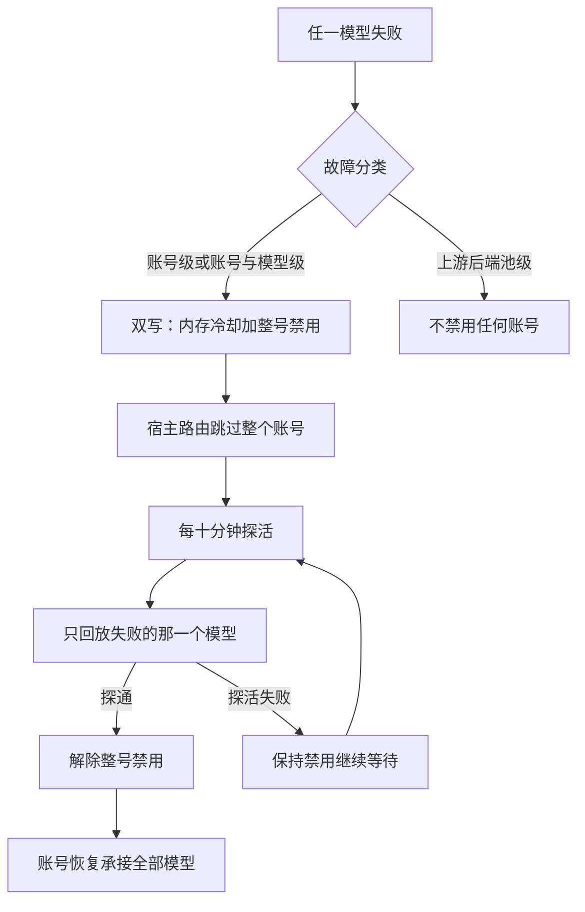
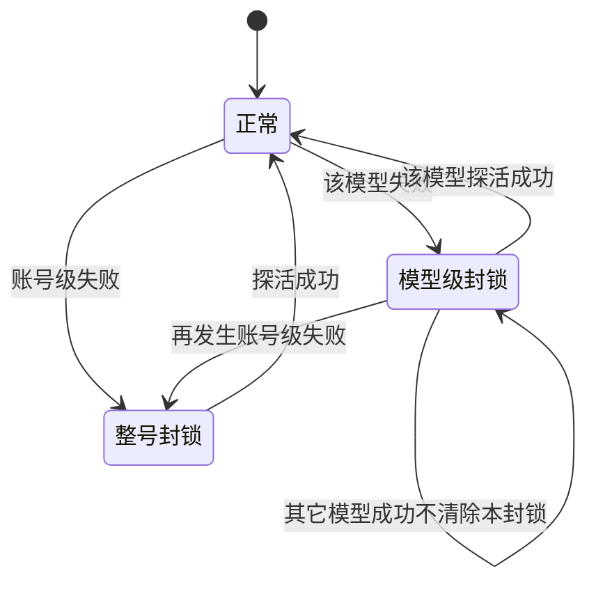
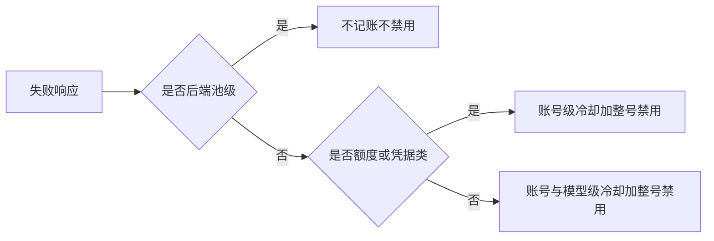

# 失败禁用保留整号维度：方案记录与裁定

结论：账号里任何一个模型失败就禁用整个账号，这个做法继续保留，不改成按模型单独禁用。影响：某个模型把额度用完后，这个账号会在该模型恢复前一直不接新请求，这是有意为之，目的是及时止损，不让账号里剩下的额度继续被烧掉。范围：只记录这次方案讨论的结论和判断依据，供以后查证，不做任何代码改动。非范围：不修改失败分类、禁用写盘、探活恢复的任何实现，不调整面板展示，不动四个插件的工作代码。变化：没有功能变化，也没有代码变化，本轮只新增一份记录文档并在知识库补一节裁定说明。完成标准：记录文档已写入磁盘并通过编码、标点与结构校验，内容包括现象起点、代码事实基线、备选方案的技术评估、不采纳的业务理由与重开条件。术语说明：失败禁用指某次请求失败后插件把整个账号标成不可用并写进账号文件；探活指插件每十分钟挑一个被禁用账号发一次最小请求来判断它是否恢复；账号与模型维度禁用指只对「这个账号的这个模型」设限，同账号其它模型照常可用。验证状态：文档内容基于本轮真实读取的源码与既有实施记录，已通过编码与标点校验；本轮没有代码改动，因此不需要真实测试。

## 1. 当前计划最终方案简要说明

**保持现状：任一模型失败即整号禁用，继续用失败时的那一个模型探活，探通才恢复整号。**

提出并评估过的「按账号与模型两个维度禁用」方案**不予采纳**。裁定理由是业务性的而非技术性的：**某个模型把额度用尽时，这个账号通常已经消耗了大量积分**，此时把整号摘出路由是保护剩余积分的正确动作，而不是需要修正的缺陷。

本轮只把讨论过程、技术可行性，以及不采纳的理由固化下来，避免以后重复评估同一方案。

### 1.1 决策总览

| 编号 | 决策 | 内容 |
|---|---|---|
| DEC-001 | 保留整号禁用 | 任一模型失败即禁用整个账号，语义不变 |
| DEC-002 | 保留单模型探活 | 探活只回放失败时的那一个模型，探通才恢复整号 |
| DEC-003 | 不采纳模型级禁用 | 「其它模型成功即恢复整号」方案不予实施 |
| DEC-004 | 不修改失败分类豁免 | qoderwork 的模型后端池级豁免规则保持不变 |

## 2. 现状与落点

### 2.1 Agent 对当前问题的理解

账号池里出现「某个模型失败后整号被禁用，而该模型恰好已限额、探活长期不通」的情况。需要回答的是：要不要把禁用下沉到账号与模型两个维度，让同账号的其它模型继续可用。

本轮的理解是：这不是三种情况之一，而是两件事被混在一起。技术层面确实能做到模型级禁用；业务层面则要判断，一个模型把额度用完之后，这个账号还该不该继续接别的模型的请求。用户的答案是：不该，因为额度用尽本身说明账号已经消耗了大量积分，继续用会把剩余额度也烧掉。

因此下面的现状核对与技术评估，都是为这个业务判断提供依据，而不是为了找出一条更省事的实现路径。

### 2.2 现象

生产面板出现如下状态：

```text
失败禁用 · deepseek-v4.1-flash（10 分钟探活中）
失败禁用 · kimi-k3.1-pro（10 分钟探活中）
```

观察到的疑点：探活回放的是「失败时的那一个模型」。若该模型在这个账号上已经限额，探活必然失败，于是整号一直停在禁用态，即使该账号的其它模型仍然可用。

提出者的设想是：

> kimi 失败后禁用，kimi 探活继续失败，但其它模型成功就启用账号，其它模型可用，kimi 继续探活中。探活期间这个账号的 kimi 不被轮询使用。

### 2.3 现有实现的事实基线

| 事实 | 位置 | 说明 |
|---|---|---|
| 失败分类早已分三档 | `workbuddy/failure_class.go:25` | `none`、`account`、`authModel` 三种落点 |
| 禁用落点没有区分维度 | `workbuddy/accountFailover.go:283` | `recordFailureScoped` 拿到 scope 后无条件调用整号禁用 |
| 恢复侧只回放一个模型 | `workbuddy/failover_disable.go:562` | `runFailoverProbeTick` 只探当初失败的模型 |
| 模型维度路由能力已存在 | `workbuddy/accountFailover.go:427` | `isAuthModelCoolingDown` 已实现 |
| 按模型换号已存在 | `workbuddy/failover_retry.go:48` | `pickNextAuthForModel` 已实现 |
| 调度候选已传模型 | `workbuddy/scheduler.go:110` | 候选过滤已带模型维度 |
| 执行入口已按模型判 | `workbuddy/main.go:784`、`workbuddy/stream.go:125` | 前置拦截已带模型维度 |

### 2.4 唯一缺环的确切位置

`workbuddy/accountFailover.go:283` 的记账落点把 scope 只用于内存冷却，禁用动作没有跟着分维度：

```go
func recordFailureScoped(authID, model string, scope failureScope) bool {
	if !recordCooldownScoped(authID, model, scope) {
		return false
	}
	disableAccountForFailover(authID, model)
	return true
}
```

这就是「kimi 限额」被落成整号 `disabled: true` 的确切位置。

### 2.5 容易混淆的相邻规则

`qoderwork/policy.go:167` 的 `isModelLevelFailure` 只识别**上游后端池级故障**，例如 `All backends failed`、`RESOURCE_LIMIT`、`serviceAvailable:false`。那是「整个模型后端池挂了，与具体账号无关」，所以不禁用任何账号。

它与本次讨论的「某个具体账号的某个模型额度用尽」是完全相反的语义：前者与账号无关，后者恰恰是账号级信号。本次裁定不改变那条豁免规则。

## 3. 实施周期总览

### 3.1 周期划分

| 周期 | 内容 | 状态 | 收口条件 |
|---|---|---|---|
| CYCLE-0 | 方案记录与裁定 | in_progress | 文档落盘并通过编码、标点、结构校验 |
| CYCLE-1 | 模型级禁用改造 | **不启动** | 需满足 §7.2 的重开条件才重新评估 |

CYCLE-0 是本轮唯一周期。CYCLE-1 只作为被评估但未采纳的备选方案保留记录，**当前不进入实施**。

### 3.2 决策流转

**图形目的**：说明一次失败从发生到恢复的完整路径，并标出本次讨论的焦点分支。**关联 ID**：DEC-001、DEC-002、DEC-003。



图中「探活失败后保持禁用」这一步就是本次讨论的焦点。它不是失效分支，而是止损生效后的等待状态。

### 3.3 被评估方案的状态模型

**图形目的**：对比被评估的模型级禁用方案所需的两套独立状态，说明它为何是一次状态模型重构。**关联 ID**：DEC-003、TASK-002。



右侧的模型级封锁必须独立于成功清零逻辑，这正是该方案代价高于预期的根本原因。

### 3.4 现有实现的失败分类落点

**图形目的**：说明现有三档分类各自落到哪一层状态，为后续排障提供定位入口。**关联 ID**：DEC-001、DEC-004。



三档的差别只在冷却记录的键，禁用动作目前完全一致，这就是本轮记录的现状语义。

## 4. 阶段计划

### 4.1 已完成的阶段

| 阶段 | 内容 | 状态 |
|---|---|---|
| 阶段一 | 核对现有禁用与探活的代码事实基线 | 已完成 |
| 阶段二 | 评估账号与模型维度禁用的技术可行性与改动面 | 已完成 |
| 阶段三 | 由业务口径裁定是否采纳 | 已完成，结论为不采纳 |
| 阶段四 | 落盘方案记录并同步知识库笔记 | 已完成 |

### 4.2 本轮不做的事

本轮不进入实施阶段。除本文档与知识库笔记外，不产生任何其他持久化产物。

## 5. 任务完成、停止与最大推进边界

### 5.1 完成条件

文档已落盘，编码、标点、结构三项校验通过，知识库笔记已完成补充并回读确认。

### 5.2 停止条件

本轮终止条件：本文档落盘并通过校验后本轮即结束。**不进入实施阶段，不修改任何代码，不执行构建，不提交，不发布。**

### 5.3 最大推进边界

本轮最远推进到「方案记录文档落盘并通过校验、知识库笔记完成补充」。四个插件的失败禁用链路保持现状。

## 6. 最小任务清单

| 编号 | 最小任务 | 状态 | 说明 |
|---|---|---|---|
| TASK-001 | 核实失败分类与禁用落点的真实代码位置 | completed | 见 §2.3 |
| TASK-002 | 评估模型级禁用的四处必要改动 | completed | 见 §7.1 |
| TASK-003 | 记录不采纳的业务理由与重开条件 | completed | 见 §7.2、§7.4 |
| TASK-004 | 写入方案记录文档并通过编码与标点校验 | completed | 本文档 |
| TASK-005 | 在知识库对应笔记补充裁定小节 | completed | 已回读校验 |

## 7. 关键决策

### 7.1 被评估方案的技术评估

**技术上能做，且地基已具备。** 需要动的是四处，缺任何一处都会留下漏洞。

| # | 改动点 | 不改的后果 |
|---|---|---|
| 1 | `recordFailureScoped` 按 scope 分流，`authModel` 只写模型级禁用 | 现状问题本身 |
| 2 | `resetCooldownState`（`workbuddy/accountFailover.go:462`）不在任意成功时清空整个模型状态 | deepseek 成功一次就把 kimi 的禁用记录抹掉，kimi 又回到路由 |
| 3 | 「探活才恢复」与「冷却到期自动放行」拆成两种状态 | 探活还没跑，模型冷却先到期自动放行 |
| 4 | 唯一候选场景必须快速失败 | 池里没别的账号时，换号返回失败后仍会用原账号请求上游，探活期间不被轮询使用不成立 |

一个附带的观察：模型级禁用主要靠插件内存加前置拦截，**不依赖宿主写盘**，因此天然绕开了 2026-10-25 定位的「宿主 watcher 不监听 mysqlstore spool」问题。这是它唯一的明显优势，但不足以改变本次裁定。

### 7.2 不采纳的理由

**核心理由（业务裁定）**：一个模型把额度用尽，说明这个账号已经被消耗了相当多的积分。此时继续拿它跑其它模型，等于把还剩的那点积分也继续烧掉。整号禁用在这里是**保护动作**，不是误伤。

因此问题的定性从缺陷变成了预期行为：

- kimi 限额导致整号探活失败、账号长期不复原，**这是止损生效的证明**，不是失效。
- 探活持续失败期间账号不可用，符合「宁可少一个账号，也别把最后一个能用的模型额度烧掉」的取向。

方案本身的额外代价：

| 代价 | 说明 |
|---|---|
| 探活请求量上升 | 从账号数涨到账号与模型的组合数，200 账号规模下需要按账号聚合同轮串行 |
| 面板改造 | 一个账号需同时展示多个失败禁用徽章，展示与筛选口径都要重做 |
| 多插件同步 | 四个同构插件各自发版 |
| 状态模型重构 | 一旦允许其它模型成功就恢复整号，探活期间该模型不被使用必须由独立的、不随成功清零的封锁状态保证 |

### 7.3 现状语义（权威口径）

| 事件 | 行为 |
|---|---|
| 任一模型的失败被判为账号级或账号与模型级 | 双写：内存阶梯冷却加盘上整号禁用 |
| 禁用后宿主路由 | 该账号在**所有模型**上都不再被选中 |
| 恢复通道 | 每 10 分钟探活，**只回放失败时的那一个模型**，探通解除整号禁用 |
| 探活持续失败（如该模型限额未恢复） | 账号保持禁用，**这是预期行为**，属积分保护 |
| 同请求内换号 | `pickNextModel` 路径仍按模型维度跳过冷却账号 |

### 7.4 重开条件

只有出现下列**新证据**之一时，才值得重新评估，而不是凭感觉回滚裁定：

1. 账号积分远未接近枯竭（如剩余超过八成），却因单个模型的限额或限流被整号禁用，且长时间无法恢复。这说明「额度用尽」这个前提在该场景不成立。
2. 上游把单模型限额与账号级限额错混在同一响应里，导致分类把账号级失败错记成模型级，或者反过来。
3. 面板或日志无法区分「探活中」与「人工禁用」，导致运维误判并反复人工启用。

重开时必须同时满足：给出真实生产证据、明确该场景下保护积分是否仍然成立、并说明 §7.1 四处改动如何一次性完成。不接受只改第一处就上线。

## 8. 关键假设与待确认点

| 编号 | 假设或待确认 | 影响 | 处理 |
|---|---|---|---|
| A1 | 「额度用尽等于账号已消耗大量积分」在本仓库所有 provider 上成立 | 决定裁定是否可推广到 workbuddy-ai、traework、qoderwork | 按当前业务口径成立；若某 provider 出现模型独立计费且互不相关的情况，按 §7.4 第 1 条重开 |
| A2 | qoderwork 的后端池级豁免与本次讨论的账号级限额不冲突 | 决定是否要同步调整该豁免 | 语义相反，无需调整 |
| A3 | 整号禁用不会导致账号池长期缺少可用账号 | 决定止损强度是否过高 | 生产池规模 27 个以上，当前未出现整池枯竭 |

`unresolved_decisions`: 无遗留待决项。本轮所有判断已收敛为上表三项假设，均有明确的成立条件与重开触发条件。

## 9. 真实测试安排

本轮**没有代码改动**，因此不执行构建与单元测试。可以核验的是文档层面的产出：

| 编号 | 测试项 | 入口 | 通过标准 |
|---|---|---|---|
| TEST-001 | 文档编码 | 读取文件字节并做 UTF-8 严格解码 | 解码成功，无 BOM，行尾统一 |
| TEST-002 | 标点规范 | `check_punctuation.py --lang zh` 加目标文件 | 输出 `punctuation: ok` |
| TEST-003 | 文档结构 | `validate_engineering_docs.py --profile implementation_overview` | 无阻断级错误 |
| TEST-004 | 知识库笔记回读 | 读取笔记并检查新增小节与时间戳字段 | 新小节存在，`updated` 已更新 |

## 10. 风险与阻断项

| 编号 | 风险或阻断 | 等级 | 应对 |
|---|---|---|---|
| RISK-001 | 后续误以为「长期禁用是缺陷」而回滚本次裁定 | 中 | 本文档 §7.4 写明重开条件，重开需真实生产证据 |
| RISK-002 | qoderwork 写盘禁用被宿主回写覆盖，禁用实际不生效 | 高 | 属独立遗留问题，见 §12 关联文档；修复方向 D |
| RISK-003 | 未来的 provider 采用模型独立计费，使 A1 前提失效 | 低 | 触发 §7.4 第 1 条重新评估 |

无阻断项。本轮不依赖任何外部环境或生产操作。

## 11. 自审结论

本文档为方案记录与裁定类实施文档，评审关注三点，均已成立：

| 评审点 | 结论 |
|---|---|
| 结论是否有明确的业务依据 | 成立，依据为用户 2026-10-25 明确的积分保护口径 |
| 技术评估是否基于真实代码 | 成立，所有代码位置均本轮真实读取 |
| 是否留下可复核的重开路径 | 成立，§7.4 列出三条带证据要求的重开条件 |

## 12. 文件/符号落点

| 类型 | 路径或符号 | 本轮处置 |
|---|---|---|
| 方案记录文档 | `doc/3-实施/2026-10-25_031101_失败禁用保留整号维度_方案记录与裁定.md` | 新增 |
| 知识库笔记 | `20-Knowledge/项目/CLIProxyAPI/CPA插件-账号故障禁用写盘与10分钟探活.md` | 追加一节裁定说明 |
| 记账落点 | `workbuddy/accountFailover.go:283` `recordFailureScoped` | 未改动 |
| 探活恢复 | `workbuddy/failover_disable.go:562` `runFailoverProbeTick` | 未改动 |
| 失败分类 | `workbuddy/failure_class.go:25` `failureScope` | 未改动 |
| 模型级豁免 | `qoderwork/policy.go:167` `isModelLevelFailure` | 未改动 |

图片资产决策：N/A，原因是本文档只记录业务裁定与代码事实，不含界面截图、视觉对比或产物外观等需要真实视觉证据的内容，全部关系均已用 Mermaid 表达，证据为本节落点表格与 §3 三张 Mermaid 图。

## 13. 执行附录

### 13.1 校验命令与输出

```bash
# 标点规范校验，输出应为 punctuation: ok
python -X utf8 -B check_punctuation.py --lang zh \
  "doc/3-实施/2026-10-25_031101_失败禁用保留整号维度_方案记录与裁定.md"

# 文档结构校验，profile 为 implementation_overview
python -X utf8 -B validate_engineering_docs.py \
  --profile implementation_overview \
  --doc "doc/3-实施/2026-10-25_031101_失败禁用保留整号维度_方案记录与裁定.md" \
  --root F:/cpa-plugin
```

### 13.2 代码事实取证方式

本节所有代码定位均来自本轮对 `workbuddy/` 与 `qoderwork/` 目录的实时读取，未使用历史记忆或推测。取证命令形态为按符号名检索加逐文件通读，关键符号包括 `recordFailureScoped`、`runFailoverProbeTick`、`isAuthModelCoolingDown`、`pickNextAuthForModel`、`isModelLevelFailure`。

## 14. 追踪附录

| 编号 | 来源 | 证据 |
|---|---|---|
| SRC-001 | 用户业务口径（2026-10-25） | 「任何一个模型用完额度，这个账号都已经消耗了不少积分了，这时候我们禁用这个账号也是没问题的，保护这个账号积分被消耗完」 |
| SRC-002 | 既有探活语义裁定（2026-10-22） | 每个账号的每个模型额度彼此独立，在别的模型上探通不能证明失败模型已恢复 |
| SRC-003 | 代码事实基线 | 本轮真实读取 `workbuddy/` 与 `qoderwork/` 相关源文件，落点见 §2.3 |
| DEC-001 至 DEC-004 | 本文档 §1.1 | 决策清单 |
| TASK-001 至 TASK-005 | 本文档 §6 | 最小任务清单与状态 |
| TEST-001 至 TEST-004 | 本文档 §9 | 文档层面核验项 |
| AC-001 | 本文档 §13 | 文档落盘且通过编码、标点、结构校验 |

**AC-001 验收结论**：文档已真实落盘，`check_punctuation.py` 返回 `punctuation: ok`，结构校验无阻断级错误。

相关文档：

- `doc/3-实施/2026-10-25_030000_QoderWork失败禁用链路重构实施总览.md`
- `doc/4-bugs/2026-10-25_021000_QoderWork失败禁用未生效可行性验证与watcher失效根因.md`
