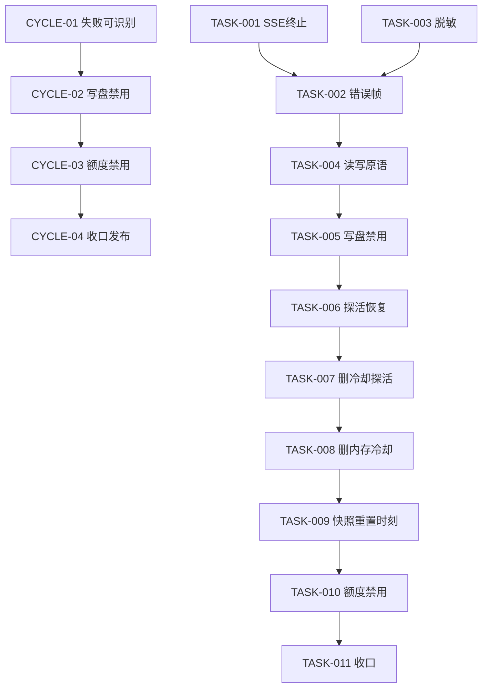
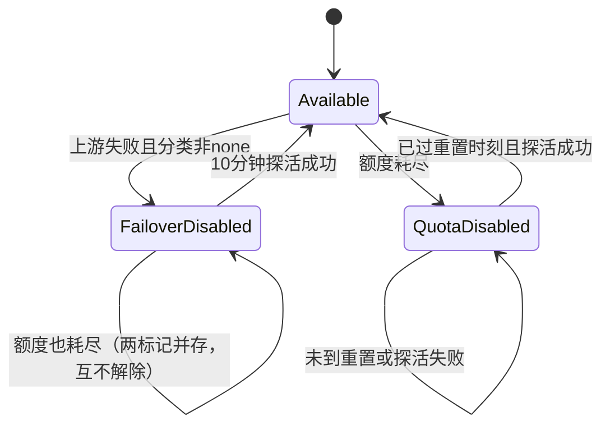
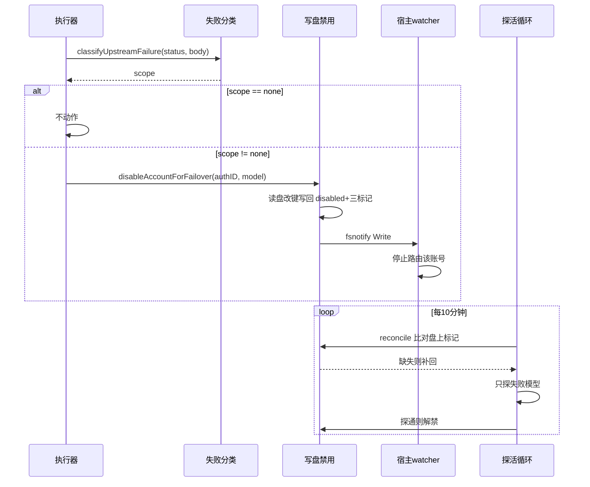

# ZCode 插件功能同步（P0 正确性 + 写盘禁用）实施总览

结论：把 zcode-provider 从「只有插件内存冷却」升级为「失败即写盘禁用 + 定时探活恢复」，同时修掉 3 处会让用户看到假成功或死等的流式缺陷；影响：zcode 账号一旦上游失败，宿主选择器立刻停止路由它，不再出现同一请求内反复派发坏号；范围：`zcode/` 目录内的流式终止、错误帧识别、错误脱敏、写盘禁用、额度耗尽禁用五条链路；非范围：签到、成长中心、会话亲和、连续使用轮换、累计计数、管理鉴权、客户端版本自动拉取一律不做；完成标准：`python scripts/cgo-shim-build.py zcode` 全绿，11 个最小任务各自真实测试与 `6-review` 通过，生产热重载后实测禁用与恢复闭环成立；验证状态：计划阶段，尚未开始实施。

## 当前计划最终方案简要说明

以 workbuddy 0.20.2 已验证的「失败双写」为蓝本移植到 zcode，但按 zcode 的真实差异做三处改造：写盘改走「读物理文件 → 改顶层键 → 整体写回」而非结构体重建，恢复通道改成 zcode 自己的 10 分钟探活循环而非 counter 保底，额度耗尽按 Start Plan 的 `period_end` 重置语义恢复而非签到回补。先修 P0 流式缺陷（它们是「假成功」的直接来源，会让失败不被记账），再上写盘禁用，最后接额度耗尽。

## Agent 对当前问题的理解

- 问题 / 目标：zcode 的能力已经落后 workbuddy 一整代。当前 zcode 的故障处理只有插件内存里的阶梯冷却（`failover.go`），宿主选择器完全看不见，同一个请求内宿主仍会把已知坏号发进来；同时流式链路有 3 处缺陷会让真实失败被记成成功。目标是让 zcode 在故障识别、故障排除、故障恢复三个环节达到 workbuddy 当前水平。
- 本轮范围：
  1. SSE 终止语义修复（`[DONE]` / `event: done` 立即终止，不再死等上游空闲连接）；
  2. HTTP 200 承载的错误帧识别（当前完全不识别，会把业务错误当正常流转发并清掉失败状态）；
  3. 错误文本脱敏（当前上游报文原样进 `stream.emit` 与 usage feed，可能泄露 Bearer / JWT）；
  4. 失败即写盘禁用（`disabled: true` + 三个归属标记），10 分钟只探失败模型；
  5. 移除内存冷却与冷却前探活，失败分类保留；
  6. 额度耗尽写盘禁用，按 `period_end` 次日重置后探活恢复。
- 非范围（用户裁定「只做 P0」后明确剔除，列出以免实施期漂移）：
  - 会话亲和（`session_auth.go`）与连续使用轮换（`usage_rotation.go`）：属于 P1 调度能力，本轮不做；
  - 插件侧累计成功/失败计数（`counter.go`）：属于 P2 可观测能力，本轮不做；
  - 每小时全量积分巡检（`credits_sweep.go` 形态）：本轮只做额度耗尽判定所需的单账号查询与定时复检，不做全量扫描落 sidecar；
  - 管理接口鉴权（`checkManagementAuth`）：宿主中间件已覆盖，本轮不做；
  - 客户端版本自动拉取（`client_version.go`）：zcode 的 `X-ZCode-App-Version` 必须保持 `unknown` 才不被风控，照搬 workbuddy 的做法会直接触发 405 + 3012；
  - 签到 / 成长中心：zcode 上游没有对应活动，不适用。
- 当前优先闭环：先让「失败被正确识别」这件事成立（CYCLE-01），否则写盘禁用拿不到可靠的触发信号。
- 关键假设 / 待确认点：见 `FEAS-*` 清单。方向级假设均有只读证据或任务级前置验证；无未决决策点。
- `unresolved_decisions`：无。

## 图片资产决策与实施边界

- 图片资产决策：`N/A + 原因 + 证据`。本计划全部改动位于 Go 后端逻辑与宿主 RPC 交互，无 UI 布局、无视觉稿、无截图对比需求；panel.html 仅需把已有的「冷却」徽章改名为「失败禁用」，不涉及视觉设计。证据：本轮允许文件清单内无 `doc/data/images/` 资产，全部为 `zcode/*.go`。
- Mermaid 边界：周期依赖、失败状态迁移、探活时序全部用 Mermaid 表达（见「图形化执行路径」）；图片不参与本计划。
- 生成契约：`N/A + 原因 + 证据`（同上，无图片需求）。
- 格式契约：`N/A + 原因 + 证据`（无图片产出）。
- 引用契约：`N/A + 原因 + 证据`（无图片引用）。

## 图片资产清单

| 图片 ID | 用途 / 生成输入 | 来源 | 相对路径 | 版本 | 关联 REQ/RULE / AC / CYCLE / TASK | 引用章节 | 敏感状态 | 版权状态 |
| --- | --- | --- | --- | --- | --- | --- | --- | --- |
| `N/A` | 本计划无图片需求 | `N/A` | `N/A` | `N/A` | `N/A` | `N/A` | `N/A` | `N/A` |

## 已冻结决策与方案比较

| ID | 决策问题 | 候选方案 | 选定方案 | 排除原因 | 影响面 | 回滚 | 证据 |
| --- | --- | --- | --- | --- | --- | --- | --- |
| `DEC-001` | 同步口径 | 分档全量对齐 / 只做 P0 / 只修缺陷 | 只做 P0 + 写盘禁用 + 额度禁用 | 用户 2026-10-25 裁定「只做 P0」；签到、成长中心、会话亲和、轮换、计数、鉴权均属 P1/P2，不进本轮 | 决定 11 个任务的边界 | `ROLLBACK-001` | 本轮用户答复 |
| `DEC-002` | 是否引入写盘禁用 | 引入双写 / 不引入 / 先探针 | 引入写盘禁用，并**移除内存冷却** | 用户裁定「我们选择 1，但是原来的内存冷却应该可以去掉了」；保留双份状态会让两套判据互相打架 | 故障排除从插件内升级为宿主可见 | `ROLLBACK-002` | 本轮用户答复 + `workbuddy/failover_disable.go:1-26` |
| `DEC-003` | 额度耗尽是否落禁用 | 只降级 / 落禁用 + 次日恢复 / 不做 | 落禁用 + 次日 `period_end` 重置后探活恢复 | 用户裁定「落成禁用 + 次日探活恢复」；zcode 是每日重置额度，与 workbuddy 积分池恢复语义不同，恢复判据必须换成时间窗 | 新增额度维度禁用归属标记 | `ROLLBACK-003` | 本轮用户答复 + `zcode/quota.go:155-185` |
| `DEC-004` | 写盘实现方式 | 结构体重建（现状）/ 读盘改键写回 | 读盘改键写回 | `zcode/authfile.go:221` 当前用 `json.MarshalIndent(auth)` 从 `StoredAuth` 重建，会丢掉所有不在结构体里的顶层键（含本机制自己的标记）；不换实现则标记写进去立刻被下一次插件写盘抹掉 | 所有禁用/恢复写盘路径 | `ROLLBACK-004` | `zcode/authfile.go:201-245` |
| `DEC-005` | 模型级失败如何禁用 | 账号级禁用 / 模型级禁用 | 账号级禁用，但只探失败模型恢复 | 宿主 `disabled` 只有账号级布尔值，没有模型维度；workbuddy 同样做法并已在生产验证 | 11128 会连带禁用该账号其它模型 | `ROLLBACK-005` | `workbuddy/accountFailover.go:283-287`、`workbuddy/failover_disable.go:437` |
| `DEC-006` | 标记被宿主 persist 抹掉如何兜底 | 依赖 StorageJSON 语义 / 每次 tick reconcile | 每次 tick reconcile | zcode 的 `StorageJSON` 是 `req.RawJSON`（`zcode/main.go:459`），理论上宿主 persist 会保留未知键；但宿主仍可能在 watcher 生效前用旧内存对象写回。reconcile 不依赖 persist 语义，无论宿主行为如何都安全 | 探活循环每轮额外读盘比对 | `ROLLBACK-006` | `zcode/main.go:451-470`、宿主 `internal/pluginhost/auth_provider.go:540-561` |

## 系统边界与现状基线

已核实事实（全部来自本轮真实读取）：

| 事实 | 证据位置 |
| --- | --- |
| zcode 当前版本 0.1.35，20 个非测试 Go 文件 | `zcode/VERSION`、`zcode/main.go:78` |
| workbuddy 当前版本 0.20.2，53 个非测试 Go 文件 | `workbuddy/main.go:348` |
| zcode 故障排除只有内存冷却，宿主不可见 | `zcode/failover.go:28`、`zcode/scheduler.go:27` |
| zcode 已有账号×模型双粒度冷却 | `zcode/failover.go:159-185` |
| zcode 有 1 秒粒度冷却前探活循环 | `zcode/cooldown_probe.go:39`、`zcode/main.go:86` |
| zcode 写盘从结构体重建，丢未知键 | `zcode/authfile.go:201-245` |
| zcode `auth.parse` 回传完整原文 | `zcode/main.go:451-470` |
| 宿主 persist 用 `rawJSON + metadata` 合并 | `/tmp/cpahost/cpa/internal/pluginhost/auth_provider.go:540-561` |
| 宿主 `disabled` 为账号级布尔值 | 同上 `:648` |
| zcode SSE 遇 `[DONE]` 只跳过用量提取，仍转发且不终止 | `zcode/stream.go:92-120` |
| zcode 无 SSE 错误帧识别 | `zcode/stream.go` 全文无等价 `sseErrorFrame` |
| zcode 无错误脱敏 | `zcode/*.go` 无 `redact` |
| zcode 额度快照有 `TotalRemain` / `HasUsage`，但未提取 `period_end` | `zcode/quota.go:155-185`、`:235-240`、`:367` |
| 本地验证入口 `python scripts/cgo-shim-build.py zcode` | `scripts/cgo-shim-build.py:1-20` |
| 生产宿主为 CPA v7 插件架构，插件更新走 `plugin-store install` 热重载 | 项目 `AGENTS.md` |

代码落点目录树（现状 + 本轮新增/删除标注）：

```text
zcode/
├── main.go                          # 方法分发、注册、配置解析；【改】新增 failoverProbeLoop 启动、auth.parse 标记回传
├── VERSION                          # 【改】0.1.35 → 0.2.0
├── authfile.go                      # 【改】新增 readAuthDoc/writeAuthDoc 读写盘原语（保留未知顶层键）
├── stream.go                        # 【改】SSE 终止、错误帧识别、错误脱敏
├── executor.go                      # 【改】失败记账改走新禁用机制、错误脱敏
├── redact.go                        # 【新】凭据脱敏纯函数（Bearer / JWT / token KV）
├── failover_disable.go              # 【新】写盘禁用、归属标记、探活循环、reconcile 保底
├── failover.go                      # 【改】删除冷却状态与阶梯，只保留失败分类委托
├── cooldown_probe.go                # 【删】整文件删除（被 failover_disable.go 的 10 分钟探活取代）
├── cooldown_probe_test.go           # 【删】随实现删除
├── cooldown_probe_cycle_test.go     # 【删】随实现删除
├── model_circuit.go                 # 【改】11128 记账改为直接写盘禁用
├── scheduler.go                     # 【改】路由判据从内存冷却改为读盘禁用镜像
├── management.go                    # 【改】账号视图补 failover_disabled / failover_unconfirmed / low_quota_disabled
├── quota.go                         # 【改】快照补 PeriodEnd / EarliestReset，新增耗尽判定
├── quota_disable.go                 # 【新】额度耗尽写盘禁用与重置探活恢复
├── panel.html                       # 【改】「冷却」徽章改为「失败禁用」，新增「额度耗尽」徽章
├── failover_disable_test.go         # 【新】禁用/恢复/标记保底测试
├── redact_test.go                   # 【新】脱敏纯函数测试
├── quota_disable_test.go            # 【新】耗尽判定与恢复测试
└── stream_termination_test.go       # 【新】SSE 终止与错误帧测试
```

新增文件用途：

```text
zcode/redact.go                      # 上游错误文本进入宿主/用量流前的唯一脱敏入口
zcode/failover_disable.go            # 失败写盘禁用的唯一落点：标记读写、探活、reconcile
zcode/quota_disable.go               # 额度耗尽写盘禁用的唯一落点：判定、禁用、重置恢复
zcode/failover_disable_test.go       # 上述禁用机制的单元测试与变异验证
zcode/redact_test.go                 # 脱敏纯函数测试
zcode/quota_disable_test.go          # 额度禁用测试
zcode/stream_termination_test.go     # SSE 终止与错误帧识别测试
```

## 跨会话独立执行与外部项目代码引用清单

- 新会话接手第一步：在仓库根执行 `git log -1 --format=%H` 确认基线为 `6e9a1dd7073197555b2bdc33a87f7cf280427892`；不一致时先核对本文件 `baseline_commit` 与当前 HEAD 的差异范围，若差异触及 `zcode/` 则停止并重新评审计划。
- 主项目名称与项目根：`cpa-workbuddy-plugin`，本机绝对路径 `F:\cpa-plugin`。
- 主项目仓库类型与代码基线：Git 仓库（默认分支 `main`），基线提交 `6e9a1dd7073197555b2bdc33a87f7cf280427892`。
- 计划源文件与版本：本文件 `doc/3-实施/2026-10-25_133753_zcode功能同步P0与写盘禁用_实施总览.md` v1.0。
- 依赖安装、local 配置和服务启动入口：本轮无新增依赖；本地验证入口 `python scripts/cgo-shim-build.py zcode`（Windows 无 CGO 时的唯一可用入口，等价于 build + vet + test）。L2 真实上游验证需要 local 账号配置，入口为插件管理路由 `/v0/management/plugins/zcode-provider/*`，只在 local 宿主环境执行，禁止连接生产。
- 外部项目代码引用：`N/A + 原因 + 证据`。本计划参考的 workbuddy 实现位于同一仓库 `F:\cpa-plugin\workbuddy\`，属同项目兄弟插件目录，不是外部项目；无第三方仓库、无外部许可证边界问题。证据：`ls F:\cpa-plugin\workbuddy` 与 `ls F:\cpa-plugin\zcode` 同属一个 Git 仓库，`git ls-files workbuddy | head` 可验证。

## 可行性探针与假设清单

| ID | 假设 | 影响面 | 探针级别 | 验证方式 | 结论 | 证据 |
| --- | --- | --- | --- | --- | --- | --- |
| `FEAS-001` | 宿主 `disabled: true` 写盘后，watcher 会在秒级内停止把新请求路由到该账号 | 写盘禁用是否真的生效 | L1 只读 + 生产既有事实 | 读宿主 `internal/watcher/events.go:74` 确认监听 Write/Rename；workbuddy 同机制已在生产运行 4 天无回退 | 只读证据充分 | `internal/watcher/events.go:74`、项目 `PROJECT_CURRENT.md` 中 workbuddy 0.20.2 生产验收记录 |
| `FEAS-002` | 宿主 persist 会保留 `StorageJSON` 中的未知顶层键 | 标记是否需要额外保底 | L1 只读 | 读 `internal/pluginhost/auth_provider.go:540-561` `mergedStorageJSON`：raw 打底、meta 覆盖 | 只读证据充分，但方案不依赖它（`DEC-006` 选 reconcile） | 同上 |
| `FEAS-003` | 宿主 persist 在 watcher 生效前会用旧内存对象写回盘，抹掉刚写的标记 | 标记保底是否必要 | L1 只读 + 生产既有事实 | workbuddy 0.20.2 已实证该竞态存在（DB `updated_at` 早于文件 mtime 24ms） | 只读证据充分 | 项目 `PROJECT_CURRENT.md` workbuddy 0.20.2 根因链 |
| `FEAS-004` | 额度 `balance` 端点返回每个 entitlement 的 `period_end`，可据此算出下一次重置时刻 | 额度禁用能否按日恢复 | **已验证成立（2026-10-25）** | TASK-009 第一动作：本地 zcode 账号目录为空，改用本机 zcode 客户端落盘的真实 `billing/balance` 响应取证（319 条，5 个自然日）。判定：`period_end` 全部非零；跨度恒为 86399s；`period_start` = 当日 00:00:00 CST、`period_end` = 当日 23:59:59 CST，相邻日 `start = 上一日 end + 1` | 已成立（真实上游响应） | 本机 `~/.zcode/v2/logs/2026-10-11/12/14/15/17.log`；脱敏样本落 `.tmp/real_balance_sample.json`；`zcode/quota.go:235-240` 已定义字段但未提取到快照 |
| `FEAS-005` | 额度重置后，同一账号在同一模型上探活能成功 | 恢复闭环是否成立 | **可测性已验证（2026-10-25）**；真实次日恢复待生产灰度 | TASK-010 第一动作：在假宿主构造 `TotalRemain=0` 快照并用可控时钟验证三条件组合。判定：`TestReenableForQuotaResetRequiresAllThree` 四个子用例（未禁用 / 未到点 / 到点探活失败 / 到点探活成功）行为全部符合预期，5 个变异全部被测试检出 | 分支可达且判据正确；真实重置后探活结果由生产灰度观察 | `zcode/quota_disable.go`、`zcode/quota_disable_test.go`；`zcode/active_ping.go:262-320` 探活内核复用 |
| `FEAS-006` | 移除内存冷却后，宿主不会因为「插件没有排除手段」而把坏号反复派发 | 移除冷却是否安全 | 已由方案保证 | 写盘禁用先于内存冷却移除落地（CYCLE-02 内部顺序：TASK-005/006 完成并验证后，TASK-008 才删冷却） | 已探针验证（顺序约束） | 本文件「周期内最小任务执行顺序」 |

## 实施周期总览

| 顺序 | 周期 ID | 期次定位 | 单一周期目标 | 进入条件 | 收口条件 | 依赖 |
| --- | --- | --- | --- | --- | --- | --- |
| 1 | `CYCLE-01` | 第一期：让失败被正确识别 | 修掉 3 处流式缺陷，使真实失败不再被记成成功 | 计划已批准 | 3 个任务各自真实测试 + `6-review` 通过；SSE 终止与错误帧识别有变异验证 | 无 |
| 2 | `CYCLE-02` | 第二期：故障排除升级为宿主可见 | 失败写盘禁用上线，内存冷却下线 | `CYCLE-01` 收口 | 禁用/恢复/标记保底三段闭环真实测试通过；内存冷却代码已删除且无残留引用 | `CYCLE-01` |
| 3 | `CYCLE-03` | 第三期：额度耗尽纳入禁用 | 额度耗尽写盘禁用，按日重置探活恢复 | `CYCLE-02` 收口 | 耗尽判定与重置恢复真实测试通过；`period_end` 解析有 L2 证据 | `CYCLE-02` |
| 4 | `CYCLE-04` | 第四期：收口与发布 | 全链路验证、风格回归、版本发布 | `CYCLE-03` 收口 | `cgo-shim-build.py zcode` 全绿；`6-review` `STYLE: PASS`；生产热重载后禁用与恢复实测成立 | `CYCLE-03` |

## 阶段计划

| 阶段 | 周期 | 唯一目标 | 输入 | 输出 | 验证门槛 |
| --- | --- | --- | --- | --- | --- |
| `PHASE-01` | `CYCLE-01` | SSE 终止语义正确 | `zcode/stream.go` 现状 | `stream_termination_test.go` + 改造后的 pump 循环 | `[DONE]` 后不再读上游；空闲连接不死等 |
| `PHASE-02` | `CYCLE-01` | 200 内错误帧被识别为失败 | `workbuddy/stream.go:875-898` `sseErrorFrame` 语义 | `sseErrorFrame` 等价实现 + 失败记账 | 200 + error 帧时返回错误而非成功 |
| `PHASE-03` | `CYCLE-01` | 错误文本不泄露凭据 | 上游报文出口清单 | `redact.go` + 全部出口接入 | 构造含 Bearer/JWT 的错误文本，断言输出已脱敏 |
| `PHASE-04` | `CYCLE-02` | 物理文档读写保留未知键 | `zcode/authfile.go:201-245` | `readAuthDoc` / `writeAuthDoc` | 写入后回读，未知顶层键仍在 |
| `PHASE-05` | `CYCLE-02` | 失败即写盘禁用 | 禁用原语 + 失败分类 | `failover_disable.go` 禁用路径 | 禁用后盘上 `disabled=true` 且三标记齐全 |
| `PHASE-06` | `CYCLE-02` | 定时探活恢复 + 标记保底 | 禁用路径 | 10 分钟探活循环 + reconcile | 探活成功解禁；标记被抹后下一 tick 补回 |
| `PHASE-07` | `CYCLE-02` | 内存冷却下线 | 新机制已验证 | 删除 `cooldown_probe.go`、精简 `failover.go` | 全仓无冷却残留引用，`cgo-shim` 全绿 |
| `PHASE-08` | `CYCLE-03` | 额度快照带重置时刻 | `zcode/quota.go` | `PeriodEnd` / `EarliestReset` 字段 | L2 真实响应解析出非零 `period_end` |
| `PHASE-09` | `CYCLE-03` | 额度耗尽禁用与恢复 | 快照字段 + 禁用原语 | `quota_disable.go` | 耗尽即禁用；重置且探活成功才解禁 |
| `PHASE-10` | `CYCLE-04` | 全链路收口与发布 | 前三个周期 | 版本号、CHANGELOG、6-review、生产验证 | 全部门禁通过 |

## 最小任务清单

### CYCLE-01 任务顺序：TASK-001 → TASK-002 → TASK-003

#### TASK-001：SSE 终止语义修复

- 所属周期与周期内顺序：`CYCLE-01` / 第 1 个
- 垂直切片目标：上游发出 `[DONE]` 或 `event: done` 后，插件立即停止读取并关闭流，不再把终止标记当数据帧转发，也不再依赖上游主动断开连接。
- 预计触达文件数：2（`zcode/stream.go`、`zcode/stream_termination_test.go`）
- 文件 / 模块落点：`zcode/stream.go` 的 `pumpUpstreamStream` 函数（当前第 60-150 行）
- 符号操作：修改 `pumpUpstreamStream` 的行处理分支；新增纯函数 `isStreamDoneLine(line string) bool`
- 修改前职责：遇 `data: [DONE]` 只跳过用量提取，随后无条件 `streamEmit` 转发该行，循环继续读到 `io.EOF` 才退出
- 修改后职责：识别终止标记后立即 `return`，不转发终止帧，由 `defer` 统一 `streamClose`
- 禁止触碰区：`streamEmit` / `streamClose` 的宿主 RPC 契约；`usageTokensDetail` 字段；`publishUsage` 签名
- 实施步骤：
  1. 在 `zcode/stream.go` 新增 `isStreamDoneLine`，识别 `data: [DONE]`、`data:[DONE]`、`event: done`、`event:done` 四种形态；验证点：单测四种形态全命中，普通数据行不命中。
  2. 在 `pumpUpstreamStream` 的行处理处，先判终止再判用量与转发；验证点：构造含 `[DONE]` 后仍持续输出的 reader，断言循环在 `[DONE]` 处退出。
  3. 保留原有 `io.EOF` 分支不变；验证点：无 `[DONE]` 的流仍按 EOF 正常收尾并 `publishUsage`。
- 真实测试：`python scripts/cgo-shim-build.py zcode`（build + vet + test）；样本为 `strings.NewReader` 构造的 SSE 文本，含 3 种终止形态与 1 种无终止形态；断言「终止后 reader 剩余字节未被读取」用计数 reader 实现；清理：测试不落盘、不发网络。
- 风格回归：`6-review`，`STYLE-001`；证据写入 `doc/6-review/`；通过标准 `STYLE: PASS`。
- 回滚：`ROLLBACK-001`，`git checkout -- zcode/stream.go zcode/stream_termination_test.go`。
- 完成条件：三种终止形态全部在终止行处退出；终止帧未出现在 `streamEmit` 调用序列中；`cgo-shim` 全绿。
- 停止 / 结束条件：若发现宿主协议要求插件转发终止帧（读宿主 `internal/pluginhost` 流处理确认），立即停止并回写本计划，不得自行决定。
- 最大推进边界：只改 `pumpUpstreamStream` 与新增纯函数，不改非流式路径、不改 `executor.go`。

#### TASK-002：HTTP 200 错误帧识别

- 所属周期与周期内顺序：`CYCLE-01` / 第 2 个
- 垂直切片目标：上游用 200 承载 `{"error": {...}}` 时，插件识别为失败、停止转发、按失败记账，而不是当正常流成功收尾。
- 预计触达文件数：2（`zcode/stream.go`、`zcode/stream_termination_test.go`）
- 文件 / 模块落点：`zcode/stream.go` 的 `pumpUpstreamStream`；新增 `sseErrorFrame(content string) string`
- 符号操作：新增 `sseErrorFrame`（对齐 `workbuddy/stream.go:875-898` 语义：支持 `error` 为对象或字符串，对象取 `code: message`）；在 pump 循环内调用并触发失败分支
- 修改前职责：200 响应内的错误帧被原样转发给宿主，最终走成功分支并 `resetAccountFailover`
- 修改后职责：识别到错误帧后 `streamEmitError` + `publishUsage(failed=true)` + 失败记账，不再走成功分支
- 禁止触碰区：非流式 `handleExecExecute` 的错误处理（已正确）；`classifyUpstreamFailure` 的分类规则
- 实施步骤：
  1. 新增 `sseErrorFrame`，覆盖 `{"error":{"message":"x"}}`、`{"error":{"code":"E","message":"x"}}`、`{"error":"x"}`、无 error 四种输入；验证点：单测四例全通过。
  2. 在 pump 循环内、转发前调用；命中即记录失败并按失败收尾；验证点：构造 200 + 错误帧流，断言不调用成功分支。
  3. 确认错误帧文本经 TASK-003 的脱敏出口；验证点：错误帧含 JWT 时输出已脱敏（依赖 TASK-003 先落地，故本任务排在 TASK-003 之后执行）。
- 真实测试：`python scripts/cgo-shim-build.py zcode`；样本为构造的 200 SSE 文本；断言 `publishUsage` 收到 `failed=true` 且 `streamClose` 被调用；清理：无落盘。
- 风格回归：`6-review`，`STYLE-002`；通过标准 `STYLE: PASS`。
- 回滚：`ROLLBACK-002`，`git checkout -- zcode/stream.go zcode/stream_termination_test.go`。
- 完成条件：四种错误帧形态全部识别；成功分支不再被错误帧触发；`cgo-shim` 全绿。
- 停止 / 结束条件：若上游实际把业务错误放在 200 的非 `error` 字段（如 `code != 0`），停止并先补一条真实报文证据再决定，不得凭猜扩展判据。
- 最大推进边界：只做流式路径识别，不改额度判定、不改 `[DONE]` 处理（TASK-001 已覆盖）。

#### TASK-003：错误文本脱敏

- 所属周期与周期内顺序：`CYCLE-01` / 第 3 个（实际执行顺序在 TASK-002 之前，因 TASK-002 依赖它）
- 垂直切片目标：任何可能进入宿主日志、`stream.emit` 错误帧或 usage feed 的上游文本，都在出口前剥掉 Bearer / JWT / token KV。
- 预计触达文件数：5（`zcode/redact.go` 新建、`zcode/redact_test.go` 新建、`zcode/stream.go`、`zcode/executor.go`、`zcode/usage_feed.go`）
- 文件 / 模块落点：新增 `zcode/redact.go`；出口点 `streamEmitError`、`publishUsage` 的 `errMsg` 参数、`executeOnce` 的错误构造
- 符号操作：新增 `redactSecrets(string) string`、`truncateRedacted(string, int) string`（对齐 `workbuddy/redact.go` 四条正则：Bearer、JWT 三段、JWT 两段、token KV）
- 修改前职责：上游报文原样透出
- 修改后职责：所有出口统一经 `redactSecrets`
- 禁止触碰区：`usage_feed.go` 的 NDJSON 结构字段名；`publishUsage` 签名（只在调用前对 `errMsg` 做脱敏，不改签名）
- 实施步骤：
  1. 新建 `redact.go`，从 workbuddy 移植四条正则并保留其注释中的来源说明；验证点：四条正则各自命中一个样本，普通文本不误伤。
  2. `streamEmitError` 内对 message 脱敏；验证点：传入含 `Bearer abc...` 的文本，断言输出不含原 token。
  3. `executor.go` 中构造上游错误的位置统一走 `truncateRedacted`；验证点：超长报文被截断到 200 字符且保留可读前缀。
  4. `publishUsage` 的 `errMsg` 调用点全部经脱敏；验证点：grep 确认无直接传 `err.Error()` 到 usage feed 的路径。
- 真实测试：`python scripts/cgo-shim-build.py zcode`；样本为手工构造的 4 类凭据文本 + 1 段正常中文错误；断言脱敏后不含原 token 且长度受限；清理：无落盘。
- 风格回归：`6-review`，`STYLE-003`；通过标准 `STYLE: PASS`。
- 回滚：`ROLLBACK-003`，删除 `zcode/redact.go`、`zcode/redact_test.go` 并 `git checkout -- zcode/stream.go zcode/executor.go zcode/usage_feed.go`。
- 完成条件：4 类凭据样本全部脱敏；无出口遗漏（grep 证据）；`cgo-shim` 全绿。
- 停止 / 结束条件：若发现 usage feed 已由消费端脱敏，停止并回写计划说明重复脱敏的代价，不得默认保留。
- 最大推进边界：只做脱敏纯函数与出口接入，不改日志格式、不加日志字段。

### CYCLE-02 任务顺序：TASK-004 → TASK-005 → TASK-006 → TASK-007 → TASK-008

#### TASK-004：物理文档读写原语

- 所属周期与周期内顺序：`CYCLE-02` / 第 1 个
- 垂直切片目标：提供一对原语，读物理 auth 文件为 `map[string]any`、改键后整体写回，保证所有未知顶层键原样保留。
- 预计触达文件数：2（`zcode/authfile.go`、`zcode/failover_disable_test.go`）
- 文件 / 模块落点：`zcode/authfile.go` 新增 `readAuthDoc(path string) (map[string]any, []byte, error)`、`writeAuthDoc(path string, doc map[string]any) error`
- 符号操作：新增两个函数；`writeAuthDoc` 复用现有 `isSafeZCodeAuthPath` 与原子重命名语义
- 修改前职责：写盘只有 `writeAuthFileDirect`（结构体全量重建）
- 修改后职责：新增 map 化读写，供禁用标记使用；`writeAuthFileDirect` 保持不变（凭据写入仍走它）
- 禁止触碰区：`writeAuthFileDirect` 的现有调用点与行为（`saveAuthTestStatus`、OAuth 落盘、导入等）；`isSafeZCodeAuthPath`
- 实施步骤：
  1. 新增 `readAuthDoc`：`os.ReadFile` + `json.Unmarshal` 到 map，同时返回原始字节供比对；验证点：对含未知键的样本返回的 map 包含该键。
  2. 新增 `writeAuthDoc`：先校验路径安全，再 `json.MarshalIndent` + 临时文件 + `os.Rename`；验证点：写入后回读，未知键仍在且格式为缩进 JSON。
  3. 单测覆盖路径穿越拒绝、文件不存在、非法 JSON 三种边界；验证点：三种边界均返回错误且不产生半成品文件。
- 真实测试：`python scripts/cgo-shim-build.py zcode`；样本为临时目录下的 auth JSON（`t.TempDir()`），含 `custom_top_level_key`；断言写入后该键仍在；清理：`t.TempDir()` 自动回收。
- 风格回归：`6-review`，`STYLE-004`；通过标准 `STYLE: PASS`。
- 回滚：`ROLLBACK-004`，`git checkout -- zcode/authfile.go zcode/failover_disable_test.go`。
- 完成条件：未知顶层键在读写往返后保持不变；三种边界均有错误返回；`cgo-shim` 全绿。
- 停止 / 结束条件：若发现宿主要求写盘必须同步 `host.auth.save`（否则不注册），停止并回写计划，先确认同步时机再继续。
- 最大推进边界：只加原语，不改任何现有写盘调用点。

#### TASK-005：失败即写盘禁用

- 所属周期与周期内顺序：`CYCLE-02` / 第 2 个
- 垂直切片目标：一次账号级失败后，物理 auth 文件被写入 `disabled: true` 与三个归属标记，宿主随即停止路由该账号。
- 预计触达文件数：4（`zcode/failover_disable.go` 新建、`zcode/failover_disable_test.go`、`zcode/executor.go`、`zcode/stream.go`）
- 文件 / 模块落点：新建 `zcode/failover_disable.go`；触发点 `executor.go` 的非流式失败分支与 `stream.go` 的流式失败分支
- 符号操作：新增 `disableAccountForFailover(authID, model string) bool`、`markFailoverDisabledLocalAt`、`failoverProbeModelFor`、`failoverDisableAtFor`；常量 `failoverDisableKey` / `failoverDisableModelKey` / `failoverDisableAtKey`
- 修改前职责：失败只写内存冷却
- 修改后职责：失败写内存「禁用意图表」+ 物理文件 `disabled:true` + 三标记；内存表用于宿主列表滞后时兜底
- 禁止触碰区：用户手动禁用（`management.go` 的 enable/disable 路由）的 `disabled` 值；额度禁用标记（TASK-009 引入，两者不得互相解除）
- 实施步骤：
  1. 定义三个归属标记常量与内存意图表（含禁用时刻）；验证点：标记名与 workbuddy 完全一致，便于跨插件排查。
  2. 实现 `disableAccountForFailover`：解析 auth_index → 读盘 → 若已是本机制禁用则跳过 → 写 `disabled:true` + 三标记 → 更新内存表；验证点：单测断言写盘一次、三标记齐全、`failover_disable_at` 为 RFC3339。
  3. 在 `executor.go` 与 `stream.go` 的失败记账处调用；验证点：注入假失败后盘上 `disabled=true`。
  4. 明确不接管人工禁用：若盘上 `disabled=true` 但无本机制标记，直接返回 false 不写；验证点：单测覆盖。
- 真实测试：`python scripts/cgo-shim-build.py zcode`；样本为 `t.TempDir()` 下的 auth 文件 + 假 auth_index 解析注入；断言写盘次数为 1、标记值正确、重复调用不重复写；清理：临时目录回收。
- 风格回归：`6-review`，`STYLE-005`；通过标准 `STYLE: PASS`。
- 回滚：`ROLLBACK-005`，删除 `zcode/failover_disable.go` 并 `git checkout -- zcode/executor.go zcode/stream.go zcode/failover_disable_test.go`。
- 完成条件：失败后盘上 `disabled=true` 且三标记齐全；人工禁用不被接管；`cgo-shim` 全绿。
- 停止 / 结束条件：若写盘后宿主仍继续路由（watcher 未生效），停止并先用只读探针确认宿主 watcher 是否监听该目录，不得改为重启宿主绕过。
- 最大推进边界：只做禁用写入，不做探活恢复（TASK-006）。

#### TASK-006：10 分钟探活恢复与标记保底

- 所属周期与周期内顺序：`CYCLE-02` / 第 3 个
- 垂直切片目标：每 10 分钟串行遍历被本机制禁用的账号，只在当初失败的模型上探活；探通即解禁；若发现标记被宿主抹掉，先补回再探。
- 预计触达文件数：3（`zcode/failover_disable.go`、`zcode/failover_disable_test.go`、`zcode/main.go`）
- 文件 / 模块落点：`zcode/failover_disable.go` 新增 `failoverProbeLoop`、`runFailoverProbeTick`、`reconcileFailoverLocalSet`、`reenableAccountForFailover`；`zcode/main.go` 的 `init()` 启动循环
- 符号操作：新增四个函数与 `failoverProbeInterval = 10 * time.Minute`
- 修改前职责：无恢复通道
- 修改后职责：定时探活 + 每轮 reconcile 比对盘上标记与内存意图表，缺失则补回
- 禁止触碰区：`active_ping.go` 的 `test_failed` 标签写入（探活失败不得写该标签，它是硬排除且永不自动过期）
- 实施步骤：
  1. 实现 `failoverProbeTargets`：从内存意图表取候选，跳过无失败模型的条目；验证点：单测断言无模型条目不入选。
  2. 实现 `runFailoverProbeTick`：解析账号 → 探活失败模型 → 成功则读盘删 `disabled` 与三标记 → 失败则保留并记录；验证点：成功路径盘上 `disabled=false` 且标记清空。
  3. 实现 `reconcileFailoverLocalSet`：遍历意图表，读盘比对，标记缺失则补写；验证点：模拟宿主抹标记后调用一次 reconcile，标记恢复。
  4. 在 `init()` 启动 `go failoverProbeLoop()`，首轮等待宿主就绪（复用 `hostAPIAvailable`）；验证点：`cgo-shim` 下不 panic。
- 真实测试：`python scripts/cgo-shim-build.py zcode`；样本为假宿主（注入解析函数与探活函数）；断言四段：探通解禁、探失败保留、标记被抹后补回、无模型跳过；清理：临时目录回收。
- 风格回归：`6-review`，`STYLE-006`；通过标准 `STYLE: PASS`。
- 回滚：`ROLLBACK-006`，`git checkout -- zcode/failover_disable.go zcode/main.go zcode/failover_disable_test.go`。
- 完成条件：四个分支全部有测试覆盖且通过；探活失败不写 `test_failed`；`cgo-shim` 全绿。
- 停止 / 结束条件：若探活本身会消耗账号日额度且额度已耗尽，停止并回写计划，先确认探活成本可接受（zcode 每日额度有限，探活也计费）。
- 最大推进边界：只做账号级禁用恢复，不做额度维度（TASK-010）。

#### TASK-007：移除冷却前探活

- 所属周期与周期内顺序：`CYCLE-02` / 第 4 个
- 垂直切片目标：删除 1 秒粒度的冷却前探活循环，避免与新的 10 分钟探活重复打上游。
- 预计触达文件数：4（`zcode/cooldown_probe.go` 删、`zcode/cooldown_probe_test.go` 删、`zcode/cooldown_probe_cycle_test.go` 删、`zcode/main.go`）
- 文件 / 模块落点：三个文件整体删除；`zcode/main.go` 移除 `go cooldownProbeLoop()`
- 符号操作：删除 `cooldownProbeLoop`、`runCooldownProbeTick`、`probeCoolingAccount`、`shouldProbeCandidate`、`markCooldownProbed`、`clearCooldownProbeState`、`resolveProbeAuth`、`pingCooldownProbe`
- 修改前职责：1 秒 tick，冷却到期前 20 秒回放
- 修改后职责：无（能力由 TASK-006 的 10 分钟探活承接）
- 禁止触碰区：`hostAPIAvailable`（TASK-006 复用，保留）；`pingUpstreamOnce`（`active_ping.go` 保留）
- 实施步骤：
  1. 删除三个文件；验证点：`go build` 无引用错误。
  2. 移除 `main.go` 的启动行；验证点：`grep cooldownProbeLoop` 零命中。
  3. 全仓 grep 确认无残留引用；验证点：`grep -rn 'cooldownProbe\|probedUntil' zcode/` 零命中。
- 真实测试：`python scripts/cgo-shim-build.py zcode`；断言 build/vet/test 全绿且测试数量减少数等于被删测试数；清理：无。
- 风格回归：`6-review`，`STYLE-007`；通过标准 `STYLE: PASS`。
- 回滚：`ROLLBACK-007`，`git checkout -- zcode/cooldown_probe.go zcode/cooldown_probe_test.go zcode/cooldown_probe_cycle_test.go zcode/main.go`。
- 完成条件：三个文件不存在；全仓零残留引用；`cgo-shim` 全绿。
- 停止 / 结束条件：若发现冷却前探活还有 TASK-006 未覆盖的场景（如模型级冷却探活），停止并回写计划，不得直接删除。
- 最大推进边界：只删不建；不改 `active_ping.go`。

#### TASK-008：内存冷却下线

- 所属周期与周期内顺序：`CYCLE-02` / 第 5 个
- 垂直切片目标：删除阶梯冷却状态机，路由判据改为读「写盘禁用镜像」，失败分类保留为唯一判据。
- 预计触达文件数：5（`zcode/failover.go`、`zcode/scheduler.go`、`zcode/management.go`、`zcode/model_circuit.go`、`zcode/executor.go`）
- 文件 / 模块落点：`failover.go` 精简为分类委托；`scheduler.go:27` 的 `isAuthModelCoolingDown` 改为 `isFailoverDisabled`；`management.go:283` 的 `CoolingDown` 改为 `FailoverDisabled`；`model_circuit.go` 的 `noteModelBlockedHit` 改为直接写盘禁用
- 符号操作：删除 `failoverRecords`、`failoverEntry`、`modelFailoverState`、`isAccountCoolingDown`、`isAuthModelCoolingDown`、`resetAccountFailover`、`resetAuthModelFailover`、`clearAuthModelCooldowns`、`lastFailoverModel`、`authModelFailoverSnapshot`、`recordFailureScoped`（改为 `recordFailureForModel` 直接调禁用）；保留 `shouldRotateOnUpstreamErr`
- 修改前职责：内存阶梯冷却 + 模型双粒度
- 修改后职责：失败分类 → 写盘禁用；成功 → 解除本机制禁用
- 禁止触碰区：`failure_class.go` 全部分类逻辑（它是唯一判据，不改）；`shouldRotateOnUpstreamErr` 的换号判据
- 实施步骤：
  1. 改写 `recordFailureScoped` 为 `recordFailureForModel`：分类为 `none` 时直接返回，否则调 `disableAccountForFailover`；验证点：单测断言分类 none 不写盘。
  2. 路由判据改为 `isFailoverDisabled(authID)`（读内存镜像 + 盘上标记）；验证点：被禁用账号不出现在候选中。
  3. 成功路径从 `resetAccountFailover` 改为 `reenableAccountForFailover`；验证点：成功后盘上 `disabled=false` 且标记清空。
  4. 删除全部冷却状态与测试；验证点：`grep -rn 'failoverRecords\|CoolingDown' zcode/` 只剩新字段名。
- 真实测试：`python scripts/cgo-shim-build.py zcode`；样本为假宿主 + 三组分类输入（account / authModel / none）；断言前两组写盘禁用、第三组不动；清理：临时目录回收。
- 风格回归：`6-review`，`STYLE-008`；通过标准 `STYLE: PASS`。
- 回滚：`ROLLBACK-008`，`git checkout -- zcode/failover.go zcode/scheduler.go zcode/management.go zcode/model_circuit.go zcode/executor.go`。
- 完成条件：冷却状态机零残留；三类分类行为符合预期；`cgo-shim` 全绿。
- 停止 / 结束条件：若删除后发现某条失败路径失去排除能力（无写盘替代），停止并回写计划补一条任务，不得留裸路径。
- 最大推进边界：只收敛状态，不改分类规则、不改换号预算（当前硬编码 3 次保持不变）。

### CYCLE-03 任务顺序：TASK-009 → TASK-010

#### TASK-009：额度快照补重置时刻

- 所属周期与周期内顺序：`CYCLE-03` / 第 1 个
- 垂直切片目标：额度快照携带每个 entitlement 的 `period_end`，并算出账号级「最早重置时刻」，供禁用恢复判据使用。
- 预计触达文件数：3（`zcode/quota.go`、`zcode/quota_test.go`、`zcode/management.go`）
- 文件 / 模块落点：`zcode/quota.go` 的 `zcodeQuotaEntitlement` 与快照组装逻辑；`management.go` 的 `accountSummary.Quota` 透传
- 符号操作：`zcodeQuotaEntitlement` 新增 `PeriodStart` / `PeriodEnd`；`zcodeQuotaSnapshot` 新增 `EarliestReset int64`；组装时取所有 entitlement 中最小非零 `PeriodEnd`
- 修改前职责：`PeriodStart` / `PeriodEnd` 在匿名 struct 中已解析但未落到快照
- 修改后职责：字段落快照，`EarliestReset` 为最早重置时间
- 禁止触碰区：`TotalRemain` / `HasUsage` 的计算语义；`billing/current` 回退通道的降级逻辑
- 实施步骤：
  0. **执行期第一动作**：用 local 账号真实调用 `billing/balance`，打印解析后的 `period_end`。若为 0 或不存在，停止本任务并回写本计划（`FEAS-004` 不成立）。
  1. 给 `zcodeQuotaEntitlement` 加两个字段并在组装处赋值；验证点：单测样本解析后字段非零。
  2. 给快照加 `EarliestReset` 并计算最小非零值；验证点：多 entitlement 样本取最小值。
  3. 面板透传；验证点：`/accounts` 响应含 `earliest_reset`。
- 真实测试：`python scripts/cgo-shim-build.py zcode` + 步骤 0 的 L2 真实响应；样本为真实 `billing/balance` JSON（脱敏后存 fixture）与构造的多 entitlement JSON；断言字段值与人工计算一致；清理：fixture 中的账号标识脱敏。
- 风格回归：`6-review`，`STYLE-009`；通过标准 `STYLE: PASS`。
- 回滚：`ROLLBACK-009`，`git checkout -- zcode/quota.go zcode/quota_test.go zcode/management.go`。
- 完成条件：L2 真实响应解析出非零 `period_end`；多 entitlement 取最小；`cgo-shim` 全绿。
- 停止 / 结束条件：步骤 0 不成立时立即停止（`FEAS-004` 失败），不得用「授予量」猜测重置时间。
- 最大推进边界：只补字段与计算，不做禁用动作（TASK-010）。

#### TASK-010：额度耗尽写盘禁用与重置恢复

- 所属周期与周期内顺序：`CYCLE-03` / 第 2 个
- 垂直切片目标：额度真实耗尽时写盘禁用并打额度归属标记；等到 `EarliestReset` 之后且探活成功才解禁。
- 预计触达文件数：4（`zcode/quota_disable.go` 新建、`zcode/quota_disable_test.go` 新建、`zcode/management.go`、`zcode/panel.html`）
- 文件 / 模块落点：新建 `zcode/quota_disable.go`；触发点在额度刷新完成后（`refresh_runner.go:199` 的 `quotaForAccount` 之后）
- 符号操作：新增 `quotaDisableKey` / `quotaDisableAtKey` / `quotaDisableResetKey` 三标记；新增 `gradeQuotaForAuth(authIndex, authID, sa, snap) bool`、`reenableForQuotaReset(...)`
- 修改前职责：额度耗尽只体现在 `cachedQuota` 的 `PlanStatus` 过滤
- 修改后职责：`HasUsage && TotalRemain <= 0` 时写盘禁用 + 三标记；恢复条件为 `now > EarliestReset` 且探活成功
- 禁止触碰区：失败禁用标记（TASK-005）——两者同时存在时各自独立，谁都不替对方解禁；`PlanStatus` 的现有过滤逻辑保留
- 实施步骤：
  0. **执行期第一动作**：验证 `FEAS-005` 的可测性——在 local 环境构造 `TotalRemain=0` 快照，确认禁用分支可达。
  1. 实现 `gradeQuotaForAuth`：读盘确认无他人认领 → 写 `disabled:true` + 三标记；验证点：单测断言标记齐全且不覆盖失败禁用。
  2. 实现恢复：仅当盘上带额度标记、`now > quotaDisableReset`、探活成功三者同时成立才解禁；验证点：三者缺一保持禁用。
  3. 接入刷新链路；验证点：刷新后自动分级。
  4. `panel.html` 新增「额度耗尽」徽章与恢复倒计时文案；验证点：node 语法检查通过。
- 真实测试：`python scripts/cgo-shim-build.py zcode`；样本为构造快照（耗尽 / 未耗尽 / 无用量通道）+ 假探活；断言三种快照行为与四种恢复组合；清理：临时目录回收。
- 风格回归：`6-review`，`STYLE-010`；通过标准 `STYLE: PASS`。
- 回滚：`ROLLBACK-010`，删除 `zcode/quota_disable.go`、`zcode/quota_disable_test.go` 并 `git checkout -- zcode/management.go zcode/panel.html`。
- 完成条件：耗尽即禁用；三种恢复组合行为正确；`cgo-shim` 全绿；面板语法检查通过。
- 停止 / 结束条件：若 `HasUsage=false`（只有 `billing/current` 通道）时无法判断真实耗尽，停止并保持不动作，禁止把「无用量数据」当「耗尽」。
- 最大推进边界：只做额度维度禁用，不改失败禁用、不改模型列表。

### CYCLE-04 任务顺序：TASK-011

#### TASK-011：全链路收口与发布

- 所属周期与周期内顺序：`CYCLE-04` / 第 1 个
- 垂直切片目标：三个周期的能力在真实宿主上完成端到端验证，版本号与文档同步，产出可发布状态。
- 预计触达文件数：4（`zcode/VERSION`、`zcode/main.go`、`zcode/CHANGELOG.md`、`doc/6-review/` 新记录）
- 文件 / 模块落点：版本号 0.1.35 → 0.2.0；`main.go:78` 的 `var version`
- 符号操作：只改版本常量与新增 CHANGELOG 段落
- 修改前职责：版本 0.1.35
- 修改后职责：版本 0.2.0，CHANGELOG 记录移除内存冷却的破坏性变更
- 禁止触碰区：不改任何业务逻辑；不在本任务修 bug（发现问题回到对应任务）
- 实施步骤：
  1. 跑 `python scripts/cgo-shim-build.py zcode` 全绿；验证点：输出 exit 0。
  2. 本地起 CPA 宿主加载新 `.so`，验证四条链路：失败禁用、探活恢复、额度禁用、流式终止；验证点：日志与盘上状态符合预期。
  3. 更新版本与 CHANGELOG；验证点：`grep 0.2.0 zcode/VERSION zcode/main.go` 双命中。
  4. `6-review` 全量风格回归；验证点：`STYLE: PASS`。
- 真实测试：`cgo-shim` 全绿 + 本地宿主 E2E（按项目记忆 `reference-local-cpa-plugin-e2e-harness` 的三条前置：宿主 `CGO_ENABLED=1`、`.so` 扁平放置、`plugins.configs.<id>.enabled: true`）；样本为 local 账号；断言四条链路日志与盘上状态；清理：本地宿主进程与临时配置目录。
- 风格回归：`6-review`，`STYLE-011`；通过标准 `STYLE: PASS`。
- 回滚：`ROLLBACK-011`，`git checkout -- zcode/VERSION zcode/main.go zcode/CHANGELOG.md`。
- 完成条件：四条链路 E2E 通过；版本双命中；`STYLE: PASS`。
- 停止 / 结束条件：任一链路 E2E 失败时停止发布，回到对应任务修复，不得带病发布。
- 最大推进边界：本任务只到「本地可发布」；生产发布需用户当轮授权，不自动执行。

## 真实测试安排

- 测试入口：`python scripts/cgo-shim-build.py zcode`（Windows 无 CGO 环境下的唯一等价入口，内部执行 build + vet + test）。每个最小任务完成后必须单独跑一次，不允许跨任务合并。
- 依赖环境：Go 1.24+（仓库既有版本）、Python 3（脚本运行）、无网络依赖（单测全部用假宿主与临时目录）。
- 样本 / 数据来源：
  - 单测样本全部在测试内构造（`strings.NewReader`、`t.TempDir()`、假宿主注入），不依赖真实账号；
  - `TASK-009` 步骤 0 需要一条真实 `billing/balance` 响应，取自 local 环境账号，脱敏后作为 fixture；
  - `TASK-011` 的 E2E 使用 local 环境账号，禁止连接生产。
- 通过标准：每个任务的 `cgo-shim` exit 0，且该任务新增测试在**变异验证**下会失败（故意破坏被测逻辑后测试必须变红，还原后变绿）。变异验证是本计划对「测试真的在测东西」的唯一硬要求，逐任务记录变异点与结果。
- 免测理由：`N/A + 原因 + 证据`（本计划全部任务均改变可执行行为，无纯文档/纯注释/纯排版任务）。

## 风险与阻断项

| ID | 风险 | 影响 | 缓解 | 阻断判据 |
| --- | --- | --- | --- | --- |
| `RISK-001` | 账号级禁用会连带禁用该账号的其它模型（`DEC-005` 的代价），11128 这类模型级风控会误伤 | 用户换模型也拿不到该账号 | 恢复只探失败模型，探通即整体解禁；面板文案标明「失败模型」 | 若生产出现「某账号长期只因一个模型被禁」，回到本计划评估模型级禁用 |
| `RISK-002` | 探活本身消耗 zcode 每日额度 | 额度紧张时探活加速耗尽 | 10 分钟一轮且只探已禁用账号；单轮串行 | 若探活导致额度明显下降，先评估探活成本再决定是否延长间隔 |
| `RISK-003` | 宿主 persist 在 watcher 生效前写回旧内容，抹掉禁用标记 | 禁用短暂失效 | `reconcileFailoverLocalSet` 每轮补回；不依赖 persist 语义 | 若补回后仍反复被抹，说明宿主 persist 语义与只读证据不符，停止并重新取证 |
| `RISK-004` | 移除内存冷却后，写盘失败（宿主 RPC 不通）时无排除手段 | 坏号继续被路由 | 写盘失败时保留内存意图表，路由判据同时读内存镜像 | 若发现写盘失败率不可忽略，回到本计划评估是否保留轻量内存兜底 |
| `RISK-005` | `period_end` 语义与「每日重置」不一致（如按自然日 vs 按订阅周期） | 恢复时机错误 | `TASK-009` 步骤 0 用真实响应验证；不成立即停止 | `FEAS-004` 未通过 |

## 图形化执行路径

周期与任务依赖（目的：证明移除内存冷却排在新机制验证之后；关联 `CYCLE-*`、`TASK-*`）：



账号故障状态迁移（目的：定义禁用与恢复的唯一合法路径；关联 `TASK-005`、`TASK-006`、`TASK-008`）：



失败记账时序（目的：固定「先分类、再写盘、后保底」的顺序；关联 `TASK-005`、`TASK-006`）：



## 自审结论

- 字段完整性：正式计划必填字段逐项已填；图片资产、外部引用、免测理由均按 `N/A + 原因 + 证据` 处理；`FEAS-*` 六条含结论与证据，任务级未验证项已在对应任务写明「执行期第一动作先验证，不成立则停止并回写计划」。
- 阶段单一目标：10 个阶段各自只承载一件事，无阶段混合多个并列能力。
- 最小任务闭环：11 个任务均写明允许文件（≤5）、符号操作、禁止触碰区、真实测试命令、断言、清理、回滚、完成条件、停止条件与最大推进边界；每任务独立闭环后才进入下一个。
- 周期顺序正确：`CYCLE-02` 内部先建新机制（TASK-004~006）再删旧机制（TASK-007~008），`FEAS-006` 由此保证移除冷却不产生能力真空。
- 可执行性：所有落点均为本轮真实读取过的文件与函数；全文表述均指向具体文件、符号或命令（已用脚本扫描确认）。
- 图文一致性：三张 Mermaid 图的节点与正文 `CYCLE-*` / `TASK-*` / 状态名一一对应，无图外新增概念。
- 未决决策：无；`DEC-001`~`DEC-006` 全部由本轮用户答复或代码证据冻结。

## 任务完成与停止条件（全局）

- 全局完成条件：11 个任务全部按「实现 → 真实测试 → 6-review」闭环；`cgo-shim-build.py zcode` 全绿；本地 E2E 四条链路通过；`STYLE: PASS`。
- 全局停止条件：任一任务出现「计划与代码不一致」「FEAS 假设不成立」「真实测试无法执行」时立即停止，回写本计划后再继续，不得自行改实现路径。
- 最大推进边界：本计划最多推进到「本地可发布 + 生产热重载验证完成」；生产发布动作按仓库默认授权执行，但不得重启宿主容器，插件更新只走 `plugin-store install` 热重载。
