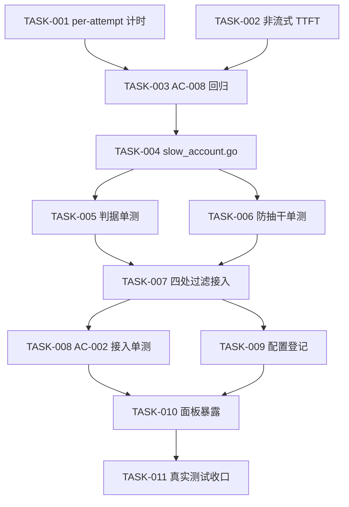

# workbuddy 慢速账号 TTFT 拥堵自动冷却实施总览

结论：给 workbuddy 增加一条「同模型 TTFT 横比 → 慢账号在该模型上进入冷却」的独立状态机，与失败冷却、轮换冷却并列互不干扰；影响：慢但不出错的账号不再无限期拉低整体响应速度，冷却到期自动恢复；范围：`workbuddy/` 内的 per-attempt 计时修复、非流式 TTFT 采集、`slow_account.go` 新状态机、四处路由过滤、5 个配置键与面板字段；非范围：其它 provider 插件、写盘禁用、按总耗时判定、历史数据回灌；完成标准：`python scripts/cgo-shim-build.py workbuddy` 全绿、10 条验收条件各自有真实测试覆盖、关键判据变异可被检出、`6-review` 通过；验证状态：计划阶段。

## 当前计划最终方案简要说明

新增 `slow_account.go`，完全仿 `usage_rotation.go` 的「独立状态 + 四处过滤」骨架：按 `账号 × 模型` 累积成功请求的 TTFT 样本（环形窗口），在同模型内做中位数横比，超倍数阈值且样本达标即写入该账号该模型的冷却窗口，到期自愈。判据用**相对倍数**而不是绝对毫秒，因为生产同一模型 33 万上下文的 prefill 本来就在十几秒量级，绝对阈值会把整池健康号一次禁光。

## Agent 对当前问题的理解

- 问题 / 目标：上游拥堵但每次仍返回 200 的账号，现有失败冷却完全抓不到，会持续留在路由池里拉低响应速度。目标是让「显著慢于同池同模型水平」的账号在该模型上自动让位，且不引入误禁风险。
- 本轮范围：
  1. per-attempt TTFT 计时修复（`started` 跨 attempt 复用导致失败耗时记到下一个账号头上）；
  2. 非流式路径 TTFT 采集补齐（当前 `publishUsage` 恒传 0）；
  3. `slow_account.go` 状态机（样本窗口、中位数横比、冷却、防抽干）；
  4. 四处过滤接入（`scheduler.pick` / `pickNextAuthForModel` / `handleExecExecute` 前置 / `pumpUpstreamStream` 前置）；
  5. 5 个配置键解析 + ConfigFields 登记；
  6. 面板暴露 `slow_cooling` 与相对倍数。
- 非范围：其它 provider 插件（机制先在 workbuddy 验证）、写盘禁用、按 `latency_ms` 判定、历史数据回灌、自动跨 provider 调整。
- 当前优先闭环：**先让 TTFT 数据可信**（CYCLE-01），否则状态机拿到的样本本身带污染，上线即误禁。
- 关键假设 / 待确认点：
  - 假设「同模型下账号间的 TTFT 差异主要由上游拥堵/负载决定，而非稳定的网络路径差异」——若成立，慢账号冷却后整体会变快；若不成立（例如某账号网络路径恒定较慢），冷却它同样是正确结果。
  - 假设「TTFT 中位数在中窗口（15 分钟）内稳定」——用中位数而非均值抵抗长尾。
- `unresolved_decisions`：无。

## 图片资产决策与实施边界

- 图片资产决策：`N/A + 原因 + 证据`。本计划全部改动位于 Go 后端逻辑与面板既有表格渲染，无布局重做、无视觉稿。证据：改动文件清单内 `panel.html` 仅新增一个徽章分支与一个字段渲染，无新样式区块。
- Mermaid 边界：状态迁移用 Mermaid 表达；图片不参与。
- 生成契约 / 格式契约 / 引用契约：`N/A + 原因 + 证据`（无图片产出与引用）。

## 图片资产清单

| 图片 ID | 用途 / 生成输入 | 来源 | 相对路径 | 版本 | 关联 REQ/RULE / AC / CYCLE / TASK | 引用章节 | 敏感状态 | 版权状态 |
| --- | --- | --- | --- | --- | --- | --- | --- | --- |
| `N/A` | 本计划无图片需求 | `N/A` | `N/A` | `N/A` | `N/A` | `N/A` | `N/A` | `N/A` |

## 已冻结决策与方案比较

| ID | 决策问题 | 候选方案 | 选定方案 | 排除原因 | 影响面 | 回滚 | 证据 |
| --- | --- | --- | --- | --- | --- | --- | --- |
| `DEC-001` | 推进方式 | 先观测再定阈值 / 直接实施 / 只增强面板 | 直接实施带默认阈值 | 用户 2026-10-25 裁定「直接实施带默认阈值」；观测面已存在，缺的只是判据链路 | 决定本轮直接进入编码 | `ROLLBACK-001` | 本轮用户答复 |
| `DEC-002` | 判定粒度 | 账号级 / 账号×模型级 | 账号 × 模型级 | 用户裁定；慢可能只体现在长上下文模型上，账号级会误伤该号在其它模型上的可用性 | 状态键为 `authID + model` | `ROLLBACK-002` | 本轮用户答复 + `workbuddy/accountFailover.go:427` 既有双层语义 |
| `DEC-003` | 判据形式 | 绝对毫秒阈值 / 相对倍数 | 相对倍数 + 绝对下限 + 样本门槛 | 生产同模型 33 万上下文 TTFT 天然十几秒，绝对阈值会一次禁光全池 | 需要全池同模型基准视图 | `ROLLBACK-003` | 用户截图 830 请求 input 33~34 万；`REQ §3.1` |
| `DEC-004` | 冷却落点 | 写盘禁用 / 内存冷却 | 只走内存冷却 | 慢是性能问题不是故障；写盘禁用要求探活恢复，对慢账号过重且会污染禁用态语义 | 不写 auth 文件、不写 DB | `ROLLBACK-004` | `workbuddy/failover_disable.go` 的禁用语义 |
| `DEC-005` | 状态是否复用失败冷却 | 复用 / 独立 | 独立 | `resetAccountFailover` 在每次成功时清零（`accountFailover.go:479`），慢速冷却会被第一次成功立刻抹掉 | 新增 `slowStates` | `ROLLBACK-005` | `workbuddy/usage_rotation.go:1-10` 头注释已载明同一理由 |
| `DEC-006` | 计时污染是否本轮修 | 本轮修 / 下轮修 | 本轮修（CYCLE-01 先于状态机） | 不修则样本带前一个账号的失败耗时，上线即误禁健康账号 | 改动 `stream.go` / `main.go` 计时基准 | `ROLLBACK-006` | `workbuddy/main.go:728`、`stream.go:218` |

## 系统边界与现状基线

已核实事实（全部来自本轮真实读取）：

| 事实 | 证据位置 |
| --- | --- |
| TTFT 采集已有，首个 SSE data 行打点 | `workbuddy/usage.go:271-282` |
| `ttftNS` 以 `started` 为基准计算 | `workbuddy/usage.go:291` |
| `started` 在 executor 入口只取一次 | `workbuddy/main.go:728`、`:901` |
| `collector` 每 attempt 新建 | `workbuddy/stream.go:218` |
| 非流式路径 `publishUsage` 传 ttft=0 | `workbuddy/main.go:874`、`:860` |
| 非流式聚合已有 `firstByteAt` 出参但被丢弃 | `workbuddy/stream.go:537-538` |
| 轮换冷却状态独立，且已实现防抽干 | `workbuddy/usage_rotation.go:313-364` |
| 四处过滤接入点 | `scheduler.go:110`、`failover_retry.go:75`、`main.go:784`、`stream.go:125` |
| 配置解析逐行前缀匹配 | `workbuddy/usage_config.go:167-192` |
| ConfigFields 登记位置 | `workbuddy/main.go:359-377` |

## 实施周期

### CYCLE-01：让 TTFT 可信（阻断型前置）

必须先完成，否则后续判据带菌。

- `TASK-001` 修复 per-attempt 计时：`pumpUpstreamStream` 内每次 attempt 重置计时基准，
  使 `ttftNS` 只反映当前 attempt。
- `TASK-002` 补齐非流式 TTFT：`doExecuteOnce` 已有 `firstByteAt`，把它上抛给
  `handleExecExecute` 的 `publishUsage`。
- `TASK-003` 两者各自补回归测试（AC-008）。

### CYCLE-02：状态机与判据

- `TASK-004` 新建 `slow_account.go`：样本环形窗口、中位数、基准计算、判定、冷却、防抽干、清理。
- `TASK-005` 判定与冷却的纯逻辑单测（AC-001 / AC-003 / AC-004 / AC-005 / AC-007）。
- `TASK-006` 防抽干单测（AC-006）。

### CYCLE-03：接入与配置

- `TASK-007` 四处过滤接入 + 成功路径样本打点。
- `TASK-008` 过滤接入单测（AC-002），关键变异为「断开某一处过滤调用」。
- `TASK-009` 5 个配置键解析 + ConfigFields 登记 + 登记测试（AC-009）。

### CYCLE-04：面板与收口

- `TASK-010` 面板暴露 `slow_cooling` / `slow_ttft_avg_ms` / `slow_ttft_ratio`，徽章渲染。
- `TASK-011` 真实测试与收口：`cgo-shim` 全绿、`node --check`、`6-review`、版本号与 CHANGELOG。

## 最小任务依赖图

## 配置键设计

| 键 | 类型 | 默认 | 语义 |
| --- | --- | --- | --- |
| `slow_account_enabled` | bool | `true` | 总开关 |
| `slow_ttft_ratio_x10` | int | `25` | 倍数阈值 ×10（25 即 2.5 倍），避免浮点配置 |
| `slow_window_minutes` | int | `15` | 样本统计窗口（分钟） |
| `slow_min_samples` | int | `5` | 单账号单模型最小样本数 |
| `slow_cooldown_minutes` | int | `10` | 冷却时长（分钟） |
| `slow_min_ttft_ms` | int | `3000` | 绝对下限：低于该值不判慢 |

## 真实测试与验收

- 构建 / 单测入口：`python scripts/cgo-shim-build.py workbuddy`（Windows 无 CGO 唯一通道）。
- 变异验证：至少覆盖「断开 `scheduler.pick` 的过滤调用」「判定去掉样本门槛」「判定去掉绝对下限」
  「冷却复用失败状态」「样本计入失败请求」五项，全部必须被测试检出。
- 面板脚本语法：`node --check` 两个 `<script>` 块。
- 风格回归：`code-style-consistency-rules` 6-review。
- 生产上线后观察 AC-010：`slow_cooling` 计数不应出现批量增长。

## 任务完成条件与停止边界

- 完成条件：11 个最小任务全部落地，AC-001~AC-009 有对应真实测试且全绿，`6-review` PASS。
- 最大推进边界：只改 `workbuddy/` 目录与 `test/workbuddy/`；不触碰其它 provider 插件；
  不做写盘禁用；不重启生产容器（安装走 `plugin-store install` 热重载）。
- 停止条件：出现「默认参数在生产批量误禁」的证据时立即回退（`slow_account_enabled: false`）。
