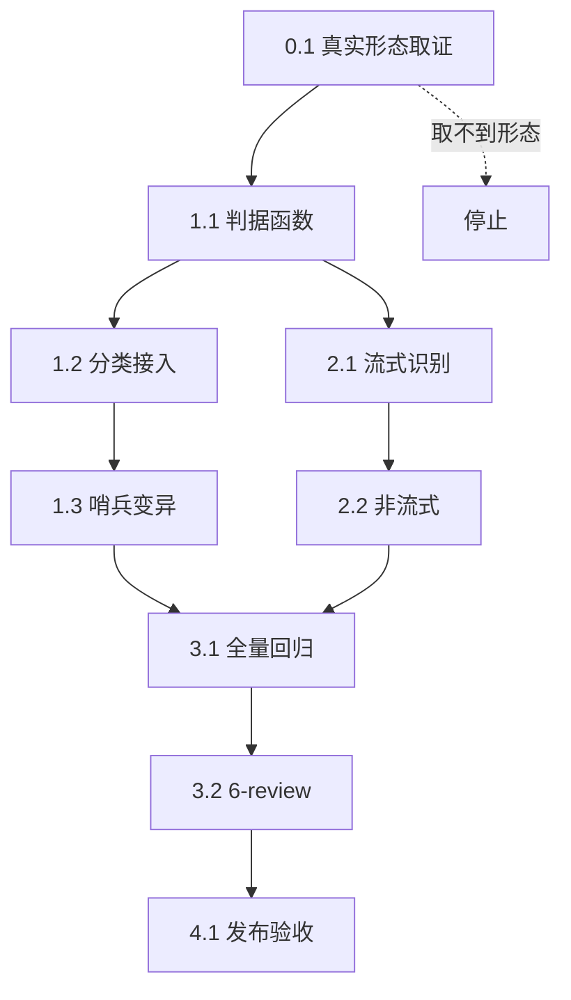

# workbuddy 把 content_filter 归入失败分类实施总览

当前计划最终方案的简要说明：在 workbuddy 侧新增 `isContentModerationFailure(body)` 判据，接在 `classifyUpstreamFailure` 的**第 3.5 步（模型级限流之后、传输/5xx 与账号级 4xx 之前）**，归入 `failureScopeModelRateLimit`；同时在**流式读取循环**里识别 `finish_reason=content_filter` 的终止分片，把它转成一次可记账的失败文本。理由是：`content_filter` 是「输出被审核截断」，与账号健康无关（不能禁号），但必须能记冷却让模型退出路由（不能直接丢弃）。

## agent 理解的问题 / 目标

### 问题

生产会话 `session-3304f06f` 实测 **42 次 `Response incomplete: content_filter`**，占全部 `finish=error` 的 84%，覆盖 31/37 个 turn。当前 workbuddy 对这类失败**完全不分类**：

1. `classifyUpstreamFailure`（`workbuddy/failure_class.go:98`）没有任何 content_filter 判据 → 落到第 7 步 `failureScopeNone`，既不写冷却也不禁用；
2. 流式路径（`workbuddy/stream.go:889`）只把 `finish_reason` 原样透传给客户端，从不作为失败处理；
3. 结果：模型 100% 被审时，插件没有任何机制让它退出路由，用户每一轮都白等一次完整生成。

### 与 traework 0.5.48 的关键差异（**必须区别对待，不能照抄**）

traework 的方案是「把判定上移到第 4.5 步，赶在账号级 4xx 之前」，因为它踩的坑是 `status==200 → 403` 重映射后被 `isAccountLevel4xxExcludingRateLimit` 吞掉。

workbuddy 的形态**不同**，有两个专属陷阱：

**陷阱 A：workbuddy 的 `content_filter` 不是错误帧，而是 `finish_reason` 值。**
宿主转译层 `F:\CLIProxyAPI\internal\translator\codex\openai\chat-completions\codex_openai_response.go:190-191` 把 `response.incomplete_details.reason=content_filter` 映射成 `choices.0.finish_reason="content_filter"`，这是**正常终止分片**，`sseErrorFrame()`（`stream.go:984`）永远返回空串。所以**只加 `classifyUpstreamFailure` 判据是无效的**——那条路径根本收不到这个文本。

**陷阱 B：正文已发出，不能换号重试。**
42/42 次 `content_filter` 都已产出正文（14 次还产出了 tool-call）。换号重试会产生两份语义冲突的回答（与 `streamReadErrorLeakedMarker` 注释里「正文一旦发出就不能重放」同理）。因此**只记冷却 + 驱逐绑定，不做同请求换号**。

### 本轮范围

- `workbuddy/policy.go`：新增 `isContentModerationFailure` 判据函数。
- `workbuddy/failure_class.go`：在 `classifyUpstreamFailure` 第 3.5 步接入，归 `failureScopeModelRateLimit`。
- `workbuddy/stream.go`：流式循环识别 `finish_reason=content_filter`，记一次模型维度冷却（`noteSSEErrorFailure`）。
- `workbuddy/policy_test.go` 或新增 `content_moderation_test.go`：判据与分类的表驱动测试。
- `workbuddy/CHANGELOG.md`：版本条目。

### 非范围

- 不改宿主 `F:\CLIProxyAPI`（跨项目只读）。
- 不改 traework / 其他插件。
- 不改 `isTransientUpstreamFailure` 的既有语义（content_filter 是确定性失败，本就不该等门限，但本轮不主动改它，避免扩散）。
- 不做同请求换号（见陷阱 B）。
- 不改 DSH 客户端侧。

## 关键假设 / 待确认点

| 假设 | 依据 | 若错则影响 |
|---|---|---|
| `finish_reason` 是 `"content_filter"` 字面量 | 宿主 `codex_openai_response.go:191` 显式赋值 | 判据匹配不到，功能无效 |
| 该分片是**空 delta + finish_reason**（无正文） | OpenAI 约定终止分片只带 finish_reason | 若带正文，需在 emit 前判定 |
| 上游可能还有 `content_filter` 的其他书写形态 | 未取证 | 判据漏判 |
| `noteSSEErrorFailure` 可承载非错误帧的记账 | `lifecycle.go:482` 只要求 body 文本 | 需确认它内部是否强制要求错误语义 |

**待确认点（实施前必须真实取证）**：生产 `usage feed` 中 `content_filter` 计数为 **0**，说明 workbuddy 侧从未记录过该失败——因此**必须先用真实上游响应确证 `finish_reason` 的确切形态**，不能只凭宿主代码推断。取证方式：临时在 `stream.go` 的 `aggregateSSEWithCollector` 加一条 debug 日志打印含 `finish_reason` 的非 stop 分片，跑一次真实请求后删除。

## 现状与落点（代码落点目录树）

```
F:\cpa-plugin\workbuddy\
├── policy.go            # 新增 isContentModerationFailure（判据）
├── failure_class.go     # classifyUpstreamFailure 第 3.5 步接入
├── stream.go            # 流式循环识别 finish_reason=content_filter
├── lifecycle.go         # 复用 noteSSEErrorFailure（不改）
├── content_moderation_test.go   # 新增：判据 + 分类 + 流式识别 三层断言
└── CHANGELOG.md         # 版本条目
```

## 实施周期与阶段计划

### 阶段 0：真实形态取证（**必须先做，阻断后续**）

1. 在 `stream.go:889` 附近临时加 debug 日志（打印 `finish` 值非 stop/空 的分片原文）。
2. 用真实 CN 账号对 `deepseek-v4-pro` 发一次会被审的请求（复现条件：中文成人向正文续写）。
3. 记录 `finish_reason` 精确字面量与分片结构（是否空 delta、是否带 usage）。
4. **立即删除临时日志**（`runtime-process-cleanup-rules` 口径）。

**验证点**：拿到 ≥1 条真实 `finish_reason=content_filter` 分片原文，且字面量与假设一致。

### 阶段 1：判据函数

**最小任务 1.1**：在 `policy.go` 新增 `isContentModerationFailure(body string) bool`。

匹配口径（按优先级，从严到宽）：

| 形态 | 匹配串 | 说明 |
|---|---|---|
| 宿主直出 | `"content_filter"` | `finish_reason` 值（含引号，避免误伤正文里的同名单词） |
| 上游原始 | `incomplete_details` + `content_filter` | `response.incomplete` 原始帧 |
| 兜底 | `sensitive content` | 与 traework 对齐的通用审核文案 |

**验证点**：表驱动单测覆盖上述 3 形态 + 4 组反例（正文中出现 "content_filter" 字样、`max_output_tokens`、`stop`、空串）。

**最小任务 1.2**：在 `failure_class.go` 的 `classifyUpstreamFailure` 第 3.5 步接入。

```go
// 3.5 内容审核拦截：上游把「输出被安全策略截断」以 200 + finish_reason=content_filter
//     （或 response.incomplete_details.reason）下发，属正常终止分片，不是错误帧。
//     落 model_rate_limit 而非 account：审核与账号健康无关，禁号会把整池逐个摘掉；
//     但必须记冷却，否则 100% 被审的模型没有任何机制退出路由。
//     2026-11-12 生产实证：session-3304f06f 42 次 content_filter，覆盖 31/37 turn。
if isContentModerationFailure(body) {
    return failureScopeModelRateLimit
}
```

**位置必须在第 4 步（传输/5xx）之前**：因为 `finish_reason` 形态下 `status==200`，不会被 5xx 分支命中；但若上游用 4xx 承载，必须在账号级 4xx 之前拦下（与 traework 同理）。

**验证点**：`TestClassifyUpstreamFailureTable` 新增 2 行断言；哨兵变异（把判定移到第 7 步之后）必须 FAIL。

### 阶段 2：流式路径识别（**本轮真正的修复点**）

**最小任务 2.1**：在 `stream.go` 的 `pumpUpstreamStream` 循环内，`cleanChunkJSON` 之后、`streamEmit` 之前，识别 `finish_reason=content_filter`：

```go
// 上游审核终止分片：finish_reason=content_filter 是正常终止（非错误帧），
// sseErrorFrame 捕获不到。此处显式记一次模型维度冷却，让持续被审的模型
// 退出路由。不换号：正文已发出，重试会产生两份冲突回答。
if isContentModerationFailure(content) {
    noteSSEErrorFailure(curAuthID, upstreamModel, content)
    contentEmitted = true
}
```

**关键约束**：
- 必须 `contentEmitted = true`（正文已出，禁止后续换号分支误判为零泄漏）；
- 分片本身要**照常 emit**（不能吞掉，否则客户端拿不到终止信号）；
- 不改 `aggregateCompletion` / `aggregateSSEWithCollector` 的非流式路径（非流式下 `finish_reason` 在 `choices.0.finish_reason`，需单独判定，见任务 2.2）。

**最小任务 2.2**：非流式 `aggregateCompletion`（`stream.go:815`）出口处，若 `finish=="content_filter"` 也记一次冷却。

**验证点**：新增 `TestContentFilterFinishReasonRecordsCooldown`，断言：① 分片仍被 emit；② `contentEmitted` 置 true；③ 冷却被记录。

### 阶段 3：测试与回归

**真实测试入口**（不是 build / lint）：

```powershell
# 1. CGO shim 全量（build + vet + test）
python scripts/cgo-shim-build.py workbuddy

# 2. 定向测试
python scripts/cgo-shim-build.py workbuddy --run "ContentModeration|ContentFilter|ClassifyUpstreamFailure"

# 3. 哨兵变异验证（判据移回第 7 步后必须 FAIL）
```

**通过标准**：三步全绿；哨兵变异被捕获；`TestClassifyUpstreamFailureMatchesLegacyCountGate` 等价性不被破坏。

### 阶段 4：生产验收

1. 发布到生产（`plugin-store install` 热重载）。
2. 观察 `docker logs cli-proxy-api | grep -i "content_filter\|content moderation"` 是否出现新记账日志。
3. 确认 `model_circuit` 对持续被审模型开闸。

**通过标准**：出现 ≥1 条 content_filter 冷却记录，且模型熔断可观测。

## 任务完成条件

- 判据函数 + 分类接入 + 流式识别三处全部落地；
- `cgo-shim-build.py workbuddy` build/vet/test 全绿；
- 哨兵变异被捕获；
- 阶段 0 的取证证据已写入 `doc/4-bugs/2026-11-12_010000_会话压缩阶段异常根因诊断.md`；
- 阶段 4 生产验收出现真实冷却记录。

## 任务停止 / 结束条件

- 阶段 0 取不到真实 `finish_reason=content_filter` 样本 → **立即停止**，回到归因阶段重新确认形态，不得凭猜测实现；
- 发现 `noteSSEErrorFailure` 会连带写盘禁用账号（即实际落到 `failureScopeAccount`）→ 停止，先修正分类落点；
- 发现格式/行为回归（`TestClassifyUpstreamFailureMatchesLegacyCountGate` 失败）→ 停止并回退该改动。

## 最大推进边界

- 只改 `workbuddy/` 下 5 个文件（`policy.go`、`failure_class.go`、`stream.go`、新增测试、`CHANGELOG.md`）；
- 不改 `F:\CLIProxyAPI`、不改 DSH、不改其他插件；
- 不引入新依赖；
- 不动 `isTransientUpstreamFailure` 既有语义；
- 不做同请求换号（陷阱 B）。

## 最小任务清单（按序，每项含真实测试）

| # | 任务 | 文件 | 真实测试 | 完成判据 |
|---|---|---|---|---|
| 0.1 | 真实形态取证 + 删临时日志 | `stream.go`（临时） | 真实上游请求 | 拿到 ≥1 条分片原文 |
| 1.1 | 新增 `isContentModerationFailure` | `policy.go` | 表驱动 7 用例 | 3 形态命中 + 4 反例不误伤 |
| 1.2 | 接入 `classifyUpstreamFailure` 第 3.5 步 | `failure_class.go` | `TestClassifyUpstreamFailureTable` +2 行 | 分类为 `model_rate_limit` |
| 1.3 | 哨兵变异验证 | 测试 | 移到第 7 步 | 测试 FAIL |
| 2.1 | 流式识别 + 记冷却 + 禁换号 | `stream.go` | 新增流式用例 | emit 保留 + 冷却记录 |
| 2.2 | 非流式出口判定 | `stream.go` | 新增聚合用例 | finish=content_filter 记冷却 |
| 3.1 | 全量回归 | — | `cgo-shim-build.py workbuddy` | build/vet/test 全绿 |
| 3.2 | 6-review 风格回归 | — | `code-style-consistency-rules` | STYLE: PASS |
| 4.1 | 发布 + 生产验收 | — | `plugin-store install` + 日志 | 出现真实冷却记录 |

## 依赖图



## 风险与取舍

| 风险 | 缓解 |
|---|---|
| `content_filter` 字面量判断误伤正文 | 匹配带引号的 `"content_filter"`，且只在 finish_reason 语义位置判定 |
| 审核失败把整池账号摘光 | 归 `failureScopeModelRateLimit`，`disablesAccount()==false` |
| 记冷却后健康号被误伤 | 模型级冷却 60s 起、阶梯退避，一次成功即清零 |
| 正文已出后仍换号 | 显式 `contentEmitted = true` + 复用 `shouldRotateOnStreamReadError` 既有判据 |
