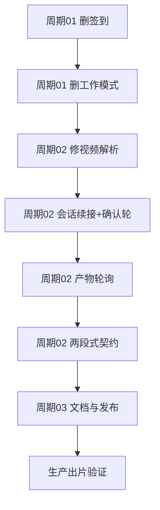
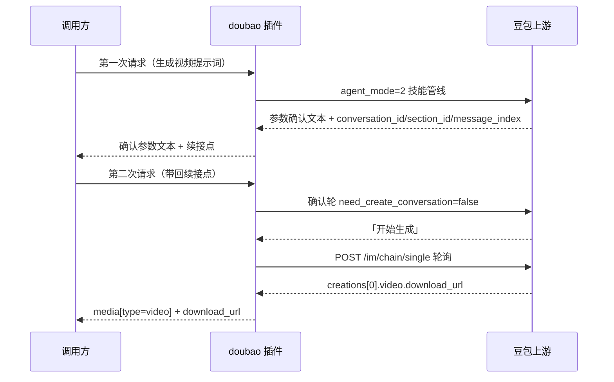

# 需求实施总览：doubao 插件改造为图片与视频专用

结论：把 doubao-provider 从「工作模式对话 + 图片 + 视频 + 签到 + 额度」的综合插件裁成只做图片与视频生成的专用插件，视频走「首轮确认 → 调用方二次确认 → 轮询取片」两段式并对齐真实网页请求形态；影响：所有通过本插件调 `doubao/*` 模型的调用方与面板使用者；范围：删签到、删工作模式对话、修正视频解析与会话续接、新增产物轮询、收敛模型目录与面板文案；非范围：不新增账号体系、不改宿主、不改图片链路语义、不改凭据导出；变化：`doubao/image` 保持现有体验，`doubao/video` 由「只回参数确认」变为能真正拿到视频直链，模型列表只剩图片与视频两类；完成标准：`/v1/models` 仅含 image 与 video 语义模型，`doubao/video` 在真机账号上能返回 `download_url`，签到与工作模式相关代码与配置全部消失且 `cgo-shim-build` 全绿；术语说明：工作模式指 `agent_mode=1` 的客户端对话管线、技能模式指 `agent_mode=2` 的网页技能管线、确认轮指视频生成里 `need_create_conversation=false` 的第二次续接请求；验证状态：需求侧已由真实浏览器抓包取证（首轮只有参数确认文本、产物由 `/im/chain/single` 回落），代码侧尚未改动。

## 1. 当前计划最终方案简要说明

- 推荐方案一句话结论：先做「减法」把插件裁成图片专用稳定基线，再单独做「视频出片」这条独立闭环，最后收口文档与发布。
- 主落点 / 主路径：`F:\cpa-plugin\doubao` 下的 `models.go`（模型目录）、`completion.go`（请求构造与会话续接）、`creation.go` / `creation_parse.go`（产物解析）、新增 `video_chain.go`（`/im/chain/single` 轮询）；先删后建，避免在旧的分支树上叠加新逻辑。
- 为什么先走这条路线：裁剪与视频出片是两件互不依赖的事。若先做视频，所有视频探针都要在一个还挂着工作模式分支的请求构造器上做实验，一旦失败无法区分是视频逻辑错还是工作模式残留干扰；先裁到「只有技能管线」再调视频，失败面唯一。

## 2. 基本信息

- 对应需求文档：`doc/2-需求/2026-11-16_234500_doubao插件改造为图片与视频专用需求.md`
- 来源对象标识（需求或 Bug）：doubao插件改造为图片与视频专用需求
- 当前实施文档命名主干：`2026-11-17_001500_doubao插件改造为图片与视频专用需求`
- 对应需求与实施计划全量顺序实施方案：N/A + 原因：本仓库当期只有这一个来源对象，不存在跨需求排序需求 + 证据：`doc/2-需求/` 下 2026-11-16 仅新增本需求文档一份。
- 实施计划完成条件（`AC-*`）所在章节：本文第 5 章各最小任务的「任务完成条件」与第 9 章真实测试安排。
- 对应 `6-review` 风格回归记录：`doc/6-review/{datetime}_doubao插件改造为图片与视频专用需求_6-review.md`（周期 03 的 TASK-015 产出）。
- agent 理解的问题 / 目标：用户明确「只做图片和视频的插件，其他的都不做」，且已确认视频要「一次做到出片，但要求调用方显式发第二次确认」以控额度。
- 当前计划范围：删签到链路、删工作模式对话链路、修正视频产物解析、打通会话续接与确认轮、新增产物轮询、收敛模型目录与面板文案、真机验证与发布。
- 明确不在范围：不改宿主 `CLIProxyAPI`；不改图片链路的同步产物语义；不改凭据导入导出与书签授权流程；不引入新的账号池或调度策略；不做视频水印去除（上游 `download_url` 本身无水印）。
- 当前优先闭环：周期 01 的 TASK-001 —— 把签到链路整条删掉并跑绿门禁，先验证「减法」不会破坏编译与面板。
- 关键假设 / 待确认点：见第 10.2 节 `FEAS-*`，其中 `FEAS-002`（确认轮请求形态可复现）与 `FEAS-003`（`/im/chain/single` 可用插件签名直接调用）是任务级未验证假设，执行期第一动作必须先验证。
- 跨会话执行入口：见第 2.3 节。
- 主项目地址、仓库类型与代码基线：`F:\cpa-plugin`（Go c-shared 插件仓库），基线 `HEAD = f032d8a`（0.1.25 已生产上线）。
- local 环境与依赖入口：Windows + `python scripts/cgo-shim-build.py doubao`（无 CGO 的等价构建/测试入口）；Go 模块缓存 `C:\Users\luode\go\pkg\mod`。
- 外部项目代码引用：N/A + 原因：本轮只改本仓库 `doubao/` 目录内代码，不引用其他项目源码 + 证据：需求文档与本章落点均限定在 `F:\cpa-plugin\doubao`。
- 当前状态：未开始编码，工作树干净（`git status --porcelain doubao/` 为空）。
- 是否已获得开始实施授权：是（用户 m13634 明确要求改造，并在 m13786 前后通过选择框确认了视频深度与裁剪范围）。

## 2.1 决策维度覆盖表

| 维度 | 状态 | 结论 / 依据 / 用户所选项 / 未决原因 |
| --- | --- | --- |
| 架构 / 技术路线 | 已弹窗且用户已选 | 视频走「首轮确认 + 调用方二次确认 + 轮询取片」两段式；不做「插件内部自动确认」。 |
| 代码落点（目录 / 包 / 文件） | 已确定 | 全部在 `doubao/` 包内；新增 `video_chain.go` 与其测试。 |
| 实现方式 | 已确定 | 先删后建：周期 01 删签到与工作模式，周期 02 再加视频闭环。 |
| 命名 | 已确定 | 沿用现有 `xxxForYyy` 风格；新增 `videoChainRequest` / `pullVideoAssets` / `buildConfirmOption`。 |
| 注释 | 已确定 | 按 `comment-rules`：函数头含 `[参数]` / `[返回]` / `最近修改时间`，体内部骤编号。 |
| 日志 | 已确定 | 沿用 `log.Printf("[doubao] ...")` 前缀。 |
| 错误处理 / 异常 | 已确定 | 上游错误码继续走 `upstreamError` + `streamErrorHint`；轮询超时返回明确中文文案。 |
| 数据模型 / 表 / 字段 | 已确定 | 无数据库；`creationVideo` 结构体按真实抓包改字段。 |
| 接口契约 | 已确定 | 对宿主的 OpenAI 契约不变；新增扩展字段承载视频续接点。 |
| 依赖与库 | 已确定 | 不新增第三方依赖，只用标准库 + 现有 `pluginapi`。 |
| 测试策略 / 样本 | 已定方案待执行 | 代码级用 `cgo-shim-build`；接口级用生产 `/v1/chat/completions`；真机用 CDP 抓包对照。 |
| 其它：裁剪边界 | 已弹窗且用户已选 | 删签到、删工作模式对话、删「令牌监控」（**该条需纠正，见第 11 章**）。 |

## 2.2 待用户选择清单

无（所有真实不确定决策点已由用户选定）。另有一条需要在实施前向用户说明的纠正：用户勾选的「删令牌监控 tokenbeat」在本插件里没有对应的独立能力（`main.go` 的 `UsagePlugin` 恒为 `false`），而 `tokenbeat.go` 实际是书签授权换 Cookie 的唯一实现，删掉会切断整个授权链路。本计划按「保留 `tokenbeat.go`、不新增用量上报」执行，并在周期 01 的 TASK-003 显式记录。

## 2.3 跨会话独立执行与外部项目代码引用清单

- 新会话接手第一步：读本文第 5 章找到当前未完成的 `TASK-*`，再读该任务的周期文档，按「实现 → 真实测试 → 6-review」顺序继续。
- 主项目地址与项目根：`F:\cpa-plugin`（仓库根），插件目录 `F:\cpa-plugin\doubao`。
- 主项目代码基线：`HEAD = f032d8a`（`chore(registry): doubao-provider 0.1.25`）。
- 计划源文件与版本：本文 + `doc/2-需求/2026-11-16_234500_doubao插件改造为图片与视频专用需求.md`。
- 依赖安装、local 配置和服务启动入口：`python scripts/cgo-shim-build.py doubao`（构建 + vet + test）；生产验证走 `https://cpa.luode.vip/v1/chat/completions`。
- 中断点核验顺序：`git status --porcelain doubao/` → `git log --oneline -3` → 重跑 `python scripts/cgo-shim-build.py doubao` → 检查当轮 `$env:TEMP` 临时探针与 Chrome 调试实例是否已清理。
- 外部项目代码引用：N/A + 原因：不引用其他项目源码 + 证据：本轮改动全部落在 `F:\cpa-plugin\doubao`。

## 3. 实施周期总览

- 总周期说明：三个周期串行推进，每个周期内部按最小任务逐个闭环。
- 本次计划拆分的子任务周期数：3。
- 周期拆分原则：按「减法（恢复稳定基线）→ 加法（视频出片）→ 收口（文档与发布）」切，每个周期都能独立编译、独立验证、独立回滚。
- 周期排序说明：先减后加，理由见第 1 章。
- 周期 1：
  - 周期序号 / 期次定位：第一期，裁剪为图片专用骨架。
  - 周期目标：插件只剩技能管线（`agent_mode=2`）与图片生成能力，签到与工作模式相关代码、配置、面板、测试全部消失，门禁全绿。
  - 本周期包含的最小任务：TASK-001 ~ TASK-006。
  - 周期内最小任务执行顺序：TASK-001 → 002 → 003 → 004 → 005 → 006。
  - 进入条件：需求文档已落盘，工作树干净。
  - 收口条件：六个任务各自「实现 + 真实测试 + 6-review」通过，`python scripts/cgo-shim-build.py doubao` 输出 `all green (doubao)`，`doubao/image` 在生产仍能出图。
  - 完成标志：`grep -r "checkin\|WorkMode\|workModelAliases" doubao/*.go` 无业务命中。
  - 与前后周期衔接：本周期只做删除与收敛，不改视频逻辑；周期 02 在本周期基线上加视频。
- 周期 2：
  - 周期序号 / 期次定位：第二期，视频一次做到出片。
  - 周期目标：`doubao/video` 在真实账号上能返回 `download_url`，且额度由调用方二次确认控制。
  - 本周期包含的最小任务：TASK-007 ~ TASK-013。
  - 周期内最小任务执行顺序：TASK-007 → 008 → 009 → 010 → 011 → 012 → 013。
  - 进入条件：周期 01 收口，插件只剩技能管线。
  - 收口条件：视频产物解析、会话续接、确认轮、轮询四段都有真实测试证据，非流式与流式两条出口都能返回视频。
  - 完成标志：生产 `/v1/chat/completions` 对 `doubao/video` 二次确认后返回含 `media[].type=="video"` 且 URL 可下载的响应。
  - 与前后周期衔接：本周期不碰文档与发布配置，留给周期 03。
- 周期 3：
  - 周期序号 / 期次定位：第三期，文档、真机验证与发布。
  - 周期目标：README / CHANGELOG / 面板文案与新能力一致，`6-review` 落盘，0.1.26 发布并生产验证。
  - 本周期包含的最小任务：TASK-014 ~ TASK-015。
  - 周期内最小任务执行顺序：TASK-014 → 015。
  - 进入条件：周期 02 收口。
  - 收口条件：版本号、CHANGELOG、review 文档、测试文档齐备，CI `Release` 成功，生产 `install` 后 `hot reloaded` 且二进制 sha256 与本地一致。
  - 完成标志：生产 `GET /v1/models` 只剩图片与视频语义模型，`doubao/video` 真机出片。
  - 与前后周期衔接：发布后本需求闭环。
- 总体真实测试安排：
  - 真实测试安排是否默认必需：是（涉及可执行行为变更）。
  - 覆盖哪些最小任务：TASK-001 ~ TASK-015 全部。
  - 公共测试环境 / 依赖：Windows + Go 1.26 + `python scripts/cgo-shim-build.py doubao`；真机验证用生产账号与 CDP 9645 的 Chrome。
  - 公共样本 / 数据来源：`$env:TEMP\acct_A.json`（欧皇小德子账号快照）、`$env:TEMP\zz_vidc_net_C1.json`（真实确认轮请求）、`$env:TEMP\zz_chain_CH1.json`（真实产物回落响应）。
  - 总体通过标准：`all green (doubao)` + 生产接口返回可下载产物 + `6-review` 输出 `STYLE: PASS`。

## 4. 阶段计划

- 阶段 1：
  - 阶段名称：删除签到链路。
  - 阶段目标：签到相关代码、路由、面板 UI、定时器全部移除且不影响其余功能。
  - 只做这一件事：只删签到，不碰工作模式。
  - 输入条件：周期 01 开始。
  - 输出产物：无 `checkin.go` / `checkin_test.go`；`management.go` 少两条路由；`main.go` 无 `ensureCheckinScheduler`；`panel.html` 无签到区块。
  - 验证门槛：`cgo-shim-build` 全绿，面板可加载，`/accounts`、`/test-active` 正常。
- 阶段 2：
  - 阶段名称：删除工作模式对话链路。
  - 阶段目标：插件只剩 `agent_mode=2` 技能管线与图片生成。
  - 只做这一件事：只删工作模式，不碰视频。
  - 输入条件：阶段 1 收口。
  - 输出产物：`models.go` 无 `workModelAliases` 与 `default`/`pro` 别名；`completion.go` 无 `buildWorkOption` / `workModeExt`；`generationMode.WorkMode` 字段消失；`main.go` 无 `work_*` 配置。
  - 验证门槛：`cgo-shim-build` 全绿，`doubao/image` 真实出图，未知模型名返回明确错误。
- 阶段 3：
  - 阶段名称：修正视频产物解析。
  - 阶段目标：`creationVideo` 结构体与真实回包字段一致，`assetFromVideo` 能取到 `download_url`。
  - 只做这一件事：只改解析，不改请求。
  - 输入条件：阶段 2 收口 + `$env:TEMP\zz_chain_CH1.json` 样本在位。
  - 输出产物：解析层单测覆盖 `download_url` / `video_model` / `cover.image_thumb` / 字符串宽高四种真实形态。
  - 验证门槛：用真实样本反序列化后 `creationAsset.URL` 非空且 `isVideo()` 为真。
- 阶段 4：
  - 阶段名称：打通会话续接与确认轮。
  - 阶段目标：首轮拿到 `conversation_id`/`section_id`/`message_index`，确认轮按真实网页形态重发。
  - 只做这一件事：只做请求层，不做轮询。
  - 输入条件：阶段 3 收口。
  - 输出产物：`collectCompletion` 支持续接点；`buildConfirmOption` 产出确认轮 option。
  - 验证门槛：真机确认轮返回 200 且 SSE 里出现「开始生成」类文本。
- 阶段 5：
  - 阶段名称：新增产物轮询。
  - 阶段目标：确认轮之后通过 `/im/chain/single` 拿到视频直链。
  - 只做这一件事：只做轮询与产物注入。
  - 输入条件：阶段 4 收口。
  - 输出产物：新增 `video_chain.go`；响应 `media[]` 含 `type=="video"`。
  - 验证门槛：真机端到端拿到可下载 URL。
- 阶段 6：
  - 阶段名称：收口与发布。
  - 阶段目标：文档、CHANGELOG、review、版本、CI、生产安装全部落地。
  - 只做这一件事：只做收口动作，不改业务逻辑。
  - 输入条件：阶段 5 收口。
  - 输出产物：0.1.26 上线。
  - 验证门槛：`hot reloaded` 记录 + 二进制 sha256 一致 + 生产出片。

## 5. 最小任务清单

- 最小任务 1：
  - 任务名：TASK-001 删除签到后端链路
  - 所属周期：周期 01
  - 周期内顺序：1
  - 所属阶段：阶段 1
  - 本任务只做这一件事：删除签到后端代码与两条管理路由。
  - 垂直切片目标：`grep -rn checkin doubao/*.go` 零命中，门禁全绿。
  - 输入条件：工作树干净。
  - 实现产出：删 `checkin.go`、`checkin_test.go`；`management.go` 删 `/checkin/status`、`/checkin/run` 与对应 `Resources`；`main.go` 删 `ensureCheckinScheduler()` 调用。
  - 真实测试是否必需：是。
  - 真实测试入口：`python scripts/cgo-shim-build.py doubao`
  - 真实测试依赖环境：Windows + Go 1.26。
  - 真实测试样本 / 数据来源：无外部样本，编译与既有单测即为验证。
  - 真实测试通过标准：`OK: go build ./...` / `OK: go vet ./...` / `ok ...` / `all green (doubao)`。
  - 测试点：编译通过；原有 `management_test.go` 里非签到路由用例仍绿。
  - `6-review` 风格回归点：删除后不得留下空文件、孤儿 import、悬空注释。
  - 任务完成条件：`AC-001` 编译与单测全绿且 `grep -rn "checkin\|Checkin" doubao/*.go` 返回空。
  - 任务停止 / 结束条件：门禁全绿即停，不顺手清理其他历史死代码。
  - 阻断条件：删除后出现其他文件对签到符号的引用且不属于本任务范围。
  - 前置依赖：无。
  - 下一任务依赖：TASK-002 依赖本任务的 `panel.html` 之外部分已清空。
  - 预计触达文件数：4。
- 最小任务 2：
  - 任务名：TASK-002 删除签到面板 UI
  - 所属周期：周期 01
  - 周期内顺序：2
  - 所属阶段：阶段 1
  - 本任务只做这一件事：删除 `panel.html` 里签到按钮、签到区块渲染与 `/checkin/*` 调用。
  - 垂直切片目标：面板可正常打开且无签到元素、无 404 请求。
  - 输入条件：TASK-001 收口。
  - 实现产出：`panel.html` 删 `#checkinBtn`（`:216`）、`ck-panel` 样式（`:561` 起）、`lastCheckin` 缓存与 `checkinBlock`/`ckQuotaText`/`loadCheckin`/`runCheckin`（`:564-640`）、卡片里的 `checkinBlock(a)` 拼接（`:671`）、首屏补签到数据的逻辑（`:738`）。
  - 真实测试是否必需：是。
  - 真实测试入口：`node --check` 等价校验（提取 `<script>` 后 `new Function`）+ 生产面板打开。
  - 真实测试依赖环境：Node 24 + 生产面板 URL。
  - 真实测试样本 / 数据来源：`F:\cpa-plugin\doubao\panel.html`。
  - 真实测试通过标准：脚本语法校验通过；面板加载后浏览器控制台无 `ReferenceError`，网络面板无 `/checkin` 请求。
  - 测试点：无残留函数引用；`renderCards` 仍能正常渲染账号卡片。
  - `6-review` 风格回归点：删除后 CSS 无失效选择器、JS 无未使用变量。
  - 任务完成条件：`AC-002` 面板可打开且无签到相关请求与报错。
  - 任务停止 / 结束条件：面板验证通过即停。
  - 阻断条件：面板其他区块依赖被删函数。
  - 前置依赖：TASK-001。
  - 下一任务依赖：TASK-003。
  - 预计触达文件数：1。
- 最小任务 3：
  - 任务名：TASK-003 收敛模型目录为图片与视频
  - 所属周期：周期 01
  - 周期内顺序：3
  - 所属阶段：阶段 2
  - 本任务只做这一件事：删 `workModelAliases` 与 `default`/`pro` 能力别名，重写 `modeForModel` 为严格解析。
  - 垂直切片目标：`/v1/models` 只剩 `doubao/image` 与 `doubao/video`（加上游透传前的静态目录）。
  - 输入条件：TASK-002 收口。
  - 实现产出：`models.go` 删 `workModelAliases`、`defaultWorkModelID` 引用点、`aliasForWorkModel`；`capabilityAliases` 只留 `image` 与 `video`；`modeForModel` 改为「命中技能别名返回、未命中返回 `(generationMode{}, false)`」；`testableAliases` / `testableModelDetails` / `aliasForTestModel` 同步收敛；`models_test.go` 同步。
  - 真实测试是否必需：是。
  - 真实测试入口：`python scripts/cgo-shim-build.py doubao` + 生产 `GET /v1/models`。
  - 真实测试依赖环境：Go 1.26 + 生产管理 API。
  - 真实测试样本 / 数据来源：插件静态目录。
  - 真实测试通过标准：单测全绿；`/v1/models` 里 `doubao/` 前缀条目只剩 image 与 video（上游透传条目按上游返回）。
  - 测试点：未知模型名必须返回明确错误而非静默回落。
  - `6-review` 风格回归点：删除后 `models.go` 不得残留未使用常量。
  - 任务完成条件：`AC-003` 模型目录收敛且未知模型名有明确错误分支。
  - 任务停止 / 结束条件：门禁与目录验证通过即停。
  - 阻断条件：`modelForAuth` 的上游透传逻辑依赖被删符号。
  - 前置依赖：TASK-002。
  - 下一任务依赖：TASK-004。
  - 预计触达文件数：2。
- 最小任务 4：
  - 任务名：TASK-004 删除工作模式请求构造
  - 所属周期：周期 01
  - 周期内顺序：4
  - 所属阶段：阶段 2
  - 本任务只做这一件事：删 `buildWorkOption` / `workModeExt` / 工作模式分支与相关类型字段。
  - 垂直切片目标：`buildCompletionRequest` 只有一条技能管线分支。
  - 输入条件：TASK-003 收口。
  - 实现产出：`completion.go` 删 `buildWorkOption`、`workModeExt`、`buildCompletionRequest` 里的 `if mode.WorkMode` 分支与 `workConversationMode` 相关赋值；`protocol.go` 删工作模式常量；`completion_test.go` / `workmode_test.go`（整文件删）同步。
  - 真实测试是否必需：是。
  - 真实测试入口：`python scripts/cgo-shim-build.py doubao`
  - 真实测试依赖环境：Go 1.26。
  - 真实测试样本 / 数据来源：既有单测。
  - 真实测试通过标准：`all green (doubao)`。
  - 测试点：技能模式请求体的 22 个默认值字段断言仍通过。
  - `6-review` 风格回归点：`completion.go` 注释不得再描述工作模式。
  - 任务完成条件：`AC-004` 编译全绿且 `grep -n "WorkMode\|buildWorkOption" doubao/*.go` 为空。
  - 任务停止 / 结束条件：门禁全绿即停。
  - 阻断条件：`generationMode` 的其他使用点无法在不改视频逻辑的前提下收敛。
  - 前置依赖：TASK-003。
  - 下一任务依赖：TASK-005。
  - 预计触达文件数：4（含整文件删除）。
- 最小任务 5：
  - 任务名：TASK-005 删除工作模式配置项
  - 所属周期：周期 01
  - 周期内顺序：5
  - 所属阶段：阶段 2
  - 本任务只做这一件事：删 `Config` 的 `work_*` 七个字段与 `ConfigFields` 声明。
  - 垂直切片目标：插件配置面板只剩超时与缓存三项。
  - 输入条件：TASK-004 收口。
  - 实现产出：`main.go` 删 `WorkBotID` / `WorkModeID` / `WorkReasoningEffort` / `WorkMemoryProfile` / `WorkTotalWindow` / `WorkEnableSandbox` / `WorkWorkspace` 字段、`defaultConfig()` 对应项、`configurePlugin` 对应覆盖逻辑、`ConfigFields` 七条声明。
  - 真实测试是否必需：是。
  - 真实测试入口：`python scripts/cgo-shim-build.py doubao` + 生产 `GET /v0/management/plugins/doubao-provider/config`。
  - 真实测试依赖环境：Go 1.26 + 生产管理 API。
  - 真实测试样本 / 数据来源：插件默认配置。
  - 真实测试通过标准：单测全绿；配置接口只剩三项且无 `work_` 键。
  - 测试点：旧配置里带 `work_*` 时反序列化不报错（yaml 宽松）。
  - `6-review` 风格回归点：`main.go` 常量块不得残留孤儿注释。
  - 任务完成条件：`AC-005` 配置项收敛且旧配置向后兼容。
  - 任务停止 / 结束条件：配置验证通过即停。
  - 阻断条件：`botID` 回退逻辑依赖 `WorkBotID`。
  - 前置依赖：TASK-004。
  - 下一任务依赖：TASK-006。
  - 预计触达文件数：2。
- 最小任务 6：
  - 任务名：TASK-006 收敛活跃测试
  - 所属周期：周期 01
  - 周期内顺序：6
  - 所属阶段：阶段 2
  - 本任务只做这一件事：让 `runActiveTest` 只支持图片与视频两类模型。
  - 垂直切片目标：面板「测试模型」下拉只剩 image 与 video。
  - 输入条件：TASK-005 收口。
  - 实现产出：`active_ping.go` 删 `defaultWorkModelID` 回落、调整成功文案里的 `model_item_key` 表述（技能管线无该值）；`active_ping_test.go` 同步；`main.go` 里 `work_*` 相关测试模型列表同步。
  - 真实测试是否必需：是。
  - 真实测试入口：`python scripts/cgo-shim-build.py doubao` + 生产 `POST /v0/management/plugins/doubao-provider/test-active`。
  - 真实测试依赖环境：Go 1.26 + 生产管理 API + 一个可用账号。
  - 真实测试样本 / 数据来源：生产账号（当前仅 `欧皇小德子`）。
  - 真实测试通过标准：单测全绿；`test-active` 对 `doubao/image` 返回成功。
  - 测试点：对 `doubao/deepseek-v4-flash` 之类已删模型返回「不支持的测试模型」。
  - `6-review` 风格回归点：成功文案不得再提「网页链路默认模型」这类工作模式术语。
  - 任务完成条件：`AC-006` 活跃测试只认 image 与 video。
  - 任务停止 / 结束条件：测试通过即停。
  - 阻断条件：面板测试需要至少一个活跃账号，若账号不可用则记为受限交接项。
  - 前置依赖：TASK-005。
  - 下一任务依赖：周期 02 的 TASK-007。
  - 预计触达文件数：3。
- 最小任务 7：
  - 任务名：TASK-007 修正视频产物结构体
  - 所属周期：周期 02
  - 周期内顺序：1
  - 所属阶段：阶段 3
  - 本任务只做这一件事：按真实回包改 `creationVideo` 与封面结构。
  - 垂直切片目标：真实 JSON 能反序列化出 `download_url`。
  - 输入条件：周期 01 收口 + `$env:TEMP\zz_chain_CH1.json` 在位。
  - 实现产出：`creation.go` 里 `creationVideo` 增 `Vid` / `DownloadURL` / `VideoType` / `DownloadFileHash`；宽高改 `json.Number` 或字符串兼容类型；`Cover` 改新结构 `creationCover{Key, ImageThumb, ImagePreview}`；`VideoModel` 保留为字符串（内层 JSON 延迟解析）。
  - 真实测试是否必需：是。
  - 真实测试入口：`go test -run TestCreationVideo`（新增用例读真实样本）。
  - 真实测试依赖环境：Go 1.26。
  - 真实测试样本 / 数据来源：`$env:TEMP\zz_chain_CH1.json` 里 `creations[0].video` 原文（需先固化为 `doubao/testdata/video_creation.json`）。
  - 真实测试通过标准：`DownloadURL` 非空、`Status == 3`、`Duration ≈ 10.08`。
  - 测试点：字符串宽高 `"384"` 与数字 `384` 都要能解析。
  - `6-review` 风格回归点：结构体字段注释必须写清「对应上游哪个键」。
  - 任务完成条件：`AC-007` 真实样本解析出非空 `DownloadURL`。
  - 任务停止 / 结束条件：解析通过即停，不做多清晰度解析（延后）。
  - 阻断条件：样本文件缺失。
  - 前置依赖：周期 01 收口。
  - 下一任务依赖：TASK-008。
  - 预计触达文件数：3（含 testdata）。
- 最小任务 8：
  - 任务名：TASK-008 修正视频产物提取
  - 所属周期：周期 02
  - 周期内顺序：2
  - 所属阶段：阶段 3
  - 本任务只做这一件事：让 `assetFromVideo` 按新结构取地址。
  - 垂直切片目标：`creationAsset.URL` 对视频不再为空。
  - 输入条件：TASK-007 收口。
  - 实现产出：`creation_parse.go` 的 `assetFromVideo` 改为取 `video.DownloadURL` → `video.Cover.ImagePreview.URL` → `video.Cover.ImageThumb.URL`；`Type` 仍为 2；`Width`/`Height` 转 int。
  - 真实测试是否必需：是。
  - 真实测试入口：`go test -run TestAssetFromVideo`。
  - 真实测试依赖环境：Go 1.26。
  - 真实测试样本 / 数据来源：TASK-007 固化的 testdata。
  - 真实测试通过标准：`isVideo()` 为真且 `URL` 非空。
  - 测试点：`cover` 只有缩略图时也能取到兜底地址。
  - `6-review` 风格回归点：步骤编号注释与既有 `assetFromImage` 一致。
  - 任务完成条件：`AC-008` 视频资产地址非空。
  - 任务停止 / 结束条件：单测通过即停。
  - 阻断条件：无。
  - 前置依赖：TASK-007。
  - 下一任务依赖：TASK-009。
  - 预计触达文件数：2。
- 最小任务 9：
  - 任务名：TASK-009 会话续接点贯通
  - 所属周期：周期 02
  - 周期内顺序：3
  - 所属阶段：阶段 4
  - 本任务只做这一件事：把 `conversation_id`/`section_id`/`message_index` 从请求贯穿到 `buildCompletionRequest`。
  - 垂直切片目标：第二次请求能带上一轮的三个续接点。
  - 输入条件：TASK-008 收口。
  - 实现产出：`completion.go` 的 `collectCompletion` 增加 `lastSectionID` / `lastMessageIndex` 入参（现在恒为空/0）；`executor.go` 从 `chatRequest` 扩展字段解析并传入；`completion_test.go` 增续接点透传断言。
  - 真实测试是否必需：是。
  - 真实测试入口：`go test -run TestCollectCompletionResume`（httptest 校验请求体 `client_meta`）。
  - 真实测试依赖环境：Go 1.26。
  - 真实测试样本 / 数据来源：`zz_vidc_net_C1.json` 里确认轮的 `client_meta` 原文。
  - 真实测试通过标准：请求体 `client_meta` 三字段与入参一致，`last_message_index` 显式输出数字。
  - 测试点：`lastMessageIndex == 0` 时仍输出 `null`（新会话语义不变）。
  - `6-review` 风格回归点：新增入参必须有函数头 `[参数]` 说明。
  - 任务完成条件：`AC-009` 续接点可透传。
  - 任务停止 / 结束条件：单测通过即停。
  - 阻断条件：`buildCompletionRequest` 签名变更影响调用点超过 5 个。
  - 前置依赖：TASK-008。
  - 下一任务依赖：TASK-010。
  - 预计触达文件数：3。
- 最小任务 10：
  - 任务名：TASK-010 确认轮请求形态
  - 所属周期：周期 02
  - 周期内顺序：4
  - 所属阶段：阶段 4
  - 本任务只做这一件事：新增「确认轮」option 构造。
  - 垂直切片目标：确认轮请求体与真实网页逐字段一致。
  - 输入条件：TASK-009 收口。
  - 实现产出：`completion.go` 新增 `buildConfirmOption(mode, needCreate=false)`：`agent_mode` / `conversation_mode` 留零值、`aggregate_params` 全空串、`model_config.model_item_key` 空串、`need_create_conversation=false`；`protocol.go` 补 `confirmText` 常量说明；`completion_test.go` 增形态断言。
  - 真实测试是否必需：是。
  - 真实测试入口：`go test -run TestBuildConfirmOption` + 真机确认轮一次。
  - 真实测试依赖环境：Go 1.26 + 生产账号。
  - 真实测试样本 / 数据来源：`zz_vidc_net_C1.json` 索引 0 的请求体。
  - 真实测试通过标准：形态断言全过；真机确认轮 HTTP 200 且收到「开始生成」类文本。
  - 测试点：`need_create_conversation` 必须为 false，否则上游会新建会话导致产物落到别的会话。
  - `6-review` 风格回归点：不得与 `buildSkillOption` 合并成一个带布尔开关的函数（两者语义不同）。
  - 任务完成条件：`AC-010` 确认轮形态与真实网页一致。
  - 任务停止 / 结束条件：真机确认轮成功即停。
  - 阻断条件：账号进入人机验证态（`710022004`）时记为受限交接项。
  - 前置依赖：TASK-009。
  - 下一任务依赖：TASK-011。
  - 预计触达文件数：3。
- 最小任务 11：
  - 任务名：TASK-011 新增产物轮询客户端
  - 所属周期：周期 02
  - 周期内顺序：5
  - 所属阶段：阶段 5
  - 本任务只做这一件事：新增 `/im/chain/single` 拉取与解析。
  - 垂直切片目标：能从一个 `conversation_id` 拉回视频 `creations`。
  - 输入条件：TASK-010 收口。
  - 实现产出：新增 `video_chain.go`：`type videoChainRequest`（`cmd=3100` / `uplink_body.pull_singe_chain_uplink_body` 全字段）、`func pullChainMessages(ctx, sa, convID string) ([]chainMessage, error)`、`func collectChainAssets(messages []chainMessage) []creationAsset`、`func pollVideoAssets(ctx, sa, convID string, timeout time.Duration) ([]creationAsset, error)`。
  - 真实测试是否必需：是。
  - 真实测试入口：`go test -run TestPullChainMessages`（httptest 校验请求体）+ 真机一次。
  - 真实测试依赖环境：Go 1.26 + 生产账号。
  - 真实测试样本 / 数据来源：`zz_chain_CH1.json`（响应）、`zz_vidc_net_C1.json` 索引 6/7（请求）。
  - 真实测试通过标准：请求体与真实抓包一致；真机拉回 `creations` 且解析出 `download_url`。
  - 测试点：`has_more` 与 `anchor_index` 的翻页语义；超时必须返回明确中文错误。
  - `6-review` 风格回归点：新文件需文件头注释说明来源与用途。
  - 任务完成条件：`AC-011` 轮询能拿到视频直链。
  - 任务停止 / 结束条件：真机拿到 URL 即停，不做增量推送订阅。
  - 阻断条件：`/im/chain/single` 需要额外签名或风控头。
  - 前置依赖：TASK-010。
  - 下一任务依赖：TASK-012。
  - 预计触达文件数：2（新增）。
- 最小任务 12：
  - 任务名：TASK-012 两段式对外契约
  - 所属周期：周期 02
  - 周期内顺序：6
  - 所属阶段：阶段 5
  - 本任务只做这一件事：非流式出口按两段式返回。
  - 垂直切片目标：首轮返回确认参数 + 续接点；第二轮返回视频。
  - 输入条件：TASK-011 收口。
  - 实现产出：`executor.go` 识别请求里是否带续接点：无则走首轮并把 `conversation_id`/`section_id`/`message_index` 放进响应扩展字段；有则走确认轮 + 轮询；`creation_render.go` 让视频 `media[]` 用 `download_url`。
  - 真实测试是否必需：是。
  - 真实测试入口：生产 `POST /v1/chat/completions` 两轮。
  - 真实测试依赖环境：生产插件 + 可用账号。
  - 真实测试样本 / 数据来源：真实账号与真实提示词（每轮提示词不同，避免风控）。
  - 真实测试通过标准：首轮 `choices[0].message.content` 含参数确认文本且带续接点扩展；第二轮 `media[0].type=="video"` 且 URL 可下载。
  - 测试点：未带续接点却要求出片时给出明确中文提示，不静默失败。
  - `6-review` 风格回归点：扩展字段命名必须在 README 与代码注释里一致。
  - 任务完成条件：`AC-012` 非流式两段式可用。
  - 任务停止 / 结束条件：真机出片即停。
  - 阻断条件：账号额度不足或人机验证。
  - 前置依赖：TASK-011。
  - 下一任务依赖：TASK-013。
  - 预计触达文件数：4。
- 最小任务 13：
  - 任务名：TASK-013 流式出口适配视频
  - 所属周期：周期 02
  - 周期内顺序：7
  - 所属阶段：阶段 5
  - 本任务只做这一件事：流式路径在视频场景下正确收尾。
  - 垂直切片目标：`stream=true` 时视频帧以 `media` 扩展下发而非只发文本占位。
  - 输入条件：TASK-012 收口。
  - 实现产出：`executor_stream.go` 与 `creation_render.go` 的 `streamAssetFrames` 让视频帧携带 `media` 扩展；`pumpCompletionStream` 的收尾顺序调整。
  - 真实测试是否必需：是。
  - 真实测试入口：生产 `POST /v1/chat/completions`（`stream=true`）两轮。
  - 真实测试依赖环境：生产插件 + 可用账号。
  - 真实测试样本 / 数据来源：真实账号。
  - 真实测试通过标准：流里出现含视频 URL 的帧，最后有 `finish_reason=stop`。
  - 测试点：视频帧不得只因文本占位就判「无输出」。
  - `6-review` 风格回归点：流式与非流式的视频渲染口径必须一致。
  - 任务完成条件：`AC-013` 流式视频可用。
  - 任务停止 / 结束条件：真机流式出片即停。
  - 阻断条件：宿主流式通道对大帧有限制。
  - 前置依赖：TASK-012。
  - 下一任务依赖：TASK-014。
  - 预计触达文件数：3。
- 最小任务 14：
  - 任务名：TASK-014 文档与面板文案收敛
  - 所属周期：周期 03
  - 周期内顺序：1
  - 所属阶段：阶段 6
  - 本任务只做这一件事：让 README / CHANGELOG / 面板文案与「只做图片与视频」一致。
  - 垂直切片目标：用户从文档与面板能看懂两段式视频用法。
  - 输入条件：周期 02 收口。
  - 实现产出：`doubao/README.md` 重写能力与模型章节、补两段式视频示例；`doubao/CHANGELOG.md` 加 0.1.26 条目；`panel.html` 顶部说明与测试文案调整。
  - 真实测试是否必需：否（纯文档与纯文案）。
  - 真实测试入口：N/A + 理由：只改文档与展示文案，不改可执行行为。
  - 真实测试依赖环境：N/A。
  - 真实测试样本 / 数据来源：N/A。
  - 真实测试通过标准：N/A。
  - 测试点：面板文案改动后仍需通过语法校验。
  - `6-review` 风格回归点：文档与代码注释口径一致。
  - 任务完成条件：`AC-014` 文档与面板无过时能力描述。
  - 任务停止 / 结束条件：文档落盘即停。
  - 阻断条件：无。
  - 前置依赖：TASK-013。
  - 下一任务依赖：TASK-015。
  - 预计触达文件数：3。
- 最小任务 15：
  - 任务名：TASK-015 真机验证、6-review 与发布
  - 所属周期：周期 03
  - 周期内顺序：2
  - 所属阶段：阶段 6
  - 本任务只做这一件事：完成收口链。
  - 垂直切片目标：0.1.26 生产可用。
  - 输入条件：TASK-014 收口。
  - 实现产出：测试主文档追加章节、`doc/6-review/..._6-review.md`、`VERSION` 与 `main.go` 版本号、commit/push、CI dispatch、registry、生产 install。
  - 真实测试是否必需：是。
  - 真实测试入口：`python scripts/cgo-shim-build.py doubao` + 生产接口 + `docker logs` 热重载记录。
  - 真实测试依赖环境：Go 1.26 + 生产主机 + 管理 API。
  - 真实测试样本 / 数据来源：真实账号。
  - 真实测试通过标准：门禁全绿、`Release` job 成功、`hot reloaded active_version=0.1.26`、生产出片。
  - 测试点：二进制 sha256 与本地 zip 一致。
  - `6-review` 风格回归点：`STYLE: PASS`。
  - 任务完成条件：`AC-015` 生产 0.1.26 可用且证据齐全。
  - 任务停止 / 结束条件：发布验证完成即停，不做额外优化。
  - 阻断条件：CI 平台构建失败或账号不可用。
  - 前置依赖：TASK-014。
  - 下一任务依赖：无（需求闭环）。
  - 预计触达文件数：5。

## 6. 现状与落点

- 涉及目录：`F:\cpa-plugin\doubao`（全部代码）、`F:\cpa-plugin\doc`（文档）。
- 涉及文件 / 模块：见下方目录树。
- 复用点：`creation_parse.go` 的 `parseCreationBlock` / `collectCreationAssets`（图片与视频共用）、`sign.go` 的 `signChatCompletionURL`、`cookiejar.go` 的 `durableJar`、`failover.go` 的冷却阶梯、`export.go` 的凭据导出。
- 需要新增的内容：`video_chain.go` 与其测试、视频解析 testdata、两段式契约的扩展字段。

```text
doubao/
├── video_chain.go                     # 新增：/im/chain/single 拉取与产物解析、轮询
├── video_chain_test.go                # 新增：请求体形态与响应解析单测
├── testdata/
│   └── video_creation.json            # 新增：真实视频 creations 样本（来自抓包）
├── creation.go                        # 改：video/cover 结构体字段对齐真实回包
├── creation_parse.go                  # 改：assetFromVideo 取 download_url
├── creation_render.go                 # 改：视频 media 段携带 download_url
├── completion.go                      # 改：删工作模式；续接点入参；buildConfirmOption
├── models.go                          # 改：只留 image/video 别名，modeForModel 收敛
├── protocol.go                        # 改：删工作模式常量，补确认轮常量
├── main.go                            # 改：删 work_* 配置与签到定时器
├── management.go                      # 改：删 /checkin/* 路由
├── active_ping.go                     # 改：只支持 image/video
├── executor.go                        # 改：两段式识别与续接点透传
├── executor_stream.go                 # 改：流式视频收尾
└── panel.html                         # 改：删签到区块，改文案
```

## 7. 方案选择

- 方案 A（推荐）：先删后建。周期 01 把插件裁到只剩技能管线与图片，周期 02 再独立打通视频。
- 方案 B：直接在当前代码上加视频逻辑，裁剪留到最后统一做。
- 方案 C：保留工作模式但把视频挂到工作模式管线。
- 推荐方案与原因：选 A。B 的问题是视频探针会在一个同时存在两条请求构造分支的代码里跑，失败无法归因；C 已被真实抓包否定——网页视频首轮用的是 `agent_mode=2`、`model_item_key="0"`，不是工作模式。

## 8. 实施步骤

1. 第一步：删签到后端（TASK-001）
   - 所属周期：周期 01
   - 所属阶段：阶段 1
   - 对应最小任务：TASK-001
   - 本步只做：删 `checkin.go` / `checkin_test.go` / 两条管理路由 / 定时器调用。
2. 第二步：删签到面板（TASK-002）
   - 所属周期：周期 01
   - 所属阶段：阶段 1
   - 对应最小任务：TASK-002
   - 本步只做：删 `panel.html` 里签到按钮、区块、脚本与样式。
3. 第三步：收敛模型目录（TASK-003）
   - 所属周期：周期 01
   - 所属阶段：阶段 2
   - 对应最小任务：TASK-003
   - 本步只做：删 `workModelAliases` 与 `default`/`pro`，重写 `modeForModel`。
4. 第四步：删工作模式请求构造（TASK-004）
   - 所属周期：周期 01
   - 所属阶段：阶段 2
   - 对应最小任务：TASK-004
   - 本步只做：删 `buildWorkOption` / `workModeExt` / 分支与常量。
5. 第五步：删工作模式配置（TASK-005）
   - 所属周期：周期 01
   - 所属阶段：阶段 2
   - 对应最小任务：TASK-005
   - 本步只做：删 `work_*` 七个配置字段与声明。
6. 第六步：收敛活跃测试（TASK-006）
   - 所属周期：周期 01
   - 所属阶段：阶段 2
   - 对应最小任务：TASK-006
   - 本步只做：让 `runActiveTest` 只认 image/video。
7. 第七步：修正视频结构体（TASK-007）
   - 所属周期：周期 02
   - 所属阶段：阶段 3
   - 对应最小任务：TASK-007
   - 本步只做：按真实回包改 `creationVideo` 与封面结构。
8. 第八步：修正视频提取（TASK-008）
   - 所属周期：周期 02
   - 所属阶段：阶段 3
   - 对应最小任务：TASK-008
   - 本步只做：`assetFromVideo` 取 `download_url`。
9. 第九步：续接点贯通（TASK-009）
   - 所属周期：周期 02
   - 所属阶段：阶段 4
   - 对应最小任务：TASK-009
   - 本步只做：`collectCompletion` 支持续接点入参。
10. 第十步：确认轮形态（TASK-010）
    - 所属周期：周期 02
    - 所属阶段：阶段 4
    - 对应最小任务：TASK-010
    - 本步只做：新增 `buildConfirmOption`。
11. 第十一步：产物轮询（TASK-011）
    - 所属周期：周期 02
    - 所属阶段：阶段 5
    - 对应最小任务：TASK-011
    - 本步只做：新增 `video_chain.go`。
12. 第十二步：非流式两段式（TASK-012）
    - 所属周期：周期 02
    - 所属阶段：阶段 5
    - 对应最小任务：TASK-012
    - 本步只做：`executor.go` 两段式识别与返回。
13. 第十三步：流式适配（TASK-013）
    - 所属周期：周期 02
    - 所属阶段：阶段 5
    - 对应最小任务：TASK-013
    - 本步只做：流式视频帧携带 media。
14. 第十四步：文档收敛（TASK-014）
    - 所属周期：周期 03
    - 所属阶段：阶段 6
    - 对应最小任务：TASK-014
    - 本步只做：README / CHANGELOG / 面板文案。
15. 第十五步：收口发布（TASK-015）
    - 所属周期：周期 03
    - 所属阶段：阶段 6
    - 对应最小任务：TASK-015
    - 本步只做：测试文档、review、版本、CI、生产安装。

## 9. 真实测试安排

- 真实测试总表：

| 任务 | 测试类型 | 入口 | 通过标准 |
| --- | --- | --- | --- |
| TASK-001~006 | 代码级 | `python scripts/cgo-shim-build.py doubao` | `all green (doubao)` |
| TASK-002 | 页面级 | 生产面板打开 + 控制台检查 | 无报错、无 `/checkin` 请求 |
| TASK-003、TASK-006 | 接口级 | 生产 `/v1/models`、`/test-active` | 模型列表收敛、测试成功 |
| TASK-007~009、TASK-011 | 代码级 | `go test -run Test...`（httptest + testdata） | 断言全过 |
| TASK-010、TASK-012、TASK-013 | 接口级 + 真机 | 生产 `/v1/chat/completions` 两轮 | 首轮带续接点、第二轮出片 |
| TASK-015 | 发布级 | CI + `docker logs` + sha256 | `Release` 成功、`hot reloaded`、sha 一致 |

- 免测任务及理由：TASK-014 为纯文档与纯展示文案改动，不改可执行行为，按 `test-strategy-rules` 标记 N/A。

- 步骤 1~6 真实测试 / 验证：`cgo-shim-build` 全绿；`grep -rn "checkin\|WorkMode\|workModelAliases" doubao/*.go` 为空；生产 `doubao/image` 仍出图。
- 步骤 7~11 真实测试 / 验证：`go test` 全绿；真实样本解析出 `download_url`；真机确认轮返回 200。
- 步骤 12~15 真实测试 / 验证：生产两轮请求拿到视频；CI `Release` 成功；`hot reloaded active_version=0.1.26`。

## 10. 图形化执行路径

- 流程图（Mermaid `flowchart`）：



- 时序图（Mermaid `sequenceDiagram`，视频两段式）：



- 泳道表（按需）：N/A + 原因：本计划只有单一实施主线，无需泳道。

## 10.1 图片资产决策、生成与引用

- 图片资产决策：N/A + 原因：本计划为代码改造，不产出需要视觉审查的设计图或对比图 + 证据：所有证据均为 JSON 文本与终端输出。
- 必需场景与 Mermaid 边界：流程与时序已由 Mermaid 表达；无 UI 原型或视觉对比需求。
- 生成输入与命令：N/A。
- 目标资产与命名：N/A。
- Markdown 引用：N/A。
- 资产清单：N/A。

## 10.2 可行性探针与假设清单

- `FEAS-001`：
  - 假设内容：视频产物在网页端由 `/im/chain/single` 回落，不在 `/chat/completion` 的 SSE 内。
  - 影响面：方向级。
  - 探针级别：L2 隔离真实。
  - 验证方式：真实 Chrome 抓包一次视频全流程（已执行）。
  - 结论：已探针验证。
  - 证据：`$env:TEMP\zz_vid_net_T1.json` 与 `zz_chain_CH1.json`；首轮 965 个请求零 `creations` 端点，产物只在 `/im/chain/single` 响应里。
  - 关联 `TASK-*`：TASK-011。
- `FEAS-002`：
  - 假设内容：确认轮请求形态（`agent_mode`/`conversation_mode`/`model_item_key` 全空、`need_create_conversation=false`）可由插件复现并被上游接受。
  - 影响面：任务级。
  - 探针级别：L2 隔离真实。
  - 验证方式：真机发一次确认轮，看是否 HTTP 200 且出现「开始生成」。
  - 结论：未验证。
  - 证据：抓包已有真实请求体（`zz_vidc_net_C1.json` 索引 0），但插件侧未重放。
  - 关联 `TASK-*`：TASK-010、TASK-012。
- `FEAS-003`：
  - 假设内容：`/im/chain/single` 可用插件现有签名与 Cookie 直接调用。
  - 影响面：任务级。
  - 探针级别：L2 隔离真实。
  - 验证方式：真机 POST 一次，看是否 200 且 `status_code=0`。
  - 结论：未验证。
  - 证据：该端点在 `sign.go:52` 的 `bdmsIncludePaths` 白名单里，但从未被调用过。
  - 关联 `TASK-*`：TASK-011。
- 探针执行记录：L1 只读（读代码与抓包文件）已完成；L2 隔离真实（真机重放确认轮与 chain 拉取）留到 TASK-010 与 TASK-011 的执行期第一动作。
- 未验证假设处置：`FEAS-002` 与 `FEAS-003` 为任务级未验证，已在 TASK-010 / TASK-011 的前置条件写明「执行期第一动作先验证，不成立则停止并回写计划」。

## 11. 风险与阻断项

- 风险：
  - 视频额度消耗：每次真机确认轮都会消耗每日免费额度，故一律低频、每轮提示词不同。
  - 账号状态：当前只有 `欧皇小德子` 一个账号，若进入人机验证态（`710022004`）会阻断所有真机验证。
  - 上游结构漂移：`creations[].video` 字段可能再变，解析层需以真实样本为回归基线。
  - `download_url` 有效期：`url_expire` 是时间戳，响应里的 URL 不能长期缓存。
  - **裁剪纠正**：用户勾选的「删令牌监控 tokenbeat」在本插件没有对应独立能力（`UsagePlugin` 恒 `false`），而 `tokenbeat.go` 是书签授权换 Cookie 的唯一实现。本计划保留该文件，只在文档层面确认「不做用量上报」。若用户后续坚持删除，需先补一套替代的换 Cookie 实现，否则整个授权链路断裂。
- 依赖：Go 1.26；`python scripts/cgo-shim-build.py`；生产管理 API `https://cpa.luode.vip`；CDP Chrome 157。
- 任务停止 / 结束条件总表：每个任务的「任务停止 / 结束条件」已在上表逐条写明；任一任务在阻断条件下停住时，必须回写本文对应任务与需求文档，不得静默跳过。

## 12. 数据库变更 SQL

- 建表 SQL：N/A + 原因：插件不使用数据库。
- 字段变更 SQL：N/A + 原因：同上。

## 13. 自审结论

- 覆盖度检查：需求文档三条核心诉求（只做图片视频、视频出片、额度可控）均映射到周期 01~03 的任务。
- 实施周期检查：三个周期各自可独立编译与验证，顺序为先减后加。
- 最小任务闭环检查：15 个任务各自写明实现、真实测试、6-review 与停止条件。
- 阶段单一目标检查：六个阶段各自只做一件事。
- 占位词检查：无「待补充」「后续再定」类占位；`FEAS-002`/`FEAS-003` 为显式未验证假设并写明执行期第一动作。
- 可执行性检查：每个任务都给出文件级落点与命令级测试入口。
- 图文一致性检查：Mermaid 步骤与第 8 章 15 步一致。
- 用户确认状态：需求方向、视频深度、裁剪范围三项已由用户确认；「删 tokenbeat」一项需按第 11 章纠正。
- 执行后回看（2026-11-17 02:10:00）：`FEAS-002` 与 `FEAS-003` 均已被真机证成立（确认轮形态可复现、chain 端点可插件直调）；TASK-003 与 TASK-004 实际合并执行（`workmode_test.go` 与已删别名强耦合，分开编译过不去）；周期 01/02 全部闭环，周期 03 待做。

## 执行附录

- local 环境：Windows 11 + Go 1.26 + Node 24 + Chrome 157。
- 周期内执行步骤：每个任务固定顺序为「读现状 → 改代码 → `cgo-shim-build` → 真实测试 → 6-review → 更新本文状态」。
- 命令：`python scripts/cgo-shim-build.py doubao`（在 `F:\cpa-plugin` 根跑）；`go test -run <Name> ./...`（在 shim 目录跑）。
- 样本：`$env:TEMP\zz_vidc_net_C1.json`、`$env:TEMP\zz_chain_CH1.json`、`$env:TEMP\acct_A.json`；固化到 `doubao/testdata/` 后不再依赖临时目录。
- 预期失败：`FEAS-002` / `FEAS-003` 若不成立，表现为确认轮 200 但无「开始生成」文本，或 chain 端点返回非 0 `status_code`。
- 清理与回滚：临时探针、Chrome 调试实例、`$env:TEMP\zz_*` 在每周期收口时清理；代码回滚用 `git checkout -- doubao/`。

## 追踪附录

- `SRC -> DEC -> REQ/RULE -> AC -> CYCLE -> TASK -> TEST -> EVIDENCE`：
  - `SRC-001`（m13634 只做图片视频）→ `DEC-01`（裁剪范围）→ `REQ-01` → `AC-001~006` → `CYCLE-01` → `TASK-001~006` → `TEST-01`（cgo-shim-build）→ `EVIDENCE-01`（门禁输出）。
  - `SRC-002`（m13634 视频出片）→ `DEC-02`（两段式）→ `REQ-02` → `AC-007~013` → `CYCLE-02` → `TASK-007~013` → `TEST-02`（go test + 生产两轮）→ `EVIDENCE-02`（真实 URL）。
  - `SRC-003`（收口发布）→ `DEC-03`（0.1.26）→ `REQ-03` → `AC-014~015` → `CYCLE-03` → `TASK-014~015` → `TEST-03`（CI + 生产）→ `EVIDENCE-03`（hot reloaded + sha256）。
- 图片资产清单：N/A。
