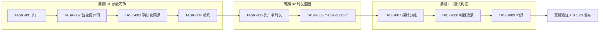
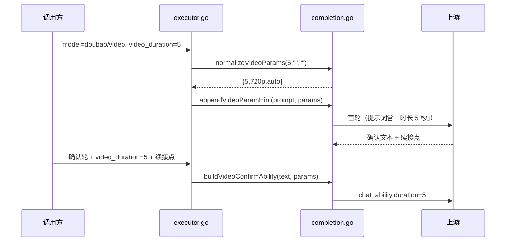

# doubao 视频参数可配置与面板测试判据收紧 实施总览

当前计划最终方案的简要说明：把视频确认轮的四个参数从 `protocol.go` 常量提升为「调用方可传、缺省回落常量」的请求字段，由 `completion.go` 在首轮提示词与确认轮 `chat_ability` 两处使用同一套值；`creationAsset` 增加 `Duration` 并透传到 `media[]`；`active_ping.go` 按 `generationMode.Kind` 分组探针提示词，并把成功判据从「有任意输出」改为「解析到创作块」。主落点是 `completion.go`（参数注入与提示词拼装）与 `active_ping.go`（判定），因为这两处分别是「偏差产生点」与「假阳性产生点」，其余文件只做字段透传。

agent 对当前问题的理解：0.1.27 把视频两段式打通后，暴露出三个与「协议正确」无关、但与「结果可信」有关的问题 —— 上游对用户承诺的时长与插件实际提交的时长不一致；调用方从 `media` 里读不到实际时长；面板「测试」把「账号能聊天」误报成「账号能生图」。本轮只修这三处，不动协议形态。

## 2. 基本信息

| 项 | 内容 |
| --- | --- |
| 来源对象 | `F:\cpa-plugin\doc\2-需求\2026-11-17_213000_doubao视频参数可配置与测试判据收紧.md` |
| 仓库 | `luode0320/cpa-workbuddy-plugin`，物理目录 `F:\cpa-plugin` |
| 代码基线 | `HEAD = 3402355`（0.1.27 生产在线） |
| 目标版本 | 0.1.28 |
| 本轮范围 | `REQ-FUNC-001` 视频参数可传、`REQ-FUNC-002` `media` 回填时长、`REQ-FUNC-003` 面板测试判据 |
| 非范围 | 两段式协议形态、模型目录、账号池/冷却、签到额度、数据库与配置项 |
| 当前优先闭环 | `REQ-FUNC-001`（参数可传）→ `REQ-FUNC-002`（时长回显）→ `REQ-FUNC-003`（测试判据） |
| 关键假设 | ① 调用方原意再次携带续接点，多带三个标量无成本；② 面板测试只等创作块首帧，不等成品地址 |
| 待确认点 | 无 `P0`/`P1`；`DEC-001` 为 `P2` 默认决策，证据见需求文档 5.3 |

### 2.1 决策维度覆盖表

| 维度 | 本轮决策 | 依据 |
| --- | --- | --- |
| 参数来源 | 调用方显式传，不解析上游自然语言 | `DEC-001`（需求 5.3） |
| 缺省行为 | 不传时与 0.1.27 逐字节一致 | `AC-001` 负向断言 |
| 越界处理 | 回落常量，不报错 | 需求 5.3 归一规则 |
| 时长单位 | 秒，整型入参、浮点出参 | 上游 `video.duration` 是 float |
| 参数生效范围 | 仅 `doubao/video`；`doubao/image` 忽略 | 需求 3.4 |
| 探针分组 | 按 `generationMode.Kind` 分两组 | 需求 `REQ-FUNC-003` |
| 测试成功判据 | 必须解析到创作块 | `SRC-003` |
| 测试失败文案 | 必须区分「上游报错」与「能出字但没出图」 | 需求 4.2 |
| 视频测试等待 | 只等创作块首帧 | 需求 4.3 风险表 |
| 改动边界 | 11 个文件，无新增文件 | 需求 3.5 目录树 |
| 版本策略 | 0.1.28 单版本一次性发布 | 三项共享同一次门禁 |
| 回滚方式 | 单次 commit 可整体 revert，无数据迁移 | 无持久化改动 |

### 2.2 待用户选择清单

无。三项改动均为需求文档已冻结的确定方向，`DEC-001` 由用户 m15748 采纳的推进顺序覆盖。

### 2.3 跨会话执行与外部引用

- 主项目地址：`F:\cpa-plugin`，仓库 `luode0320/cpa-workbuddy-plugin`，基线 `3402355`。
- 新会话接手第一步：`cd F:\cpa-plugin; python scripts/cgo-shim-build.py doubao` 确认基线全绿。
- local 环境入口：无数据库/缓存/外部服务依赖；真机验证走生产账号，凭据从宿主 `/v0/management/plugins/doubao-provider/accounts` 导出。
- 中断点核验顺序：先 `git status --porcelain doubao/` 看残留，再跑门禁，再对本文档第 3 章周期状态表定位断点。
- `EXT-*` 外部项目引用：`N/A`，原因：本轮只改本仓库 `doubao/` 包内代码，不引用其他项目源码；证据：需求文档 3.5 目录树全部落在 `doubao/`。

## 3. 实施周期总览

| 周期 | 定位 | 目标 | 最小任务 | 进入条件 | 收口条件 |
| --- | --- | --- | --- | --- | --- |
| 01 | 参数可传与一致性 | `REQ-FUNC-001` | TASK-001~004 | 需求文档已落盘、基线门禁全绿 | 首轮提示词与确认轮 `ability_param` 同源，缺省路径零变化 |
| 02 | 响应回填真实时长 | `REQ-FUNC-002` | TASK-005~006 | 周期 01 收口 | `media[].duration` 等于产物时长，图片无该键 |
| 03 | 面板测试判据收紧 | `REQ-FUNC-003` | TASK-007~009 | 周期 02 收口 | 纯文本帧判失败、创作块帧判成功，文案可区分 |

## 4. 阶段计划

| 阶段 | 周期 | 只做一件事 | 产出 | 验证点 |
| --- | --- | --- | --- | --- |
| S1 | 01 | 定义视频参数类型与归一 | `videoParams` 结构与缺省/越界规则 | 单测覆盖合法、越界、缺省三态 |
| S2 | 01 | 把参数注入两段请求 | 首轮提示词拼装 + 确认轮 `ability_param` | 两处取值相等的单测 |
| S3 | 02 | 让时长进入响应 | `creationAsset.Duration` + `media[].duration` | 视频带值、图片不带键 |
| S4 | 03 | 分组探针提示词 | 按 `Kind` 取提示词 | 两组提示词互不出现在对方请求里 |
| S5 | 03 | 收紧成功判据 | 创作块判定 + 失败文案 | 纯文本帧判失败、创作块帧判成功 |

## 5. 最小任务清单

### TASK-001 定义视频参数结构与归一

- 只做这一件事：在 `protocol.go` 新增 `videoParams` 结构与归一函数，保留四个常量作为缺省值。
- 垂直切片目标：任何调用方都能得到「一份已归一的视频参数」，越界值不抛错。
- 实现产出：`type videoParams struct { Duration int; Resolution string; Ratio string }`、`func normalizeVideoParams(duration int, resolution, ratio string) videoParams`、`func (p videoParams) isDefault() bool`。
- 触达文件：`protocol.go`、`protocol_test.go`（新建？否 —— 复用 `request_test.go`）。
- 真实测试入口：`request_test.go` 新增 `TestNormalizeVideoParams`。
- 通过标准：`(0,"","")` → `{10,"720p","auto"}`；`(5,"1080p","9:16")` 原样；`(-3,"  ","")` → 缺省；`(120,"720p","auto")` → 缺省（越界）。
- `6-review` 回归点：新标识符命名、注释分层、常量注释是否仍成立。
- 完成条件：`AC-001` 的归一分支全部覆盖。
- 停止条件：归一函数写完且单测通过。
- 阻断条件：若发现 `videoConfirmModel` 也需可传，暂停并回需求域（模型选择不在本轮范围）。
- 前置依赖：无。下一任务依赖：TASK-002 使用该结构。

### TASK-002 首轮提示词携带参数

- 只做这一件事：让 `doubao/video` 首轮提示词带上非缺省参数。
- 实现产出：`func appendVideoParamHint(prompt string, params videoParams) string`；在 `executor.go` / `executor_stream.go` 拿到 `mode` 之后、调 `runWithFailover` / `collectStreamResponse` 之前调用（仅 `mode.Kind == "video"` 时）。
- 触达文件：`executor.go`、`executor_stream.go`、`completion.go`（放函数）。
- 真实测试入口：`completion_test.go` 新增 `TestAppendVideoParamHint`；`executor_test.go` 断言 payload 抓到的提示词含参数。
- 通过标准：缺省参数时提示词**逐字节不变**；`duration=5` 时提示词含「5 秒」且含 `1080p` / `9:16`（若传）。
- `6-review` 回归点：提示词拼装位置是否在两条执行路径都覆盖。
- 完成条件：`AC-001`。
- 停止条件：两条路径都注入且单测通过。
- 阻断条件：若提示词追加导致上游拒答（真机验证），回退到「不追加、只改 `ability_param`」并记入 bug 文档。
- 前置依赖：TASK-001。

### TASK-003 确认轮使用同一套参数

- 只做这一件事：让 `buildVideoConfirmAbility` 从 `videoParams` 取四个值而不是常量。
- 实现产出：`buildVideoConfirmAbility(text string, params videoParams)`；`chatRequest` 新增 `VideoDuration int` / `VideoResolution string` / `VideoRatio string` 三个可选字段；`runWithFailover` 与两条执行路径把 `videoParams` 传到 `buildCompletionRequestWith`。
- 触达文件：`completion.go`、`executor.go`、`executor_stream.go`、`executor_failover.go`。
- 真实测试入口：`request_test.go` 的 `TestBuildConfirmOptionMatchesWebShape` 扩展；新增 `TestBuildConfirmOptionUsesRequestedParams`。
- 通过标准：传 `duration=5` 时 `ability_param.duration == 5`；不传时 == 10；`ratio` / `resolution` 同理。
- `6-review` 回归点：签名变更影响面（`runWithFailover` 有多个测试调用点）。
- 完成条件：`AC-001`。
- 停止条件：两段取值一致的断言通过。
- 阻断条件：`runWithFailover` 调用点超过 5 个需重新评估（当前 3 处生产 + 2 处测试）。
- 前置依赖：TASK-001/002。

### TASK-004 参数一致性哨兵

- 只做这一件事：用一条哨兵证明「首轮与确认轮同源」不是巧合。
- 实现产出：把 `buildVideoConfirmAbility` 里的 `params.Duration` 临时换成常量 `videoConfirmDuration`，`TestBuildConfirmOptionUsesRequestedParams` 必须失败。
- 完成条件：哨兵真失败 + 恢复后全绿。
- 停止条件：哨兵失败文本已记录。
- 前置依赖：TASK-003。

### TASK-005 `creationAsset` 增加时长与解析

- 只做这一件事：把产物时长读进 `creationAsset`。
- 实现产出：`creationAsset` 新增 `Duration float64`；`assetFromVideo` 从 `video.Duration` 填充（`video.Duration` 已在 0.1.26 解析）。
- 触达文件：`creation.go`、`creation_parse.go`、`creation_test.go`。
- 真实测试入口：`creation_test.go` 的 `TestParseCreationBlockVideo` 增加 `Duration == 10.08` 断言。
- 通过标准：视频资产的 `Duration > 0`；图片资产恒为 0（无该字段）。
- `6-review` 回归点：`mergeAssets` 是否需要合并 `Duration`（需要，末帧才补时长）。
- 完成条件：`AC-002`。
- 停止条件：单测通过且 `mergeAssets` 已补合并分支。
- 前置依赖：周期 01 收口。

### TASK-006 `media[]` 输出时长

- 只做这一件事：让 `mediaExtension` 输出 `duration`。
- 实现产出：视频条目在 `Duration > 0` 时写入 `item["duration"]`。
- 触达文件：`creation_render.go`、`creation_test.go`。
- 真实测试入口：新增 `TestMediaExtensionCarriesVideoDuration`。
- 通过标准：视频条目有 `duration` 且等于资产值；图片条目无该键。
- `6-review` 回归点：`duration` 是否会污染图片条目。
- 完成条件：`AC-002`。
- 停止条件：单测通过。
- 前置依赖：TASK-005。

### TASK-007 探针提示词按能力分组

- 只做这一件事：让面板测试按 `Kind` 取不同提示词。
- 实现产出：`testPingPrompts` 拆成 `testPingPromptsImage` / `testPingPromptsVideo`；`testPingPrompt(kind string) string` 按组轮换（两组各自用独立的原子计数器，避免互相干扰）。
- 触达文件：`active_ping.go`、`active_ping_prompt_test.go`、`active_ping_test.go`。
- 真实测试入口：`TestTestPingPromptRotates` 改为按组断言；新增 `TestTestPingPromptGroupsDiffer`。
- 通过标准：图片组全部是「画/生成一张……」语义；视频组全部是「生成一段……视频」；两组互不相交。
- `6-review` 回归点：两个计数器命名与注释。
- 完成条件：`AC-003`。
- 停止条件：单测通过。
- 前置依赖：周期 02 收口。

### TASK-008 成功判据收紧到创作块

- 只做这一件事：让 `image` / `video` 模式必须看到创作块才算成功。
- 实现产出：`activeTestOutput` 增加第二个返回值（是否携带创作块）；`runActiveTest` 对 `mode.Kind != ""` 时要求该标志；失败文案区分「上游报错」「能出字但没能出图/出片」「没有任何输出」。
- 触达文件：`active_ping.go`、`active_ping_test.go`。
- 真实测试入口：新增 `TestRunActiveTestRequiresCreationForImage`（只回文本的帧序列 → 失败且文案含「没能出图」）、`TestRunActiveTestAcceptsCreationBlock`（带 `block_type=2074` 的帧 → 成功）。
- 通过标准：纯文本帧判失败；创作块帧判成功；`textMode` 路径行为不变。
- `6-review` 回归点：`contentOutput` 是否被误改（保留，供 `textMode` 与预览用）。
- 完成条件：`AC-003`。
- 停止条件：两条用例一绿一红按预期。
- 阻断条件：若上游在视频模式下从不下发创作块占位帧，改判据为「看到 `SSE_REPLY_END` 且无错误」并记入 bug 文档。
- 前置依赖：TASK-007。

### TASK-009 判据收紧的哨兵

- 只做这一件事：证明新判据真的能拦住假阳性。
- 实现产出：把 `runActiveTest` 里「必须创作块」的判断临时去掉，`TestRunActiveTestRequiresCreationForImage` 必须失败。
- 完成条件：哨兵真失败 + 恢复后全绿。
- 停止条件：失败文本已记录。
- 前置依赖：TASK-008。

## 6. 现状与落点

```text
F:\cpa-plugin\doubao\
├── protocol.go              # 改：新增 videoParams 结构与归一；四个常量降为缺省值
├── completion.go            # 改：appendVideoParamHint；buildVideoConfirmAbility 改签名
├── completion_test.go       # 改：新增 TestAppendVideoParamHint
├── request_test.go          # 改：新增 TestNormalizeVideoParams / TestBuildConfirmOptionUsesRequestedParams
├── executor.go              # 改：chatRequest 三个可选字段；提示词注入；videoParams 透传
├── executor_stream.go       # 改：同上（流式路径）
├── executor_failover.go     # 改：签名透传 videoParams
├── creation.go              # 改：creationAsset 新增 Duration
├── creation_parse.go        # 改：assetFromVideo 填充 Duration
├── creation_merge.go        # 改：mergeAssets 合并 Duration
├── creation_test.go         # 改：时长断言 + media duration 用例
├── creation_render.go       # 改：mediaExtension 输出 duration
├── active_ping.go           # 改：探针分组 + 创作块判据 + 失败文案
├── active_ping_test.go      # 改：两条新用例
└── active_ping_prompt_test.go # 改：按组轮换断言
```

无新增文件。数据库：`N/A`，原因与证据见需求文档 3.5。

## 7. 方案选择

| 方案 | 做法 | 取舍 |
| --- | --- | --- |
| A（采用） | 调用方传三个可选标量，插件在首轮与确认轮各用一次 | 无状态友好、可预测；多带三个字段 |
| B | 从上游确认文本正则解析参数 | 文案改版即失效（实测出现过协商语句），弃用 |
| C | 插件侧维护 `conversation_id → params` 映射 | 插件无状态、重启即丢，弃用 |

面板判定同样比较了两条：只改文案（保留「有输出即成功」）会让假阳性继续存在，弃用；采用「按能力要求创作块」，代价是图片模式下需等创作块首帧（正常 1~3 秒）。

## 8. 实施步骤

按周期推进，每周期内按 TASK 顺序逐条「实现 → 真实测试 → `6-review`」：

1. TASK-001 归一结构与单测。
2. TASK-002 首轮提示词注入（两条执行路径）。
3. TASK-003 确认轮参数同源 + 签名透传。
4. TASK-004 一致性哨兵。
5. 周期 01 收口：`python scripts/cgo-shim-build.py doubao` + `6-review`。
6. TASK-005 时长入资产 + 合并分支。
7. TASK-006 `media.duration` 输出。
8. 周期 02 收口。
9. TASK-007 探针分组。
10. TASK-008 判据收紧 + 文案。
11. TASK-009 判据哨兵。
12. 周期 03 收口 + 真机验证 + 0.1.28 发布链。

## 9. 真实测试安排

| 层 | 入口 | 依赖环境 | 样本来源 | 通过标准 |
| --- | --- | --- | --- | --- |
| 代码级 | `cd F:\cpa-plugin; python scripts/cgo-shim-build.py doubao` | 无 CGO（shim 重写 `main.go`） | 本轮新增/修改的 15 个文件 | `go build` / `go vet` / `go test` 全绿 |
| 代码级（哨兵） | 同上，临时改源码制造缺陷 | 同上 | TASK-004 / TASK-009 | 指定用例必须 FAIL，恢复后全绿 |
| 接口级 | `N/A`，原因：插件在宿主进程内，无独立 HTTP 服务可录入 apifox；证据：对外接口由宿主 `/v1/chat/completions` 代理 | — | — | — |
| 页面级 | `N/A`，原因：面板测试按钮由真机环节覆盖，无独立前端自动化基建 | — | — | — |
| 真机（非流式） | 生产 `POST /v1/chat/completions`，`doubao/video` + `video_duration=5` | 生产账号 | 提示词「生成一段 5 秒的海浪拍打礁石短视频」 | 首轮 5~10 秒返回确认文本且文本含「5 秒」；`media.duration` 落在 4~6 秒区间 |
| 真机（流式） | 同上 `stream:true` | 同上 | 同上 | 帧序列含产物帧，`media.duration` 存在 |
| 真机（面板） | 面板对 `doubao/image` 与 `doubao/video` 各点一次测试 | 同上 | 面板按钮 | 均进入创作块判定路径；对不能出图的账号必须报「没能出图」 |

## 10. 图形化

**流程图：三周期的依赖与收口**



**时序图：参数在后两段请求中的流转（TASK-002/003 的验证对象）**



### 10.1 图片资产决策

`N/A`，原因：本轮无界面设计与可视化产物；证据：需求文档 3.6 图片资产决策同为 `N/A`。

### 10.2 可行性探针与假设清单

| ID | 假设 | 验证方式 | 状态 |
| --- | --- | --- | --- |
| `FEAS-001` | `video.Duration` 在产物里是浮点秒数 | 已读 0.1.26 抓包：`duration: 10.08` | 已验证 |
| `FEAS-002` | 首轮提示词追加参数不会让上游拒答 | TASK-002 真机验证 | 待验证 |
| `FEAS-003` | 视频模式流内会先下发 `block_type=2074` 占位帧 | 已读 0.1.26 图片抓包；视频帧待 TASK-008 真机确认 | 部分验证 |

## 11. 风险与阻断项

| 风险 | 影响 | 缓解 | 阻断条件 |
| --- | --- | --- | --- |
| 提示词追加参数触发上游拒答 | 首轮取不到确认文本 | 真机先验；失败则只改 `ability_param` 并记 bug | 真机连续两次失败 |
| 视频模式无创作块占位帧 | TASK-008 判据过严、全部失败 | 改为「`SSE_REPLY_END` 且无错误帧」 | 真机确认无占位帧 |
| `runWithFailover` 签名变更波及测试 | 编译失败面扩大 | 已核调用点：3 处生产 + 2 处测试 | 调用点超过 5 处需重估 |
| 越界归一误伤合法值 | 调用方指定规格被静默改写 | 归一上下界写死在单测里 | 上游支持 > 60 秒 |

## 12. 数据库变更 SQL

`N/A`，原因：本轮无任何持久化结构变更；证据：改动全部落在内存结构体与请求构造逻辑。

## 13. 自审结论

- 任务表体检：9 个任务无重复、无依赖环（C1→C2→C3 单向）、每个任务都有明确所有者动作与验证点、顺序与周期一致。
- 反方批判：最可能的失败点是 `FEAS-002`（提示词追加导致上游拒答）与 `FEAS-003`（无占位帧），两者都已在第 11 章列为阻断条件并给出退路，不会让计划卡死。
- `AC-*` 冻结：`AC-001`（参数同源 + 缺省零变化）、`AC-002`（`media.duration` 真实）、`AC-003`（测试必须创作块）三条写入对应 TASK 的完成条件。
- 图形化：3 周期 >= 2 且有跨模块时序 ⇒ 已提供流程图 + 时序图。
- 未决项：无 `P0`/`P1`。

## 执行附录

周期文档：

- `F:\cpa-plugin\doc\3-实施\2026-11-17_213500_doubao视频参数可配置与测试判据收紧_实施周期01_参数可传与一致性.md`
- `F:\cpa-plugin\doc\3-实施\2026-11-17_213500_doubao视频参数可配置与测试判据收紧_实施周期02_响应回填真实时长.md`
- `F:\cpa-plugin\doc\3-实施\2026-11-17_213500_doubao视频参数可配置与测试判据收紧_实施周期03_面板测试判据收紧.md`

## 追踪附录

| 需求 | 周期 | 任务 | 验收 | 证据落点 |
| --- | --- | --- | --- | --- |
| `REQ-FUNC-001` | 01 | TASK-001~004 | `AC-001` | `request_test.go` / `completion_test.go` / 真机两段式 |
| `REQ-FUNC-002` | 02 | TASK-005~006 | `AC-002` | `creation_test.go` / 真机产物 |
| `REQ-FUNC-003` | 03 | TASK-007~009 | `AC-003` | `active_ping_test.go` / 面板真机 |
