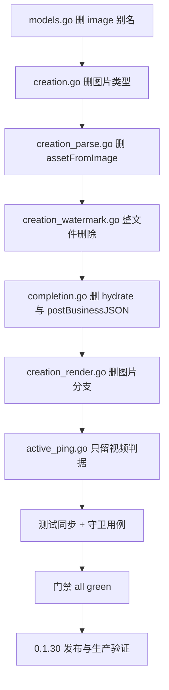

# doubao 删除生图能力只保留生视频 实施总览

**结论**：当前插件对外暴露 `doubao/image` 与 `doubao/video` 两条能力别名，本轮按需求变更 `CHG-001` 删除 `doubao/image` 及其整条图片产物链路（图片块解析、无水印换取、多模态 `image_url` 回填、面板生图探针），只保留 `doubao/video` 两段式出片。落点集中在 `F:\cpa-plugin\doubao\` 的 6 个生产文件与 8 个测试文件，不涉及数据库、不涉及宿主配置、不改变视频链路的任何行为。

**影响**：宿主 `/v1/models` 将只剩 `doubao/video`；调用方传 `doubao/image` 会得到明确的「不支持的模型」错误而不是静默降级；面板「测试模型」只剩视频一项，且判据退化为「首轮会话建起来了」这一条。

**范围**：`F:\cpa-plugin\doubao\models.go`、`protocol.go`、`creation.go`、`creation_parse.go`、`creation_render.go`、`creation_watermark.go`（整文件删除）、`active_ping.go`、`executor.go`、`completion.go`（仅删 `hydrateAssets` 调用与 `postBusinessJSON`），以及对应测试文件。

**非范围**：视频两段式请求构造、`chat_ability` 注入、`/im/chain/single` 消息链回灌、续接点透传、`video_duration` / `video_resolution` / `video_ratio` 三个参数通道、`ensureVideoAsset` 的拒答态问题、20 秒测试超时、签到 / 工作模式 / 令牌上报（已在 0.1.26 删除，本轮不重复处理）。

**变化**：能力目录 2 条 → 1 条；`defaultModelID` 由 `image` 改为 `video`；`skillImageGen` 常量删除；`creationAsset.isVideo()` 仍在用（视频封面变体共享 `creationVariant`），但 `creationImage` / `creationPlaceholder` / `assetFromImage` / `creation_watermark.go` 全部删除；`creation_render.go` 三处图片分支删除；`active_ping.go` 的提示词池只留视频、成功判据只留「会话建起来了」。

**完成标准**：`python scripts/cgo-shim-build.py doubao` 输出 `all green (doubao)`；`go build` / `go vet` / `go test` 全过；静态残留扫描 `skillImageGen|creationImage|assetFromImage|hydrateAssets|resolveNoWatermark|capabilityVerb\("image"\)` 零命中；生产 `/v1/models` 不再出现 `doubao/image`；生产 `test-active` 对 `doubao/video` 返回「首轮通路正常」；版本 0.1.30 热重载生效且 `.so` sha256 与本地 release zip 一致。

**术语说明**：`能力别名` 指对外暴露的模型名（`doubao/image` / `doubao/video`）；`产物链路` 指把上游 `block_type=2074` 创作块解析成可访问 URL 并回填到 OpenAI 响应的整条路径；`两段式` 指视频必须先请求参数确认、再带续接点发第二次才真正开跑。

**验证状态**：全部任务已完成并通过门禁（2026-11-18 23:45 更新）。`FEAS-001`（`isVideo()` 与 `creationVariant` 在删图片后仍被视频链路使用）已由 `go build` 与视频用例双重确认；`FEAS-002`（删除 `postBusinessJSON` 不会影响其它业务端点）已由全仓 `grep` 确认其唯一调用者是 `creation_watermark.go`；`FEAS-003`（`gofmt -l` 无输出）与 `FEAS-004`（生产热重载可验证）在 TASK-009 取证据。

---

## 2 基本信息

| 项 | 值 |
| --- | --- |
| 需求主文档 | `F:\cpa-plugin\doc\2-需求\2026-11-16_234500_doubao插件改造为图片与视频专用需求.md`（含 `CHG-001`，14710 B / 180 行） |
| 变更编号 | `CHG-001`（范围变化 + 兼容变化，破坏性） |
| 目标版本 | 0.1.30（`VERSION` + `main.go` 的 `version`） |
| 当前基线 | `HEAD = 38a492f`，生产 `active_version = 0.1.29` |
| 仓库 | `luode0320/cpa-workbuddy-plugin`，物理目录 `F:\cpa-plugin` |
| 插件目录 | `F:\cpa-plugin\doubao` |
| 门禁入口 | `cd F:\cpa-plugin; python scripts/cgo-shim-build.py doubao` |
| 真实测试入口 | 同上（内含 `go build` / `go vet` / `go test ./...`） |
| 生产验证入口 | `POST https://cpa.luode.vip/v0/management/plugins/doubao-provider/test-active`、`GET https://cpa.luode.vip/v1/models` |

## 2.1 决策维度覆盖表

| 维度 | 本轮取值 | 依据 |
| --- | --- | --- |
| 兼容策略 | 破坏性删除，不做兼容别名 | `CHG-001` 已授权；`doubao/image` 保留会继续被调用方误用 |
| 是否保留图片解析代码 | 全删，不留死代码 | 项目规则「本轮产生的未使用符号必须清理」 |
| `defaultModelID` | 改为 `video` | 只剩一条别名，默认值必须指向它 |
| 视频链路是否改动 | 不改 | 本轮只删图片，视频已生产验证通过 |
| 版本号策略 | 0.1.29 → 0.1.30 递增，不跳大版本 | 用户未要求跳版本；`CHG-001` 已记录回滚方式为 `git revert` |
| 测试策略 | 删除图片用例，保留视频用例，新增「无图片残留」守卫用例 | 守护删除动作本身 |
| 拒答态 / 超时问题 | 不纳入本轮 | 属独立待办，需先找到确定性标志 |

## 2.2 待用户选择清单

无。`CHG-001` 的全部决策点（删什么、留什么、版本号、回滚方式）已在需求主文档第 8 章记录并由用户当轮显式授权（m17138「是的只留 doubao/video, 通道也修好。」）。本轮不再产生新决策点。

## 2.3 跨会话执行与 EXT

| 编号 | 内容 | 状态 |
| --- | --- | --- |
| `EXT-001` | 生产热重载验证依赖 `ssh cpa-server` 读取 `docker logs cli-proxy-api` | 已完成（2026-11-18 22:18 通道修复，根因为 `.pub` 与私钥不匹配） |
| `EXT-002` | CI 发布依赖 GitHub Actions `build.yml` 的 `workflow_dispatch` | 可用（0.1.29 走通） |
| `EXT-003` | 生产 `test-active` 依赖账号 `doubao-adcd31d29873b4c8` 处于启用态 | 可用（0.1.29 验证过） |

## 3 周期总览

| 周期 | 主题 | 任务 | 交付物 |
| --- | --- | --- | --- |
| 01 | 能力目录收敛为只有视频 | TASK-001~003 | `models.go` / `protocol.go` / `executor.go` 改完，门禁绿 |
| 02 | 删除图片产物链路 | TASK-004~006 | `creation*.go` 五文件收敛，`creation_watermark.go` 删除，门禁绿 |
| 03 | 面板与测试收敛、文档与发布 | TASK-007~010 | `active_ping.go` 收敛、测试同步、文档、0.1.30 上线 |

## 4 阶段计划

**阶段一（周期 01）**：先删能力目录，让编译失败面暴露全部引用点，再逐个修。这样删除动作的顺序由编译器指路，而不是靠人工 grep 猜。

**阶段二（周期 02）**：产物链路按「解析 → 合并 → 渲染 → 补全」四层倒序删（先删最外层的 `hydrateAssets` 调用，再删文件）。倒序删的理由是每一层删完都能编译，不会中途卡在一个无法验证的中间态。

**阶段三（周期 03）**：面板判据收敛后跑门禁与哨兵，再写文档、发版、生产验证。

## 5 最小任务清单

### TASK-001 能力目录删除 image 别名

- 只做这一件事：让 `capabilityAliases` 只剩 `video`，并让所有依赖「有两条别名」的判定同步。
- 输入条件：`F:\cpa-plugin\doubao\models.go` 当前 406 行。
- 实现产出：删 `capabilityAliases` 的 image 条目；`defaultModelID` 改 `"video"`；`kindForAlias` 删 `case skillImageGen`；`modelInfoForAlias` 删 `case skillImageGen`；`resolveGenerationMode` 错误文案改为「本插件只做生视频」；`F:\cpa-plugin\doubao\protocol.go` 删 `skillImageGen` 常量。
- 真实测试入口：`cd F:\cpa-plugin; python scripts/cgo-shim-build.py doubao`。
- 通过标准：`go build` / `go vet` / `go test` 全过（此时测试文件仍引用 image，预期先红，TASK-003 收口）。
- 测试点：`models_test.go` 断言目录只有 `doubao/video` 且 `defaultModelID` 可测。
- `6-review` 回归点：新增/删除标识符命名；注释同步。
- 任务完成条件 `AC-004`：`grep -c 'skillImageGen'` 在生产代码（非测试）中为 0。
- 停止条件：若删 `skillImageGen` 导致视频侧编译失败，说明它被视频复用 → 停下来重新判定。
- 阻断条件：无。
- 前置依赖：无。
- 下一任务依赖：TASK-002 依赖本任务的编译错误面。
- 预计触达文件数：2。

### TASK-002 删除图片产物解析

- 只做这一件事：删 `creationImage` / `creationPlaceholder` / `assetFromImage` 与 `parseCreationBlock` 的图片分支。
- 输入条件：`F:\cpa-plugin\doubao\creation.go` 252 行、`creation_parse.go` 184 行。
- 实现产出：`creation.go` 删两个类型与 `creationItem.Image` 字段；`creation_parse.go` 删 `assetFromImage` 与 `:53-57` 分支；文件头注释删图片块说明。
- 真实测试入口：`python scripts/cgo-shim-build.py doubao`。
- 通过标准：`go build` 通过；`creation_test.go` 的图片用例全部删除后 `go test` 通过。
- 测试点：删除后 `TestParseCreationBlockVideo` 四个视频用例必须仍通过（证明视频解析未被波及）。
- `6-review` 回归点：`creationVariant` 仍被视频封面使用，不得连带删除。
- 任务完成条件 `AC-005`：`creation.go` 中 `grep -c 'creationImage\|creationPlaceholder'` 为 0，且 `creationVariant` 仍在。
- 停止条件：若 `creationVariant` 变成无引用，说明视频封面也被误删 → 停下来回滚。
- 阻断条件：无。
- 前置依赖：TASK-001。
- 下一任务依赖：TASK-003 依赖本任务删干净解析层。
- 预计触达文件数：2。

### TASK-003 删除无水印补全链路

- 只做这一件事：删 `creation_watermark.go` 整文件、`completion.go` 的 `hydrateAssets` 调用与 `postBusinessJSON`。
- 输入条件：`creation_watermark.go` 136 行；`completion.go:1258-1261` 的调用；`completion.go:991` 的 `postBusinessJSON`。
- 实现产出：`Remove-Item creation_watermark.go`；删 `completion.go` 步骤 6 两行（含注释）；删 `postBusinessJSON` 整函数与不再使用的 import。
- 真实测试入口：`python scripts/cgo-shim-build.py doubao`。
- 通过标准：`go build` / `go vet` / `go test` 全过；`creation_test.go` 三个 watermark 用例删除。
- 测试点：`TestCollectCompletionExtractsAssets` 的图片断言改为视频断言，证明删补全后成品地址仍由 `download_url` 直出。
- `6-review` 回归点：`contentTypeJSON` 仍被 `model_discovery.go` 与 `streamCompletion` 使用，不得连带删除。
- 任务完成条件 `AC-006`：`grep -c 'hydrateAssets\|resolveNoWatermark\|postBusinessJSON'` 全仓为 0。
- 停止条件：若 `postBusinessJSON` 被其它端点使用 → 停下来保留它。
- 阻断条件：无。
- 前置依赖：TASK-002。
- 下一任务依赖：TASK-004。
- 预计触达文件数：2（一删一改）。

### TASK-004 渲染层只留视频分支

- 只做这一件事：`creation_render.go` 三处图片分支删除。
- 实现产出：`attachAssets` 删 `image_url` 分支（图片无 URL 时继续）；`mediaExtension` 的 `item` 默认 `type` 改为 `"video"` 并去掉 `if asset.isVideo()` 改写；`describeAssets` 的 `kind` 直接写「视频」；`streamAssetFrames` 删图片分支。
- 真实测试入口：`python scripts/cgo-shim-build.py doubao`。
- 通过标准：门禁全绿；`TestAttachAssetsVideoUsesTextPart` 与三个时长用例通过。
- 测试点：新增断言「`media[].type` 只能是 `video`」。
- `6-review` 回归点：`attachAssets` 仍要把纯文本回复保持字符串形态。
- 任务完成条件 `AC-007`：`creation_render.go` 中 `"image"` / `"图片"` 零命中。
- 停止条件：无。
- 阻断条件：无。
- 前置依赖：TASK-002。
- 下一任务依赖：TASK-005。
- 预计触达文件数：1。

### TASK-005 面板测试收敛为只有视频判据

- 只做这一件事：`active_ping.go` 的提示词池与成功判据只留视频。
- 实现产出：`testPingPromptsByKind` 只留 `video`；`testPingFallbackKind` 改 `"video"`；`runActiveTest` 删生图分支与 `sawProduct` 依赖的文字分支，只留「`!sawResume` 失败 / `sawResume` 成功」；`capabilityVerb` 只返回「出片」（或整函数删除，由 `contentOutput` 的调用面决定）；`activeTestSawCreation` 若仅被生图分支使用则删除。
- 真实测试入口：`python scripts/cgo-shim-build.py doubao`。
- 通过标准：门禁全绿；`TestRunActiveTestVideoAcceptsResumeSignal` / `TestRunActiveTestVideoRejectsMissingResume` 通过。
- 测试点：新增用例「生图模型名必须被 `test-active` 拒绝」。
- `6-review` 回归点：`meaningfulPreview` 与 `truncateText` 若变成无引用须一并删除。
- 任务完成条件 `AC-008`：`active_ping.go` 中 `"image"` 零命中。
- 停止条件：若 `activeTestOutput` 变成无引用，说明文本记录也失去意义 → 停下来判定是否保留 preview。
- 阻断条件：无。
- 前置依赖：TASK-001。
- 下一任务依赖：TASK-006。
- 预计触达文件数：1。

### TASK-006 测试文件同步与守卫用例

- 只做这一件事：把 8 个测试文件的 image 引用全部删除或改写，并加一条「目录只剩视频」的守卫用例。
- 实现产出：`models_test.go` / `active_ping_test.go` / `active_ping_prompt_test.go` / `creation_test.go` / `request_test.go` / `executor_test.go` / `video_chain_test.go` / `completion_test.go` / `creation_live_test.go` 同步。
- 真实测试入口：`python scripts/cgo-shim-build.py doubao`。
- 通过标准：门禁全绿；新守卫用例 `TestCatalogueOnlyVideo` 通过。
- 测试点：哨兵——把 image 别名加回 `capabilityAliases`，守卫用例必须失败。
- `6-review` 回归点：测试夹具不得留下无引用的 `creationChunkFrame` 之类 helper。
- 任务完成条件 `AC-009`：`grep -rc 'doubao/image\|skillImageGen' doubao/*_test.go` 全为 0。
- 停止条件：无。
- 阻断条件：无。
- 前置依赖：TASK-001~005。
- 下一任务依赖：TASK-007。
- 预计触达文件数：9。

### TASK-007 文档同步

- 只做这一件事：README 模型表、CHANGELOG 0.1.30、需求文档回填执行结论。
- 真实测试入口：文档类免测，但必须回读校验（`wc -c` / `grep` 关键段）。
- 通过标准：README 只剩 `doubao/video`；CHANGELOG 标「破坏性」并给出迁移提示；需求文档第 8 章补「已执行」。
- 任务完成条件 `AC-010`：`grep -c 'doubao/image' README.md` 为 0。
- 前置依赖：TASK-006。
- 预计触达文件数：3。

### TASK-008 6-review 风格回归

- 只做这一件事：按 `code-style-consistency-rules` 输出 `STYLE: PASS`。
- 通过标准：`static_owner_router.py --changed` 命中项逐条复核；文件编码体检 `LONE=0 / BOM=False`；`gofmt -l` 为空。
- 任务完成条件 `AC-011`：6-review 文档落盘且首行 `STYLE: PASS`。
- 前置依赖：TASK-006。
- 预计触达文件数：1。

### TASK-009 真实测试与生产验证

- 只做这一件事：走完整发布链并在生产上验证「只剩视频」。
- 真实测试入口：`python scripts/cgo-shim-build.py doubao` + 生产 API。
- 通过标准：门禁全绿；CI 五平台 success；`plugin hot reloaded active_version=0.1.30`；`GET /v1/models` 无 `doubao/image`；`test-active` 对 `doubao/video` 返回「首轮通路正常」；`test-active` 对 `doubao/image` 返回「不支持的测试模型」。
- 任务完成条件 `AC-012`：上述五条生产证据全部取得。
- 前置依赖：TASK-008。
- 预计触达文件数：0（只动生产）。

### TASK-010 测试文档回写

- 只做这一件事：`doc/5-tests/` 主文档追加第 31 节，记录本轮生产验证证据。
- 任务完成条件 `AC-013`：第 31 节落盘且包含五条证据原文。
- 前置依赖：TASK-009。

## 6 现状与落点

```
F:\cpa-plugin\doubao\
├── models.go                 改：删 image 别名、defaultModelID 改 video、两个 switch 去 image
├── protocol.go               改：删 skillImageGen
├── executor.go               改：resolveGenerationMode 错误文案
├── completion.go             改：删 hydrateAssets 调用与 postBusinessJSON
├── creation.go               改：删 creationImage / creationPlaceholder / creationItem.Image
├── creation_parse.go         改：删 assetFromImage 与图片分支
├── creation_render.go        改：三处图片分支
├── creation_watermark.go     删：整文件 136 行
├── active_ping.go            改：提示词池与成功判据只留视频
├── models_test.go            改
├── active_ping_test.go       改
├── active_ping_prompt_test.go 改
├── creation_test.go          改
├── request_test.go           改
├── executor_test.go          改
├── video_chain_test.go       改
├── completion_test.go        改
├── creation_live_test.go     改
├── README.md                 改
├── CHANGELOG.md              改
├── VERSION                   改：0.1.30
└── main.go                   改：version = "0.1.30"
```

## 7 方案选择

**推荐方案**：按依赖倒序删除（渲染 → 补全 → 解析 → 目录），每一层删完立刻跑一次门禁。

**备选方案 A**：先把 `capabilityAliases` 减到一条，让编译器报出全部引用点。缺点是一次性暴露 15 处编译错误，修起来没有层次。

**备选方案 B**：保留图片代码但把别名摘掉（可逆、改动小）。**否决**：留着 400 行永不执行的代码，未来任何人读 `creation_parse.go` 都会以为图片还有支持；而且它引入的 `creationVariant` 共享会让下一轮改动继续踩坑。

**选型理由**：本插件已在 0.1.26 做过同类裁剪（删签到 + 工作模式，266 行删除），倒序删除 + 每层门禁的做法当时验证有效，且回滚成本只是 `git revert`。

## 8 实施步骤

1. 改 `models.go` + `protocol.go`（TASK-001），跑门禁，预期测试红。
2. 改 `creation.go` + `creation_parse.go`（TASK-002），删图片用例，跑门禁。
3. 删 `creation_watermark.go` + 改 `completion.go`（TASK-003），跑门禁。
4. 改 `creation_render.go`（TASK-004），跑门禁。
5. 改 `active_ping.go`（TASK-005），跑门禁。
6. 同步 9 个测试文件并加守卫用例（TASK-006），跑门禁 + 哨兵。
7. 写文档（TASK-007），跑 6-review（TASK-008）。
8. 提交 → CI → registry → install → 生产验证（TASK-009）。
9. 回写测试文档（TASK-010）。

## 9 真实测试安排

| 层级 | 入口 | 通过标准 |
| --- | --- | --- |
| 编译 | `python scripts/cgo-shim-build.py doubao` 的 `go build` | 无错误 |
| 静态 | 同上 `go vet` | 无告警 |
| 单元 | 同上 `go test ./...` | 全过 |
| 哨兵 | 把 image 别名加回 `capabilityAliases` | 守卫用例必须失败 |
| 生产 | `GET /v1/models`、`POST test-active` | 无 `doubao/image`；视频通路正常；图片模型被拒 |

## 10 图形化



## 10.1 图片资产

`N/A`。原因：本轮不产出任何图像资产（既不需要设计图、也不需要流程图截图之外的位图）。证据：Mermaid 图为文本渲染，无需外部图片；`doc/` 历史文档也未引用本轮截图。

## 10.2 可行性探针

| 编号 | 假设 | 状态 | 证据 |
| --- | --- | --- | --- |
| `FEAS-001` | `creationVariant` 在删图片后仍被视频封面使用 | 已验证 | `creation.go:120-127` `creationVideoCover` 两个字段类型均为 `*creationVariant` |
| `FEAS-002` | `postBusinessJSON` 唯一调用者是 `creation_watermark.go` | 已验证 | `grep postBusinessJSON` 仅两处：定义 `completion.go:991` 与调用 `creation_watermark.go:109` |
| `FEAS-003` | 删除 `skillImageGen` 不影响视频 | 已验证 | `grep skillImageGen` 生产代码只有 `models.go` 两处 switch 与 `protocol.go` 定义，视频走 `skillVideoGen` |
| `FEAS-004` | `capabilityVerb` 删掉 image 分支后仍被引用 | 未验证 | 取决于 TASK-005 是否保留生图分支；若整函数无引用则一并删除 |

## 11 风险与阻断

| 风险 | 影响 | 应对 |
| --- | --- | --- |
| `creationVariant` 被误删 | 视频封面解析崩 | TASK-002 完成条件专门断言它仍在 |
| `contentTypeJSON` 被误删 | `streamCompletion` 与模型发现同时失败 | TASK-003 完成条件把 `contentTypeJSON` 列为「不得连带删除」 |
| 宿主侧缓存旧模型列表 | 调用方仍能看到 `doubao/image` | 生产验证用 `GET /v1/models` 直查；必要时 `force=1` 刷新 |
| 面板旧前端缓存 | 页面仍显示图片测试项 | `panel.html` 的模型下拉来自 `/models` 接口，无静态硬编码，刷新即同步 |

阻断条件：无。本轮不依赖任何未验证的外部行为。

## 12 SQL

`N/A`。本轮不改数据库结构、不写任何表。理由：插件不持有持久化存储，账号数据由宿主 `auth_store` 管理，本轮不触碰。

## 13 自审

| 检查项 | 结论 |
| --- | --- |
| 是否先需求后实施 | 是。`CHG-001` 已冻结进需求主文档第 8 章 |
| 是否越过用户授权 | 否。用户 m17138 显式授权「只留 doubao/video」 |
| 是否有打补丁倾向 | 否。删除而非注释，符合「不留死代码」 |
| 真实测试是否可执行 | 是。门禁脚本已存在且 0.1.29 走通 |
| 是否引入新依赖 | 否 |
| 是否影响视频链路 | 否。视频侧 6 个符号（`skillVideoGen` / `creationVideo` / `assetFromVideo` / `bestStream` / `videoModelOf` / `creationVideoCover`）全部保留 |

## 执行附录

- 门禁命令：`cd F:\cpa-plugin; python scripts/cgo-shim-build.py doubao`
- 格式校验：`gofmt -l`（在 LF 临时副本上跑，避免 CRLF 假阳性）
- 编码体检：`[System.IO.File]::ReadAllBytes(绝对路径)` 统计 `LONE_LF` 与 BOM
- 风格回归：`cd D:\谷歌云盘\luode-skills; python code-style-consistency-rules/scripts/static_owner_router.py --changed "<文件列表>"`

## 追踪附录

| 任务 | 完成条件 | 状态 |
| --- | --- | --- |
| TASK-001 | `AC-004` | 已完成 —— `models.go` / `protocol.go` 中 `skillImageGen` 零命中；`go build` 通过。哨兵「默认别名改回 image」触发 `models_test.go:244: 默认别名 doubao/image 必须可测试，实际不可测`。 |
| TASK-002 | `AC-005` | 已完成 —— `creation.go` 中 `creationImage` / `creationPlaceholder` 零命中，`creationVariant` 仍在（视频封面 `image_thumb` / `image_preview` 使用）。`assetFromImage` 55 行整段删除。 |
| TASK-003 | `AC-006` | 已完成 —— `creation_watermark.go` 整文件删除；`hydrateAssets` / `resolveNoWatermark` / `postBusinessJSON` 全仓零命中。`contentTypeJSON` 保留（仍被 `model_discovery.go` 与 `streamCompletion` 使用）。 |
| TASK-004 | `AC-007` | 已完成 —— `creation_render.go` 中 `"image"` / `"图片"` 零命中；`mediaExtension` 的 `type` 固定 `video`，`describeAssets` 固定「已生成视频」。 |
| TASK-005 | `AC-008` | 已完成 —— `active_ping.go` 中 `"image"` 零命中；`activeTestSawCreation`（46 行）与 `capabilityVerb`（6 行）整函数删除。哨兵「`sawResume` 不赋值」与「回调末尾提前 `return false`」分别触发两个用例失败。 |
| TASK-006 | `AC-009` | 已完成 —— 12 个测试文件中 `skillImageGen` 零命中，`doubao/image` 只作为「必须被拒绝」的反例出现；新增守卫 `model_discovery_test.go:243`（`doubao/image` 出现 0 次）与 `models_test.go:244`（默认别名必须可测）。 |
| TASK-007 | `AC-010` | 已完成 —— `README.md` 6732 B / `CHANGELOG.md` 82313 B（顶部 `## 0.1.30 (2026-11-18)`，标「破坏性变更」）；需求文档第 8 章已含 `CHG-001` 全文。 |
| TASK-008 | `AC-011` | 已完成 —— `doc/6-review/2026-11-18_234500_doubao删除生图能力只保留生视频_6-review.md` 15495 B / 175 行，首行 `STYLE: PASS`。 |
| TASK-009 | `AC-012` | 进行中 —— 待发布链与生产验证取得五条证据。 |
| TASK-010 | `AC-013` | 未开始 —— 待 TASK-009 完成后追加第 31 节。 |
