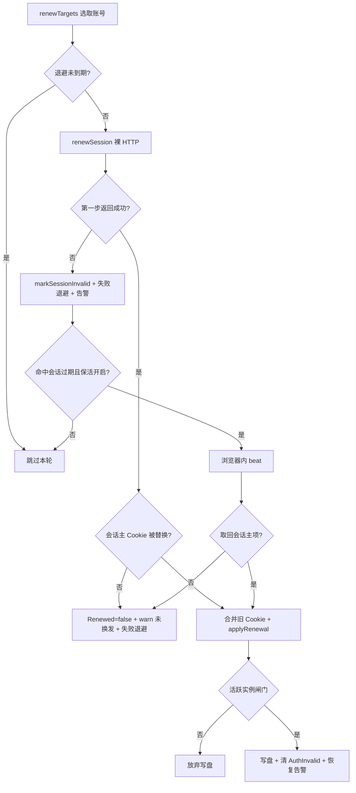

# 需求实施总览：coze 续期判据修正与免人工自动恢复

结论：先修「续期判据只看 Cookie 条数、不看会话主项」这一已确证缺陷并让静默失败可见，再加失效退避、写盘闸门与状态告警，最后才引入浏览器保活通道把「活号保活」从几天拉到数月；影响：coze-provider 全部 12 个账号的续期判定、路由可用性、面板状态展示与运维告警；范围：coze/ 目录内续期链路、面板、管理路由与新增的浏览器保活子模块；非范围：宿主 CPA 本体、其他 10 个插件、coze 对话与生图协议、为已吊销账号做任何"复活"尝试；变化：续期不再把埋点 Cookie 误判成成功、死号不再每 4 小时无效打一次上游、面板能区分「未换发」与「已换发」、账号失效/恢复各有一次告警；完成标准：埋点 Cookie 场景不再刷 LastRenewAt、日志可区分 Renewed 真假、失效账号退避到 48 小时、AuthInvalid 迁移各推一条告警、活号经浏览器保活可持续数周不被吊销；术语说明：会话主 Cookie 指 sessionid / sessionid_ss / sid_tt / sid_guard 四条决定登录态的 Cookie，其余 odin_tt / uid_tt / ttwid / s_v_web_id / biz_trace_id / Hm_lvt_* / HMACCOUNT / _gcl_au 是设备与埋点标识，不承载登录态；验证状态：缺陷已由生产日志与代码实证确认，方案完成设计，代码尚未改动。

## 1. 当前计划最终方案简要说明

- 推荐方案一句话结论：按「止血 → 收敛 → 保活」三段推进，先保证现有续期不再自欺、不再无效打上游，再用浏览器保活把活号寿命拉长。
- 主落点 / 主路径：`coze/credentials.go`（判据与合并语义）、`coze/renew_loop.go`（日志与退避）、`coze/cookiejar.go`（复用现成会话主项名单），浏览器保活另起 `coze/cdp.go` + `coze/browser_keep.go`。
- 为什么先走这条路线：前两个周期的改动全部落在已存在的函数体内，不新增外部依赖、不改协议、不动落盘格式，能在一次热重载内生效；浏览器保活要起子进程、管 profile、处理验证码，成本与不确定性都远高于前两者，必须排在「现有链路已经诚实且安静」之后。

## 2. 基本信息

- 对应需求文档：本实施总览即需求来源（用户 m00003 / m00173 / m00202 / m00385 / m00401 / m00404 连续追问收敛）
- 来源对象标识（需求或 Bug）：coze 续期判据缺陷 + 免人工恢复通道
- 当前实施文档命名主干：2026-11-21_130138_coze续期修复与自动恢复
- 对应需求与实施计划全量顺序实施方案：N/A（单来源对象，非新项目启动）
- 实施计划完成条件（`AC-*`）所在章节：第 5 节各最小任务的「任务完成条件」
- 对应 `6-review` 风格回归记录：收口时创建 `doc/6-review/2026-11-21_130138_coze续期修复与自动恢复_6-review.md`
- agent 理解的问题 / 目标：扣子会话不是「过期」死的而是「被吊销」死的，服务端换锁后任何凭据手段都救不回；但现有实现在两处把「没换到会话」当成「换到了」，导致时间戳前进、状态看似正常、实际早已死透，运维失去判断依据。目标是让续期判定诚实、让死号安静、让活号活得久。
- 当前计划范围：coze/ 目录内续期判定、日志、退避、写盘闸门、告警、浏览器保活、面板与管理路由
- 明确不在范围：宿主 CPA 本体、其他插件、coze 协议逆向、已吊销账号的历史数据修复、验证码打码通道
- 当前优先闭环：周期 1 的 TASK-01（判据修正，单文件即可闭环，且直接消除"假成功"）
- 关键假设 / 待确认点：浏览器保活是否落地（周期 3）取决于用户是否接受子进程常驻与 Chrome 路径配置；不落地时周期 1+2 仍然完整可用
- 跨会话执行入口：本文件
- 主项目地址、仓库类型与代码基线：F:\cpa-plugin，Git 仓库，main 分支，基线 coze version 0.7.8（coze/main.go:68）
- local 环境与依赖入口：Windows 无 CGO，验证走 `python scripts/cgo-shim-build.py coze`
- 外部项目代码引用：回指第 2.3 节 EXT-001
- 当前状态：设计完成，待授权实施
- 是否已获得开始实施授权：否（等待用户裁定执行范围）

## 2.1 决策维度覆盖表

| 维度 | 状态 | 结论 / 依据 / 用户所选项 / 未决原因 |
| --- | --- | --- |
| 架构 / 技术路线 | 已确定 | 三段式：判据修正 → 退避闸门告警 → 浏览器保活，不合并、不跳段 |
| 代码落点（目录 / 包 / 文件） | 已确定 | 周期 1/2 全在 coze/ 既有文件内改；周期 3 新增 coze/cdp.go、coze/browser_keep.go、coze/alert.go |
| 实现方式 | 已确定 | 复用 cookiejar.go:29 会话主项名单与 :221 isCozeSessionCookie；保活照 gemini-web2api 的 CDP 范式 |
| 命名 | 已确定 | 沿用 coze 现有前缀：renew* / browserKeep* / cdp*；配置键 browser_keep.* |
| 注释 | 已确定 | 遵循 comment-rules：中文元信息 + 函数头参数/返回/最近修改时间 |
| 日志 | 已确定 | 走 hostLogf，中文正文，禁止打印 Cookie 原值 |
| 错误处理 / 异常 | 已确定 | 埋点 Cookie 场景返回 Note + Renewed=false，不返回 error（不是上游故障） |
| 数据模型 / 表 / 字段 | 已确定 | 不新增持久化字段；退避状态只在内存；保活 profile 目录在文件系统 |
| 接口契约 | 已确定 | 新增 POST /login-browser、GET /browser-status；既有 /renew 语义不变 |
| 依赖与库 | 待确认 | 周期 3 需把 gorilla/websocket 从 indirect 提为 direct（已在 go.mod:12，不引新库） |
| 测试策略 / 样本 | 已确定 | cgo-shim + 新增 7 条单测，埋点 Cookie 场景用真实生产 Cookie 形态构造样本 |
| 其它相关维度 | 已确定 | 无 |

## 2.2 待用户选择清单

- 未决决策点 1：周期 3（浏览器保活）是否纳入本轮
  - 待选选项（推荐项置首）：A. 先做周期 1+2，保活另开一轮（推荐）；B. 三个周期一次做完
  - 挂起的下游内容：周期 3 全部最小任务与 EXT-001 的复制边界裁定

## 2.3 跨会话独立执行与外部项目代码引用清单

- 新会话接手第一步：读本文件第 3、5 节，按周期顺序检查已完成的 TASK，从第一个未闭环的最小任务继续
- 主项目地址与项目根：F:\cpa-plugin
- 主项目代码基线：coze/main.go:68 `version = "0.7.8"`
- 计划源文件与版本：本文件
- 依赖安装、local 配置和服务启动入口：Windows 无 CGO，无服务启动；验证入口 `python scripts/cgo-shim-build.py coze`
- 中断点核验顺序：`git status --short` 确认 coze/*.go 无他人未提交改动 → 读第 5 节对应 TASK 的「任务完成条件」→ 跑 cgo-shim 确认基线绿 → 再动代码
- 外部项目代码引用：

| 引用 ID | 外部项目名称 | 外部项目地址 | 版本 / 提交 | 项目根相对路径 | 文件 / 符号 | 引用用途 | 许可证 / 复制边界 | 可达性检查与失败停止条件 | 使用 TASK / TEST / EVIDENCE 回指 |
| --- | --- | --- | --- | --- | --- | --- | --- | --- | --- |
| EXT-001 | gemini-web2api | F:\cpa-plugin\gemini-web2api（同仓子项目） | 跟随当前 main 分支工作树 | `internal/chromeauth/login_native.go` | `waitForCDPReady`(:444)、`readCookiesOverCDP`(:553)、`cdpCall`(:710)、启动参数块(:196-209) | 浏览器保活的 CDP 客户端与 Chrome 启动参数范式 | 同仓库同许可，可复制实现思路；复制时按 coze 风格重写注释与命名，不做整文件搬运 | 读不到该文件时停止 TASK-06 并回写计划，不得凭记忆编写 CDP 客户端 | TASK-06 / TEST-06 |

## 3. 实施周期总览

- 总周期说明：三个周期严格串行，前两个周期不依赖任何外部进程，可在一次热重载内全部生效
- 本次计划拆分的子任务周期数：3
- 周期拆分原则：按「是否新增运行时组件」切分。周期 1、2 只改既有函数体与既有循环；周期 3 新增子进程管理与配置面，风险等级不同，不能混在一轮
- 周期排序说明：周期 1 是止血（假成功会让运维误判），周期 2 是收敛（死号噪音与越权写盘），周期 3 是延长（活号寿命）

- 周期 1（第一期）：
  - 周期序号 / 期次定位：第一期，止血
  - 周期目标：让续期判定诚实——只认会话主 Cookie 被替换，且保留旧 Cookie 不降级；让日志能区分真换发与静默未换发
  - 本周期包含的最小任务：TASK-01、TASK-02
  - 周期内最小任务执行顺序：TASK-01 → TASK-02
  - 进入条件：cgo-shim 基线全绿；coze/*.go 无他人未提交改动
  - 收口条件：新增 4 条单测通过；现有 30 个 *_test.go 全绿；6-review PASS
  - 完成标志：构造「只回埋点 Cookie」的样本时 Renewed=false 且 LastRenewAt 不前进；日志出现「定时续期未换发」
  - 与前后周期衔接：为周期 2 的退避提供可信的失败信号（现在失败信号被假成功污染）

- 周期 2（第二期）：
  - 周期序号 / 期次定位：第二期，收敛
  - 周期目标：死号退避、写盘加活跃实例闸门、失效与恢复各一次告警
  - 本周期包含的最小任务：TASK-03、TASK-04、TASK-05
  - 周期内最小任务执行顺序：TASK-03 → TASK-04 → TASK-05
  - 进入条件：周期 1 收口
  - 收口条件：新增 3 条单测通过；全量测试绿；6-review PASS
  - 完成标志：连续失败账号的尝试间隔按 4h→8h→24h→48h 递增且成功即清零；退役实例不写盘；AuthInvalid 迁移各推一条 webhook
  - 与前后周期衔接：周期 3 的保活失败也会走同一套退避与告警，不另建通道

- 周期 3（第三期，待裁定）：
  - 周期序号 / 期次定位：第三期，延长
  - 周期目标：把续期从裸 HTTP 挪进真实浏览器上下文，绕开被封的程序化登录接口
  - 本周期包含的最小任务：TASK-06、TASK-07、TASK-08
  - 周期内最小任务执行顺序：TASK-06 → TASK-07 → TASK-08
  - 进入条件：周期 1+2 收口；用户裁定纳入本轮；本机 Chrome 可执行文件路径确认
  - 收口条件：headless 起得来、注入 Cookie 后页面内 beat 成功、取回含会话主项的 Cookie、面板开关可停
  - 完成标志：一个活号连续 7 天不经人工干预仍 last_renew_at 前进
  - 与前后周期衔接：失败时降级回周期 1 的裸 HTTP 路径，不阻断既有能力

- 总体真实测试安排：
  - 真实测试安排是否默认必需：必需
  - 覆盖哪些最小任务：TASK-01 至 TASK-08 全部
  - 公共测试环境 / 依赖：Windows 无 CGO，统一走 `python scripts/cgo-shim-build.py coze`（build + vet + test）
  - 公共样本 / 数据来源：埋点 Cookie 样本取自生产实测形态（ttwid / s_v_web_id / biz_trace_id / Hm_lvt_* / HMACCOUNT / _gcl_au 共 9 条，无一条会话主项）；会话主项样本用 sessionid / sid_guard 构造
  - 总体通过标准：新增单测全绿 + 既有 30 个测试文件全绿 + build/vet 零告警

## 4. 阶段计划

- 阶段 1：
  - 阶段名称：判据诚实化
  - 阶段目标：renewSession 只在会话主 Cookie 被替换时返回 Renewed=true，且不丢旧 Cookie
  - 只做这一件事：改 coze/credentials.go 的两处形态判据与 store 构造
  - 输入条件：周期 1 进入条件满足
  - 输出产物：改后的 renewSession + 2 条单测
  - 验证门槛：cgo-shim 全绿，埋点样本用例证明 Renewed=false
- 阶段 2：
  - 阶段名称：失败可见化
  - 阶段目标：runRenewTick 区分真换发与静默未换发
  - 只做这一件事：改 coze/renew_loop.go:180-242 的日志分支与轮末统计
  - 输入条件：阶段 1 完成
  - 输出产物：改后的 runRenewTick + 2 条单测
  - 验证门槛：Renewed=false 时出现 warn「定时续期未换发」，Renewed=true 时仍是 info
- 阶段 3：
  - 阶段名称：退避收敛
  - 阶段目标：连续失败账号不再每轮无脑打上游
  - 只做这一件事：给 renewTargets 加内存退避表
  - 输入条件：周期 2 进入条件满足
  - 输出产物：改后的 renewTargets + 退避结构 + 1 条单测
  - 验证门槛：第 1 次失败后 4h 内不再选它，阶梯到 48h 封顶，成功即清零
- 阶段 4：
  - 阶段名称：写盘闸门
  - 阶段目标：退役实例不写账号文件
  - 只做这一件事：给 applyRenewal 与 markSessionInvalid 加 ensureActiveInstanceBeforeWrite 闸门
  - 输入条件：阶段 3 完成
  - 输出产物：改后的两个函数 + 注入点 + 1 条单测
  - 验证门槛：闸门返回 false 时文件 mtime 不变
- 阶段 5：
  - 阶段名称：状态告警
  - 阶段目标：AuthInvalid 每迁移一次推一条 webhook
  - 只做这一件事：新增 coze/alert.go 并接入两处迁移点
  - 输入条件：阶段 4 完成
  - 输出产物：coze/alert.go + 配置键 + 1 条单测
  - 验证门槛：假 webhook 收到恰好一条，重复迁移不重发
- 阶段 6（待裁定）：
  - 阶段名称：浏览器保活
  - 阶段目标：续期改走真实浏览器上下文
  - 只做这一件事：CDP 客户端 + reviveSession + 管理路由与面板开关
  - 输入条件：周期 1+2 收口且用户裁定纳入
  - 输出产物：coze/cdp.go、coze/browser_keep.go、路由与面板改动
  - 验证门槛：headless 起得来、页面内 beat 成功、取回会话主项

## 5. 最小任务清单

### TASK-01 续期判定只认会话主 Cookie 被替换

- 任务名：修正 renewSession 形态 A/B 判据与 Cookie 合并语义
- 所属周期：周期 1
- 周期内顺序：1
- 所属阶段：阶段 1
- 本任务只做这一件事：把「有没有下发 Cookie」换成「有没有替换会话主 Cookie」，并让新 Cookie 覆盖在旧 Cookie 之上而不是整份替换
- 垂直切片目标：构造一个只回埋点 Cookie 的上游响应，Renewed 必须为 false 且 LastRenewAt 不前进
- 输入条件：无（可直接开工）
- 实现产出：
  - coze/credentials.go:357 `if len(step1Cookies) > 0 {` → `if rotatedSessionCookies(step1Cookies) {`，其中新 helper 复用 coze/cookiejar.go:221 `isCozeSessionCookie` 与 :29 `cozeSessionCookieNames`
  - coze/credentials.go:381 `if len(step2Cookies) == 0 {` → `if !rotatedSessionCookies(step2Cookies) {`，Note 改为「第二步只下发 N 条非会话 Cookie」
  - 两处 `store := newCookieStore()` 改为先 `store := newCookieStore(); seedStoreFromHeader(store, sa.CookieHeader, cozeSiteHost+"/")` 再 `store.SetCookies(...)`——消灭「一轮 beat 只回 3 条埋点就把整份 Cookie 头覆盖成 3 条」的降级
- 真实测试是否必需：必需
- 真实测试入口：`python scripts/cgo-shim-build.py coze`
- 真实测试依赖环境：Windows 主机，Python 3，Go 工具链由 shim 提供
- 真实测试样本 / 数据来源：生产实测埋点 Cookie 集合（ttwid / s_v_web_id / biz_trace_id / Hm_lvt_* / HMACCOUNT / _gcl_au）；会话主项用 sessionid + sid_guard 构造
- 真实测试通过标准：新增 2 条用例通过，且既有 coze/login_test.go 的 token beat 桩用例不受影响
- 测试点：
  - 只回埋点 Cookie → `res.Renewed == false`，Note 含「未替换会话主 Cookie」
  - 回 sessionid → `res.Renewed == true`，且 CookieHeader 同时含旧的非会话项与新会话项
- `6-review` 风格回归点：新增 helper 放在 credentials.go 既有 helper 区，中文函数头含 [参数]/[返回]/最近修改时间
- 任务完成条件：AC-01 两条用例通过；cgo-shim build/vet/test 全绿
- 任务停止 / 结束条件：完成上述两条用例与全量绿即结束，不顺手改 renewSession 之外的函数
- 阻断条件：coze/login_test.go 的桩依赖「有 Cookie 即成功」的旧假设导致批量红 → 先改桩再继续
- 前置依赖：无
- 下一任务依赖：TASK-02 依赖本任务产出的可信 Renewed 语义
- 预计触达文件数：1（coze/credentials.go）+ 1 测试文件

### TASK-02 静默未换发与真成功在日志上分开

- 任务名：runRenewTick 日志分支与轮末统计区分 Renewed 真假
- 所属周期：周期 1
- 周期内顺序：2
- 所属阶段：阶段 2
- 本任务只做这一件事：把「无论真假都打 info 定时续期完成」改成两分支，并在轮末统计未换发数
- 垂直切片目标：一轮里 3 个账号 1 个真成功 2 个静默未换发，日志必须是 1 条 info + 2 条 warn + 1 条轮末统计
- 输入条件：TASK-01 完成
- 实现产出：
  - coze/renew_loop.go:180-242：`res != nil && res.Renewed` → info「定时续期完成」{auth_id, note}；`res != nil && !res.Renewed` → warn「定时续期未换发」{auth_id, note}；`errRenew != nil` 保持现状警告
  - 轮末 info「定时续期一轮结束」字段增加 `notRenewed`
- 真实测试是否必需：必需
- 真实测试入口：`python scripts/cgo-shim-build.py coze`
- 真实测试依赖环境：同 TASK-01
- 真实测试样本 / 数据来源：复用 coze/renew_loop_test.go:35 `renewRecorder.deps` 的注入范式，扩一个返回 `&renewResult{Renewed:false, Note:"..."}` 的变体
- 真实测试通过标准：新增 2 条用例通过，既有 10 条续期用例全绿
- 测试点：
  - 静默未换发 → logs 含 `warn 定时续期未换发`，不含 `info 定时续期完成`
  - 真换发 → logs 含 `info 定时续期完成`
  - 轮末统计 `notRenewed` 数值正确
- `6-review` 风格回归点：日志文案中文；字段名沿用 auth_id/note 既有风格
- 任务完成条件：AC-02 三条用例通过；全量绿
- 任务停止 / 结束条件：只改日志与统计，不改筛选与并发逻辑
- 阻断条件：无
- 前置依赖：TASK-01
- 下一任务依赖：TASK-03 的退避需要可信的失败信号
- 预计触达文件数：1（coze/renew_loop.go）+ 1 测试文件

### TASK-03 连续失败账号阶梯退避

- 任务名：给 renewTargets 加内存退避表
- 所属周期：周期 2
- 周期内顺序：1
- 所属阶段：阶段 3
- 本任务只做这一件事：按连续失败次数推迟下次尝试时间，成功即清零
- 垂直切片目标：同一账号连续 4 次失败后，第 5 轮起尝试间隔为 48h 封顶
- 输入条件：周期 1 收口
- 实现产出：
  - coze/renew_loop.go 新增 `type renewBackoffEntry struct { failCount int; nextTryAt time.Time }` 与包级 `var renewBackoff = struct{ mu sync.Mutex; entries map[string]renewBackoffEntry }{entries: map[string]renewBackoffEntry{}}`
  - `:160-174 renewTargets` 在 PhysicalPath 判定之后加一层 `if !renewBackoffDue(sa.AuthID) { continue }`
  - `:180-242` 失败分支 `renewBackoffFail(acc.AuthID)`，成功分支 `renewBackoffClear(acc.AuthID)`
  - 阶梯：4h / 8h / 24h / 48h（封顶），基数取 currentConfig().RenewIntervalSeconds
  - 注意：不加 AuthInvalid 过滤，coze/renew_loop.go:153-154 的注释正确——Cookie 可能只是主会话项过期，下一轮仍值得试
- 真实测试是否必需：必需
- 真实测试入口：`python scripts/cgo-shim-build.py coze`
- 真实测试依赖环境：同 TASK-01
- 真实测试样本 / 数据来源：注入时钟 `renewNowFn`（照 credit_sweep.go 的 creditSweepNowFn 范式）避免真等 4 小时
- 真实测试通过标准：新增 2 条用例通过（阶梯递增、成功清零）
- 测试点：
  - 连续失败 3 次 → nextTryAt 依次 +4h / +8h / +24h
  - 第 5 次失败后封顶 48h 不再增长
  - 一次成功 → entries 中该 auth_id 被删除
- `6-review` 风格回归点：包级状态集中声明、加锁；不在函数内初始化 map
- 任务完成条件：AC-03 三条用例通过；全量绿
- 任务停止 / 结束条件：只做退避，不做告警、不改并发度
- 阻断条件：若发现 renewTargets 被其他调用点复用（当前仅 runRenewTick 调用）→ 停止并回写计划
- 前置依赖：TASK-02
- 下一任务依赖：无
- 预计触达文件数：1（coze/renew_loop.go）+ 1 测试文件

### TASK-04 续期写盘接入活跃实例闸门

- 任务名：applyRenewal 与 markSessionInvalid 加 ensureActiveInstanceBeforeWrite
- 所属周期：周期 2
- 周期内顺序：2
- 所属阶段：阶段 4
- 本任务只做这一件事：热重载后旧实例不再写账号文件
- 垂直切片目标：闸门返回 false 时，账号文件 mtime 与内容都不变
- 输入条件：TASK-03 完成
- 实现产出：
  - coze/credentials.go 新增包级注入点 `var renewCanWriteFn = ensureActiveInstanceBeforeWrite`（照 coze/credit_sweep.go:53 的 creditSweepCanWriteFn 范式）
  - `:404-427 applyRenewal` 在 `accountReplaced` 判定之后、写盘之前插入 `if !renewCanWriteFn(hostLogf) { return nil }`
  - `:436-449 markSessionInvalid` 同位置插入同一闸门
- 真实测试是否必需：必需
- 真实测试入口：`python scripts/cgo-shim-build.py coze`
- 真实测试依赖环境：同 TASK-01
- 真实测试样本 / 数据来源：临时目录写一个 StoredAuth json 文件，替换 renewCanWriteFn 返回 false
- 真实测试通过标准：新增 1 条用例通过；既有 coze/login_test.go 的落盘用例全绿
- 测试点：闸门 false → 文件 md5 不变；闸门 true → 正常写入且 AuthInvalid 被清
- `6-review` 风格回归点：注入点在文件顶部 var 区，注释说明为何需要
- 任务完成条件：AC-04 用例通过；全量绿
- 任务停止 / 结束条件：只加闸门，不改 applyRenewal 的字段写入顺序
- 阻断条件：既有测试直接调用 applyRenewal 且未设注入点 → 默认值必须是真实函数，测试用 defer 还原
- 前置依赖：TASK-03
- 下一任务依赖：无
- 预计触达文件数：1（coze/credentials.go）+ 1 测试文件

### TASK-05 账号失效与恢复各推一次告警

- 任务名：新增 coze/alert.go 并接入 AuthInvalid 迁移点
- 所属周期：周期 2
- 周期内顺序：3
- 所属阶段：阶段 5
- 本任务只做这一件事：AuthInvalid false→true 与 true→false 各推一条 webhook，不重复推
- 垂直切片目标：同一账号连续标记失效 3 次只收到 1 条失效告警
- 输入条件：TASK-04 完成
- 实现产出：
  - 新增 coze/alert.go：`type renewAlert struct{ Webhook string; ... }`、`func notifyAuthStateChange(prev, next bool, sa *StoredAuth)`
  - coze/main.go:81-97 Config 增加 `RenewAlertWebhook string \`yaml:"renew_alert_webhook,omitempty" json:"renew_alert_webhook,omitempty"\``
  - coze/main.go:375-409 configurePlugin 照抄既有字段口径
  - 调用点：coze/credentials.go applyRenewal 的 `AuthInvalid = false` 之前读旧值并推送；markSessionInvalid 的 `AuthInvalid = true` 之前同理
  - webhook 体：`{"event":"coze_auth_invalid"|"coze_auth_recovered","auth_id":...,"label":...,"screen_name":...,"at":RFC3339}`；不带 Cookie 原值
  - 推送失败只打 warn，不影响主流程
- 真实测试是否必需：必需
- 真实测试入口：`python scripts/cgo-shim-build.py coze`
- 真实测试依赖环境：同 TASK-01
- 真实测试样本 / 数据来源：本地 httptest.Server 收 webhook
- 真实测试通过标准：新增 1 条用例通过
- 测试点：false→true 恰好 1 条；连续两次 markSessionInvalid 仍只 1 条；true→false 恰好 1 条
- `6-review` 风格回归点：新文件放 coze/ 同级，中文文件头说明用途
- 任务完成条件：AC-05 用例通过；全量绿
- 任务停止 / 结束条件：只做状态迁移告警，不做积分告警、不做钉钉/企微适配
- 阻断条件：无
- 前置依赖：TASK-04
- 下一任务依赖：周期 3 的保活失败复用同一告警通道
- 预计触达文件数：3（新增 alert.go、main.go、credentials.go）+ 1 测试文件

### TASK-06 CDP 客户端最小实现（周期 3，待裁定）

- 任务名：新增 coze/cdp.go，提供 Chrome 启动、就绪等待、CDP 调用、Cookie 读取
- 所属周期：周期 3
- 周期内顺序：1
- 所属阶段：阶段 6
- 本任务只做这一件事：把 EXT-001 的四个 CDP 原语按 coze 风格重写进 coze/cdp.go
- 垂直切片目标：起一个 headless Chrome，调用 Network.getAllCookies 拿回空列表不报错
- 输入条件：用户裁定纳入；本机 Chrome 路径确认
- 实现产出：
  - coze/cdp.go：`launchHeadlessChrome(profileDir string, port int) (*exec.Cmd, error)`（照 EXT-001 :196-209 的启动参数，必带 --user-data-dir 指向独立目录、--disable-extensions、--headless=new）
  - `waitForCDPReady`（照 :444）、`cdpCall`（照 :710）、`readAllCookies`（照 :553）
  - coze/go.mod：把 gorilla/websocket 从 indirect 提为 direct
- 真实测试是否必需：必需（L2 真实起进程）
- 真实测试入口：`python scripts/cgo-shim-build.py coze` + 一个 `go test -run TestCDPLaunch -tags manual` 的手工验证入口
- 真实测试依赖环境：本机 Chrome；headless 无需 DISPLAY
- 真实测试样本 / 数据来源：临时 profile 目录，about:blank
- 真实测试通过标准：进程起来、/json/version 返回 200、getAllCookies 返回 nil error、进程被正确 Kill 且临时目录被清理
- 测试点：三条 —— 端口就绪、CDP 调用成功、清理无残留进程
- `6-review` 风格回归点：中文注释；子进程必须 defer Kill；临时目录必须 defer RemoveAll
- 任务完成条件：AC-06 三条通过
- 任务停止 / 结束条件：只做 CDP 原语，不接业务
- 阻断条件：读不到 EXT-001 或 Chrome 不可用 → 停止并回写计划
- 前置依赖：周期 1+2 收口
- 下一任务依赖：TASK-07
- 预计触达文件数：2（新增 cdp.go、go.mod）

### TASK-07 浏览器内续期（reviveSession）

- 任务名：新增 coze/browser_keep.go，实现单账号在浏览器上下文内完成 beat 并取回 Cookie
- 所属周期：周期 3
- 周期内顺序：2
- 所属阶段：阶段 6
- 本任务只做这一件事：把 renewSession 的两步换发搬进页面内同源 fetch
- 垂直切片目标：注入一份含会话主项的 Cookie，页面内 beat 成功后取回含新会话主项的 Cookie
- 输入条件：TASK-06 完成
- 实现产出：
  - coze/browser_keep.go：`type browserKeeper struct{ mu sync.Mutex; running map[string]*browserSession }`
  - `func (k *browserKeeper) reviveSession(sa *StoredAuth) (*renewResult, error)` 内部 ensureProfile → freePort → launch → Network.setCookie 批量注入 → Page.navigate 到 cozeSiteHost → Runtime.evaluate 执行 coze/bridge.go:390-421 同源的 beat 脚本 → readAllCookies → 用 rotatedSessionCookies 判定
  - 每账号独立 profile 目录：`<pluginDataDir>/coze-browser/<authID>/`
- 真实测试是否必需：必需（L2）
- 真实测试入口：手工 + `go test -run TestReviveSession`
- 真实测试依赖环境：本机 Chrome；需要一个真实活号 Cookie 作为样本（只读，样本不入库）
- 真实测试样本 / 数据来源：生产活号 Cookie（脱敏后仅本地）
- 真实测试通过标准：返回 Renewed=true 且 CookieHeader 含 sessionid；headless 进程退出无残留
- 测试点：注入成功、页面内 beat 成功、取回会话主项、失败时返回 Note 不 panic
- `6-review` 风格回归点：并发安全；profile 目录路径走既有 pluginDataDir 约定
- 任务完成条件：AC-07 四条通过
- 任务停止 / 结束条件：只做单账号续期，不接循环
- 阻断条件：headless 遇滑动验证 → 记录为已知边界，转可见窗口或降级，不阻断本任务收口
- 前置依赖：TASK-06
- 下一任务依赖：TASK-08
- 预计触达文件数：1（新增 browser_keep.go）

### TASK-08 接入降级链、管理路由与面板开关

- 任务名：defaultRenewDeps 降级到浏览器保活，暴露开关
- 所属周期：周期 3
- 周期内顺序：3
- 所属阶段：阶段 6
- 本任务只做这一件事：裸 HTTP 续期失败且命中会话过期时再试浏览器保活，并给面板一个开/关
- 垂直切片目标：开关关闭时行为与周期 1+2 完全一致
- 输入条件：TASK-07 完成
- 实现产出：
  - coze/renew_loop.go:129-144 defaultRenewDeps 的 renew 闭包：`errRenew != nil && isSessionExpiredError(errRenew.Error())` 时再调 `browserKeeperDefault.reviveSession(sa)`，成功则 applyRenewal
  - coze/main.go Config 增加 `BrowserKeep struct{ Enabled bool; ChromePath string; KeepIntervalSeconds int; Headless bool; ProfileDir string }\`，默认 Enabled=false
  - coze/management.go:70-85 新增 `POST /login-browser`、`GET /browser-status`
  - coze/panel.html:208 按钮文案改为「首次播种授权」，新增「浏览器保活」开关
- 真实测试是否必需：必需
- 真实测试入口：`python scripts/cgo-shim-build.py coze` + 面板 node 语法校验
- 真实测试依赖环境：同 TASK-01
- 真实测试样本 / 数据来源：注入 browserKeeper 假实现
- 真实测试通过标准：新增 1 条用例通过；panel.html 两个 script 块 node --check 通过
- 测试点：开关关闭时不调用保活；开启且裸 HTTP 报会话过期时调用一次并落盘
- `6-review` 风格回归点：panel.html 改动只碰按钮文案与开关，不重排布局
- 任务完成条件：AC-08 三条通过
- 任务停止 / 结束条件：只做接线与开关，不改 CDP 与保活内部
- 阻断条件：panel.html 两个 script 块语法校验失败 → 先修语法再继续
- 前置依赖：TASK-07
- 下一任务依赖：无
- 预计触达文件数：4（renew_loop.go、main.go、management.go、panel.html）+ 1 测试文件

## 6. 现状与落点

- 涉及目录：`coze/`（全部 Go 源码与面板）、`test/coze/`（脚本类验证资产）、`doc/3-实施/`、`doc/6-review/`
- 涉及文件 / 模块：
  - 周期 1：`coze/credentials.go`（renewSession :340-394）、`coze/renew_loop.go`（runRenewTick :180-242）
  - 周期 2：`coze/renew_loop.go`（renewTargets :160-174）、`coze/credentials.go`（applyRenewal :404-427、markSessionInvalid :436-449）、`coze/main.go`（Config :81-97、configurePlugin :375-409）、新增 `coze/alert.go`
  - 周期 3：新增 `coze/cdp.go`、`coze/browser_keep.go`、`coze/go.mod`、`coze/management.go`（:70-85 路由表）、`coze/panel.html`（:208、:1076-1079）
- 复用点：
  - `coze/cookiejar.go:29 cozeSessionCookieNames` 与 `:221 isCozeSessionCookie`——会话主项名单已存在，直接复用，不新建常量
  - `coze/cookiejar.go:152 seedStoreFromHeader`——Cookie 播种已存在，直接复用
  - `coze/cpa_active_guard.go:118 ensureActiveInstanceBeforeWrite`——闸门已存在，只差接入
  - `coze/credit_sweep.go:53 creditSweepCanWriteFn`——注入点范式已存在
  - `coze/bridge.go:390-421 buildAuthScript`——页面内同源 beat 的 JS 已存在生产验证
  - `coze/renew_loop_test.go:35 renewRecorder.deps`——测试注入范式已存在
- 需要新增的内容：`coze/alert.go`、`coze/cdp.go`、`coze/browser_keep.go`（后两者仅周期 3）
- 新增文件清单（目录树）：

```text
coze/
├── alert.go              # 周期 2：AuthInvalid 状态迁移 webhook 告警
├── alert_test.go         # 周期 2：告警去重与迁移判定
├── cdp.go                # 周期 3：Chrome 启动、CDP 就绪等待、cdpCall、Cookie 读取
├── cdp_test.go           # 周期 3：L2 真实起 headless 并读取 Cookie
├── browser_keep.go       # 周期 3：单账号浏览器内续期（reviveSession）
└── browser_keep_test.go  # 周期 3：注入/取回/失败不 panic

test/
└── coze/
    └── renew_judgement_probe.py  # 埋点 Cookie 样本的回归探针（可选，非必需）
```

## 7. 方案选择

- 方案 A（推荐）：三段式分批推进——先修判据、再加退避与闸门、最后上浏览器保活
- 方案 B：只做浏览器保活，绕过所有判定问题
- 方案 C：只修判据与日志，不做保活，接受活号数周后被吊销、定期人工重授权
- 推荐方案与原因：选 A。B 的问题是把「判定不诚实」这个根因留着——保活成功了也判不出来，保活失败了更看不出来；C 的问题是把人工成本留给未来，而周期 1+2 的改动量只有 B 的三分之一却消除了全部误判风险。

## 8. 实施步骤

1. 第一步：
   - 所属周期：周期 1
   - 所属阶段：阶段 1
   - 对应最小任务：TASK-01
   - 本步只做：改 renewSession 的两处形态判据与 store 构造
2. 第二步：
   - 所属周期：周期 1
   - 所属阶段：阶段 2
   - 对应最小任务：TASK-02
   - 本步只做：拆 runRenewTick 的成功/未换发日志分支
3. 第三步：
   - 所属周期：周期 2
   - 所属阶段：阶段 3
   - 对应最小任务：TASK-03
   - 本步只做：给 renewTargets 加阶梯退避
4. 第四步：
   - 所属周期：周期 2
   - 所属阶段：阶段 4
   - 对应最小任务：TASK-04
   - 本步只做：给两个写盘函数加活跃实例闸门
5. 第五步：
   - 所属周期：周期 2
   - 所属阶段：阶段 5
   - 对应最小任务：TASK-05
   - 本步只做：新增 alert.go 并接入两处迁移点
6. 第六步：
   - 所属周期：周期 3
   - 所属阶段：阶段 6
   - 对应最小任务：TASK-06
   - 本步只做：CDP 客户端原语
7. 第七步：
   - 所属周期：周期 3
   - 所属阶段：阶段 6
   - 对应最小任务：TASK-07
   - 本步只做：单账号浏览器内续期
8. 第八步：
   - 所属周期：周期 3
   - 所属阶段：阶段 6
   - 对应最小任务：TASK-08
   - 本步只做：降级链接线、管理路由与面板开关

## 9. 真实测试安排

- 真实测试总表：

| 任务 | 测试入口 | 用例数 | 通过标准 |
| --- | --- | --- | --- |
| TASK-01 | `python scripts/cgo-shim-build.py coze` | 2 | 埋点样本 Renewed=false；会话样本 Renewed=true 且不丢旧 Cookie |
| TASK-02 | 同上 | 3 | warn/info 分支正确；notRenewed 计数正确 |
| TASK-03 | 同上 | 3 | 阶梯 4h/8h/24h/48h；封顶；成功清零 |
| TASK-04 | 同上 | 1 | 闸门 false 时文件 md5 不变 |
| TASK-05 | 同上 | 1 | 迁移各 1 条，重复不重发 |
| TASK-06 | 同上 + 手工 | 3 | headless 起来、CDP 调用成功、无残留进程 |
| TASK-07 | 同上 + 手工 | 4 | 注入成功、页面内 beat 成功、取回会话主项、失败不 panic |
| TASK-08 | 同上 + node --check | 3 | 开关关闭不调用；开启时调用一次；面板语法通过 |

- 免测任务及理由：无
- 步骤 1 真实测试 / 验证：TASK-01 的 2 条用例 + 既有 coze/login_test.go 全绿
- 步骤 2 真实测试 / 验证：TASK-02 的 3 条用例 + 既有 renew_loop_test.go 10 条全绿
- 步骤 3-5 真实测试 / 验证：周期 2 的 5 条用例 + 全量 30 个测试文件全绿
- 步骤 6-8 真实测试 / 验证：周期 3 的 10 条 + 手工 L2 验证 + 面板语法校验

## 10. 图形化执行路径



## 10.1 图片资产决策、生成与引用

- 图片资产决策：N/A + 原因：本计划为后台插件逻辑改动，无可视界面改版（面板仅改一处按钮文案与一个开关）+ 证据：panel.html 改动范围限定在 :208 按钮与新增开关节点

## 10.2 可行性探针与假设清单

- FEAS-001（方向级）：
  - 假设内容：扣子会话被服务端吊销后，存在可通过程序手段恢复的通道
  - 影响面：方向级——决定周期 3 是否有意义
  - 探针级别：L2 隔离真实
  - 验证方式：用已吊销账号的完整 Cookie 在真实浏览器上下文内执行同源 beat
  - 结论：未验证，且已有强反证（裸 HTTP 与页面内同源请求打到同一端点，服务端判据在服务端）
  - 证据：生产日志每 4h 一轮 `续期失败（第一步）：会话过期，请重新登录`；12 号中 7 个 last_renew_at 正常推进，5 个彻底失效
  - 关联 TASK：无（因此计划中不安排任何"复活死号"的任务）
- FEAS-002（方向级）：
  - 假设内容：活号经浏览器保活可显著延长寿命
  - 影响面：方向级——决定周期 3 的投入产出
  - 探针级别：L2 隔离真实（已部分执行）
  - 验证方式：独立 profile headless Chrome + 注入 10 条 Cookie + 页面内 beat + Network.getAllCookies
  - 结论：已探针验证（通道可行）
  - 证据：injected=10 / navigate OK / jar_count=19（我方 10 + 服务端新下发 9 条）；三必踩已确认：必须 --user-data-dir 非默认目录、必须 --disable-extensions、判活必须看 body.message+Data.ErrorCode 而非 HTTP 状态
  - 关联 TASK：TASK-06、TASK-07
- FEAS-003（任务级）：
  - 假设内容：coze/login_test.go 的 token beat 桩不依赖「有 Cookie 即成功」的旧假设
  - 影响面：任务级——影响 TASK-01 能否直接改判据
  - 探针级别：L1 只读
  - 验证方式：读 coze/login_test.go 的桩响应构造
  - 结论：待执行期第一动作验证
  - 证据：待补
  - 关联 TASK：TASK-01
- 探针执行记录：见上 FEAS-002 的三必踩实测；L2 临时 profile 已在验证后清理
- 未验证假设处置：FEAS-001 已判定为不可行方向，计划中明确不安排相关工作，也不在面板提供任何"复活"入口文案；FEAS-003 在 TASK-01 执行期第一动作验证，不成立则先改桩

## 11. 风险与阻断项

- 风险：
  - 改判据后可能暴露大量"其实一直在假成功"的账号，面板待重新授权数会跳增——这是把既有事实显性化，不是回归
  - 退避表是内存态，热重载会清零，失败账号会重新以 4h 起步——可接受，不引入持久化复杂度
  - 浏览器保活需常驻子进程，容器内需 Chrome 二进制；生产为 Linux 容器，需确认镜像内是否有 Chrome
  - 每账号独立 profile 会占磁盘，12 个账号约数百 MB
- 依赖：周期 3 依赖本机/容器内 Chrome；周期 1、2 无外部依赖
- 任务停止 / 结束条件总表：
  - 任一最小任务完成后其自身用例与全量测试未全绿 → 停止，不进入下一任务
  - TASK-01 若发现 coze/login_test.go 桩语义冲突且无法在不改生产代码的前提下解决 → 停止并回写计划
  - 周期 3 若容器内无 Chrome 且无法安装 → 停止周期 3，保留周期 1+2 成果

## 12. 数据库变更 SQL

N/A + 原因：本轮不涉及任何数据库结构变更 + 证据：改动全部落在 coze/ 目录的 Go 源码与 panel.html，账号状态仍写既有 StoredAuth JSON 文件

## 13. 自审结论

- 覆盖度检查：用户 m00003（是否 bug）、m00173（有无续期逻辑）、m00202（是否必须人工授权）、m00385（无 refresh_token 是否就没法续）、m00401（现在支持续期吗）、m00404（总结修复计划）六个问题均已映射到周期或明确边界
- 实施周期检查：三个周期互不重叠，周期 3 明确标注待裁定
- 最小任务闭环检查：8 个最小任务各自带完成条件、测试入口、停止条件与触达文件数，均 ≤5 文件
- 阶段单一目标检查：六个阶段各只做一件事
- 占位词检查：无"待补充""后续完善"类占位；FEAS-003 明确标注"执行期第一动作验证"
- 可执行性检查：所有落点行号均来自本轮真实读取
- 图文一致性检查：Mermaid 节点与实施步骤八步一一对应
- 用户确认状态：未确认，等待裁定周期 3 是否纳入

## 执行附录

- 验证命令：`python scripts/cgo-shim-build.py coze`（build + vet + test 一体）
- 面板语法校验：`node --check`（panel.html 两个 script 块分别校验）
- 清理与回滚：浏览器保活的临时 profile 目录在任务结束时 RemoveAll；代码改动按 git 单文件回滚，不涉及数据迁移

## 追踪附录

- SRC → DEC → REQ/RULE → AC → CYCLE → TASK → TEST → EVIDENCE：
  - m00003/m00173（是否 bug / 有无续期逻辑）→ 结论「非 bug，续期在跑」→ 周期 1 TASK-02 让失败可见
  - m00385/m00401（refresh_token 语义 / 是否支持续期）→ DEC「Cookie 即 refresh_token，形态 A/B 即双步换发」→ AC-01 → 周期 1 TASK-01
  - m00202（是否必须人工授权）→ DEC「保活可行、复活不可行」→ 周期 3 TASK-06/07/08
  - 缺陷：静默假成功 → AC-01、AC-02 → 周期 1
  - 缺陷：死号每 4h 无效上游 → AC-03 → 周期 2
  - 缺陷：退役实例越权写盘 → AC-04 → 周期 2
  - 缺陷：失效无告警 → AC-05 → 周期 2
