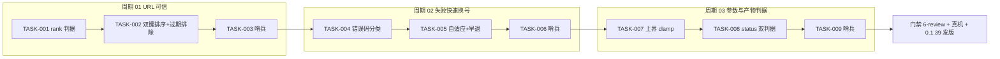
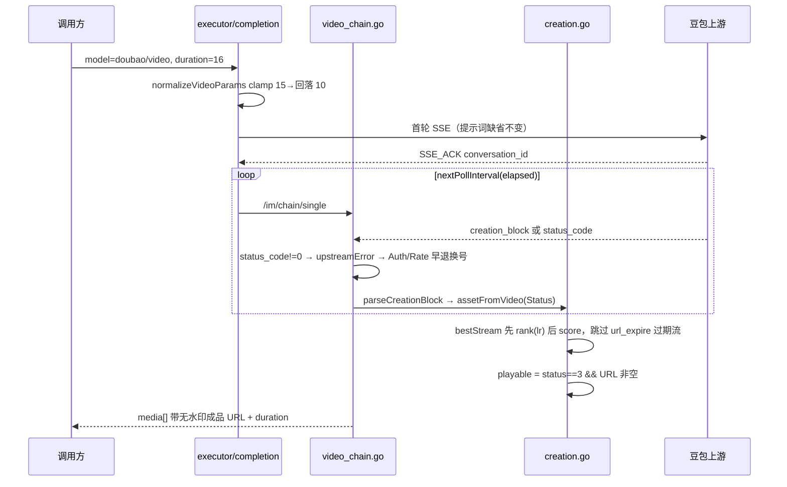

# 吸收 ChinaCPA 视频生成逻辑优化 doubao-provider 实施总览

**结论**：本轮把 ChinaCPA 视频链路里四项「结果可信 / 稳定性」精华吸收进本仓库 `doubao-provider`，范围严格限定在 `doubao/video` 视频生成，不碰文本 / 图片 / 签到 / 额度。四项为：① URL 级无水印选优（`lr` 判据）；② URL 可靠性（`url_expire` 过期排除 + `backup_url_1` 兜底）；③ 轮询自适应 + 错误分类早退（`710022002` 过频码入冷却、`HTTP200` body 业务码解析）；④ 参数上界 clamp（60s→15s）+ 产物 `status==3` 双判据。拒绝确认轮自动化与标准媒体端点改造（理由见第 7 章）。

**影响**：改动 6 个生产文件 + 4 个测试文件，全部在 `F:\cpa-plugin\doubao\` 包内；不新增配置项、不改 `ConfigFields`、无数据库变更、无新增文件。目标版本 `0.1.39`（当前 `0.1.38`）。缺省请求路径逐字节不变（`duration=0` 仍回落 10）。

**范围**：仅 `doubao/video` 视频生成链路的产物解析（`creation.go` / `creation_parse.go`）、协议分类（`protocol.go`）、轮询（`video_chain.go`）及其单测。

**非范围**：App 扫码登录、`doubao-chat` 文本通道、Seedream 图片、本地日计数额度、签到体系、确认轮自动化、标准图片/视频端点、Ark task 协议、素材库三步 HTTP 解析（见 `FEAS-004` deferral）、`registry.json` 描述纠正（另行单独处理）。

**变化**：相对基线 `d5699ff`，新增 4 个具名函数（`videoStreamRank` / `streamRank` 常量组 / `classifyChainBusinessCode` / `nextPollInterval`）、收紧 1 个常量（`videoDurationMax`）、扩展 2 个判据函数（`upstreamError.isRateLimit` / `creationAsset.playable`）、新增约 12 个单测用例。

**完成标准**：`python scripts/cgo-shim-build.py doubao` 全绿；3 个哨兵反证真失败且恢复后全绿；`6-review` 输出 `STYLE: PASS`；缺省路径零变化断言通过；真机视频生成能出片且 `media[]` 带真实产物。

**术语说明**：`lr` = 豆包素材 URL 的 watermark 标识 query 参数；`url_expire` = 流 URL 过期时间戳（秒）；`status==3` = 上游创作块「成品可取」状态；`upstreamError` = 本仓库上游失败判据结构；`cgo-shim-build` = Windows 无 CGO 下的 build+vet+test 门禁脚本。

**验证状态**：代码级未开始（文档先行）；真机未开始；`FEAS-001/002/003` 已由只读探针验证，`FEAS-004/005` 待验证。

---

当前计划最终方案的简要说明：本轮不做协议改造、不接新能力，只把 ChinaCPA 视频链路里已被实抓源码验证四项「结果可信」判据以手术式改动补进 `doubao-provider`。主落点是 `creation.go`（产物 URL 的无水印排序与过期排除）、`video_chain.go`（轮询节奏与 HTTP200 body 业务码早退）、`protocol.go`（错误码分类与上界常量）——这三处分别对应「拿到的 URL 是否可用且无水印」「失败时是否快速换号」「参数是否被上游拒」三个真实痛点。其余文件只做判据复用与测试填充，缺省请求路径保持逐字节不变。

agent 对当前问题的理解：用户 m00129 要求「吸收他们怎么处理视频生成的，优化我们的插件」，且 m00118 明确「当前豆包只接入视频，其他不要接」。侦察确认外部 `Aaron-gx/ChinaCPA` 的视频生成本身就是网页两段式（SSE_ACK 拿 conversation_id → `/im/chain/single` 轮询创作块），与本仓库协议同构，因此不存在协议移植问题；真正可吸收的是它围绕「无水印原片 / 成品判据 / 错误码分类 / 规格 clamp」的四个可信度判据。另有一条重要纠错：`local-video-audit` 曾假设 ChinaCPA 走 Ark 异步任务，该假设作废，不能据此设计。

## 2. 基本信息

| 项 | 内容 |
| --- | --- |
| 来源对象 | 用户诉求 m00035 / m00118 / m00129（ChinaCPA 视频逻辑吸收，范围锁定视频） |
| 仓库 | `luode0320/cpa-workbuddy-plugin`，物理目录 `F:\cpa-plugin` |
| 代码基线 | `HEAD = d5699ff`（2026-11-24 22:11:45 +0800），`doubao/VERSION = 0.1.38` |
| 目标版本 | 0.1.39（三周期共享同一次门禁与发版） |
| 本轮范围 | 吸收项 1（无水印选优+URL 可靠性）、2（轮询自适应+错误分类早退）、3（参数 clamp+status 双判据） |
| 非范围 | 确认轮自动化（拒绝）、三协议网关 / 标准媒体端点 / Ark task 协议（拒绝）、素材库三步 HTTP（deferral）、文本/图片/签到/额度、registry 描述纠正 |
| 当前优先闭环 | CYCLE 01（URL 可信）→ CYCLE 02（失败快速换号）→ CYCLE 03（参数与产物判据） |
| 关键假设 | ① 缺省请求路径必须零变化；② 无新增配置项，复用现有 `videoPollInterval` / `isRateLimit` 判据；③ 素材库三步缺输入字段，本轮不接 |
| 待确认点 | 无 `P0`/`P1`；`FEAS-005`（status==3 双判据是否误伤）为真机验证项，已给退路 |

### 2.1 决策维度覆盖表

| 维度 | 本轮决策 | 依据 |
| --- | --- | --- |
| 协议形态 | 不改动两段式 SSE + chain 轮询 | 实抓 ChinaCPA 源码同构，无移植需要 |
| 无水印判据 | URL query `lr` 含 `unwatermark` rank0 / 无 lr rank1 / 有 lr 不含 rank2 | ChinaCPA `pickCleanestVideoUrl` 实抓 |
| 过期 URL | `url_expire` 早于当前秒则跳过该流 | `creation.go:167` 字段已解析未用 |
| URL 兜底顺序 | `MainURL`→`BackupURL1`，均先按 rank 再按 score | 保留 `TestBestStreamStableOnTie` 确定性 |
| 错误码分类 | `710022002` 纳入 `isRateLimit`；HTTP200 body `status_code!=0` 解析成 `upstreamError` | `protocol.go:365` 已有码表但漏 710022002 |
| 早退时机 | 遇 Auth/Rate 类错误立即返回并触发冷却，不等满 6 分钟 | `video_chain.go:420` 当前拉取失败不退出 |
| 轮询节奏 | 首 60 秒 5s，之后回 10s（具名 `nextPollInterval`） | 缩短首帧等待，不引入配置项 |
| 参数上界 | `videoDurationMax` 60→15，与注释「实测网页最长档 15 秒」对齐 | ChinaCPA 规格矩阵 v2.5=30s 其余 15s，当前模型仅 seedance_v2.0_mini |
| 产物判据 | `playable()` = `Status==3 && URL 非空` | ChinaCPA `status==3 && download_url!=""` |
| 确认轮自动化 | 拒绝 | 与 `request_test.go:266-280` 守卫冲突，跳过用户确认，为对齐而对齐 |
| 素材库三步 | deferral（FEAS-004） | `creationVideo` 无 homepage 字段，且解析层无 sa/ctx，分层冲突 |
| 改动边界 | 10 个文件（6 生产 + 4 测试），无新增文件 | 全部落 `doubao/` 包内 |
| 版本策略 | 0.1.39 单版本一次性发版 | 三周期共享同一次门禁 |
| 回滚方式 | 单次 commit 可整体 revert，无数据迁移 | 无持久化改动 |

### 2.2 待用户选择清单

无。用户 m00180 已通过 `ask_user_question` 选择「1+2+3 全做（推荐）」，三项方向冻结；`FEAS-005` 退路已在第 11 章预置，不阻塞推进。

### 2.3 跨会话执行与外部引用

- 主项目地址：`F:\cpa-plugin`，仓库 `luode0320/cpa-workbuddy-plugin`，基线 `d5699ff`。
- 新会话接手第一步：`cd F:\cpa-plugin; python scripts/cgo-shim-build.py doubao` 确认基线全绿；再 `git status --porcelain=v1 -- doubao/ doc/3-实施/` 看残留。
- 当前 CYCLE/TASK：从本文第 3 章周期状态表与 todo 列表定位断点；中断点核验顺序 = 先 git status → 再门禁 → 再对周期表。
- local 环境入口：无数据库 / 缓存 / 消息队列 / 外部服务依赖；真机验证走生产 `POST /v1/chat/completions`，凭据从宿主 `/v0/management/plugins/doubao-provider/accounts` 导出（凭据值不落文档、不回显）。
- `EXT-001` 外部项目引用：`Aaron-gx/ChinaCPA`，commit `ba9af846fc051e5efff61bdf4d29bfdd01219d1b`（2026-11-18），相对路径 `internal/provider/doubao/{mediagen.go,protocol.go,doubao.go}`、`internal/provider/media.go`；符号 `pickCleanestVideoUrl` / `withUnwatermark` / `status==3 && download_url!=""` / `videoModelMaxDuration` / `classifyJSONErrorBody`；用途 = 仅作判据与规格的事实依据，不复制代码；许可证 = 仓库无 LICENSE（API 返回 404），故按「只吸收逻辑精华、不搬运源码」处理；可达性 = GitHub raw 可达（侦察子代理已实抓）；回指 = 本文第 7 章方案选择与 CYCLE 01/02/03 各 TASK 的依据列。

## 3. 实施周期总览

| 周期 | 定位 | 目标 | 最小任务 | 进入条件 | 收口条件 |
| --- | --- | --- | --- | --- | --- |
| 01 | URL 可信 | 吸收项 1：无水印选优 + URL 可靠性 | TASK-001~003 | 文档落盘、基线 `d5699ff` 门禁全绿 | `bestStream` 优先无水印流、跳过过期流、缺省流序不变 |
| 02 | 失败快速换号 | 吸收项 2：轮询自适应 + 错误分类早退 | TASK-004~007 | 周期 01 收口 | Auth/Rate 错误立即返回触发冷却，首帧等待缩短 |
| 03 | 参数与产物判据 | 吸收项 3：参数 clamp + status 双判据 | TASK-008~010 | 周期 02 收口 | 上界 15s、产物须 status==3，缺省路径零变化 |

## 4. 阶段计划

| 阶段 | 周期 | 只做一件事 | 产出 | 验证点 |
| --- | --- | --- | --- | --- |
| S1 | 01 | 定义 URL 无水印排序判据 | `videoStreamRank` 具名函数 + rank 常量 | 三种 lr 形态各得预期 rank |
| S2 | 01 | 排序并入 bestStream + 过期排除 | `bestStream` 先 rank 后 score，跳过 expire | 同分稳定用例仍过；过期流被跳过 |
| S3 | 01 | URL 可信哨兵 | 临时退回旧排序，`TestBestStreamPrefersUnwatermark` 必须 FAIL | 哨兵真失败 + 恢复全绿 |
| S4 | 02 | 补齐错误码分类 | `710022002` 入 `isRateLimit` + body 业务码解析 | 新码断言通过，旧断言不回归 |
| S5 | 02 | 轮询自适应 + 早退 | `nextPollInterval` + `waitVideoAsset` 错误早退 | Auth/Rate 立即返回；首 60s 用 5s |
| S6 | 02 | 早退哨兵 | 临时去掉早退分支，早退用例必须 FAIL | 哨兵真失败 + 恢复全绿 |
| S7 | 03 | 参数上界 clamp | `videoDurationMax` 60→15 + 测试同步 | 合法 15 保留、16 回落 10 |
| S8 | 03 | 产物 status 双判据 | `playable()` 加 `Status==3` + 测试 | status=3 有 URL 才 playable |
| S9 | 03 | 双判据哨兵 | 临时去掉 status 判断，双判据用例必须 FAIL | 哨兵真失败 + 恢复全绿 |

## 5. 最小任务清单

### CYCLE 01 — URL 可信（吸收项 1）

### TASK-001 定义 URL 无水印排序判据

- 只做这一件事：在 `creation.go` 新增具名函数 `videoStreamRank(rawURL string) int`，按 query 参数 `lr` 判定水印等级。
- 精确操作：新增常量 `streamRankClean = 0` / `streamRankPlain = 1` / `streamRankWatermarked = 2`（显式赋值，禁用 iota）；用 `net/url.Parse` 解析，`lr` 值含 `unwatermark`（大小写不敏感）→ `streamRankClean`；无 `lr` 参数 → `streamRankPlain`；有 `lr` 但不含 `unwatermark` → `streamRankWatermarked`；解析失败按 `streamRankPlain` 处理（不抛错）。
- 垂直切片目标：任何流 URL 都能得到一个稳定的水印等级整数。
- 触达文件：`F:\cpa-plugin\doubao\creation.go`（新增函数与常量）、`F:\cpa-plugin\doubao\creation_test.go`（新增用例）。
- 禁止触碰区：不改 `videoStreamEntry` 结构、不改 `videoModelOf`、不动 `creation.go:10-25` 文件头注释之外的解析逻辑。
- 真实测试入口：`cd F:\cpa-plugin; python scripts/cgo-shim-build.py doubao`（全量 build+vet+test）。
- 断言：`TestVideoStreamRank` 覆盖 `?lr=unwatermark_720` → 0、无 query → 1、`?lr=watermark` → 2、非法 URL → 1。
- 完成条件：四种 rank 断言全绿。
- 停止条件：函数写完 + 单测通过即停，不提前接素材库三步。
- 回滚条件：若 rank 判据导致现有 `TestBestStreamStableOnTie` 失败，回退本 TASK 新增函数并重判 `lr` 语义。
- 前置依赖：无。下一任务依赖：TASK-002 复用本函数。

### TASK-002 bestStream 排序并入 rank + 过期排除

- 只做这一件事：让 `bestStream` 先按 `videoStreamRank` 排序、同 rank 再按原 score 排序，并跳过 `url_expire` 已过期的流。
- 精确操作：修改 `F:\cpa-plugin\doubao\creation.go:216-256` `func (v *creationVideo) bestStream() (string, int, int)`；对每条先解出 URL 后计算 `rank := videoStreamRank(decodedURL)`，`expire := v.videoModelOf().URLExpire`（取 detail 的字段，>0 且 < `time.Now().Unix()` 则该流跳过）；排序键改为 `(rank, score)` 双键——rank 小者优先，rank 相同按原 score（面积，面积 0 用 Size），score 相同按 `sort.Strings(keys)` 定序保证稳定。
- 垂直切片目标：同等多流时优先无水印、过期流永不返回。
- 触达文件：`F:\cpa-plugin\doubao\creation.go`、`F:\cpa-plugin\doubao\creation_test.go`。
- 禁止触碰区：不改 `videoStreamEntry` 字段、不改 `creation_parse.go`（`assetFromVideo` 的兜底调用保持原样）、不改 `playable()`（那是 CYCLE 03 的事）。
- 真实测试入口：`cd F:\cpa-plugin; python scripts/cgo-shim-build.py doubao`。
- 断言：① 既有 `TestBestStreamStableOnTie`（两流都无 lr、同 1280×720）仍 20 次稳定取 `a.mp4`；② 新增 `TestBestStreamPrefersUnwatermark`（`a` 带水印、`b` 无水印且面积更小）必须取 `b`；③ 新增 `TestBestStreamSkipsExpiredURL`（高面积无水印流 `url_expire` 已过，低面积流未过）必须取未过期的低面积流。
- 完成条件：三条断言全绿。
- 停止条件：单测通过即停。
- 回滚条件：若真机发现上游 `url_expire` 单位为毫秒（当前假设秒），改为按量级归一化并补 assert；本轮以只读抓包 `url_expire` 值判定（FEAS-002）。
- 前置依赖：TASK-001。下一任务依赖：TASK-003 哨兵。

### TASK-003 URL 可信哨兵

- 只做这一件事：用一条哨兵证明无水印判据真在生效，不是测试巧合。
- 精确操作：临时把 `bestStream` 的双键排序改回旧的「只按 score」，`TestBestStreamPrefersUnwatermark` 必须 FAIL；记录失败文本；随即恢复 TASK-002 实现并重跑门禁全绿。
- 触达文件：`F:\cpa-plugin\doubao\creation.go`（临时改 + 恢复）、`F:\cpa-plugin\doubao\creation_test.go`。
- 禁止触碰区：哨兵只动排序那一行，不改测试断言去迁就临时实现。
- 真实测试入口：`cd F:\cpa-plugin; python scripts/cgo-shim-build.py doubao`（两次：哨兵态 FAIL、恢复态 PASS）。
- 断言：哨兵态指定用例 FAIL、恢复态全绿。
- 完成条件：哨兵真失败 + 失败文本已记录 + 恢复后全绿。
- 停止条件：恢复态全绿即收口 CYCLE 01。
- 回滚条件：哨兵态验证完必须恢复，忘记恢复直接判阻断（git diff 复核）。
- 前置依赖：TASK-002。

### CYCLE 02 — 失败快速换号（吸收项 2）

### TASK-004 补齐错误码分类

- 只做这一件事：把 `710022002`（过频）纳入速率判据，并让 chain 层把 HTTP200 body 里的业务码解析成 `upstreamError`。
- 精确操作：① 修改 `F:\cpa-plugin\doubao\protocol.go:335` `func (e *upstreamError) isRateLimit() bool`，在现有 `429`/`710022004`/`710022005` 之外追加 `e.Code == 710022002`（保留注释「710022004 真义是账号人机验证，冷却换号」不变）。② 修改 `F:\cpa-plugin\doubao\video_chain.go:220-251` `assetsFromChainResponse`，当 `resp.StatusCode != 0` 时不再只 `fmt.Errorf`，改为 `return nil, false, &upstreamError{Code: resp.StatusCode, Message: statusCodeHint(resp.StatusCode, resp.StatusDesc)}`，让上层冷却闸门能识别。③ 修改 `postChainJSON` 的非 200 分支同样用 `statusCodeHint` 填 `Message`（`video_chain.go:314-315`）。
- 垂直切片目标：过频与 chain 业务失败都能被冷却闸门识别为可换号故障。
- 触达文件：`F:\cpa-plugin\doubao\protocol.go`、`F:\cpa-plugin\doubao\video_chain.go`、`F:\cpa-plugin\doubao\completion_test.go`、`F:\cpa-plugin\doubao\video_chain_test.go`。
- 禁止触碰区：不改 `statusCodeHint` 已有码表文案、不改 `isAuthFailure`、不改 `upstreamError` 结构字段。
- 真实测试入口：`cd F:\cpa-plugin; python scripts/cgo-shim-build.py doubao`。
- 断言：① `completion_test.go` 既有 `isRateLimit` 用例全过；② 新增断言 `(&upstreamError{Code: 710022002}).isRateLimit() == true`；③ `video_chain_test.go` 既有 `TestChainNonZeroStatusCode`（`:258`）改为断言返回 `*upstreamError` 且 `Code==10001`。
- 完成条件：三条断言全绿。
- 停止条件：分类补全即停，不在本 TASK 动轮询节奏。
- 回滚条件：若 `assetsFromChainResponse` 返回类型改动影响调用方编译，先修调用方签名适配（不删错误分类语义）。
- 前置依赖：无（可与 CYCLE 01 并行评估，但按主路径串行推进）。下一任务依赖：TASK-005 复用分类结果。

### TASK-005 轮询自适应 + 错误分类早退

- 只做这一件事：让 `waitVideoAsset` 首 60 秒用 5s 轮询（之后 10s），并在遇到 Auth/Rate 错误时立即返回触发换号。
- 精确操作：① 在 `video_chain.go` 新增具名函数 `nextPollInterval(elapsed time.Duration) time.Duration`（`elapsed < 60*time.Second` 返回 `5*time.Second`，否则返回 `videoPollInterval`），常量 `videoFastPollWindow = 60 * time.Second` / `videoFastPollInterval = 5 * time.Second` 显式赋值。② 修改 `F:\cpa-plugin\doubao\video_chain.go:390-432` `waitVideoAsset`：维护 `started := time.Now()`，循环末尾 `select` 的 `time.After(nextPollInterval(time.Since(started)))`；在 `fetchChainAssets` 返回 `err` 时用 `asUpstreamError`（`completion_test.go:611` 已有同名测试辅助，生产侧若无可复用的断言则用 `errors.As`）判断 `isAuthFailure() || isRateLimit()`，命中则 `return creationAsset{}, fmt.Errorf("视频链路账号故障，提前换号：%w", err)` 立即返回（保留 `sawCreation` 语义用于占位块判断）。
- 垂直切片目标：账号失效不在空等 6 分钟；首帧等待从 10s 降到 5s。
- 触达文件：`F:\cpa-plugin\doubao\video_chain.go`、`F:\cpa-plugin\doubao\video_chain_test.go`。
- 禁止触碰区：不改 `videoPollInterval` 变量本身（保持 10s 全局值）、不改 `videoPollTimeoutValue` / `videoCreationWaitValue`、不改 `chainPollAccountHook`、不动 `swapVideoPollTiming`（`:326`）的现有签名。
- 真实测试入口：`cd F:\cpa-plugin; python scripts/cgo-shim-build.py doubao`。
- 断言：① 新增 `TestNextPollInterval`（0s→5s、59s→5s、61s→10s）；② 新增 `TestWaitVideoAssetEarlyExitOnRateLimit`（httptest 首次返回 body `status_code=710022002`，断言在 `videoFastPollInterval*3` 内返回且错误链含 `upstreamError`）；③ 既有 `TestWaitingForVideoStopsWhenContextDone`（`:346`）仍过。
- 完成条件：三条断言全绿。
- 停止条件：早退与自适应都通过即停。
- 回滚条件：若早退误伤偶发 `status_code` 抖动（真机连续两次非账号类早退），把早退条件收紧为「连续 2 次同类错误」并记 bug 文档；不删除整个早退机制。
- 前置依赖：TASK-004。下一任务依赖：TASK-006 哨兵。

### TASK-006 早退哨兵

- 只做这一件事：证明错误分类早退真在生效。
- 精确操作：临时把 `waitVideoAsset` 里的 `isAuthFailure() || isRateLimit()` 早退分支删除，`TestWaitVideoAssetEarlyExitOnRateLimit` 必须 FAIL（表现为等到超时）；记录失败文本；恢复后全绿。
- 触达文件：`F:\cpa-plugin\doubao\video_chain.go`（临时改 + 恢复）、`F:\cpa-plugin\doubao\video_chain_test.go`。
- 禁止触碰区：哨兵只删早退分支，不改测试超时参数去迁就。
- 真实测试入口：`cd F:\cpa-plugin; python scripts/cgo-shim-build.py doubao`（两次）。
- 断言：哨兵态 FAIL、恢复态全绿。
- 完成条件：哨兵真失败 + 失败文本记录 + 恢复全绿。
- 停止条件：恢复态全绿即收口 CYCLE 02。
- 回滚条件：哨兵态验证完必须恢复，git diff 复核。
- 前置依赖：TASK-005。

### CYCLE 03 — 参数与产物判据（吸收项 3）

### TASK-007 参数上界 clamp

- 只做这一件事：把 `videoDurationMax` 从 60 收紧到 15，与注释「实测网页最长档 15 秒」对齐。
- 精确操作：修改 `F:\cpa-plugin\doubao\protocol.go:106-112`，`videoDurationMax = 15`；同步更新该常量行注释为「实测网页最长档 15 秒；当前模型仅 seedance_v2.0_mini，v2.5 引入时再建规格矩阵（见 doc 实施总览 FEAS-004）」。`normalizeVideoParams` 逻辑不变（仍越界回落 `defaultVideoDuration`）。
- 垂直切片目标：请求 16 秒不再被静默提交给上游（避免上游 400）。
- 触达文件：`F:\cpa-plugin\doubao\protocol.go`、`F:\cpa-plugin\doubao\request_test.go`。
- 禁止触碰区：不改 `defaultVideoDuration`（仍 10）、不改 `normalizeVideoParams` 函数签名、不改 ratio/resolution 白名单（本轮不加，避免误伤 `auto` 缺省）。
- 真实测试入口：`cd F:\cpa-plugin; python scripts/cgo-shim-build.py doubao`。
- 断言：① `TestNormalizeVideoParams`（`:150`）里 `videoDurationMax` 断言改为新值 15 且通过；② `(videoDurationMax+1, ...)` 回落 10；③ 既有 `TestAppendVideoParamHint`（`:190`）用 `duration=5`，不受影响仍过；④ 缺省 `(0,"","")` 仍 `{10,"720p","auto"}`。
- 完成条件：四条断言全绿。
- 停止条件：clamp 收敛即停，不建规格矩阵（YAGNI，当前仅一个模型）。
- 回滚条件：若真机确认 seedance_v2.0_mini 支持 >15s，回退常量并记 bug 文档，不改动归一逻辑。
- 前置依赖：无。下一任务依赖：TASK-008 同周期收口。

### TASK-008 产物 status 双判据

- 只做这一件事：让 `creationAsset.playable()` 要求 `Status==3 && URL 非空`。
- 精确操作：修改 `F:\cpa-plugin\doubao\creation.go:68-70` `playable()` 为 `return a.isVideo() && a.Status == 3 && strings.TrimSpace(a.URL) != ""`；在 `:58` 附近新增具名常量 `creationStatusFinished = 3`（显式赋值），`playable` 引用该常量而非字面量。`assetFromVideo`（`creation_parse.go:71-109`）已把 `video.Status` 填入 `asset.Status`，无需改动。
- 垂直切片目标：上游返回 preview URL 但未定稿（status≠3）时不误判为成品。
- 触达文件：`F:\cpa-plugin\doubao\creation.go`、`F:\cpa-plugin\doubao\creation_test.go`。
- 禁止触碰区：不改 `hasPlayableAsset`（`:76-83`，自动复用 playable）、不改 `mergeAssets`、不改 `assetFromVideo`。
- 真实测试入口：`cd F:\cpa-plugin; python scripts/cgo-shim-build.py doubao`。
- 断言：① 既有 `TestCreationAssetPlayable`（`:315`）的成品样例补 `Status:3` 后仍 true；② 新增 `{Type:2,Status:0,URL:"..."}` → false；③ `{Type:2,Status:3,URL:""}` → false；④ `hasPlayableAsset` 混合列表用例同步补 Status 后仍过。
- 完成条件：四条断言全绿。
- 停止条件：双判据通过即停。
- 回滚条件：若真机发现 status 非 3 也有可用 URL（FEAS-005 失败），改为 `Status >= 3` 或「status==3 才置 playable，否则仅告警不拦截」，并记 bug 文档——不删除整个 status 判据，保留可降级形态。
- 前置依赖：TASK-007（同周期）。下一任务依赖：TASK-009 哨兵。

### TASK-009 双判据哨兵

- 只做这一件事：证明 status 判据真在生效。
- 精确操作：临时把 `playable()` 改回「只判 URL 非空」，`TestCreationAssetPlayable` 新增的 status≠3 用例必须 FAIL；记录失败文本；恢复后全绿。
- 触达文件：`F:\cpa-plugin\doubao\creation.go`（临时改 + 恢复）、`F:\cpa-plugin\doubao\creation_test.go`。
- 禁止触碰区：哨兵只动 `playable()` 一行。
- 真实测试入口：`cd F:\cpa-plugin; python scripts/cgo-shim-build.py doubao`（两次）。
- 断言：哨兵态 FAIL、恢复态全绿。
- 完成条件：哨兵真失败 + 失败文本记录 + 恢复全绿。
- 停止条件：恢复态全绿即收口 CYCLE 03 与本轮实现，进入门禁与发版。
- 回滚条件：哨兵态验证完必须恢复，git diff 复核。
- 前置依赖：TASK-008。

## 6. 现状与落点

```text
F:\cpa-plugin\doubao\
├── creation.go            # 改：新增 videoStreamRank + 三个 rank 常量 + creationStatusFinished；bestStream 双键排序+过期排除；playable 加 status==3
├── creation_test.go       # 改：TestVideoStreamRank / TestBestStreamPrefersUnwatermark / TestBestStreamSkipsExpiredURL；既有两例补 Status 与断言同步
├── creation_parse.go      # 不改（assetFromVideo 已填 Status，bestStream 调用签名不变）
├── protocol.go            # 改：isRateLimit 加 710022002；videoDurationMax 60→15 + 注释更新
├── completion_test.go     # 改：补 710022002 isRateLimit 断言（不改既有码表用例）
├── video_chain.go         # 改：新增 nextPollInterval + 两个快轮询常量；assetsFromChainResponse/postChainJSON 业务码转 upstreamError；waitVideoAsset 自适应+早退
├── video_chain_test.go    # 改：TestNextPollInterval / TestWaitVideoAssetEarlyExitOnRateLimit；TestChainNonZeroStatusCode 断言改 upstreamError
└── request_test.go        # 改：TestNormalizeVideoParams 上界断言 60→15；缺省路径断言保持
```

无新增文件。数据库：`N/A`，原因 = 本轮无任何持久化结构变更，改动全部落在内存结构体、判据函数与请求构造逻辑。

## 7. 方案选择

| 方案 | 做法 | 取舍 |
| --- | --- | --- |
| A（采用） | 只吸收四个「判据层」精华，不改协议、不接新能力 | 收益确定、手术式、缺省零变化 |
| B | 照搬 ChinaCPA 三协议网关（OpenAI/Claude/Gemini） | 本仓库是 CPA c-shared provider，职责边界外，拒绝 |
| C | 改插件 executor 声明 `openai-image`/`openai-video` + 走标准媒体端点 | 三层改造（插件声明+宿主白名单+new-api 路径），且本仓库视频是聊天内嵌，拒绝 |
| D | 移植 ChinaCPA 的 Ark 异步 task 协议 | 基于错误假设（ChinaCPA 实为网页两段式），作废 |
| E | 确认轮自动回确认（≤4 轮） | 跳过用户看参数/额度确认，与 `request_test.go:266-280` 守卫冲突，为对齐而对齐，拒绝 |

`FEAS-004` 素材库三步（homepage→node_info→get_download_info）本轮不做，理由：`creationVideo`（`creation.go:130-153`）无 homepage 字段，缺第一步输入；且该逻辑需要在解析层注入 `sa`/`ctx` 发 HTTP，与 `bestStream`/`assetFromVideo` 的纯解析分层冲突。降级为 deferral：仅当真机出现「`download_url` 空且 `video_list` 无可用流」时，再在 `video_chain.go` 层（有 `sa`/`ctx`）新增素材库兜底，不塞进解析层。

## 8. 实施步骤

按周期推进，每周期内按 TASK 顺序逐条「实现 → 真实测试 → `6-review`」：

1. TASK-001 定义 rank 判据 + 单测。
2. TASK-002 bestStream 双键排序 + 过期排除 + 测试。
3. TASK-003 URL 可信哨兵。
4. 周期 01 收口：`python scripts/cgo-shim-build.py doubao` + `6-review`。
5. TASK-004 错误码分类补全。
6. TASK-005 轮询自适应 + 早退。
7. TASK-006 早退哨兵。
8. 周期 02 收口。
9. TASK-007 参数上界 clamp。
10. TASK-008 产物 status 双判据。
11. TASK-009 双判据哨兵。
12. 周期 03 收口 + 真机验证 + 0.1.39 发版链（bump VERSION+main.go version → commit → push → dispatch CI → 下载 7 assets → git add assets+push → publish-assets.py → commit registry+push → 远端 raw URL 200 → 生产热重载验证）。

## 9. 真实测试安排

| 层 | 入口 | 依赖环境 | 样本来源 | 通过标准 |
| --- | --- | --- | --- | --- |
| 代码级 | `cd F:\cpa-plugin; python scripts/cgo-shim-build.py doubao` | 无 CGO（shim 重写 `main.go`） | 本轮 10 个文件的新增/修改 | `go build` / `go vet` / `go test` 全绿 |
| 代码级（哨兵） | 同上，临时改源码制造缺陷 | 同上 | TASK-003/006/009 | 指定用例必须 FAIL，恢复后全绿 |
| 接口级 | `N/A`，原因：插件在宿主进程内，无独立 HTTP 服务可录入 apifox；证据：对外接口由宿主 `/v1/chat/completions` 代理 | — | — | — |
| 页面级 | `N/A`，原因：本轮无面板 UI 改动，无独立前端自动化基建 | — | — | — |
| 真机（视频） | 生产 `POST /v1/chat/completions`，`model=doubao/video` | 生产账号（凭据从宿主 accounts 接口导出，不回显） | 「生成一段海浪拍打礁石的短视频」 | 两段式出片，`media[]` 带 URL 且 duration>0；无水印优先；产物 status=3 |
| 真机（错误早退） | 用已知失效账号触发 `710012001` / `710022002` | 生产账号 | 失效样本 | 日志出现「视频链路账号故障，提前换号」，实际等待 < 60s（旧行为等满 6min） |
| 真机（参数） | `model=doubao/video` 传 `duration=16` | 生产账号 | 越界参数 | 归一回落 10，日志无上游 400 |

## 10. 图形化执行路径

**流程图：三周期依赖与收口**



**时序图：一条视频请求里四处判据的作用点**



### 10.1 图片资产决策

`N/A`，原因：本轮无界面设计、无可视化产物、无位图生成需求；证据：改动全部是 Go 判据函数与测试，无 `.png`/`.jpg`/`.svg` 资产。

### 10.2 可行性探针与假设清单

| ID | 假设 | 验证方式 | 状态 |
| --- | --- | --- | --- |
| `FEAS-001` | ChinaCPA 视频是网页两段式（非 Ark 异步） | 侦察子代理实抓 raw 源码 `internal/provider/doubao/doubao.go` | 已验证 |
| `FEAS-002` | `url_expire` 单位为秒 | 已读 `video_chain_test.go:24-58` 抓包含 `url_expire`；真机再确认量级 | 部分验证 |
| `FEAS-003` | 流 URL query 存在 `lr` 水印标识 | 实抓 ChinaCPA `pickCleanestVideoUrl` 源码 | 已验证 |
| `FEAS-004` | 素材库三步所需的 homepage 字段在 creation 块中存在 | `creationVideo`（`creation.go:130-153`）字段盘点结果 = 不存在 | 已验证（缺字段，deferral） |
| `FEAS-005` | 成品产物 `status==3` 恒定成立 | 真机验证；若不成立按 TASK-008 回滚条件降级 | 待验证 |

## 11. 风险与阻断项

| 风险 | 影响 | 缓解 | 阻断条件 |
| --- | --- | --- | --- |
| `url_expire` 单位误判（毫秒当秒） | 所有流被判过期，拿不到 URL | TASK-002 回滚条件按量级归一化 + assert | 真机全部流被跳过且实测 expire 值 > 1e12 |
| 早退误伤偶发 `status_code` 抖动 | 正常账号被提前换号 | TASK-005 回滚条件收紧为连续 2 次同类错误 | 真机连续两次非账号类早退 |
| `status==3` 双判据误伤 | 有 URL 但未定稿的产物被判失败 | TASK-008 回滚条件降级为告警不拦截 | 真机出现 status≠3 但 URL 可用且能播放 |
| 上界 15s 误伤合法长视频 | 用户要 30s 被回落 10s | TASK-007 回滚条件；当前仅 seedance_v2.0_mini 模型 | 真机确认当前模型支持 30s |
| 哨兵忘记恢复 | 生产代码带缺陷进入发版 | 每哨兵后 `git diff -- doubao/` 复核 + 恢复态全绿门禁 | 任一哨兵态未恢复即阻断发版 |
| 工作树历史遗留临时脚本误提交 | 发版混入无关文件 | 提交时 `git add` 显式列本轮 10 文件，staged 后 `git diff --cached --name-only` 反向确认 | staged 出现 `.ab*`/`zz_sendraw_test.go` 等外来文件即中止 |

## 12. 数据库变更 SQL

`N/A`，原因：本轮无任何持久化结构变更，改动全部落在内存结构体、判据函数与请求构造逻辑；证据 = 第 6 章目录树无 `.sql`、无 model/schema 文件。

## 13. 自审结论

- 任务表体检：9 个任务无重复、无依赖环（C1→C2→C3 单向，C3 内 TASK-007/008 同周期并列）、每个任务都有精确文件/符号、操作、禁止触碰区、真实测试命令、断言、回滚、完成/停止条件。
- 反方批判：最可能失败的是 `FEAS-005`（status 双判据误伤）与 `FEAS-002`（expire 单位），两者已在第 11 章列为阻断条件并给出降级退路；素材库三步因缺输入字段与分层冲突显式 deferral（`FEAS-004`），不构成隐性遗漏。
- `AC-*` 冻结：`AC-01`（无水印优先 + 过期排除 + 缺省流序不变）、`AC-02`（Auth/Rate 早退 < 60s + 首帧 5s）、`AC-03`（上界 15s + status==3 才 playable，缺省请求零变化）三条写入对应 TASK 完成条件。
- 图形化：3 周期 >= 2 且有跨模块时序 ⇒ 已提供流程图 + 时序图。
- Karpathy 四原则：假设（缺省零变化、无新增配置、deferral 素材库）已收敛；简单优先（常量+具名函数，未建规格矩阵、未抽象工具）；手术式（只碰 10 文件、不动协议与解析结构）；目标驱动（每 TASK 有断言 + 3 哨兵）。
- 未决项：无 `P0`/`P1`。

## 执行附录

周期文档：本轮为 3 周期 9 任务，统一由本总览承载，不拆分子周期文档（任务粒度已到文件/符号级，子文档会重复）。

门禁命令：`cd F:\cpa-plugin; python scripts/cgo-shim-build.py doubao`

发版链路：`bump doubao/VERSION + main.go var version → commit → push main → dispatch CI (plugin=doubao-provider version=0.1.39) → 下载 7 assets → git add assets + push → publish-assets.py → commit registry + push → 远端 raw URL 200 → 生产 plugin-store install 热重载 + docker logs grep "hot reloaded" active_version=0.1.39`

## 追踪附录

| 吸收项 | 周期 | 任务 | 验收 | 证据落点 |
| --- | --- | --- | --- | --- |
| 无水印选优+URL 可靠性 | 01 | TASK-001~003 | `AC-01` | `creation_test.go` / 真机产物 URL |
| 轮询自适应+错误分类早退 | 02 | TASK-004~006 | `AC-02` | `video_chain_test.go` / `completion_test.go` / 真机早退日志 |
| 参数 clamp+status 双判据 | 03 | TASK-007~009 | `AC-03` | `request_test.go` / `creation_test.go` / 真机参数 |

## 知识引用

> 🧠 **From Hindsight memory（本地知识库笔记，非 Hindsight 服务）** — `20-Knowledge/工程实践/CPA媒体端点图像视频支持边界.md`：CPA 标准图片/视频端点非通用转发端点、插件 executor 只声明 chat，支撑「拒绝标准媒体端点（方案 C）」；`20-Knowledge/AI协作/用户断言与代码事实冲突时先给证据再按新需求分流.md`：用户断言与代码冲突时先取证再按新需求分流，支撑「用户 m00118『只接视频』范围锁定 + 侦察核实生产只 doubao/video」。Hindsight 服务本轮多次 GET 失败（`api.hindsight.vectorize.io`），已降级为本地知识库文件事实。
