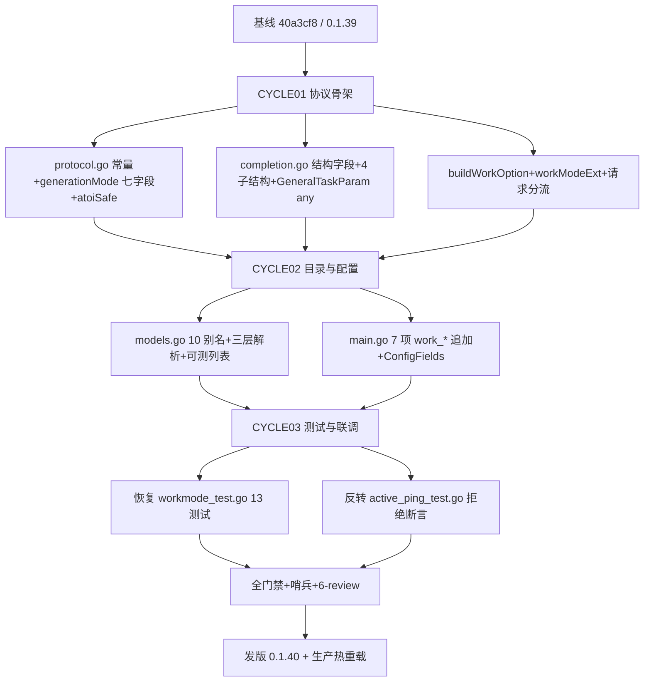
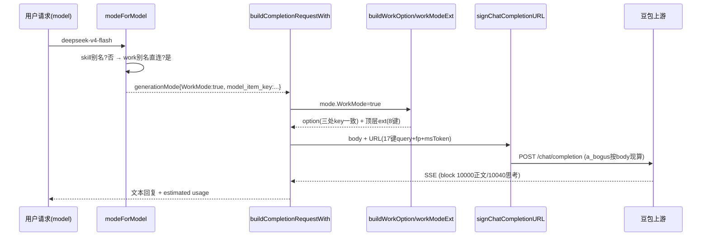

# 豆包工作模式模型重新开放（路径 D）实施总览

结论：本轮要重新开放豆包的工作模式文本模型，做法是把本插件早前删掉的那套能力按原来的设计逐步加回来，模型清单继续由现有接口自动获取，不引入新的运行时或依赖。影响：只改这个插件内部六个文件，新增七项配置，不影响现有视频生成功能，目标版本是 0.1.40。范围：恢复工作模式的请求构造、模型目录、配置和测试四块内容。非范围：视频生成链路、令牌用量估算、模型自动获取接口本身、第三方命令行工具、图像与签到等功能都不改。变化：相对当前基线，增量恢复约二十个符号和常量、追加七项配置、恢复十三个历史测试并纠正一处测试断言。完成标准：统一门禁全绿，工作模式与视频两条链路的测试都通过，风格回归通过。术语说明：工作模式是指由上游按指定模型处理文本任务的链路，视频模式是现有生成视频的另一条链路，两者互不干扰。验证状态：需求与探测已完成，请求格式已被上游接受，只有真实出字效果仍需换一个未被限制的网络环境补验，不阻碍本次实施。

## 当前计划最终方案简要说明

本轮不引入任何新协议或第三方运行时，只把 0.1.26（commit `5707b5d`）删除的工作模式能力按符号增量恢复到当前 0.1.39 代码上。主落点四个文件——`protocol.go` 恢复请求常量与 `generationMode` 七字段、`completion.go` 恢复 `buildWorkOption`/`workModeExt` 与请求分流、`models.go` 恢复 10 条别名与三层解析、`main.go` 追加 7 项配置——这四处分别对应「请求形状」「模型选择」「模型目录」「运行参数」。之所以能零新增依赖：动态模型发现（`model_discovery.go`）从没被删、线上在用，满足用户「通过接口自动获取模型」约束；正确 `model_item_key` 从本仓库 `5707b5d^` 历史直接取，与第三方 `dsh-connect-doubaowork` 的静态表逐条一致，无需 Node CLI。所有工作模式分支由 `mode.WorkMode` 隔离，视频路径不受影响。

agent 对当前问题的理解：用户 m01077「我们想把豆包工作模式的模型也开放出来使用」是一次需求转向（此前 0.1.26/CHG-001 把插件收敛为「只做视频」）。侦察阶段历经 G1（新请求形态来源）、G3（完整 10 模型 + 动态获取）、G4（架构冲突 A/B/C）三轮决策，最终由用户 m02154「我们之前的提交有做过的吧? 后来删除了」触发史实核查，推翻 G4 三选项：工作模式在 0.1.26（非 CHG-001）删除，模型发现从没删，正确映射在 git 历史里。用户 m02199「探活并进入实施规划」授权真实 Cookie 探活 + 实施规划。探活结果：3 账号登录态有效、1 过期；工作模式请求 3 模型均无 `-1`（历史最大障碍在正确网页协议口径下不是必然），但生产出口 IP 被持续风控（710022002×2 / 710022004×1），未取到出字铁证——这不阻断实施，行为验收改由干净网络补取。

## 2. 基本信息

| 项 | 内容 |
| --- | --- |
| 来源对象 | 用户 m01077（开放工作模式模型），经 m02109（完整 10 模型+动态获取）、m02154（史实核查）、m02199（探活+实施规划）收敛 |
| 仓库 | `luode0320/cpa-workbuddy-plugin`，物理目录 `F:\cpa-plugin` |
| 代码基线 | `HEAD = 40a3cf8`（工作树干净，doubao 目录无未提交改动）；`doubao/VERSION = 0.1.39`；生产 `active_version = 0.1.39` |
| 目标版本 | 0.1.40（三周期共享一次门禁与发版；发版沿用 `project-cpa-workbuddy-plugin-release-rules` 13 步链路） |
| 历史恢复基线 | `5707b5d^`（即 `f032d8a`，0.1.25），只读 worktree 在 `C:\Users\luode\AppData\Local\Temp\cpa-wm-probe`；禁止整体 revert（会连带删视频两段式） |
| 本轮范围 | CYCLE01 协议骨架 → CYCLE02 模型目录与配置 → CYCLE03 测试恢复与联调 |
| 非范围 | 视频链路、`convert.go`/`model_discovery.go`（已正确）、Node CLI、签到/额度/图片、registry description |
| 当前优先闭环 | CYCLE01（能按工作模式形状发出请求且 JSON 形状对齐） |
| 关键假设 | ① 缺省/视频路径逐字节不变；② 复用现有 `buildBusinessQuery`（不新增 buildClientQuery）；③ `local_permissions.status=3`、usage 用 `estimateTokens`；④ `-1` 判据保留不改 |
| 待确认点 | 无 P0/P1；FEAS-005（出字铁证）为真机行为验收项，需干净网络，不阻断代码实施 |

### 2.1 决策维度覆盖表

| 决策维度 | 结论 | 依据 |
| --- | --- | --- |
| 请求形态来源 | 我方历史网页协议（17 键 query，aid=497858） | 探活证明签名/形状被接受（无 710020202/710022013）；第三方 body 口径相反不可用 |
| 模型目录 | 静态 10 别名（测试/选择）+ 动态发现 67 条代号（展示）并存 | 用户「通过接口自动获取模型」由 `model_discovery.go` 满足；代号无法映射具体模型（`active_ping.go:126`） |
| model_item_key | 从 `5707b5d^:doubao/models.go:78-159` 逐条恢复 | 与 `dsh-connect-doubaowork` catalog.js:31-42 逐条一致，无需 Node CLI |
| GeneralTaskParam 冲突 | `completionOption.GeneralTaskParam` 改 `any` 多态 | 视频确认轮 `*generalTaskParamPayload`（4 字段）与工作模式 6 字段结构互斥且要求视频逐字节不变 |
| modeForModel 语义 | 保留 `(mode, bool)` 严格命中，未知名仍 false | 与当前「不静默替换」一致；工作模型名返回 true 即可通过面板测试 |
| -1 处理 | 保留 `failover.go` 现状（isAccountFailure 不含、shouldRotate 含） | 探活无 -1 不代表可选；换号不清冷却是既定语义 |
| 配置 | 追加 7 项 work_*，不动现有 8 项 | ConfigFields 用 reflect 校验，必须逐项声明 |

### 2.2 待用户选择清单

无。G1/G2/G3/G4 已全部关闭，路径 D 已由用户 m02199 授权。

### 2.3 跨会话独立执行与外部项目代码引用清单

新会话接手第一步：`cd F:\cpa-plugin && git status --porcelain doubao/ doc/`（确认基线干净）；再读本文档 + 需求主文档 `doc/2-需求/2026-11-25_231800_豆包工作模式模型重新开放需求.md`；恢复代码时以只读 worktree `C:\Users\luode\AppData\Local\Temp\cpa-wm-probe\doubao` 的 `5707b5d^` 源码为逐符号参照（若 worktree 已清理，用 `git show 5707b5d^:doubao/<file>` 重建）。

外部项目代码引用（仅侦察记录，路径 D **不依赖**任何第三方源码）：

| ID | 地址 / 提交 | 相对路径 / 符号 | 用途 | 许可证 | 可达性 | 回指 |
| --- | --- | --- | --- | --- | --- | --- |
| EXT-001 | Aaron-gx/ChinaCPA @ 572da294 | `internal/provider/doubao/protocol.go:259 textSubmitPayload` | 文本链路侦察（提交+轮询两段式），最终未采用其协议 | MIT | 已克隆只读 | 需求文档 §G1/G3 |
| EXT-002 | Joseph2Young/dsh-connect-doubaowork @ main | `catalog.js:31-42`、`doubao-protocol.js:100-239` | 交叉验证 10 条 model_item_key；其 body 口径与我方相反，不采用 | 见仓库 | 已克隆只读 | 需求文档 §G4 |

## 3. 实施周期总览

| 周期 | 主题 | 生产文件 | 真实测试 | 完成判据 |
| --- | --- | --- | --- | --- |
| CYCLE01 | 协议骨架与请求体恢复 | `protocol.go`、`completion.go` | 工作模式 option JSON 形状 6 个单测 | 工作模式请求能构造且形状对齐，视频路径不变 |
| CYCLE02 | 模型目录与配置恢复 | `models.go`、`main.go` | 别名解析/指纹/query 6 个单测 + `TestDoubaoRegistrationDeclaresAllConfigFields` | 10 别名可解析、7 配置已声明 |
| CYCLE03 | 测试恢复与系统联调 | `workmode_test.go`（恢复）、`active_ping_test.go`（反转） | 全门禁 + 13 历史单测 + 哨兵 + 6-review | 全绿、STYLE PASS、视频回归绿 |

## 4. 阶段计划

图形目的：展示三周期从协议骨架到测试联调的推进顺序与依赖关系；关联 ID：CYCLE01~CYCLE03、TASK-001~TASK-009。



## 5. 最小任务清单

### CYCLE01 — 协议骨架与请求体恢复

**TASK-001（protocol.go）**
- 文件：`F:\cpa-plugin\doubao\protocol.go`
- 操作：在 `const` 块（:39-110）追加 7 常量，取值严格照 `5707b5d^:doubao/protocol.go:83-104`：`workConversationMode=2`、`defaultWorkModeID="3"`、`defaultWorkReasoningEffort="4"`、`defaultWorkMemoryProfile="300k_230"`、`defaultWorkTotalWindow="300000"`、`needDeepThinkOn=10001`、`workWorkspaceMarker="\\Doubao"`。把 `generationMode`（:172-177）从 2 字段扩为 7 字段，追加 `ModelItemKey/MemoryProfile/TotalWindow/ReasoningEffort string` + `WorkMode bool`，字段顺序与注释照 `5707b5d^:doubao/protocol.go:117-132`。新增 `atoiSafe(s string) int`（逐位累加数字前缀，无前缀返回 0），照 `5707b5d^:doubao/protocol.go:402-414`。
- 禁止触碰区：`buildBusinessQuery`（:199-229，17 键一块不动）、`fingerprintOf`（:253）、`statusCodeHint`（:363）、视频常量 `skillVideoGen/videoDurationMax`、文件头「只做视频」注释仅改「工作模式已删」那 3 行为「已恢复」措辞，不改其余。
- 真实测试：`python scripts/cgo-shim-build.py doubao`（build+vet+test）；断言 `TestAtoiSafe` 覆盖 `"4"`/`"4 "`/`"abc"`。
- 完成条件：常量 7 项齐全、generationMode 7 字段、atoiSafe 全绿、门禁通过。
- 停止条件：出现任何 `channel/client_platform/chromium_version/runtime_version` 进入 query 的迹象立即停（走错管线→-1）。

**TASK-002（completion.go 结构与字段）**
- 文件：`F:\cpa-plugin\doubao\completion.go`
- 操作：`completionOption`（:126-192）追加字段（照 `5707b5d^:completion.go:128-147`）：`ConversationMode int json:"conversation_mode,omitempty"`、`ConversationInitOption *conversationInitOption json:"conversation_init_option,omitempty"`、`ConversationInitExt *conversationInitExt json:"conversation_init_ext,omitempty"`；把 `IsOldUser`/`MessageStorageType` 从当前指针形态（:190-191，`*bool`/`*int`，视频确认轮专用）改为工作模式需要的非指针 `bool`/`int` 会破坏视频确认轮——因此保留当前指针字段不动，工作模式所需同名语义由 `buildWorkOption` 填充时统一（见 TASK-003 决策）。关键：`GeneralTaskParam` 字段（:186）类型从 `*generalTaskParamPayload` 改为 `any`（json tag 保持 `general_task_param,omitempty`），视频确认轮继续填 `*generalTaskParamPayload`（逐字节不变），工作模式填新版 6 字段 `*generalTaskParam`。新增 4 结构：`conversationInitOption`（ProjectID/NeedAckConversation）、`conversationInitExt`（ModelItemKey/ReasoningEffort/ModeID/AgentTaskParam）、`agentTaskParam`（RuntimeType+5 空字段）、`generalTaskParam`（Action/ThreadLocalMessageID/ProjectID/RuntimeType/AgentTaskParam/ServerDoCompare），字段与 json tag 照 `5707b5d^:completion.go:184-222`。`aggregateParams`（:217-227）与 `modelConfig`（:230-234）当前已具备所需字段，仅核对无缺。
- 禁止触碰区：`permission`（:87）、`clientMeta`（:73）、`generalTaskParamPayload`（:198，视频确认轮专用，保留）、`recoveryOption`（:210）、`confirmExt`（:506）、`skillExt`（:413）、`buildVideoConfirmAbility`（:532）。
- 边界（`GeneralTaskParam` 改 `any` 后）：**禁止给该 any 字段赋 typed-nil 指针**（如 `var p *generalTaskParamPayload=nil; option.GeneralTaskParam=p`）——`request_test.go:282` 用 `body.Option.GeneralTaskParam != nil` 断言首轮应为 nil，typed-nil 装进 interface 后 `!= nil` 为真，会让首轮形状测试误判。首轮/Gap 分支一律不赋值（零值 nil interface），只有确认轮与工作模式分支显式赋具体指针。
- 真实测试：门禁 + `TestWorkOptionJSONShape`（JSON 形状断言：connector_info_list/edit_query_id/regen_query_id 为 `[]`、related_deleted_message_ids 为 `{}`、recovery_option.req_create_time_sec 为当前秒）。
- 完成条件：结构字段齐全、门禁通过、视频确认轮 JSON 形状断言仍绿。
- 停止条件：`*generalTaskParamPayload` 被改动或删除立即停（视频确认轮会退化）。

**TASK-003（completion.go 请求构造与分流）**
- 文件：`F:\cpa-plugin\doubao\completion.go`
- 操作：新增 `buildWorkOption(cfg Config, sa *StoredAuth, mode generationMode, localMessageID string, needCreate bool) completionOption`，逐行照 `5707b5d^:completion.go:430-516`（AgentMode=1、NeedDeepThink=needDeepThinkOn、ConversationMode=workConversationMode 整数、AggregateParams.ConversationMode=strconv.Itoa(workConversationMode) 字符串、三处 model_item_key 一致、general_task_param 双写、ConnectorInfoList/EditQueryID/RegenQueryID=`[]any{}`、RecoveryOption 当前秒）；新增 `workModeExt(generalTaskJSON string) map[string]string` 照 `5707b5d^:completion.go:525-536`（顶层 ext 8 键）。在 `buildCompletionRequestWith`（:274-334）的 option 组装处按管线三分支：`if confirm {…}` → `else if mode.WorkMode {…}` → `else {…}`；工作模式分支只替换 option/ext 的取值——`body.Option=buildWorkOption(currentConfig(),sa,mode,localMessageID,needCreate)`，`generalTaskJSON, err := json.Marshal(body.Option.GeneralTaskParam)` **必须显式判 err（禁 `generalTaskJSON, _ :=` 吞错误）**，`body.Ext=workModeExt(string(generalTaskJSON))`。关键：该分支复用函数开头已组装好的同一个 `body`（client_meta/messages/user_context/resume 通用字段）——可以像历史 `5707b5d^:completion.go:306-310` 那样在分支末尾 `return body`（返回的就是开头那个实例，正确），但**不得在函数开头提前返回跳过通用字段组装，也不得新建第二个 body**，否则会丢会话续接点与消息块。`applyUpstreamHeaders`（:872）无需改（当前单参、header 值与历史一致）。
- 禁止触碰区：`confirm` 分支（:321-330）、视频 `buildConfirmOption`/`buildVideoConfirmAbility`、`buildSkillOption` 既有取值、`streamCompletion`/`collectCompletion`。
- 真实测试：门禁 + `TestBuildWorkOptionContract`/`TestBuildWorkOptionModelKeyConsistent`/`TestWorkOptionCarriesWebDefaults`。
- 完成条件：工作模式 option 可构造、三处 model_item_key 一致、视频 confirm/skill 两条路径原样通过。
- 停止条件：工作模式请求里出现 `x-flow-trace`/`last-event-id` 头或 `Content-Type` 带 `; encoding=utf-8` 立即停。

### CYCLE02 — 模型目录与配置恢复

**TASK-004（models.go 别名与解析）**
- 文件：`F:\cpa-plugin\doubao\models.go`
- 操作：新增 `var workModelAliases = []modelAlias{...}` 10 条，逐条照 `5707b5d^:models.go:78-159`（字段 ID/DisplayName/Description/ModelItemKey/MemoryProfile/TotalWindow，10 条 model_item_key 见需求文档 §3.1）；新增 `const defaultWorkModelID="deepseek-v4-flash"`；新增 `aliasForWorkModel(name string) (modelAlias,bool)` 照 `:238-246`；新增 `workModeForAlias(alias modelAlias, allowWorkMode bool) generationMode` 照 `:255-283`（Skill!=0 保持技能模式；否则展开工作模式字段并补默认值）；把 `modeForModel`（:91-99）改为三层解析照 `:210-232`——① skill 别名优先（`alias.Skill!=0` → `workModeForAlias(alias,false)`）；② 工作模型名直连（`aliasForWorkModel` 命中 → `workModeForAlias(alias,true)`）；③ 纯对话/未知名回落 `defaultWorkModelID`。但保留当前 `(generationMode, bool)` 签名：命中 10 工作别名或 video 别名返回 `(mode,true)`，其余返回 `(_,false)`——未知名仍失败，不静默替换（与当前 `TestRunActiveTestRejectsUnknownModel` 一致）。
- 禁止触碰区：`normalizeModelName`（:74）、`kindForAlias`（:116）、`modelIDPrefix`/`referenceCreated`、`catalogueWithUpstream`（:333）、`authForModelRequest`（:368）、`capabilityAliases` 的 video 条目内容。
- 真实测试：门禁 + `TestBuildSkillOptionKeepsWebPipeline`（技能别名仍走 agent_mode=2）+ 工作模型名解析测试。
- 完成条件：10 别名可解析、未知名仍 false、视频别名仍走技能管线。
- 停止条件：`capabilityAliases` 的 video 被改成工作模式立即停。

**TASK-005（models.go 目录与可测列表）**
- 文件：`F:\cpa-plugin\doubao\models.go`
- 操作：`catalogueModels`（:131-142）与 `testableAliases`（:152-154）把 `workModelAliases` 合并进来（去重按小写 ID，能力别名在前）；`testableModelIDs` 随之覆盖 10 个工作模型名。`catalogueWithUpstream`（:333）保持能力别名在前 + 动态代号在后的合并顺序（动态发现已满足用户约束，不改其内部逻辑，仅确认工作别名进入 `catalogueModels` 后自动带上）。
- 禁止触碰区：`modelInfoForAlias` 的 `default` 标记逻辑（:184，`alias.ID==defaultModelID` 仍 video）。
- 真实测试：门禁 + `TestDoubaoCatalogueIncludesWorkModels`（新增：目录含 10 工作别名 + video）。
- 完成条件：面板模型列表可见 10 工作模型、动态代号仍可见、`default` 仍 video。
- 停止条件：动态发现链路被改动立即停。

**TASK-006（main.go 配置）**
- 文件：`F:\cpa-plugin\doubao\main.go`
- 操作：`Config`（:80-122）追加 7 项（照 `5707b5d^:main.go:87-100`）：`WorkBotID/WorkModeID/WorkReasoningEffort/WorkMemoryProfile/WorkTotalWindow string`、`WorkEnableSandbox bool`、`WorkWorkspace string`，各带 yaml+json tag 与中文注释；`defaultConfig`（:128）追加 7 默认值（照 `:112-118`：`WorkBotID=defaultBotID`、`WorkModeID=defaultWorkModeID`、`WorkReasoningEffort=defaultWorkReasoningEffort`、`WorkMemoryProfile=defaultWorkMemoryProfile`、`WorkTotalWindow=defaultWorkTotalWindow`、`WorkEnableSandbox=false`、`WorkWorkspace=""`）；`ConfigFields`（:275-285）追加 7 项（照 `:278-284`，`work_enable_sandbox` 用 `ConfigFieldTypeBoolean`）。**另必须在 `configurePlugin`（:413）的解码链（:424-456，`yaml.Unmarshal(req.ConfigYAML,&decoded)` 之后）补 7 项 work_* 分支**：6 个字符串项照 `5707b5d^:main.go:392-408` 用 `if decoded.X != "" { cfg.X = decoded.X }`（空值回落默认、不覆盖），`WorkEnableSandbox` 照 `:411` 用直接赋值 `cfg.WorkEnableSandbox = decoded.WorkEnableSandbox`（布尔无「空值」语义，需支持显式 false 关闭）。**漏这一处则用户 YAML 里的 work_* 被静默忽略**：`defaultConfig` 有默认值故功能仍能跑，但用户改的配置全部无效——这是配置链路断点，不可省。现有 8 项配置与其默认值一字不改。
- 禁止触碰区：现有 8 项配置、`keepalive_enabled` 的 boolean 声明（当前是 `*bool` 指针判 `!= nil`，不要照历史改成裸 bool）、registration capability（:287-297）。
- 真实测试：门禁 + `TestDoubaoRegistrationDeclaresAllConfigFields`（`main_test.go:51-81`，reflect 校验每个 yaml 键都声明）+ 新增 `TestConfigurePluginWorkFields`（构造含 7 项 work_* 的 config_yaml，调 `configurePlugin` 后断言 7 项值与传入一致、缺省项回落默认，证明解码链通）。
- 完成条件：15 项配置齐全且全部声明、7 项 work_* 解码链通（新测试绿）、门禁通过。
- 停止条件：现有配置项被删或默认值被改立即停。

### CYCLE03 — 测试恢复与系统联调

**TASK-007（恢复 workmode_test.go）**
- 文件：`F:\cpa-plugin\doubao\workmode_test.go`（当前不存在，新建）
- 操作：从 `5707b5d^:doubao/workmode_test.go`（551 行、13 测试）恢复，按当前 head 适配**五处**：① `localPermissionsFor()` 当前无参（历史有 workMode 参），调用改无参；② `applyUpstreamHeaders(req)` 当前单参（历史双参），调用改单参；③ `buildCompletionRequest` 当前带 `params ...videoParams` 变参，工作模式调用不传即可（兼容）；④ **字段形态**：历史 `IsOldUser bool` / `MessageStorageType int` / `GeneralTaskParam *generalTaskParam` 是值形态，当前 head `IsOldUser *bool`（`completion.go:190`）/ `MessageStorageType *int`（:191）为指针、`GeneralTaskParam` 经 TASK-002 改为 `any`，恢复的断言要按当前形态取指针解引用或类型断言（例如 `if body.Option.IsOldUser==nil || *body.Option.IsOldUser!=true`，工作模式 `gtp,ok:=body.Option.GeneralTaskParam.(*generalTaskParam)`），**直接照抄历史断言会编译失败**；⑤ 历史测试引用的 `TestAtoiSafe`/`TestDeviceIDForIsStable` 依赖的 `atoiSafe`/`deviceIDFor`/`fingerprintOf` 当前已存在（`protocol.go:268/:253`），无需再恢复符号，仅确认签名一致。13 测试名见需求文档 §5，关键断言：三处 model_item_key 一致、conversation_mode 整数 vs 字符串、status=3、两管线 query 去 a_bogus/web_tab_id 后逐字相同且 4 个客户端键必须空、header 无 x-flow-trace/last-event-id、JSON 形状 [] 与 {}、req_create_time_sec 当前秒。
- 禁止触碰区：不修改任何生产代码来迁就测试；适配只在测试文件内做。
- 真实测试：`python scripts/cgo-shim-build.py doubao`，13 测试全绿。
- 完成条件：13 测试恢复且全绿。
- 停止条件：需改生产代码才能让测试通过立即停（回查是否符号恢复遗漏）。

**TASK-008（反转 active_ping_test.go）**
- 文件：`F:\cpa-plugin\doubao\active_ping_test.go`
- 操作：把 `TestRunActiveTestRejectsRemovedWorkModels`（:265-284）的 6 个拒绝模型**拆两组**——① `deepseek-v4-flash`/`deepseek-v4-pro`/`kimi-k3`/`glm-5.3` 这 4 个是真实工作模型（`workModelAliases` 恢复后必然存在），必须移入「接受」测试：新增 `TestRunActiveTestAcceptsWorkModels`，用不可达 httptest 地址（照 `TestRunActiveTestAcceptsVideoCapability` 的写法）验证这 4 个模型能进到上游层、不报「不支持的测试模型」；② `default`/`pro` 两个纯对话别名**不在 10 条 workModelAliases 内**（当前 `capabilityAliases` 只有 video，历史恢复也不含它们），必须**继续保留在拒绝列表**，断言仍报「不支持的测试模型」——把原测试重命名为 `TestRunActiveTestRejectsNonCatalogModels` 并只留 default/pro（顺带加一个 `doubao/not-exist` 巩固 unknown 拒绝）。**禁止把 default/pro 也改成「接受」**：那会让目录外模型被静默放行，与 `TestRunActiveTestRejectsUnknownModel` 的严格拒绝语义冲突。保留 `TestRunActiveTestRejectsUnknownModel`。注释与「最近修改时间」同步更新。
- 禁止触碰区：`runActiveTest`（`active_ping.go:269`）生产逻辑不改；其他 active_ping 测试不动。
- 真实测试：门禁 + 新增 `TestRunActiveTestAcceptsWorkModels`（4 模型）绿 + `TestRunActiveTestRejectsNonCatalogModels`（default/pro）绿 + `TestRunActiveTestRejectsUnknownModel` 仍绿。
- 完成条件：4 个真实工作模型被接受、default/pro/未知模型仍被拒、门禁全绿。
- 停止条件：为通过测试而放宽 unknown 拒绝逻辑立即停。

**TASK-009（系统联调与收口）**
- 操作：全门禁 `python scripts/cgo-shim-build.py doubao`；3 哨兵反证（见 §9）；生产代码测试污染扫描 `python C:\Users\luode\.dsh\skills\test-strategy-rules\scripts\scan_test_pollution.py --root . --diff-only`；`6-review` 风格回归；路径限定 `git add` + `git diff --cached --name-only` 反向确认。
- 真实测试：全门禁 + 污染扫描 + 6-review + 视频两段式回归（`TestCreationAssetPlayable` 等）。
- 完成条件：全绿、POLLUTION PASS、STYLE PASS、视频回归绿。
- 停止条件：任一门禁非绿不得收口、不得发版。

## 6. 现状与落点

代码落点目录树（文件/符号级）：

```
F:\cpa-plugin\doubao\
├── protocol.go        [改] const 追加7常量; generationMode 2→7字段; +atoiSafe
│                       不动: buildBusinessQuery:199 / fingerprintOf:253 / statusCodeHint:363 / 视频常量
├── completion.go      [改] completionOption 加3字段 + GeneralTaskParam 改any; +4结构;
│                       +buildWorkOption +workModeExt; buildCompletionRequestWith 加 WorkMode 分支
│                       不动: generalTaskParamPayload:198 / confirmExt:506 / skillExt:413 /
│                             buildVideoConfirmAbility:532 / streamCompletion:921 / collectCompletion:1157 /
│                             applyUpstreamHeaders:872(header值不需改) / localPermissionsFor:344(status已=3)
├── models.go          [改] +workModelAliases(10) +defaultWorkModelID +aliasForWorkModel
│                       +workModeForAlias; modeForModel 三层解析; catalogueModels/testableAliases 合并
│                       不动: capabilityAliases video:45-52 / defaultModelID=video:57 /
│                             catalogueWithUpstream:333 / authForModelRequest:368
├── main.go            [改] Config 追加7项; defaultConfig 追加7默认; ConfigFields 追加7声明
│                       不动: 现有8项配置 / registration capability
├── convert.go         [不动] estimateTokens:234 已是 CJK1字/拉丁4字符 正确口径
├── model_discovery.go [不动] /alice/basic/launch 动态发现在用，满足用户约束
├── failover.go        [不动] isAccountFailure:78 / shouldRotate:102 的 -1 语义保留
├── active_ping.go     [不动] runActiveTest:269 生产逻辑保留
├── active_ping_test.go[改] 反转 TestRunActiveTestRejectsRemovedWorkModels:265
└── workmode_test.go   [新增] 从 5707b5d^ 恢复 551 行 13 测试并适配
```

历史参照只读 worktree：`C:\Users\luode\AppData\Local\Temp\cpa-wm-probe\doubao`（HEAD=f032d8a=5707b5d^）。若清理后用 `git show 5707b5d^:doubao/<file>`。

## 7. 方案选择

| 方案 | 描述 | 裁决 |
| --- | --- | --- |
| A 集成 Node CLI | `@bytedance/doubao-cli` 子进程 + `doubao model list` | 拒绝：新增运行时依赖、CLI 自有 passport 不复用现有 4 Cookie 账号、需 Docker/Node；史实校正后无需 |
| B 用户抓包补映射 | 人工抓包新模型 model_item_key | 拒绝：一次性、不可持续；历史已有正确 10 条映射 |
| C 静态恢复 10 模型 | 仅恢复别名不改管线 | 部分采纳：别名恢复是路径 D 的一部分，但缺请求管线无法工作 |
| **D 史实恢复（本轮）** | 复用现有动态发现 + 恢复 10 别名 + 恢复请求管线，零新增依赖 | **采纳**：用户 m02199 授权；探活证明链路技术上成立 |

## 8. 实施步骤

按 CYCLE01→02→03 顺序推进，每个最小任务完成自己的门禁（build+vet+test）后才进下一个；**6-review 按 CYCLE 汇总，每完成一个 CYCLE 出一份 6-review（共 3 份），不按单任务逐份出**（与 0.1.39 ChinaCPA 周期一致的粒度）。单任务默认 ≤5 文件。所有改动为增量分支（`mode.WorkMode` 隔离），不重构既有视频代码。发版 0.1.40 在 CYCLE03 全绿后启动，沿用 release skill 13 步（bump VERSION + main.go var version → CHANGELOG → 门禁 → commit → push → dispatch → 下载校验 → publish registry → 远端验证 → 生产 plugin-store install + 热重载验收）。**发版 contingency（0.1.39/0.5.60 实测常态）**：CI 的 darwin/arm64 job 偶发 `cancelled` 导致整 run 显示 cancelled，发布成败只看 Release job 与 release 实体；此时用 `publish-assets.py <id> <ver> --allow-missing` 发 5 平台 artifacts（registry 5 平台），不视作失败，逐 asset 远端 raw sha256 校验仍必做。

## 9. 真实测试安排

本轮每个 TASK 都把真实测试入口、通过标准、停止条件写进任务体；`unresolved_decisions` 为零个 P0/P1。文件/符号操作契约见 §6 现状与落点，最大推进边界见 §8。

| 项 | 入口 | 通过标准 |
| --- | --- | --- |
| 统一门禁 | `python scripts/cgo-shim-build.py doubao`（在 `F:\cpa-plugin` 下，build+vet+test） | EXITCODE=0，全绿 |
| 工作模式单测 | 恢复的 `workmode_test.go` 13 测试 | 全 PASS |
| 视频回归 | `TestCreationAssetPlayable`/`TestBestStreamStableOnTie` 等既有测试 | 全 PASS，确认视频路径未退化 |
| 配置声明 | `TestDoubaoRegistrationDeclaresAllConfigFields` | 15 项全部声明 |
| 污染扫描 | `scan_test_pollution.py --root . --diff-only` | POLLUTION: PASS |
| 6-review | `static_owner_router.py --root C:\Users\luode\.dsh\skills --changed <files> --json` + 人工风格回归 | STYLE: PASS |

**3 个哨兵反证**（临时改坏→确认测试真失败→恢复→全绿，才算测试有效）：
1. TASK-001 哨兵：`atoiSafe` 改回整段 `strconv.Atoi` → `TestAtoiSafe` 的 `"4 "` 案例失败。
2. TASK-003 哨兵：三处 model_item_key 之一改错 → `TestBuildWorkOptionModelKeyConsistent` 失败。
3. TASK-004 哨兵：`modeForModel` 去掉工作模型直连分支 → 工作模型名解析测试失败。

**生产行为验收**（FEAS-005，非阻断）：出字铁证需在未被风控的出口用真实 Cookie 验证 DeepSeek/Kimi/GLM 能出字；当前生产出口 IP 持续风控（710022002/710022004），本轮不重复探活，由用户另行安排干净网络或人工浏览器补取。

## 10. 图形化执行路径

图形目的：展示一次工作模式请求从模型名解析到上游签名发送再到响应聚合的调用链；关联 ID：TASK-004、TASK-003、FEAS-001。



### 10.1 图片资产决策

图片资产决策：N/A（原因：本轮是纯协议与文本代码改动，不涉及 UI 或位图素材；证据：需求文档已记 N/A，实施范围仅六个代码文件、无 imagegen 或 UI 资源改动）。

### 10.2 可行性探针与假设清单

| ID | 假设 | 级别 | 证据 |
| --- | --- | --- | --- |
| FEAS-001 | 工作模式请求形态+签名被上游接受 | L2 真实探针 | 生产探活：无 710020202/710022013，账号在工作模式内被识别 |
| FEAS-002 | 3 账号登录态有效可走网页协议 | L2 真实探针 | `/samantha/user/preference/get` code=0；号10 code=710012001 过期 |
| FEAS-003 | 动态发现已在用满足「接口获取模型」 | L1 只读代码 | `model_discovery.go:95 discoverUpstreamModels` → `/alice/basic/launch`，`models.go:333 catalogueWithUpstream` 调用 |
| FEAS-004 | 10 条 model_item_key 正确 | L1 git 证据 | `5707b5d^:models.go:78-159` 与 `dsh-connect-doubaowork catalog.js:31-42` 逐条一致 |
| FEAS-005 | 工作模型能真实出字 | 待真机 L2 | 生产出口 IP 风控未取到铁证；需干净网络补验，不阻断代码实施 |

## 11. 风险与阻断项

| 风险 | 等级 | 缓解 |
| --- | --- | --- |
| `GeneralTaskParam` 多态破坏视频确认轮 | 高 | 视频确认轮继续填 `*generalTaskParamPayload`，逐字节不变断言纳入门禁；工作模式填独立结构 |
| 恢复符号与当前视频结构签名不匹配 | 中 | 按当前 head 适配（buildCompletionRequest 变参、localPermissionsFor/applyUpstreamHeaders 单参），不改生产代码迁就测试 |
| 工作模型名被面板测试误拒 | 中 | TASK-005 纳入 testableAliases + TASK-008 反转拒绝断言；保留 unknown 严格失败 |
| `-1` 账号未投放 | 中 | 保留 failover 现状（换号不清冷却）；探活无 -1 不代表可选 |
| 出口 IP 风控导致行为验收缺失 | 低 | 代码实施不依赖出字；行为验收由用户干净网络补取 |
| 整体 revert 误删视频两段式 | 高 | 严禁 revert 5707b5d；逐符号增量恢复，只碰 §6 落点 |

**阻断项**：无 P0/P1。FEAS-005 出字铁证为可延后真机项，不阻断编码与发版。

## 12. 数据库 SQL

无。本轮为插件内 Go 代码改动，无数据库 schema / 查询变更；生产插件配置仍由 `plugin-store install` 自动维护，禁止手工读写 `config_store` 表。

## 任务完成、停止与最大推进边界

- **任务完成**：三周期九个最小任务全部达标——工作模式请求能按网页协议发出且 JSON 形状对齐、10 个工作别名可解析并可测、7 项 work_* 配置可写入可解码、历史 13 测试恢复全绿、视频两段式回归全绿，且 6-review 三份 STYLE: PASS。
- **任务停止 / 结束条件**：出现方向级错误（如路径 D 被推翻、视频链路被破坏、需要改生产代码才能让测试通过）立即停止并回退需求域；每个 TASK 的停止条件见 §5，任一门禁非绿不得进入下一周期。
- **最大推进边界**：仅按 §6 落点改动 6 个文件（4 生产 + 2 测试），不改范围、版本、任务数；本计划本身不授权编码与发版，实施须在正式开工指令下推进；FEAS-005 出字铁证属可延后真机项，不在本边界内。

## 追踪矩阵

| 需求/目标 | 实施任务 | 文件/符号 | 真实测试 | 证据落点 |
| --- | --- | --- | --- | --- |
| 开放工作模式模型（m01077） | TASK-001~003 | `protocol.go`/`completion.go` 请求管线 | workmode 契约测试 | §5 各 TASK |
| 10 别名 + 接口自动获取 | TASK-004~005 | `models.go` 别名与目录 | 目录与解析测试 | §5 / FEAS-003~004 |
| 配置可调 | TASK-006 | `main.go` Config/解码/ConfigFields | 配置声明+解码测试 | §5 TASK-006 |
| 视频不退化 | TASK-001~009 | 视频分支隔离 | 视频回归测试 | §9 |
| -1 换号不清冷却 | 保留 failover | `failover.go` 不改 | 现有 failover 测试 | §11 |

图形目的：追踪需求目标到实施任务、文件符号、真实测试与证据的闭环关系；关联 ID：TASK-001~TASK-009、FEAS-003、FEAS-004。


## 13. 自审结论

- 前置条件：需求主文档已落盘并收口（G1/G2/G3/G4 全关），用户 m02199 授权探活+实施规划，探活已完成——满足正式计划前置。
- 复杂度：3 周期 / 9 最小任务 / 6 文件 / 4 模块 → 必填 Mermaid 已含 2 图（flowchart + sequence）。
- 零决策字段精度：每个 TASK 均给出文件+符号、操作、禁止触碰区、真实测试命令、断言、完成/停止条件。
- FEAS 分级：运行时行为假设（001/002）标 L2 真实探针，代码/历史事实（003/004）标 L1，出字（005）标待真机。
- 图片资产：N/A + 原因 + 证据。
- 自包含：基线、历史 worktree 路径、10 条 model_item_key 参照、第三方 EXT 引用、新会话接手第一步齐备。
- 结论：本计划满足 plan-output-gate 全部必填项，可作为实施授权依据；下一步从 CYCLE01/TASK-001 开始。

## 执行附录

- 门禁入口：`cd F:\cpa-plugin && python scripts/cgo-shim-build.py doubao`
- 历史源码：`git -C F:\cpa-plugin show 5707b5d^:doubao/<file>`，或只读 worktree `C:\Users\luode\AppData\Local\Temp\cpa-wm-probe`
- 收口清理：`git worktree remove --force C:\Users\luode\AppData\Local\Temp\cpa-wm-probe`（实施完成后）；Temp 探针资产 `wmprobe-build`/`wmprobe_prep.py`/`zz_wmprobe_test.go` 删除
- 发版 skill：`F:\cpa-plugin\skills\project-cpa-workbuddy-plugin-release-rules\SKILL.md`（非内置 skill）

## 追踪附录

- 需求主文档：`F:\cpa-plugin\doc\2-需求\2026-11-25_231800_豆包工作模式模型重新开放需求.md`
- 上一轮实施（0.1.39，独立周期，本轮不覆盖）：`F:\cpa-plugin\doc\3-实施\2026-11-24_ChinaCPA视频生成逻辑吸收_实施总览.md`
- 关键 commit：`193cb87`（0.1.7 引入工作模式）、`5707b5d`（0.1.26 删除）、`40a3cf8`（当前 HEAD）
- 知识引用：`20-Knowledge/项目/CLIProxyAPI/豆包CPA插件生态-两个第三方实现.md`；`20-Knowledge/AI协作/用户断言与代码事实冲突时先给证据再按新需求分流.md`（详见需求主文档，本轮沿用其「史实核查优先于断言」结论）
