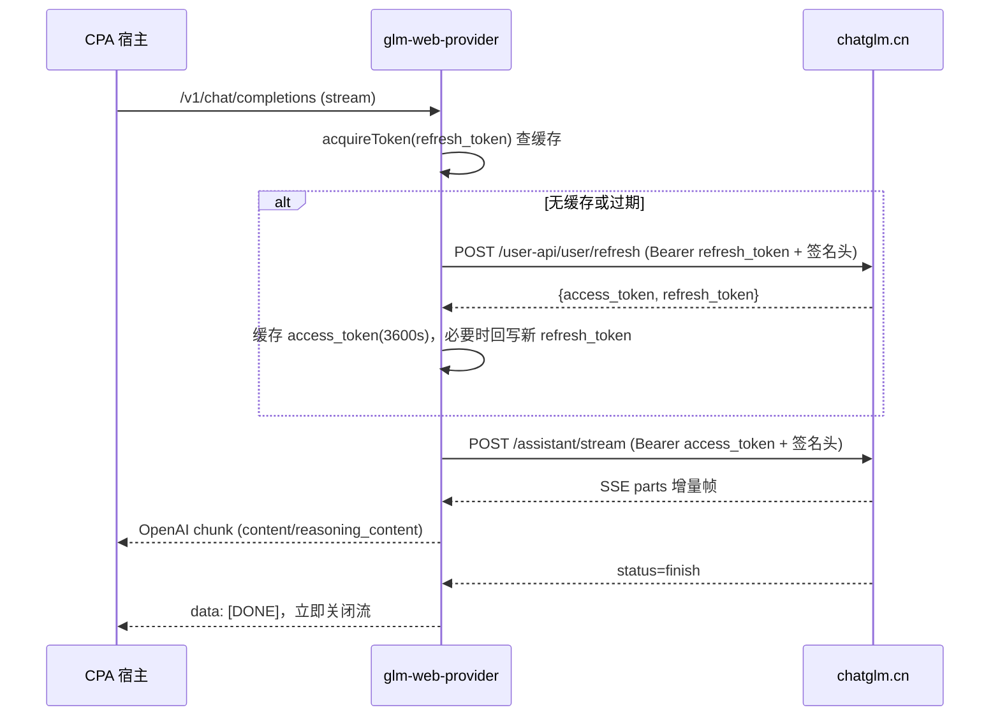

# 需求实施总览：glm-web-provider 智谱清言 refresh_token 反代插件立项

结论：新建独立 Go c-shared 插件 `glm-web-provider`，把 chatglm.cn 网页版的 `chatglm_refresh_token` 反代成 OpenAI 兼容的 `/v1/chat/completions`；鉴权一等公民是 **refresh_token → access_token 刷新链路**，没有刷新 token 的方案不做；影响：CPA 可用网页版 GLM 额度走统一网关，与现有 zcode-provider 的 Coding Plan 通道隔离；范围：refresh_token 凭据落盘、刷新与签名、SSE 流式对话、多账号、模型别名、面板、用量、发布链；非范围：扫码登录、Cookie/账号密码鉴权、生图生视频、文件解析、联网搜索注入；变化：生产新增一个 provider，模型目录以 `glm-web/` 前缀出现；完成标准：插件完成并发布热重载上线（mock 全链路 + 门禁全绿），上线后用户 OAuth 登录账号时真实 refresh_token 刷新并流式对话成功；术语说明：`refresh_token` 是从 chatglm.cn Cookie 取出的长期令牌，`access_token` 是它换取的一次性调用令牌（有效期 3600s）；验证状态：刷新契约与签名算法已从 GLM-Free-API / Chat2API 双源 L1 取证，真实账号验证延后到上线后 OAuth 登录（CYCLE-03）。

## 1. 当前计划最终方案简要说明

- **推荐方案一句话结论**：新建 `glm-web-provider` 插件，凭据层只接受 `chatglm_refresh_token`，插件内实现 `POST https://chatglm.cn/chatglm/user-api/user/refresh` 换取 `access_token`（带签名头），再用 `access_token` 调 `POST /chatglm/backend-api/assistant/stream` 并把 SSE 转成 OpenAI 流格式。
- **主落点 / 主路径**：`glm-web/authfile.go`（refresh_token 落盘）+ `glm-web/token.go`（刷新、签名、并发合并）+ `glm-web/completion.go`（对话与 SSE 转换）；骨架复用 `zcode/`（token 型账号结构）+ `doubao/`（流式转换、面板、保活、发布）的成熟结构，按函数逐项适配，不整体覆盖。
- **为什么走这条路线**：用户红线是「只做 token 鉴权、必须有 refresh_token」；chatglm.cn 恰好有稳定的 `refresh` 端点把 refresh_token 换成 access_token（GLM-Free-API 已趟平），这条链路不依赖扫码、不依赖 Cookie 续期、不读浏览器，最符合红线；仓库内 zcode 已有 token 型落盘范式，doubao 已有网页 SSE 范式，二者拼接即可，风险集中在协议变更而非工程结构。

## 2. 基本信息

- 对应需求文档：本文档（对话立项：2026-11-28 用户「智谱清言 github 由反代的项目吗？我们也想做一个 cpa 插件」+「不是 token 的鉴权方式吗？如果不是 token，没有刷新 token，我们是不做的」）
- 来源对象标识（需求或 Bug）：`glm-web-provider`
- 当前实施文档命名主干：`2026-11-28_033000_glm-web-provider智谱清言刷新令牌反代插件立项_实施总览`
- 对应需求与实施计划全量顺序实施方案：N/A（单来源对象新插件）
- 实施计划完成条件（`AC-*`）所在章节：§11
- 对应 `6-review` 风格回归记录：待各周期产出（`doc/6-review/`）
- **agent 理解的问题 / 目标**：用户想给 CPA 增加智谱清言网页版的 provider；明确限定鉴权必须是 token 方式、必须有刷新 token，否则不做。因此本计划的第一等公民是 refresh_token 刷新链路，不是扫码/Cookie。用户补充：当前手上没有可用 token，插件完成并上线后会通过 OAuth 登录一个账号再来验证。

### 范围、边界与归属

- **当前计划范围（含归属）**：本插件归属本仓库 `glm-web/` 目录，覆盖 refresh_token 凭据落盘与导入、refresh_token→access_token 刷新（含签名与并发合并）、access_token 缓存与过期刷新、OpenAI 兼容对话（同步 + SSE 流式）、智能体 ID→模型映射、多账号与 failover、模型目录、面板与账号管理、用量上报、发布链与热重载。
- **明确不在范围（边界外）**：扫码登录、账号密码登录、直接 Cookie 鉴权、生图、生视频、文件上传/解析、联网搜索开关注入、与 zcode-provider 的账号互通或凭证复用。
- **当前优先闭环**：CYCLE-01「刷新令牌链路本地跑通」——用本地 mock 上游模拟 refresh + SSE → 落盘/签名/刷新/缓存/对话转换全链路单测 + 哨兵反证全绿 → cgo-shim build+vet+test 通过。**真实 token 的端到端验证延后到插件完成上线后，用户通过 OAuth 登录账号时进行**（见 CYCLE-03）。
- **OAuth 与红线的关系（用户 2026-11-28 补充裁定）**：用户「暂时没有 token，完成上线后通过 OAuth 登录一个账号」。经 EXT-002 `docs/providers/glm.md` 与 `src/main/oauth/adapters/glm.ts` 取证：chatglm.cn 的认证方式本质就是 Refresh Token，其 OAuth 适配器 `authMethods:['manual']`、`processCallback` 明确「GLM does not support OAuth callback」——所谓 OAuth 登录其实是「打开浏览器 → 用户从 DevTools 复制 `chatglm_refresh_token` → 填入插件」，产物就是 refresh_token。**因此 OAuth 登录入口与「只做 token 鉴权、必须有 refresh token」红线完全自洽**：OAuth 只是拿 token 的交互方式，调用上游仍走 refresh_token→access_token 刷新链。插件面板提供「粘贴 refresh_token / 跳转 chatglm.cn 取 token 指引」入口即可，不实现浏览器自动化回调。
- **关键假设 / 待 L2 取证点**：
  - `H-00`（方向级，已 L1 取证完成，双源交叉印证）：`POST https://chatglm.cn/chatglm/user-api/user/refresh` 用 `Authorization: Bearer <refresh_token>` + 签名头换取 `{access_token, refresh_token}`，access_token 有效期 3600s —— ✅ 证据见 EXT-001 `src/api/controllers/chat.ts` `requestToken()`/`acquireToken()` 与 EXT-002 `glm.ts` `refreshToken()`/`validateToken()`，两处签名算法与端点完全一致。
  - `H-01`（方向级，L2 取证项，**上线后用 OAuth 账号验证**）：真实 refresh_token 在目标出口环境可成功刷新并返回 access_token（用户上线后 OAuth 登录账号时执行，探针在 local 隔离执行）。
  - `H-02`（方向级，L2 取证项，**上线后用 OAuth 账号验证**）：`POST /chatglm/backend-api/assistant/stream` 以 access_token + 签名头返回 `text/event-stream`，`parts[].content[]` 含 `text`/`think` 结构 —— 同 EXT-001/EXT-002。
  - `H-03`（任务级）：刷新返回的「新 refresh_token」是否必须回写落盘（GLM-Free-API 返回了新 refresh_token 但只在内存用；Chat2API `refreshToken()` 也返回 `refreshToken: result.refresh_token`）；执行期第一动作验证，若上游滚动 refresh_token 则必须回写，否则保持原值。
  - `H-04`：SIGN_SECRET 是否仍为 `8a1317a7468aa3ad86e997d08f3f31cb`（EXT-001/EXT-002 双源一致）；若失效需从网页 bundle 重新逆向，属上线后验证阻断项。
  - `H-05`（新增，L1 已取证）：`GET https://chatglm.cn/chatglm/user-api/user/info` 用 access_token 可取用户信息（`email`/`phone`/`nickname`/`is_guest`），用于面板账号标识与拒绝访客账号 —— 证据 EXT-002 `glm.ts` `getUserInfo()`。
- **跨会话执行入口**：本文件 + §2.3 跨会话清单 + 各 `TASK-*`。
- **主项目地址、仓库类型与代码基线**：`F:\cpa-plugin`（仓库 `luode0320/cpa-workbuddy-plugin`），Go c-shared 插件；基线为执行当日 `git rev-parse HEAD`（新会话第一步记录，本计划不写死哈希以免过期）。
- **local 环境与依赖入口**：Windows 无 CGO，验证统一 `python scripts/cgo-shim-build.py glm-web`（build+vet+test 全绿）；Go module 沿用现有 `go.mod` 的 `github.com/router-for-me/CLIProxyAPI/v7/sdk/*`。
- **外部项目代码引用**：见 §2.3 `EXT-001`。
- **当前状态**：已立项，方案与红线锁定，协议契约双源 L1 取证完成；用户当前无可用 token，采用 mock 先行进入 CYCLE-01/02 编码与上线，真实 token L2 探针留到上线后 CYCLE-03（OAuth 登录账号时）。
- **是否已获得开始实施授权**：否（本轮仅要求「出一版正式实施计划」；计划确认不等于开工授权）。

## 2.1 决策维度覆盖表

| 维度 | 状态 | 结论 / 依据 |
|---|---|---|
| 架构 / 技术路线 | 已确定 | 独立插件 + refresh_token 刷新 + OpenAI 兼容反代（用户红线 + EXT-001） |
| 鉴权方式 | 已确定 | 仅 refresh_token；无刷新 token 的方案不做（用户明确） |
| 代码落点 | 已确定 | 新建 `glm-web/`，与 `zcode/`、`doubao/` 平级 |
| 实现方式 | 已确定 | 复用 zcode 的 token 落盘 + doubao 的流式/面板骨架，逐函数适配 |
| 命名 | 已确定 | plugin id `glm-web-provider`，auth 前缀 `glm-web-`，模型别名 `glm-web/` |
| 注释 | 已确定 | 中文注释 + 函数头 `[参数]/[返回]/最近修改时间` 元信息（comment-rules） |
| 日志 | 已确定 | 不打印 refresh_token / access_token / 签名原值，只打印脱敏尾号与状态码 |
| 错误处理 / 异常 | 已确定 | 刷新失败即换号；access_token 过期重试一次；SSE `event: error` 早退；401 触发刷新 |
| 数据模型 / 表 / 字段 | 已确定 | 复用 auth 文件（非数据库）；顶层 `type=glm-web-provider` + `refresh_token`/`access_token`/`expires_at` |
| 接口契约 | 已确定（L1 证据） | 刷新端点与对话端点见 EXT-001；对外只暴露 OpenAI `/v1/chat/completions` |
| 依赖与库 | 已确定 | 仅 Go 标准库 + 仓库现有 SDK；不引入新依赖 |
| 测试策略 / 样本 | 已确定 | cgo-shim build+vet+test + 哨兵反证 + 本地 mock 上游（CYCLE-01/02）；真实 token L2 探针单列 TASK-008（上线后） |
| 图片资产 | N/A + 原因 + 证据 | 纯后端插件，无 UI 位图需求；管理面板沿用 doubao 的 HTML 模板改文案，不新增图 |

## 2.2 用户决策收敛记录

已收敛（所有方案分叉已由用户本轮明确：只做 token 鉴权、必须有 refresh token；无刷新 token 则不做）。

- 备注：`H-01`/`H-02` 是运行时取证项，由 CYCLE-03 的 TASK-008 L2 探针解决，不属于方案分叉；若探针失败，按 §11 阻断项回写计划，不自行换技术路线。

## 2.3 跨会话独立执行与外部项目代码引用清单

- **新会话接手第一步**：读取本文件 → 核对 `git rev-parse HEAD` 与工作树 → 确认 `glm-web/` 目录是否已存在 → 按当前周期进入：CYCLE-01/02 用本地 mock 上游推进（不依赖真实 token）；CYCLE-03 才等用户上线后 OAuth 登录账号做真实验证。
- **主项目地址与项目根**：`F:/cpa-plugin`（Windows 绝对路径，仓库 `luode0320/cpa-workbuddy-plugin`）。
- **主项目代码基线**：执行当日 `git rev-parse HEAD`（新会话记录；不得沿用旧哈希）。
- **计划源文件与版本**：本文件，`doc/3-实施/2026-11-28_033000_glm-web-provider智谱清言刷新令牌反代插件立项_实施总览.md`。
- **依赖安装、local 配置和服务启动入口**：无需新增依赖；验证入口 `python scripts/cgo-shim-build.py glm-web`；无本地服务需启动（插件由 CPA 宿主加载）。
- **中断点核验顺序**：`PROJECT_CURRENT.md` → 本实施总览 → 最近一份 `doc/3-实施/*glm-web*实施周期*.md` → `doc/5-tests/*glm-web*.md` → `git status` → 目标 `TASK-*` 的文件/测试现状。

| 引用 ID | 外部项目名称 | 外部项目地址 | 版本 / 提交 | 项目根相对路径 | 文件 / 符号 | 引用用途 | 许可证 / 复制边界 | 可达性检查与失败停止条件 | TASK / TEST / EVIDENCE 回指 |
|---|---|---|---|---|---|---|---|---|---|
| EXT-001 | xiaoY233/GLM-Free-API（修复版，源自 LLM-Red-Team/glm-free-api） | https://github.com/xiaoY233/GLM-Free-API | `master` 分支 tree `6f03b1c98c3b048214e619b630b0cace95ebd918`（2026-11-28 取） | `src/api/controllers/` | `chat.ts`：`generateSign()`、`requestToken(refreshToken)`、`acquireToken()`、`createCompletionStream()`、`createTransStream()`、`receiveStream()`、`checkResult()`、`tokenSplit()`；`src/api/routes/token.ts`：`/token/check` | 移植 refresh_token→access_token 刷新契约、签名算法、SSE 解析与 OpenAI 流转换；**只参考协议与算法，用 Go 重写，不复制 JS 源码** | 仓库根 LICENSE 为 GPL-3.0（blob `f288702...`）；本计划只提取协议事实/常量与算法思路并用 Go 独立实现，不逐字复制其源码；原上游 LLM-Red-Team 版有供应链攻击史（`src/api/chat.js` 末尾混淆恶意代码），禁止从原版取码 | 新会话 `git ls-remote`/web fetch 核对仓库与文件存在；若 `chat.ts` 路径或 `requestToken` 符号消失，停止并回写 GAP-00，不得自行猜测协议 | TASK-001/002/003；TEST-002/003；EVIDENCE-001 |
| EXT-002 | xiaoY233/Chat2API（GLM-Free-API 继任者） | https://github.com/xiaoY233/Chat2API | `main` 分支 tree `59f03ab2988867a4d7bacb97d98f3ee018b0e4d0`（2026-11-28 取） | `src/main/oauth/adapters/`、`docs/providers/` | `glm.ts`：`GLMAdapter`（`authMethods:['manual']`、`processCallback` 明确不支持 OAuth 回调、`loginWithToken()`、`refreshToken()`、`validateToken()`、`getUserInfo()`）；`docs/providers/glm.md`（认证=Refresh Token、凭据字段 `refresh_token`、默认模型 GLM-5.1） | 证明「GLM OAuth 登录产物就是 refresh_token」并与红线自洽；交叉印证刷新端点/签名算法；提供 `GET /user-api/user/info` 账号标识与访客账号拒绝逻辑 | 仓库根 LICENSE GPL-3.0；只提取协议事实与交互流程，Go 独立实现，不复制 TS 源码 | 新会话 web fetch 核对 `glm.ts` 与 `glm.md`；若认证方式变更或符号消失，停止并回写 GAP-06 | TASK-005（面板 token 入口）、TASK-002（刷新交叉印证）、CYCLE-03（上线后 OAuth 账号验证）；EVIDENCE-OAUTH |
| EXT-003 | 本仓库 zcode-provider（仓库内复用基线，非外部项目） | `F:/cpa-plugin/zcode`（同一仓库） | 执行当日工作树 | `zcode/` | `authfile.go:StoredAuth`（`Token`/`AccessToken`/`ExpiresAt` 字段）、`refresh_runner.go`、`main.go` 的 plugin id/Config 骨架 | 作为 token 型账号落盘与刷新任务的复用范式 | 同一仓库内代码，自由复用 | 文件存在即通过；缺失则停止回写 GAP-01 | TASK-001；TEST-001 |
| EXT-004 | 本仓库 doubao-provider（仓库内复用基线） | `F:/cpa-plugin/doubao`（同一仓库） | 执行当日工作树 | `doubao/` | `stream.go`（SSE 实时流）、`active_ping.go`（流式探活）、`panel.go`/面板 HTML、`failover.go`、`executor_failover.go` | 复用流式转发、探活、面板、账号故障切换的成熟实现 | 同一仓库内代码，自由复用 | 文件存在即通过；缺失则停止回写 GAP-02 | TASK-003/004/005；TEST-003/004 |

> EXT-003/004 为仓库内可复用基线，列入清单仅为回指来源，不涉及跨项目写入授权（WRT 不适用）。EXT-001/002 为外部参考项目，只取协议事实与算法思路，Go 独立实现，不复制源码。

## 3. 实施周期总览

- 总周期说明：分 3 期。第一期用本地 mock 打通「刷新令牌 + 对话」主链路（不依赖真实 token）；第二期补齐多账号/面板/用量/发布并上线；第三期在用户上线后 OAuth 登录账号时做真实 token 端到端验证与修正。
- 本次计划拆分的子任务周期数：3。
- 周期拆分原则：用户当前没有可用 token，因此方向级运行时验证（H-01/H-02）后置到第三期；第一、二期用 mock 上游 + 双源协议取证（EXT-001/EXT-002）驱动实现，避免空等；每个最小任务单独闭环「实现→真实测试→6-review」。
- **周期 01（第一期）：刷新令牌与对话主链路（mock 驱动）**
  - 周期序号 / 期次定位：CYCLE-01 / 第一期（主链路实现，mock 验证）
  - 周期目标：用本地 mock 上游完成 refresh→access_token→SSE 对话全链路，SSE 正确转成 OpenAI 格式且 `[DONE]` 立即收尾。
  - 本周期包含的最小任务：TASK-001 账号落盘骨架、TASK-002 刷新与签名、TASK-003 对话与 SSE 转换。
  - 周期内最小任务执行顺序：001 → 002 → 003（后者依赖前者）。
  - 进入条件：用户确认计划（**不需要真实 token**，用 mock 上游）。
  - 收口条件：三个任务各自完成「实现→真实测试→6-review」；mock 刷新/缓存/并发/SSE 转换断言全绿；哨兵反证有效。
  - 完成标志：`python scripts/cgo-shim-build.py glm-web` 全绿；mock 下 SSE 结束符正确；H-00 双源协议证据归档。
  - 与前后周期衔接：CYCLE-01 收口后才进入 CYCLE-02；真实 token 验证不在本周期。
- **周期 02（第二期）：多账号、面板、用量与发布**
  - 周期序号 / 期次定位：CYCLE-02 / 第二期（工程完备 + 上线）
  - 周期目标：多账号 failover、面板账号管理（含 refresh_token 录入入口与取 token 指引）、模型目录、探活、用量上报、发布链与生产热重载。
  - 本周期包含的最小任务：TASK-004 多账号与探活、TASK-005 面板与模型目录、TASK-006 用量上报、TASK-007 发布与热重载。
  - 周期内最小任务执行顺序：004 → 005 → 006 → 007。
  - 进入条件：CYCLE-01 收口。
  - 收口条件：全部任务闭环，生产 `hot reloaded active_version=<目标版本>` 且落盘 `.so` sha256 与 release zip 一致，13 插件启用态 `STATE_UNCHANGED`。
  - 完成标志：生产模型目录可见 `glm-web/` 前缀模型；面板可导入/管理 refresh_token；容器未重启。
  - 与前后周期衔接：CYCLE-02 上线后进入 CYCLE-03（由用户 OAuth 登录账号触发）。
- **周期 03（第三期）：上线后真实账号验证与修正**
  - 周期序号 / 期次定位：CYCLE-03 / 第三期（真实 token 端到端，用户触发）
  - 周期目标：用户通过 OAuth 登录（手工取 refresh_token）账号后，真实验证 H-01/H-02/H-04/H-05，确认线上协议与 mock/取证一致，必要时最小修正。
  - 本周期包含的最小任务：TASK-008 真实账号端到端验证与协议校正。
  - 周期内最小任务执行顺序：008。
  - 进入条件：CYCLE-02 已上线 + 用户提供一个有效 `chatglm_refresh_token`（OAuth 登录产物）。
  - 收口条件：真实 refresh 成功、真实 SSE 对话出字、`[DONE]` 收尾、账号信息识别正确；若 SIGN_SECRET/端点/SSE 结构与协议不符，按 GAP 回写并最小修正后复验。
  - 完成标志：`doc/5-tests/` 留下脱敏 EVIDENCE；真实账号在面板可正常使用；无回归。
  - 与前后周期衔接：CYCLE-03 为最终收尾周期。
- 总体真实测试安排：
  - 真实测试是否默认必需：是（涉及可执行行为变更）；第一、二期的"真实测试"指本地 mock 上游 + cgo-shim 可执行单测，第三期才是真实 token 端到端。
  - 覆盖哪些最小任务：TASK-001~008 全覆盖。
  - 公共测试环境 / 依赖：Windows + `python scripts/cgo-shim-build.py glm-web`；mock 上游用 local 临时服务；第三期 L2 探针在 local 临时目录用一次性脚本，不打生产配置。
  - 公共样本 / 数据来源：第一、二期用 mock 固定响应 + EXT-001/EXT-002 协议契约；第三期用用户 OAuth 登录产物 `chatglm_refresh_token`（过程性输出只显示脱敏尾号）。
  - 总体通过标准：cgo-shim build+vet+test 全绿；哨兵反证有效；mock 全链路通过；第三期真实刷新 + 对话成功；生产热重载证据齐全。

## 4. 阶段计划

- **阶段 1：协议取证与落盘骨架（mock 口径）**
  - 阶段目标：归档双源协议证据（H-00）并确定账号落盘结构。
  - 只做这一件事：`StoredAuth` 结构落地 + 协议证据归档（不依赖真实 token）。
  - 输入条件：用户确认计划。
  - 输出产物：协议证据（`doc/5-tests/`，EXT-001/EXT-002 双源）、`glm-web/authfile.go`。
  - 验证门槛：`StoredAuth` 单测断言 refresh_token/access_token/expires_at 读写正确；H-00 双源一致归档。
- **阶段 2：对话主链路（mock 驱动）**
  - 阶段目标：用 mock 上游完成一次 SSE 流式对话全链路。
  - 只做这一件事：刷新→签名→对话→SSE 转 OpenAI 流（mock 上游）。
  - 输入条件：阶段 1 收口。
  - 输出产物：`glm-web/token.go`、`glm-web/completion.go` 及测试 + mock 上游。
  - 验证门槛：mock 下 SSE 增量文本/思考分离正确，`[DONE]` 立即收尾；真实 token 验证留待阶段 4。
- **阶段 3：工程完备与上线**
  - 阶段目标：多账号、面板、用量、发布全链路可用。
  - 只做这一件事：补齐 provider 外围能力并按发布链上线。
  - 输入条件：阶段 2 收口。
  - 输出产物：多账号/failover、面板（refresh_token 录入入口）、用量、release assets、registry、热重载证据。
  - 验证门槛：生产热重载生效且启用态不变。
- **阶段 4：上线后真实账号验证**
  - 阶段目标：用用户 OAuth 登录产物验证真实协议与 mock/取证一致。
  - 只做这一件事：真实 token 端到端刷新 + 对话 + 账号识别，必要时最小修正。
  - 输入条件：阶段 3 上线 + 用户提供一个有效 `chatglm_refresh_token`。
  - 输出产物：`doc/5-tests/` 脱敏 EVIDENCE、必要的最小修正（若有）。
  - 验证门槛：H-01/H-02/H-04/H-05 真实通过；无回归。

## 5. 最小任务清单

### 最小任务 TASK-001：账号落盘骨架（token 型 StoredAuth）

- 任务名：glm-web 账号落盘骨架
- 所属周期：CYCLE-01；周期内顺序：1；所属阶段：阶段 1
- 本任务只做这一件事：定义并落盘 token 型 `StoredAuth` 与 auth 文件读写。
- 垂直切片目标：能从面板/导入接口写入一个 `refresh_token` 账号并在磁盘读回。
- 输入条件：EXT-002 `zcode/authfile.go` 结构。
- 实现产出：`glm-web/authfile.go`（`StoredAuth` 含 `type=glm-web-provider`、`provider`、`auth_id`、`refresh_token`、`access_token`、`expires_at`、`label`、`disabled`、`created_at`、`updated_at`、`physical_path`；复用 `authFilesMu`/`setAccountsDir`/`hostAuthList`/`hostAuthGet`/`writeAuthFileDirect` 范式）。
- 禁止触碰区：不修改 `zcode/`、`doubao/` 及其他 provider 文件；不引入数据库。
- 真实测试是否必需：是。
- 真实测试入口：`python scripts/cgo-shim-build.py glm-web`（build+vet+test）。
- 真实测试依赖环境：Windows 本地，CGO_ENABLED=0 shim。
- 真实测试样本 / 数据来源：临时目录中的假 refresh_token 字符串（非真实凭据）。
- 真实测试通过标准：单测断言写入→读回字段一致、未知顶层字段不丢失、auth 前缀为 `glm-web-`。
- 测试点：`TestStoredAuthRoundTrip`、`TestWriteAuthFileDirectPreservesUnknownFields`。
- `6-review` 风格回归点：中文注释、函数头元信息、UTF-8 无 BOM、无行尾空白；结论 `STYLE: PASS`。
- 任务完成条件：实现 + 真测全绿 + STYLE: PASS。
- 任务停止 / 结束条件：单测失败或字段不一致即停，修到全绿。
- 阻断条件：cgo-shim 无法识别 `glm-web` 目录结构。
- 前置依赖：计划确认。
- 下一任务依赖：TASK-002 读取本任务落盘的 refresh_token。
- 预计触达文件数：2（`authfile.go` + `authfile_test.go`）。

### 最小任务 TASK-002：refresh_token 刷新、签名与 access_token 缓存

- 任务名：刷新令牌链路
- 所属周期：CYCLE-01；周期内顺序：2；所属阶段：阶段 1/2
- 本任务只做这一件事：实现 `refresh_token → access_token` 刷新、签名头生成、并发合并与过期缓存。
- 垂直切片目标：一个 refresh_token 能稳定拿到有效 access_token，并发请求只刷新一次。
- 输入条件：TASK-001；EXT-001 `requestToken()`/`generateSign()`/`acquireToken()` + EXT-002 `glm.ts` `refreshToken()`（双源交叉印证）。
- 实现产出：`glm-web/token.go`——`generateSign()`（时间戳算法 + `md5(timestamp-nonce-SIGN_SECRET)`，`SIGN_SECRET` 可配置）、`requestToken(refreshToken)`（POST `https://chatglm.cn/chatglm/user-api/user/refresh`，Bearer=refresh_token，签名头 `X-Device-Id`/`X-Nonce`/`X-Request-Id`/`X-Sign`/`X-Timestamp`，解析 `result.access_token`/`result.refresh_token`）、`acquireToken()`（内存缓存 + 3600s 过期刷新 + 同 token 并发合并队列）、滚动 refresh_token 回写逻辑（H-03 决定：默认按 EXT-002 回写新 refresh_token）、401 时清缓存强制刷新。上游 base URL 做成可配置覆盖点，便于 mock 与上线后真实探针共用同一入口。
- 禁止触碰区：不改其他 provider；不打印 token/签名原值。
- 真实测试是否必需：是（mock 上游 + 可执行单测；真实 token 验证在 TASK-008）。
- 真实测试入口：local 临时 mock HTTP 服务（返回固定 `{access_token,refresh_token}`）+ `go test`；通过覆盖点把刷新端点指向 mock 地址。
- 真实测试依赖环境：local 临时目录；不连生产、不依赖真实 token。
- 真实测试样本 / 数据来源：mock 固定响应 + 双源协议契约（EXT-001/EXT-002）。
- 真实测试通过标准：mock 下刷新/缓存/过期/并发合并 4 类断言通过；签名算法与 EXT-001/EXT-002 双源一致。
- 测试点：`TestGenerateSign`（固定时间戳/nonce 断言 md5）、`TestRequestTokenMock`、`TestAcquireTokenCacheExpiry`、`TestAcquireTokenConcurrentSingleRefresh`。
- `6-review` 风格回归点：签名算法注释、错误分类、日志脱敏；`STYLE: PASS`。
- 任务完成条件：mock 断言全绿 + 哨兵反证有效 + STYLE: PASS。
- 任务停止 / 结束条件：mock 断言失败或签名与双源不一致即停，修到全绿。
- 阻断条件：双源协议冲突（EXT-001 与 EXT-002 端点/算法不一致）；回写 GAP 并暂停。
- 前置依赖：TASK-001。
- 下一任务依赖：TASK-003 消费 access_token。
- 预计触达文件数：2（`token.go` + `token_test.go`；mock 上游为测试内嵌 httptest，不额外计文件）。

### 最小任务 TASK-003：OpenAI 兼容对话与 SSE 流式转换

- 任务名：对话与 SSE 转换
- 所属周期：CYCLE-01；周期内顺序：3；所属阶段：阶段 2
- 本任务只做这一件事：用 access_token 调 stream 端点并把 GLM SSE 转成 OpenAI chunk 流。
- 垂直切片目标：一次 mock 请求拿到正确的 OpenAI 格式流式响应并 `[DONE]` 收尾。
- 输入条件：TASK-002。
- 实现产出：`glm-web/completion.go`——请求构造（`assistant_id` 由模型映射：`24 位小写字母数字` 视为智能体 ID，否则默认 `65940acff94777010aa6b796`；model 含 `think`/`zero`→`chat_mode=zero`，含 `deepresearch`→`deep_research`）、`meta_data` 固定字段、签名/伪装头、SSE 解析（`parts[].content[]` 的 `text`→`delta.content`、`think`→`delta.reasoning_content`，按全量 parts 快照算增量去重）、结束帧 `[DONE]` 立即写出并关闭流、`event: error`/非 `text/event-stream` 早退；同步模式复用同一解析聚合。stream 端点做成可配置覆盖点。
- 禁止触碰区：不改其他 provider；SSE 遇到 `[DONE]`/`event: done` 禁止 `continue`（仓库流式规范）。
- 真实测试是否必需：是（mock SSE + 可执行单测；真实对话验证在 TASK-008）。
- 真实测试入口：local 内嵌 httptest SSE 服务 + `go test`；通过覆盖点把 stream 端点指向 mock 地址。
- 真实测试依赖环境：local 临时目录；不连生产、不依赖真实 token。
- 真实测试样本 / 数据来源：mock SSE 帧（含 text/think/finish 与 `event: error`），结构对齐 EXT-001 `createTransStream()`/`receiveStream()`。
- 真实测试通过标准：增量文本/思考分离正确、无重复、无幽灵内容；`[DONE]` 立即返回；`event: error` 早退。
- 测试点：`TestSSEDeltaDedup`、`TestSSEReasoningSplit`、`TestDoneTerminatesImmediately`、`TestEventErrorEarlyExit`。
- `6-review` 风格回归点：流关闭纪律、注释、UTF-8；`STYLE: PASS`。
- 任务完成条件：mock 单测全绿 + 哨兵反证有效 + STYLE: PASS + CYCLE-01 收口。
- 任务停止 / 结束条件：SSE 死等或 `[DONE]` 不收尾即停，修到全绿。
- 阻断条件：mock SSE 结构与 EXT-001 解析逻辑对不上；回写计划并暂停。
- 前置依赖：TASK-002。
- 下一任务依赖：CYCLE-02 全部任务。
- 预计触达文件数：2（`completion.go` + `completion_test.go`；mock SSE 服务为测试内嵌，不额外计文件）。

### 最小任务 TASK-004：多账号、failover 与流式探活

- 任务名：多账号与探活
- 所属周期：CYCLE-02；周期内顺序：1；所属阶段：阶段 3
- 本任务只做这一件事：多账号轮换、失败换号与轻量探活。
- 垂直切片目标：一个账号 refresh 失败或 401 时自动切到下一个账号。
- 输入条件：CYCLE-01 收口。
- 实现产出：`glm-web/failover.go`（401/刷新失败/传输错误计入账号故障，阶梯冷却复用仓库口径）、`glm-web/active_ping.go`（`stream:true,max_tokens:1` 流式探活，首帧即返回并异步关流；拦截 HTTP 200 下的 `event: error`）。
- 禁止触碰区：不改其他 provider 的 failover 配置；不改宿主 API。
- 真实测试是否必需：是。
- 真实测试入口：`python scripts/cgo-shim-build.py glm-web`。
- 真实测试依赖环境：Windows 本地 shim + mock 上游。
- 真实测试样本 / 数据来源：mock 401/成功响应。
- 真实测试通过标准：故障账号被冷却、请求切到健康账号；探活首帧即返回不空等。
- 测试点：`TestFailoverOnRefreshFailure`、`TestActivePingFirstFrameReturn`。
- `6-review` 风格回归点：与 doubao/failover 风格一致；`STYLE: PASS`。
- 任务完成条件：实现 + 真测全绿 + STYLE: PASS。
- 任务停止 / 结束条件：换号逻辑破坏单账号连通即停。
- 阻断条件：无。
- 前置依赖：TASK-003。
- 下一任务依赖：TASK-005。
- 预计触达文件数：4（`failover.go`、`active_ping.go` + 2 测试文件）。

### 最小任务 TASK-005：面板、账号管理与模型目录

- 任务名：面板与模型目录
- 所属周期：CYCLE-02；周期内顺序：2；所属阶段：阶段 3
- 本任务只做这一件事：面板 refresh_token 录入/管理（含取 token 指引）+ 模型目录（含 `glm-web/` 前缀）。
- 垂直切片目标：面板粘贴 refresh_token 后账号可见、调用端点模型可见。
- 输入条件：TASK-004；EXT-002 `docs/providers/glm.md` 取 token 步骤 + `glm.ts:getUserInfo()` 账号标识。
- 实现产出：`glm-web/main.go`（plugin id `glm-web-provider`、Config、`ConfigFields`、管理路由前缀 `/v0/management/plugins/glm-web-provider/*`；`const API` 必须与 id 一致）、`glm-web/panel.html`（refresh_token 粘贴录入、导出、测试按钮走插件别名目录；附「打开 chatglm.cn → DevTools → Local Storage 复制 `chatglm_refresh_token`」指引文案；不做浏览器自动化）、`glm-web/models.go`（默认模型 + 智能体别名映射，`glm-web/` 前缀与 zcode 隔离）、`glm-web/management.go`（账号标识与访客账号拒绝逻辑复用 EXT-002 `getUserInfo()` 语义：`is_guest` 或昵称含「访客」拒绝）。
- 禁止触碰区：不改 zcode 的模型别名；不复用 zcode 账号；不做扫码/OAuth 回调自动化（GLM 不支持）。
- 真实测试是否必需：是。
- 真实测试入口：`python scripts/cgo-shim-build.py glm-web` + node `new Function()` 校验两个 `<script>` 块语法。
- 真实测试依赖环境：Windows 本地 + Node。
- 真实测试样本 / 数据来源：mock 账号列表与模型目录。
- 真实测试通过标准：导入导出往返一致；面板路由前缀与 id 一致；脚本语法通过；模型目录无与 zcode 冲突的裸 `glm-*` 别名。
- 测试点：`TestPanelMatchesPluginID`、`TestModelAliasPrefixIsolated`。
- `6-review` 风格回归点：面板注释、UI 事件链 review（`data-action` ↔ 处理函数 ↔ 变量作用域）；`STYLE: PASS`。
- 任务完成条件：实现 + 真测全绿 + STYLE: PASS。
- 任务停止 / 结束条件：面板 404（前缀不一致）或别名冲突即停。
- 阻断条件：无。
- 前置依赖：TASK-004。
- 下一任务依赖：TASK-006。
- 预计触达文件数：5（main/panel/models/management + 测试）。

### 最小任务 TASK-006：用量上报

- 任务名：用量上报
- 所属周期：CYCLE-02；周期内顺序：3；所属阶段：阶段 3
- 本任务只做这一件事：把每次对话的 token 用量接入统一用量统计。
- 垂直切片目标：NDJSON feed 中出现 `glm-web` 的用量记录。
- 输入条件：TASK-003 的 usage 解析、TASK-005 的模型目录。
- 实现产出：`glm-web/usage.go`（`publishUsage` 带 accountLabel/reasoningEffort，按仓库 NDJSON feed 口径写入 `<CLIProxyAPI root>/data/token-usage-feed.ndjson`），接入 completion 的成败分支。
- 禁止触碰区：不改 token-usage-tracker 插件。
- 真实测试是否必需：是。
- 真实测试入口：`python scripts/cgo-shim-build.py glm-web`。
- 真实测试依赖环境：Windows 本地 shim + 临时 feed 文件。
- 真实测试样本 / 数据来源：mock usage 帧。
- 真实测试通过标准：成功/失败请求均产生正确 feed 记录，字段完整。
- 测试点：`TestPublishUsageFeed`。
- `6-review` 风格回归点：与 workbuddy publishUsage 参数风格一致；`STYLE: PASS`。
- 任务完成条件：实现 + 真测全绿 + STYLE: PASS。
- 任务停止 / 结束条件：feed 写入破坏主链路即停。
- 阻断条件：无。
- 前置依赖：TASK-005。
- 下一任务依赖：TASK-007。
- 预计触达文件数：2（`usage.go` + 测试）。

### 最小任务 TASK-007：发布链与生产热重载

- 任务名：发布与热重载
- 所属周期：CYCLE-02；周期内顺序：4；所属阶段：阶段 3
- 本任务只做这一件事：按仓库发布链产出 release assets、更新 registry 并热重载到生产。
- 垂直切片目标：生产 `glm-web-provider` 加载目标版本且启用态不变。
- 输入条件：CYCLE-02 前六个任务全绿。
- 实现产出：bump `VERSION`+`main.go var version`→commit→push→dispatch CI（`plugin=glm-web-provider version=<ver>`）→下载 6 平台资产（5 平台常态）→`publish-assets.py`→registry 更新→`POST /v0/management/plugin-store/glm-web-provider/install?version=<ver>`。
- 禁止触碰区：默认授权不含重启 `cli-proxy-api` 容器；install 前取全插件启用态快照，新产品属启用组则验 hot reloaded，.stopped 组按规则还原。
- 真实测试是否必需：是（生产验收）。
- 真实测试入口：CI release + `docker logs cli-proxy-api | grep "hot reloaded"` + 落盘 `.so` sha256 对 release zip + 管理 API 快照 diff。
- 真实测试依赖环境：生产 45.207.222.65（管理端口 8317）；管理密钥取插件配置 `cpa_management_key`，过程性输出不回显。
- 真实测试样本 / 数据来源：release zip 内 `.so`。
- 真实测试通过标准：`hot reloaded active_version=<目标版本>`；`.so` sha256 逐字节一致；13 插件启用态 `STATE_UNCHANGED`；容器未重启；模型目录可见 `glm-web/` 前缀。
- 测试点：发布链每步 raw URL 200 / checksum OK；热重载证据齐全。
- `6-review` 风格回归点：发布文档与 CHANGELOG 中文、UTF-8；`STYLE: PASS`。
- 任务完成条件：生产热重载生效 + 证据齐全。
- 任务停止 / 结束条件：任一发布步骤失败或状态不一致即停，按回滚路径处理。
- 阻断条件：CI 失败、registry 未生效、热重载无日志（需用户确认后才可重启容器）。
- 前置依赖：TASK-006。
- 下一任务依赖：TASK-008（上线后用户提供 OAuth 账号时触发）。
- 预计触达文件数：5（VERSION、main.go、CHANGELOG、registry.json、发布脚本输出）。

### 最小任务 TASK-008：上线后真实账号端到端验证与协议校正

- 任务名：真实账号端到端验证
- 所属周期：CYCLE-03；周期内顺序：1；所属阶段：阶段 4
- 本任务只做这一件事：用用户 OAuth 登录产物（`chatglm_refresh_token`）真实验证刷新 + 对话 + 账号识别，必要时最小修正。
- 垂直切片目标：真实账号在面板可用，一次真实对话出字且 `[DONE]` 收尾。
- 输入条件：CYCLE-02 已上线 + 用户提供一个有效 `chatglm_refresh_token`（过程性输出只显示脱敏尾号）。
- 实现产出：`doc/5-tests/` 脱敏 EVIDENCE（刷新响应摘要、SSE 首帧结构、`getUserInfo` 账号标识、是否访客）；若协议与 EXT-001/EXT-002 不符，做最小代码修正（端点/签名/SSE 字段）并重新发版热重载（沿用 TASK-007 发布链）。
- 禁止触碰区：不改其他 provider；不回显 token / access_token / 签名原值；不连非 local 配置做探针。
- 真实测试是否必需：是（本任务本身就是真实验证）。
- 真实测试入口：local 临时目录一次性脚本，通过插件可配置覆盖点指向真实 chatglm.cn 端点；脱敏输出。
- 真实测试依赖环境：local 临时目录；真实 token 仅内存使用、不落盘到仓库、不进日志。
- 真实测试样本 / 数据来源：用户 OAuth 登录产物 `chatglm_refresh_token`。
- 真实测试通过标准：H-01（真实刷新拿到 access_token）、H-02（真实 SSE 对话出字 + `[DONE]` 收尾）、H-04（SIGN_SECRET 有效）、H-05（`getUserInfo` 识别账号且非访客）全部通过。
- 测试点：`L2-EVIDENCE-REFRESH`（真实）、`L2-EVIDENCE-CHAT`（真实）、`EVIDENCE-OAUTH`（账号标识）、`EVIDENCE-ACCOUNT`（访客拒绝）。
- `6-review` 风格回归点：若有代码修正，按 comment-rules + 6-review 校验；`STYLE: PASS`。
- 任务完成条件：四项 H-* 真实验证通过 + EVIDENCE 落盘 + 无回归（或修正后复验通过）。
- 任务停止 / 结束条件：真实刷新失败（`40102`/过期）或 SSE 结构与取证不符且无法最小修正即停，回写 GAP 并交用户裁决。
- 阻断条件：SIGN_SECRET 失效需重取（H-04）、出口 IP 风控、上游协议大改；均回写 GAP，不自行换路线。
- 前置依赖：TASK-007（已上线）+ 用户提供有效 refresh_token。
- 下一任务依赖：无（最终收尾）。
- 预计触达文件数：2（EVIDENCE 文档；若有协议修正则 + 对应代码文件与测试）。

## 6. 现状与落点

- 涉及目录：`glm-web/`（新建）、`doc/3-实施/`、`doc/5-tests/`、`doc/6-review/`、`.github/workflows`（仅发布链路引用，不改结构）、`registry.json`（发布时更新）。
- 涉及文件 / 模块：见 §5 各任务 + §6 目录树。
- 复用点：EXT-002 zcode 的 token 型 `StoredAuth`/`refresh_runner`；EXT-003 doubao 的 `stream.go`/`active_ping.go`/`panel.go`/`failover.go`；EXT-001 的协议契约（Go 重写）。
- 需要新增的内容：全新 `glm-web/` 插件包 + 文档。
- **代码落点目录树**：
  ```text
  glm-web/
  ├── main.go                  # 插件入口：plugin id、Config、ConfigFields、ABI 导出
  ├── VERSION                  # 插件版本号（与 main.go var version 同步）
  ├── Makefile                 # 构建入口（对齐其他 provider）
  ├── go.mod / go.sum          # 模块依赖（沿用仓库 SDK，不新增第三方）
  ├── authfile.go              # refresh_token 型 StoredAuth 与 auth 文件读写
  ├── authfile_test.go         # 落盘往返与未知字段保留单测
  ├── token.go                 # refresh_token→access_token 刷新、签名、缓存、并发合并
  ├── token_test.go            # 签名/刷新/过期/并发单测 + mock 上游
  ├── completion.go            # OpenAI 兼容请求构造 + SSE→OpenAI chunk 转换
  ├── completion_test.go       # SSE 增量/思考分离/[DONE] 收尾单测
  ├── failover.go              # 账号故障冷却与换号
  ├── failover_test.go         # 刷新失败/401 换号单测
  ├── active_ping.go           # 流式轻量探活
  ├── active_ping_test.go      # 首帧返回与 error 帧拦截单测
  ├── models.go                # 默认模型与智能体别名映射（glm-web/ 前缀）
  ├── models_test.go           # 别名隔离单测
  ├── panel.go                 # 管理面板静态资源加载
  ├── panel.html               # 面板 UI：refresh_token 录入/导出、取 token 指引、测试、账号管理
  ├── management.go            # /v0/management/plugins/glm-web-provider/* 路由
  ├── usage.go                 # 用量上报到 NDJSON feed
  └── usage_test.go            # 用量上报单测
  ```
- 新增文件清单：见上方目录树，全部为新增（新插件目录）。

## 7. 方案选择

- **方案 A（推荐）**：独立插件 `glm-web-provider`，refresh_token 鉴权，Go 重写 EXT-001 协议，模型别名 `glm-web/` 与 zcode 隔离。
- **方案 B（否）**：在 zcode-provider 内加网页 token 模式开关。否的理由：两套凭证/风控/保活混进一个 provider，与仓库「一服务一 provider 垂直切分」冲突，且 zcode 已有 Coding Plan 语义，强行合并会污染既有账号结构。
- **方案 C（否）**：仅部署 EXT-001 的 Docker 服务，前面挂一层协议转换给 CPA。否的理由：多一个常驻服务、多账号与保活要在外部重做、无法复用仓库的 failover/用量/面板体系；用户要的是「CPA 插件」而非外挂网关。
- 推荐方案与原因：方案 A 最贴合红线与仓库架构；因用户当前无 token，协议运行时风险由 CYCLE-03 上线后 OAuth 账号的 L2 探针消解，CYCLE-01/02 用 mock 上游 + 双源协议取证驱动，工程能力可批量复用。

## 8. 实施步骤

1. **第一步**：CYCLE-01 / 阶段 1 / TASK-001——建 `glm-web/` 骨架与 token 型 `StoredAuth`，跑 cgo-shim 单测。
2. **第二步**：CYCLE-01 / 阶段 1-2 / TASK-002——实现刷新、签名、缓存、并发合并；跑 mock 单测（不依赖真实 token）。
3. **第三步**：CYCLE-01 / 阶段 2 / TASK-003——实现对话与 SSE 转换；跑 mock 单测，CYCLE-01 收口。
4. **第四步**：CYCLE-02 / 阶段 3 / TASK-004——多账号 failover 与流式探活。
5. **第五步**：CYCLE-02 / 阶段 3 / TASK-005——面板（refresh_token 录入 + 取 token 指引）、账号管理、模型目录（`glm-web/` 前缀）。
6. **第六步**：CYCLE-02 / 阶段 3 / TASK-006——用量上报接入。
7. **第七步**：CYCLE-02 / 阶段 3 / TASK-007——发布资产、registry、生产热重载与验收。
8. **第八步**：CYCLE-03 / 阶段 4 / TASK-008——上线后用户 OAuth 登录账号，做真实 token 端到端验证（H-01/H-02/H-04/H-05），必要时最小修正并复验。

## 9. 真实测试安排

- 真实测试总表：见 §5 各任务「真实测试入口/通过标准」+ §10.2 FEAS-*。
- 免测任务及理由：无（全部涉及可执行行为）。
- 各步骤验证点：见下方逐步骤真实测试/验证条目与 §5 各任务「测试点」字段。
- 步骤 1 真实测试 / 验证：cgo-shim build+vet+test，`TestStoredAuthRoundTrip`/`TestWriteAuthFileDirectPreservesUnknownFields` 通过。
- 步骤 2 真实测试 / 验证：mock 刷新四断言（签名/刷新/过期/并发合并）全绿；真实 token H-01 验证留到步骤 8。
- 步骤 3 真实测试 / 验证：mock SSE 增量/思考/收尾/`event: error` 早退断言全绿；真实对话 H-02 验证留到步骤 8。
- 步骤 4~6 真实测试 / 验证：cgo-shim 全绿 + 各任务专门单测（不依赖真实 token）。
- 步骤 7 真实测试 / 验证：CI release success + checksum OK + 生产 hot reloaded + `.so` sha256 一致 + 13 插件 `STATE_UNCHANGED` + 容器未重启。
- 步骤 8 真实测试 / 验证：真实 token H-01 刷新成功、H-02 对话出字且 `[DONE]` 收尾、H-04 签名有效、H-05 账号识别正确；全部脱敏落 EVIDENCE。
- 哨兵反证要求：每个核心机制至少一个测试用「改坏对应行→FAIL→还原全绿」证明测试真实命中（签名算法、SSE 增量去重、[DONE] 收尾、别名隔离）。

## 10. 图形化执行路径

- 目的：展示 refresh_token 主链路与 CYCLE 依赖；关联 `TASK-001~008`。
- 流程图（Mermaid `flowchart`）：

```mermaid
flowchart TD
  A[面板录入 chatglm_refresh_token] --> B[TASK-001 落盘 StoredAuth]
  B --> C[TASK-002 generateSign + requestToken]
  C -->|POST /chatglm/user-api/user/refresh| D[access_token 缓存 3600s]
  D --> E[TASK-003 POST /chatglm/backend-api/assistant/stream]
  E --> F[SSE parts 解析: text->content, think->reasoning]
  F --> G[OpenAI chunk 流 + [DONE] 立即收尾]
  G --> H{CYCLE-01 mock 收口?}
  H -->|否| C
  H -->|是| I[TASK-004 多账号 failover + 探活]
  I --> J[TASK-005 面板 + 模型目录 glm-web/]
  J --> K[TASK-006 用量上报]
  K --> L[TASK-007 发布 + 热重载]
  L --> M[生产可用 glm-web-provider]
  M --> N{用户 OAuth 登录账号?}
  N -->|提供 refresh_token| O[TASK-008 真实端到端验证 H-01/02/04/05]
  O -->|协议不符| P[最小修正 + 复验]
  P --> O
  O -->|全部通过| Q[CYCLE-03 收尾]
```

- 时序图（refresh 与流式对话）：



## 10.1 图片资产决策、生成与引用

- 图片资产决策：`N/A + 原因 + 证据`。
- 原因：纯后端插件，面板沿用 doubao 的 HTML 模板改文案，不产出位图；流程/时序已由 §10 Mermaid 表达，图片不替代图形门禁。证据：§6 目录树无位图文件，§5 TASK-005 仅改 HTML/文案。

## 10.2 可行性探针与假设清单（FEAS-*）

- **FEAS-001（方向级，已 L1 双源取证）**：refresh_token 可换 access_token（技术路线成立）。
  - 假设内容：`POST /chatglm/user-api/user/refresh` 用 Bearer refresh_token + 签名头返回 access_token（3600s），技术路线成立。
  - 影响面：方向级（不成立则整个插件路线作废）。
  - 探针级别：L1 只读（源码取证）。
  - 验证方式：读取 EXT-001 `chat.ts` 的 `requestToken()`/`acquireToken()` + EXT-002 `glm.ts` 的 `refreshToken()`/`validateToken()`。
  - 结论：已探针验证（只读证据级，源码 L1 双源交叉印证）。
  - 证据：EXT-001 `requestToken` 明确 `axios.post("https://chatglm.cn/chatglm/user-api/user/refresh", {}, {headers:{Authorization:Bearer refreshToken,...}})`，解构 `access_token,refresh_token`，`ACCESS_TOKEN_EXPIRES=3600`；EXT-002 `glm.ts` `refreshToken()` 同端点同算法，返回 `expiresAt=now+3600`，两源签名算法逐行一致。
  - 关联 TASK：TASK-002。
- **FEAS-002（方向级，已 L1 双源取证）**：stream 端点返回可解析 SSE（技术路线成立）。
  - 假设内容：`POST /assistant/stream` 返回 `text/event-stream`，`parts[].content[]` 含 `text`/`think`，可转成 OpenAI chunk 流。
  - 影响面：方向级（不成立则 SSE 转换重写）。
  - 探针级别：L1 只读（源码取证）。
  - 验证方式：读取 EXT-001 `createTransStream()`/`receiveStream()` 的 SSE 解析分支。
  - 结论：已探针验证（只读证据级，源码 L1）。
  - 证据：EXT-001 `createTransStream()` 明确按 `result.parts[].content[]` 的 `type=text/think` 生成 `delta.content`/`delta.reasoning_content`，`status=finish` 写 `[DONE]`；`checkResult()` 对非 `text/event-stream` 早退。
  - 关联 TASK：TASK-003。
- **FEAS-003（任务级，L2 取证项）**：真实 refresh_token 在目标出口可刷新。
  - 假设内容：用户上线后 OAuth 登录提供的有效 refresh_token 能真实换到 access_token。
  - 影响面：任务级（只影响 TASK-008 验证结果；技术路线已由 FEAS-001 坐实，不改变架构）。
  - 探针级别：L2 隔离真实。
  - 验证方式：local 临时目录一次性脚本发刷新请求，只输出是否成功与脱敏尾号。
  - 结论：待 L2 取证（等用户上线后提供 token；不阻断 CYCLE-01/02，用 mock 先行）。
  - 清理与回滚：脚本与输出放临时目录，用后即删，回读确认无残留；不回显 token 原值。
  - 关联 TASK：TASK-008（执行期第一动作先验，不成立则停并回写 GAP-003）。
- **FEAS-004（任务级，L2 取证项）**：stream 端点真实返回可解析 SSE。
  - 假设内容：`POST /assistant/stream` 用真实 access_token 返回结构符合 FEAS-002 取证。
  - 影响面：任务级（只影响 TASK-008 验证结果，不改架构）。
  - 探针级别：L2 隔离真实。
  - 验证方式：真实 token 发一次最小对话，观察首帧结构与结束帧。
  - 结论：待 L2 取证（L1 已见 EXT-001 解析逻辑；上线后由 L2 确认）。
  - 清理与回滚：同 FEAS-003；请求结束后上游 conversation 按 EXT-001 `removeConversation` 语义清理。
  - 关联 TASK：TASK-008（执行期第一动作先验，不成立则停并回写 GAP-004）。
- **FEAS-005（任务级，L2 取证项）**：SIGN_SECRET 仍有效。
  - 假设内容：`8a1317a7468aa3ad86e997d08f3f31cb` 未变（EXT-001/EXT-002 双源一致）。
  - 影响面：任务级（失效则改从网页 bundle 重取 SIGN_SECRET，不动架构）。
  - 探针级别：L2（随 FEAS-003 一起验）。
  - 结论：待 L2 取证。
  - 关联 TASK：TASK-008（第一动作先验，失败回写 GAP-005）。
- **FEAS-006（任务级，L2 取证项）**：滚动 refresh_token 回写必要性。
  - 假设内容：refresh 返回的新 refresh_token 必须落盘（EXT-002 `refreshToken()` 返回新 refresh_token）。
  - 影响面：任务级（只影响 token.go 回写分支）。
  - 探针级别：L2（观察真实刷新返回的新 refresh_token 是否与原值不同）。
  - 结论：待 L2 取证。
  - 关联 TASK：TASK-008（第一动作先验，按观察结果决定回写分支）。
- 探针执行记录：FEAS-001/002 已执行（L1，见 §2.3 EXT-001/EXT-002 双源证据）；FEAS-003/004/005/006 待用户上线后提供有效 token 时由 TASK-008 执行，输出与清理结果写入 `doc/5-tests/` EVIDENCE 文档。
- 待取证假设处置：FEAS-003/004/005/006 均为任务级（技术路线方向级已 L1 坐实），在 TASK-008 执行期第一动作先验；不成立则停并回写 GAP，不按原假设放行，不阻断 CYCLE-01/02 的 mock 实现。

## 11. 风险与阻断项

- 风险：
  - R1：chatglm.cn 网页协议/签名变更或验证码风控 → 方向级技术路线已 L1 双源坐实；真实运行时有效性由 CYCLE-03 TASK-008 L2 探针验证，失败即暂停回写 GAP。
  - R2：上游源项目有供应链攻击史 → 只取 EXT-001/EXT-002 修复版协议事实，Go 独立重写，不复制 JS/TS 源码，不引入 npm 依赖。
  - R3：单账号单路输出限制（EXT-001 README 明确）→ 多账号 + `AccountMaxInflight=1` + 最小间隔控制（复用 doubao 口径）。
  - R4：模型别名与 zcode 冲突 → 强制 `glm-web/` 前缀单测守卫。
  - R5：SSE 死等 → `[DONE]`/`event: done` 立即 break 并关流（仓库流式硬规范）。
  - R6：用户上线后 OAuth 登录取到的 token 为访客账号 → 复用 EXT-002 `getUserInfo()` 语义拒绝访客（`is_guest`/昵称含「访客」/email 含 `@guest`），面板明确提示用真实账号。
- 依赖：CYCLE-01/02 不依赖真实 token（mock 先行）；CYCLE-03 依赖用户上线后 OAuth 登录产物 `refresh_token`；生产 45.207.222.65 管理通道（`cpa_management_key`，不回显）；CI release 权限。
- 任务停止 / 结束条件总表：见 §5 各任务；方向级 FEAS-001/002 已 L1 坐实，任务级 FEAS-003~006 在 TASK-008 验证，失败即暂停。
- **反方批判结论（plan-devils-advocate-review）**：`方案假设基本成立，推荐路线保留；因用户无 token，真实运行时验证后置到上线后 TASK-008`。三条按严重度：
  1. **假设挑战（最严重）**：H-01/H-02 只有 L1 源码证据，没有真实 token 的运行时证据。若刷新端点因出口 IP 风控或 SIGN_SECRET 变更失效，真实调用会失败。处置：技术路线仍成立（双源交叉印证），CYCLE-01/02 用 mock 先行不空等；CYCLE-03 TASK-008 上线后强制 L2；失败登记 GAP-003/GAP-004 并暂停，不自行换方案。
  2. **依赖与顺序**：先做落盘骨架（TASK-001）再做刷新（TASK-002）看似稳妥，但若 H-03（滚动 refresh_token 回写）探针结论要求改 `StoredAuth` 字段，会返工。处置：TASK-001 的 `StoredAuth` 预留 `refresh_token` 可回写字段，H-03 结论只改写入逻辑不改结构。
  3. **边界与异常**：方案覆盖主路径，但「单账号单路输出 + 上游隐藏 conversation 清理」在高频请求下可能互扰。处置：TASK-003 按 EXT-001 语义在流结束后异步删除 conversation；TASK-004 用 `AccountMaxInflight=1` 串行化，纳入单测。
- **最大推进边界**：本次计划执行最多推进到「生产热重载生效并上线」；CYCLE-03 真实账号验证在用户上线后 OAuth 登录账号时另行触发。不含重启容器（除热重载证据失败且用户明确确认）、不含跨项目写入、不含扫码/OAuth 回调自动化（GLM 不支持）、不含生图生视频。

## 12. 数据库变更 SQL

- `N/A + 原因 + 证据`：本插件账号与用量均沿用文件落盘（auth 文件 + NDJSON feed），不新增数据库表或字段；证据见 §6 目录树（无 SQL 文件）与 §5 TASK-001/006。

## 13. 自审结论

- 覆盖度检查：正式计划必填字段（简要说明、问题理解、范围、非范围、优先闭环、关键假设、周期、阶段、最小任务、真实测试、完成/停止条件、最大推进边界、跨会话清单、EXT-*、FEAS-*、图形、自审）齐全。
- 实施周期检查：3 周期（CYCLE-01 mock 主链路 / CYCLE-02 工程完备上线 / CYCLE-03 上线后 OAuth 账号真实验证），期次定位/顺序/进入/收口/完成标志/衔接齐全。
- 最小任务闭环检查：TASK-001~008 各自归属唯一周期、含实现+真测+6-review+完成/停止条件；无跨周期复用。
- 阶段单一目标检查：阶段 1/2/3/4 各只做一件事。
- 占位词检查：无待定占位词（T-B-D / T-O-D-O / 后续再定）；L2 取证项均以 FEAS-* + 处置路径表达。
- 红线自洽检查：OAuth 登录产物就是 refresh_token（EXT-002 取证），与「只做 token、必须有 refresh token」红线一致；面板不做扫码/OAuth 回调自动化。
- 可执行性检查：目录树、符号、测试命令、探针清理/回滚、发布链步骤可逐条执行。
- 图文一致性检查：§10 Mermaid 的节点与 §8 步骤、§5 任务一一对应。
- 用户确认状态：用户已确认红线（只做 token、必须有 refresh token）；尚未确认「开始实施」——本计划不作开工授权。

## 执行附录

- local 环境：Windows，验证统一 `python scripts/cgo-shim-build.py glm-web`；无新增依赖。
- 发布链命令：bump VERSION/main.go → commit → push → `dispatch plugin=glm-web-provider version=<ver>` → `download-release-assets.py <ver> glm-web-provider` → `publish-assets.py glm-web-provider <ver> --allow-missing` → registry commit/push → 远端 raw 200 → `POST /v0/management/plugin-store/glm-web-provider/install?version=<ver>&source=<sid>`。
- L2 探针清理：临时脚本/输出放系统临时目录，用后删除并回读；token 原值不落盘到仓库、不进日志；对话探针结束后调 `removeConversation` 语义清理上游会话。
- 回滚：发布失败时 registry 回退上一版本并 reinstall；热重载未生效先查日志，重启容器需用户明确确认。

## 追踪附录

- `SRC -> DEC -> REQ/RULE -> AC -> CYCLE -> TASK -> TEST -> EVIDENCE`：
  - SRC：用户对话 2026-11-28（找反代项目 + token 红线 + 当前无 token、上线后 OAuth 登录账号）。
  - DEC：方案 A（独立插件 + refresh_token + Go 重写 EXT-001/EXT-002），见 §7；三期结构（mock 先行→上线→OAuth 账号真实验证）。
  - REQ/RULE：本文档 §2/§2.1；红线「只做 token、必须有 refresh token」；OAuth 与红线自洽裁定。
  - AC：§11 各任务完成条件 + CYCLE 收口条件。
  - CYCLE：CYCLE-01（TASK-001~003，mock）、CYCLE-02（TASK-004~007，上线）、CYCLE-03（TASK-008，上线后 OAuth 账号验证）。
  - TASK/TEST：§5 各任务的测试点与 §9 真实测试安排。
  - EVIDENCE：`doc/5-tests/` 下 glm-web 探针与单测记录；`doc/6-review/` 下风格回归；生产热重载日志与 sha256 记录；CYCLE-03 脱敏 EVIDENCE-REFRESH/CHAT/OAUTH/ACCOUNT。
  - EXT 回指：EXT-001 → TASK-002/003 → TEST-002/003 → EVIDENCE-001；EXT-002 → TASK-002/005/008 → TEST/TEST-005 → EVIDENCE-OAUTH；EXT-003(zcode) → TASK-001 → TEST-001；EXT-004(doubao) → TASK-003/004/005 → TEST-003/004。
