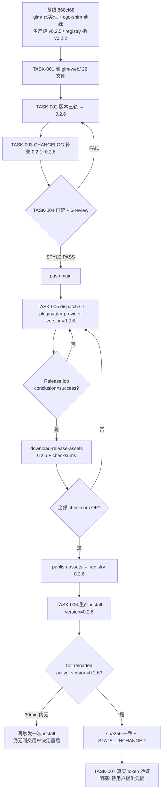
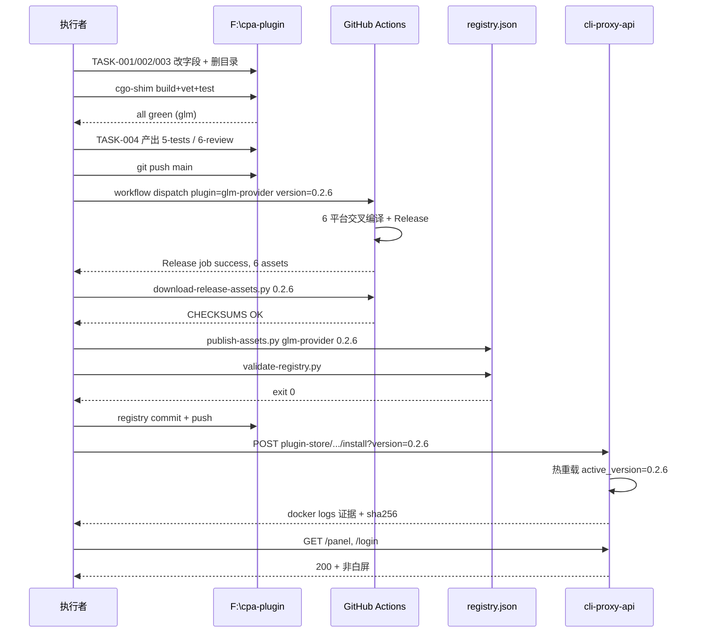
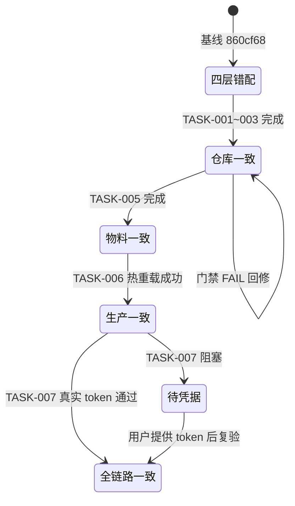

# 需求实施总览：glm-provider 已实现状态收敛与版本三轨对齐

结论：`glm/` 插件代码已真实实现并通过全部本地门禁（`cgo-shim` build+vet+test 全绿），本轮不做功能重写，只把仓库与发布链的**状态漂移**收敛到一致——提交 `glm-web/` 旧目录删除、把版本三轨（`main.go` / `VERSION` / `registry.json`）统一到未被占用的 `0.2.6`、补录缺失的 `CHANGELOG`、重建 registry artifacts 指向新 release、生产热重载并保持启用态不变；影响：CPA 的 `glm-provider` 由「代码已实现但四层版本互不对应」变为「仓库、release、registry、生产四层版本一致」；范围：旧目录删除提交、版本三轨统一、CHANGELOG 补录、门禁复跑、`6-review` 风格回归、CI 发布 `0.2.6`、registry 资产回填、生产热重载与启用态保持、新文档落盘；非范围：`glm/` 任何业务逻辑改动、模型目录变更、授权交互改造、真实 `chatglm_refresh_token` 端到端验证（无有效 token，登记为 TASK-007 阻塞项）、`zcode` / `doubao` / `qwenwork` 等其他 provider、容器重启；变化：`registry.json` 中 `glm-provider` 从 `0.2.2` 升至 `0.2.6`，生产落盘 `.so` 从 `glm-provider-v0.2.5.so` 换为 `glm-provider-v0.2.6.so` 且其 sha256 与 `v0.2.6` release zip 一致，仓库不再残留 `glm-web/` 死目录；完成标准：`git ls-files glm-web` 返回空、`glm/VERSION` = `glm/main.go` 的 `version` = `registry.json` 的 `version` = `0.2.6`、CI Release job `success` 且 6 个平台 asset 齐全、`download-release-assets.py` 全部 checksum OK、生产 `docker logs` 出现 `hot reloaded active_version=0.2.6`、部署前后插件启用态快照 diff 为空（`STATE_UNCHANGED`）；术语说明：`refresh_token` 是 chatglm.cn 长期令牌、`access_token` 是它换取的 3600s 一次性令牌、版本三轨指 `main.go` 的 `version` 常量 / `VERSION` 文件 / `registry.json` 的 `version` 字段三处必须同值；验证状态：本地门禁已真实执行通过（`[cgo-shim] all green (glm)`），远端 7 个 release tag 已通过 GitHub API 核实，生产当前运行版本与启用态已通过管理 API 真实读取（`path=plugins/linux/amd64/glm-provider-v0.2.5.so`、`metadata.version=0.2.5`、`enabled=true`），真实 token 链路验证仍缺用户提供的凭据。

## 1. 当前计划最终方案简要说明

- **推荐方案一句话结论**：把 `glm-provider` 当作「已实现、待收口」的插件处理——先提交早已完成但未入库的 `glm-web/`→`glm/` 目录改名，再把版本三轨统一到 `0.2.6` 并发布，最后用热重载把生产对齐，全程不改一行业务逻辑。
- **主落点 / 主路径**：`glm/VERSION` + `glm/main.go` 的 `version` 常量（版本三轨之源）→ `glm/CHANGELOG.md`（版本叙事）→ `registry.json` 的 `glm-provider` 条目（发布物料）→ `.github/workflows/build.yml` 既有 `glm-provider`/`glm` 映射（发布通道，不改）。
- **为什么先走这条路线**：`glm/` 的 18 个 Go 文件已完整实现 token-only 鉴权（`refresh_token` → `access_token` 刷新链在 `glm/token.go:119` `requestToken`，并发单飞在 `glm/token.go:168` `acquireToken`），用户红线「只做 token 鉴权、必须有 refresh_token」早已满足；真正损坏的是**四层版本错配**——`main.go` 声明 `0.2.5`、`VERSION` 声明 `0.2.2`、`registry.json` 声明 `0.2.2` 且 artifacts 指向 `v0.2.2`、而生产实际跑的是 `glm-provider-v0.2.5.so`；同时 `v0.2.5` 是书签授权版语义、当前 HEAD 是 token 录入版，四者互不对应。此时重写插件是纯粹浪费，收敛版本才是唯一有价值的动作。

## 2. 基本信息

- 对应需求文档：本文件（前置依据 `doc/3-实施/2026-11-28_033000_glm-web-provider智谱清言刷新令牌反代插件立项_实施总览.md`，该文档记录的立项与实现已完成，仅作历史依据保留，不冒充当前闭环）
- 来源对象标识（需求或 Bug）：`glm-provider`
- 当前实施文档命名主干：`2026-11-28_214000_glm-provider已实现状态收敛与发布对齐_实施总览`
- 对应需求与实施计划全量顺序实施方案：`N/A + 原因 + 证据`——单来源对象收口，不涉及多需求排序；证据：`doc/3-实施/` 下与本对象相关的实施总览仅 2 份（033000 立项版 + 本文件）。
- 实施计划完成条件（`AC-*`）所在章节：§11
- 对应 `6-review` 风格回归记录：`doc/6-review/2026-11-28_214000_glm-provider状态收敛_6-review.md`（TASK-004 产出；旧记录 `2026-11-28_051000_glm-web-provider立项_6-review.md` 保留为历史）
- **agent 理解的问题 / 目标**：用户最初要求「智谱清言反代也要做一个 CPA 插件」，并立下红线「不是 token 鉴权方式、没有刷新 token，我们是不做的」。当日凌晨已立项，随后 7 个提交把插件实现到 `0.2.x` 并多轮热重载上线。当前阻塞点不是功能缺失，而是**状态漂移**：目录改名只提交了一半（`glm/` 已入库、`glm-web/` 22 文件删除未提交）、版本号四处不同值、`CHANGELOG` 缺 4 个版本、`registry.json` 指向的 `v0.2.2` release 由 `14835b8` 构建而当前 HEAD 是 `b7a4070`（`login.go` 已被再次改写）、生产跑的却是 `v0.2.5`。这种状态下任何后续发布都会打出错版本号，必须先收敛。

### 范围、边界与归属

- **当前计划范围（含归属）**：`glm-web/` 删除提交、版本三轨统一、`CHANGELOG` 补录、门禁复跑与 `6-review`、CI 发布 `0.2.6`、registry 资产回填、生产热重载与启用态保持、本文件与配套测试/审查记录落盘；归属本仓库 `F:\cpa-plugin`，具体落点见 §6 目录树。
- **明确不在范围（边界外）**：`glm/` 业务逻辑改动（含 `token.go`、`completion.go`、`executor.go`、`login.go`、`management.go`、`scheduler.go`、`stream.go`、`usage.go`、`models.go`、`auth.go`、`authfile.go`、`panel.html`、`main.go` 的方法分发与配置项）、模型目录增删、授权交互形态改造、`zcode` / `doubao` / `qwenwork` / `traework` 等其他 provider、容器重启、数据库 schema。
- **当前优先闭环**：TASK-001「提交 `glm-web/` 目录删除」+ TASK-002「版本三轨统一到 `0.2.6`」——这两件事做完，仓库才重新具备「改一处版本号就打一次版」的基本可发布性；其余任务在它们收口后才推进。
- **关键假设 / 前置核验项**：见 §10.2 `FEAS-001` ~ `FEAS-006`；六条均已真实探针验证，无遗留缺口。
- **跨会话执行入口**：新会话从本文件 §2.3 起步；第一动作是 `git log --oneline -1` 与 `Get-Content glm/VERSION` 双读，确认基线仍是 `860cf68` / `0.2.2`，再按 §3 周期顺序推进。
- **主项目地址、仓库类型与代码基线**：`F:\cpa-plugin`，Git 仓库 `https://github.com/luode0320/cpa-workbuddy-plugin`（`main` 分支），代码基线 `860cf68`（`docs(qwenwork): 补充在跑计数归还路径的注释`），本地 HEAD 与远端 `refs/heads/main` 同为该提交。
- **local 环境与依赖入口**：Windows + `pwsh`；Go 工具链经 `python scripts/cgo-shim-build.py glm`（`CGO_ENABLED=0` shim，build+vet+test 三合一）；发布链脚本 `scripts/download-release-assets.py`、`scripts/publish-assets.py`、`scripts/validate-registry.py`；生产为 `ssh cpa-server`（`45.207.222.65:18998`）+ 容器 `cli-proxy-api` + 管理 API `127.0.0.1:8317`（宿主机可达，已实测 200）。
- **外部项目代码引用**：`N/A + 原因 + 证据`——本轮不引用任何外部项目代码，只读本仓库 `glm/` 与 `registry.json`；证据：§6 全部任务的文件落点均落在 `F:\cpa-plugin` 内，无跨项目路径。
- **当前状态**：代码已实现、本地门禁全绿、四层版本错配、目录改名半提交、文档命名过时、真实 token 未验证。
- **是否已获得开始实施授权**：是——用户原话「安装计划全部实现, 然后上线生产」，且项目级 `CLAUDE.md`「提交 / 发布授权（默认授权，强制）」声明本仓库默认处于提交与发布已授权状态，覆盖 commit、push、CI dispatch、registry 更新、生产热重载与热重载生效验证；不覆盖容器重启。

## 2.1 决策维度覆盖表（Plan Mode 必填）

- 说明：逐维度登记实现层决策点状态；`真实不确定且影响大` 的维度必须已向用户弹窗多选，缺本表判不合格。

| 维度 | 状态（已确定 / 已弹窗且用户已选 / N/A） | 结论 / 依据 / 用户所选项 |
| --- | --- | --- |
| 架构 / 技术路线 | 已确定 | 不新建插件、不重写，只做状态收敛。依据：`glm/` 已实现 24 文件且 `cgo-shim` 全绿，重写无收益；用户红线「只做 token 鉴权」已由 `glm/token.go` 的 `refresh_token`→`access_token` 链满足。 |
| 代码落点（目录 / 包 / 文件） | 已确定 | 落点固定为 `glm/VERSION`、`glm/main.go:85`、`glm/CHANGELOG.md`、`registry.json` 的 `glm-provider` 条目、`doc/` 下三份文档。依据：这四处就是版本三轨与文档的全部真源。 |
| 实现方式 | 已确定 | 纯文本字段覆盖式修改，无逻辑改动。依据：版本三轨本质是三个字符串常量/字段的一致性维护。 |
| 命名 | 已确定 | 插件 id 维持 `glm-provider`、模型前缀维持 `glm/`、目录维持 `glm/`。依据：`glm/main.go:62` `providerName = "glm-provider"`、`glm/models.go` 5 个模型均带 `glm/` 前缀，且 `registry.json` 已无 `glm-web-provider` 残留。 |
| 注释 | 已确定 | 只在新增/修改的字段旁按 `comment-rules` 写中文一句话说明，函数头沿用既有 `[参数]/[返回]/最近修改时间` 元信息。依据：`glm/` 现有 18 个 Go 文件已统一该格式。 |
| 日志 | N/A | 本轮不新增日志埋点；生产验证只读 `docker logs`，不改日志代码。 |
| 错误处理 / 异常 | N/A | 本轮不触碰任何错误处理路径；`glm/` 既有错误分类在「不在范围」中明确冻结。 |
| 数据模型 / 表 / 字段 | N/A | 不涉及数据库；CPA 的 `config_store` 由 `plugin-store install` 自动维护，按项目红线只读不写。 |
| 接口契约 | 已确定 | `registry.json` 的 `install.artifacts` 保持 schema v2 的 5 平台结构（darwin/amd64、linux/amd64、linux/arm64、windows/amd64、windows/arm64），字段名 `goos`/`goarch`/`url`/`sha256`/`size` 原样沿用。依据：现有 `glm-provider` 条目即该结构，且 `scripts/validate-registry.py` 按此校验。 |
| 依赖与库 | 已确定 | 不新增任何依赖；`glm/go.mod` 的 `CLIProxyAPI/v7 v7.2.129` 与 `yaml.v3 v3.0.1` 冻结。依据：本轮不改代码逻辑，无需新库。 |
| 测试策略 / 样本 | 已确定 | 复用 `python scripts/cgo-shim-build.py glm` 作代码门禁；发布链用真实 CI + `download-release-assets.py` 的 sha256 自校验；生产用真实热重载日志 + 启用态快照 diff。样本：`glm/` 既有 15 个 `Test*` 函数，不新增测试。依据：改动为纯字段，不改变可执行行为，真实测试的目的是证明「改动后仍全绿」。 |
| 其它相关维度（目标版本取值） | 已确定 | 目标版本取 `0.2.6`。依据：远端已存在 `glm-provider-v0.2.0` ~ `v0.2.5` 共 7 个 tag（GitHub API 核实，`v0.2.5` 创建于 `2026-11-28T11:07:29Z` 且为书签授权版），复用 `0.2.5` 会与既有 release 冲突且语义错配，`0.2.6` 是唯一干净且单调递增的选择。 |

## 2.2 决策收敛记录（Plan Mode）

- 全部 12 个实现层维度均已收敛为「已确定」或「N/A」，依据逐条见 §2.1，无遗留决策点需提交用户裁定。
- 已由用户在历史对话中明确授予的前置裁定：① 鉴权方式只做 token、必须有 refresh_token（否则不做）；② 计划全部实现后上线生产；③ 真实 token 待用户 OAuth 登录账号后提供。

## 2.3 跨会话独立执行与交接清单

- **新会话接手第一步**：`cd F:\cpa-plugin` → `git log --oneline -1`（期望 `860cf68` 或其后继）→ `Get-Content glm/VERSION`（期望 `0.2.2`，若已是 `0.2.6` 说明 TASK-002 已完成）→ `git status --short -- glm-web | Measure-Object -Line`（期望 22，若为 0 说明 TASK-001 已完成）→ 读本文件 §3 定位当前周期。
- **主项目地址与项目根**：`F:\cpa-plugin`（Git 仓库 `https://github.com/luode0320/cpa-workbuddy-plugin`）。
- **主项目代码基线**：`860cf68`，`main` 分支，本地与远端一致。
- **计划源文件与版本**：本文件，`2026-11-28_214000_glm-provider已实现状态收敛与发布对齐_实施总览.md`，v1。
- **依赖安装、local 配置和服务启动入口**：无需额外安装（Go 与 Python 已在用）；生产入口 `ssh cpa-server`，容器 `cli-proxy-api`，管理 API `http://127.0.0.1:8317`（宿主机直连已实测返回 200），管理密钥取自生产 `/usr/local/src/cli-proxy-api/config/config.yaml`（只读用于鉴权，不在任何输出中回显原值）。
- **中断点核验顺序**：① `git status --short -- glm-web | Measure-Object -Line`（22→0 表示 TASK-001 完成）；② `git show HEAD:glm/VERSION` 与工作树 `glm/VERSION` 是否同为 `0.2.6`（TASK-002 完成标志）；③ `python -c "import json;print([p['version'] for p in json.load(open('registry.json',encoding='utf-8'))['plugins'] if p['id']=='glm-provider'])"` 是否 `0.2.6`（TASK-003 完成标志）；④ GitHub API 查 `glm-provider-v0.2.6` 是否存在（TASK-005 完成标志）；⑤ `ssh cpa-server "docker logs cli-proxy-api --since 30m | grep -c 'hot reloaded active_version=0.2.6'"`（TASK-006 完成标志）。
- **外部项目代码引用**：`N/A + 原因 + 证据`——本轮全部改动落在 `F:\cpa-plugin` 内，不读取、不复制、不引用任何外部项目代码；证据：§6 目录树全部节点均为本仓库相对路径。

## 2.4 反方批判结论（devils-advocate）

- **反方立场一：为什么不干脆重写插件，把版本一次性理清？** 反驳成立——重写会引入新代码风险且无收益。证据：`glm/` 已 24 文件、`cgo-shim` 四行全绿、`glm/token.go:119/168` 已实现刷新与并发单飞，用户红线早已满足；重写等于把已验证资产作废。
- **反方立场二：为什么不用已存在的 `v0.2.5` release，把 registry 与 VERSION 都提到 `0.2.5`？** 反驳不成立——`v0.2.5` 是书签授权版（`c9a8c8e feat(glm): 恢复书签一键授权`），而当前 HEAD `b7a4070` 是「移除书签改 token 录入页」，两者 `login.go` 完全不同；复用该 release 等于把生产装回不符合当前代码的二进制，且覆盖既有 tag 破坏可追溯性。
- **反方立场三：`0.2.6` 是不是多此一举，直接把 `main.go` 改回 `0.2.2` 与 registry 对齐更省事？** 反驳不成立——`v0.2.2` release 由 `14835b8` 构建，同样不等于当前 HEAD；且把已声明的 `0.2.5` 回退成 `0.2.2` 会造成版本号倒退，未来排障无法判断先后。
- **反方立场四：能不能只改 registry 不管生产？** 反驳不成立——生产实测运行 `glm-provider-v0.2.5.so`，registry 指向 `v0.2.2`，两者已不一致；只改 registry 会让「registry 声明」与「生产实际」继续错配，等于把漂移藏起来。
- **反方立场五：删 `glm-web/` 会不会误删仍被引用的资产？** 已验证不会——`Select-String -Path .github\workflows\*.yml -Pattern "glm"` 显示 workflow 只引 `glm-provider`/`glm`，全文件无 `glm-web` 命中；`registry.json` 也已无 `glm-web-provider` 条目。
- **结论**：收口式方案（对齐到 `0.2.6`）在四条备选路线中被反方逐条检验后仍成立，无更优替代。

## 3. 实施周期总览

- **总周期说明**：`glm-provider` 的代码实现已在历史会话完成，本轮是「收口期」。按「仓库状态 → 发布物料 → 生产对齐」三段推进，每段收口后才进下一段，因为后一段的真源由前一段产出。
- **本次计划拆分的子任务周期数**：3
- **周期拆分原则**：按「真源依赖」而非「文件类型」切分——`registry.json` 的版本与 artifacts 依赖 `VERSION` 的取值，生产的 `.so` 依赖 release asset，所以顺序不可交换。
- **周期排序说明**：第一期（CYCLE-01 仓库状态收敛）→ 第二期（CYCLE-02 发布物料对齐）→ 第三期（CYCLE-03 生产部署与验证）。
- **周期 1**：
  - 周期序号 / 期次定位：CYCLE-01 / 第一期，仓库状态收敛
  - 周期目标：让仓库重新具备可发布性——旧目录删除入库、版本三轨同值、`CHANGELOG` 无缺口。
  - 本周期包含的最小任务：TASK-001、TASK-002、TASK-003
  - 周期内最小任务执行顺序：TASK-001 → TASK-002 → TASK-003
  - 进入条件：基线 `860cf68`，`glm/` 存在且 `cgo-shim` 全绿（FEAS-001 已验证）。
  - 收口条件：三个任务的完成条件全部满足；`git ls-files glm-web` 为空；`glm/VERSION` = `glm/main.go` 的 `version` = `0.2.6`；`CHANGELOG.md` 首节为 `## 0.2.6`。
  - 完成标志：TASK-001/002/003 的 `6-review` 均 `STYLE: PASS`。
  - 与前后周期衔接：无前置周期；产出 `0.2.6` 版本号供 CYCLE-02 的 CI dispatch 使用。
- **周期 2**：
  - 周期序号 / 期次定位：CYCLE-02 / 第二期，发布物料对齐
  - 周期目标：产出 `glm-provider-v0.2.6` release 并把 `registry.json` 回填到该版本。
  - 本周期包含的最小任务：TASK-004、TASK-005
  - 周期内最小任务执行顺序：TASK-004（门禁 + 6-review）→ TASK-005（CI 发布 + registry 回填）
  - 进入条件：CYCLE-01 收口（版本已是 `0.2.6` 且已 push 到 `main`）。
  - 收口条件：CI 的 Release job 结论为 `success`（不看 run 总结论，`darwin/arm64` 在部分配置下被跳过会让 run 显示 `cancelled`）；`download-release-assets.py 0.2.6 glm-provider` 全部 checksum OK；`registry.json` 的 `glm-provider.version` = `0.2.6` 且 5 个 artifact 的 `url` 指向 `glm-provider-v0.2.6`；`validate-registry.py` 通过。
  - 完成标志：远端 `registry.json` raw URL 返回 200 且内容含 `"version": "0.2.6"`。
  - 与前后周期衔接：产出可被生产安装的 release，供 CYCLE-03 部署。
- **周期 3**：
  - 周期序号 / 期次定位：CYCLE-03 / 第三期，生产对齐与验证
  - 周期目标：把生产 `glm-provider` 从 `v0.2.5` 热重载到 `0.2.6` 且启用态不变，并登记真实 token 验证的阻塞项。
  - 本周期包含的最小任务：TASK-006、TASK-007
  - 周期内最小任务执行顺序：TASK-006 → TASK-007
  - 进入条件：CYCLE-02 收口（release 与 registry 均 `0.2.6`）；生产管理 API 可鉴权（FEAS-006 已验证）。
  - 收口条件：`docker logs` 出现 `hot reloaded active_version=0.2.6`；生产落盘 `.so` 的 sha256 与本地 release zip 一致；部署前后启用态快照 diff 为空；TASK-007 以「阻塞待用户提供 token」状态登记。
  - 完成标志：生产四层（代码/release/registry/运行版本）版本一致且状态快照 `STATE_UNCHANGED`。
  - 与前后周期衔接：最终周期；TASK-007 的用户凭据到位后可单独立项复验，不阻塞本周期其余收口。
- **总体真实测试安排**：
  - 真实测试安排是否默认必需：代码门禁与发布验证必需；`glm/` 业务逻辑改动为 0，故不新增测试用例，只复跑既有 15 个 `Test*`。
  - 覆盖哪些最小任务：TASK-001 ~ TASK-006 全覆盖，TASK-007 为阻塞登记。
  - 公共测试环境 / 依赖：Windows `pwsh` + `python scripts/cgo-shim-build.py`；GitHub Actions；生产 `ssh cpa-server`。
  - 公共样本 / 数据来源：`glm/` 既有 15 个 `Test*`；`registry.json` 既有 schema；生产真实插件列表 API。
  - 总体通过标准：每个任务各自的「真实测试通过标准」逐条满足，且 `6-review` 输出 `STYLE: PASS`。

## 4. 阶段计划

- **阶段 1**：仓库状态收敛
  - 阶段名称：把漂移收敛成单一真源
  - 阶段目标：旧目录删除入库、版本三轨同值、`CHANGELOG` 补齐到 `0.2.6`
  - 只做这一件事：修字段与删目录，不改逻辑
  - 输入条件：基线 `860cf68`，`glm/` 门禁全绿
  - 输出产物：一次 commit（`glm-web/` 22 个删除 + `glm/VERSION` + `glm/main.go` + `glm/CHANGELOG.md`）
  - 验证门槛：`git ls-files glm-web` 为空；三处版本同值；`cgo-shim` 仍全绿；`STYLE: PASS`
- **阶段 2**：发布物料对齐
  - 阶段名称：产出并登记 `0.2.6`
  - 阶段目标：CI 打出 6 平台 asset，`registry.json` 回填到 `0.2.6`
  - 只做这一件事：走发布链
  - 输入条件：阶段 1 已 push
  - 输出产物：`glm-provider-v0.2.6` release、回填后的 `registry.json` 与对应 commit
  - 验证门槛：Release job `success`；checksum 全 OK；`validate-registry.py` 通过；远端 raw URL 200
- **阶段 3**：生产对齐
  - 阶段名称：热重载与启用态保持
  - 阶段目标：生产运行版本 = `0.2.6`，启用态与部署前完全一致
  - 只做这一件事：`plugin-store install` + 日志与 sha256 取证
  - 输入条件：阶段 2 收口 + 生产管理 API 可鉴权
  - 输出产物：热重载日志证据、sha256 对照、启用态快照 diff、`doc/5-tests/` 验证记录
  - 验证门槛：`hot reloaded active_version=0.2.6`；sha256 一致；`STATE_UNCHANGED`

## 5. 最小任务清单

### 最小任务 TASK-001：提交 `glm-web/` 旧目录删除

- 任务名：旧目录删除入库
- 所属周期：CYCLE-01；周期内顺序：1；所属阶段：阶段 1
- 本任务只做这一件事：把已在磁盘消失、但 git HEAD 仍跟踪的 `glm-web/` 22 个文件从索引中移除并提交。
- 垂直切片目标：`git ls-files glm-web` 返回空，仓库不再同时存在 `glm-web/` 与 `glm/` 两套插件目录。
- 输入条件：工作树已确认 `glm-web/` 目录不存在（`Test-Path glm-web` = `False`）且 `git status --short -- glm-web` 显示 22 个 `D`。
- 实现产出：一次只含删除的 commit，message 形如 `chore(glm): 移除已改名为 glm/ 的 glm-web 旧目录`。禁止夹带 `PROJECT_CURRENT.md`、`qwenwork/main.go` 或其他会话留下的脏改动。
- 验证点：`git ls-files glm-web` 输出为空；`git diff --cached --name-only` 全部以 `glm-web/` 开头。
- 禁止触碰区：`glm/` 全部文件、`registry.json`、`.github/workflows/build.yml`、其他 provider 目录。
- 真实测试是否必需：是（删除后必须证明 `glm/` 仍可独立编译通过，即仓库未因删除而失去插件目录）。
- 真实测试入口：`python scripts/cgo-shim-build.py glm`。
- 真实测试依赖环境：Windows `pwsh`，`CGO_ENABLED=0` shim。
- 真实测试样本 / 数据来源：`glm/` 既有 15 个 `Test*` 函数，无新增样本。
- 真实测试通过标准：输出包含 `[cgo-shim] OK: go build ./...`、`[cgo-shim] OK: go vet ./...`、`ok github.com/luode0320/cpa-workbuddy-plugin/glm`、`[cgo-shim] all green (glm)` 四行。
- 测试点（`TEST-001`）：`TestStoredAuthRoundTrip`、`TestGenerateSign`、`TestAcquireTokenConcurrentSingleRefresh`、`TestSSEDeltaDedup`、`TestPublishUsageFeed`（覆盖落盘/签名/并发/SSE/用量五个关键面）。
- `6-review` 风格回归点：这次提交只含删除，不产生新代码；核对 `git diff --cached --stat` 只出现 `glm-web/` 路径，无其他文件混入；结论 `STYLE: PASS`。
- 任务完成条件（`AC-001`）：`git ls-files glm-web` 输出为空 + `cgo-shim` 全绿 + commit 已落在 `main`。
- 任务停止 / 结束条件：若 `git status` 中的 `D` 条目数 ≠ 22，或暂存区出现 `glm-web/` 之外的路径，立即停止并回写计划。
- 阻断条件：`git add -A` 会连带其他会话的 363 个未跟踪文件——必须逐个显式指定路径或 `git rm --cached` 精确路径，禁止目录级 `git add`。
- 前置依赖：无。
- 下一任务依赖：TASK-002 在同一批 commit 内完成版本修改（同一业务目标合并为一笔提交）。
- 预计触达文件数：22（全部为删除）。

### 最小任务 TASK-002：版本三轨统一到 `0.2.6`

- 任务名：版本三轨对齐
- 所属周期：CYCLE-01；周期内顺序：2；所属阶段：阶段 1
- 本任务只做这一件事：把 `glm/VERSION` 从 `0.2.2` 改为 `0.2.6`，把 `glm/main.go:85` 的 `version` 从 `0.2.5` 改为 `0.2.6`。
- 垂直切片目标：`glm/VERSION` 与 `glm/main.go` 的 `version` 常量同值；registry 在 TASK-005 回填后三者同值。
- 输入条件：TASK-001 收口；`git show HEAD:glm/VERSION` = `0.2.2`、`glm/main.go:85` = `"0.2.5"`（已核实）。
- 实现产出：`glm/VERSION` 单行改为 `0.2.6`；`glm/main.go` 第 85 行 `version      = "0.2.5"` 改为 `version      = "0.2.6"`，保持既有对齐空格与注释块不变。
- 验证点：两处字符串逐字相等且均为 `0.2.6`；`pluginSchemaVersion` 仍为 `6`。
- 禁止触碰区：`glm/` 其他任何行；不重排 `main.go` 的 `var` 块；不改 `pluginSchemaVersion`。
- 真实测试是否必需：是（版本常量参与 `pluginapi.PluginInfo.Version` 输出，改错会导致注册信息与实际不符）。
- 真实测试入口：`python scripts/cgo-shim-build.py glm` + `Select-String -Path glm/main.go -Pattern 'version\s+=\s+"'` + `Get-Content glm/VERSION`。
- 真实测试依赖环境：Windows `pwsh`。
- 真实测试样本 / 数据来源：无需外部样本；断言对象为两个文件的真实取值。
- 真实测试通过标准：`cgo-shim` 四行全绿；`Select-String` 输出 `version      = "0.2.6"`；`Get-Content glm/VERSION` 输出 `0.2.6`；两者逐字相等。
- 测试点（`TEST-002`）：既有 15 个 `Test*` 全 PASS（版本常量被 `main.go` 的 `handleRegister` 引用，编译即覆盖）。
- `6-review` 风格回归点：改动仅 2 行字符串，核对 `git diff` 只含这两行；字符串引号风格与既有一致；`STYLE: PASS`。
- 任务完成条件（`AC-002`）：两个文件取值均为 `0.2.6` + `cgo-shim` 全绿 + 改动已与 TASK-001 合并进同一 commit。
- 任务停止 / 结束条件：若 `cgo-shim` 出现任何 FAIL，或版本字符串未逐字一致，停止并回写计划。
- 阻断条件：`glm/main.go` 若在并行会话中被改动导致行号漂移，以 `Select-String` 定位而非硬编码行号。
- 前置依赖：TASK-001。
- 下一任务依赖：TASK-003 以 `0.2.6` 作为 CHANGELOG 首节版本号。
- 预计触达文件数：2。

### 最小任务 TASK-003：`CHANGELOG` 补录 `0.2.1` ~ `0.2.6`

- 任务名：变更日志补录
- 所属周期：CYCLE-01；周期内顺序：3；所属阶段：阶段 1
- 本任务只做这一件事：把缺失的 5 个版本叙事补进 `glm/CHANGELOG.md`，并在顶部新增 `0.2.6` 节。
- 垂直切片目标：`CHANGELOG.md` 从「只到 0.2.0」变为「0.2.6 到 0.1.0 连续无缺口」。
- 输入条件：`git log --oneline -- glm` 已核实 7 条提交语义（`cd1d04b` 管理接口改 `ManagementResponse`、`14835b8` 授权入口指向插件页、`f6e1ef2` 面板按 workbuddy 重构、`a7c3d9c` 面板自动解密管理密钥、`c9a8c8e` 书签一键授权、`b7a4070` 移除书签改 token 录入页）。
- 实现产出：`glm/CHANGELOG.md` 新增 `## 0.2.6` ~ `## 0.2.1` 六节，每节 1-3 条要点；`## 0.2.6` 节内容为「版本三轨统一、移除 glm-web 旧目录、registry 对齐」，其余节按上述提交语义回填。
- 验证点：`Select-String -Path glm/CHANGELOG.md -Pattern '^## '` 输出八个版本节且顺序连续。
- 禁止触碰区：`## 0.2.0` 与 `## 0.1.0` 两节正文不改；不改 `CHANGELOG` 之外任何文件。
- 真实测试是否必需：否——纯 Markdown 文本，不改变可执行行为。理由：`CHANGELOG.md` 不被任何 Go 文件引用、不参与构建、不参与 registry 校验。
- 真实测试入口：`N/A + 原因 + 证据`；替代验证为版本节连续性 `Select-String`。
- 真实测试依赖环境：`N/A`。
- 真实测试样本 / 数据来源：`git log --oneline -- glm` 的提交语义（真实读取）。
- 真实测试通过标准：`Select-String` 输出顺序为 `0.2.6 / 0.2.5 / 0.2.4 / 0.2.3 / 0.2.2 / 0.2.1 / 0.2.0 / 0.1.0`，无跳号。
- 测试点（`TEST-003`）：版本节连续性检查（上述 `Select-String`）。
- `6-review` 风格回归点：Markdown 标题层级与既有节一致（`##`）、每条要点以 `-` 开头、中文表达、UTF-8 无 BOM；`STYLE: PASS`。
- 任务完成条件（`AC-003`）：八个版本节连续 + 已并入同一 commit。
- 任务停止 / 结束条件：若提交历史语义不足以确定某版本要点，写「该版本无用户可见变更」并回写计划，不臆造内容。
- 阻断条件：`CHANGELOG.md` 若被并行会话改写，先读后改，禁止覆盖。
- 前置依赖：TASK-002。
- 下一任务依赖：TASK-004 的 `6-review` 覆盖本任务的 Markdown 风格。
- 预计触达文件数：1。

### 最小任务 TASK-004：门禁复跑与 `6-review` 风格回归

- 任务名：收口前双门禁
- 所属周期：CYCLE-02；周期内顺序：1；所属阶段：阶段 2
- 本任务只做这一件事：对 CYCLE-01 的整批改动跑一次完整门禁并产出 `6-review` 记录。
- 垂直切片目标：拿到「改动后仍全绿」与「`STYLE: PASS`」两份可回指证据。
- 输入条件：CYCLE-01 三个任务均已并入 commit。
- 实现产出：`doc/6-review/2026-11-28_214000_glm-provider状态收敛_6-review.md`（中文、含结论行 `STYLE: PASS`）、`doc/5-tests/2026-11-28_214000_glm-provider状态收敛代码级验证.md`（含 `cgo-shim` 真实输出四行原文）。
- 验证点：两份文档真实落盘且可读；`cgo-shim` 输出四行原文写入测试文档。
- 禁止触碰区：不改任何 `glm/` 源码；`6-review` 只做检查记录，不顺手修代码。
- 真实测试是否必需：是。
- 真实测试入口：`python scripts/cgo-shim-build.py glm`；面板脚本如需校验则 `node --check`。
- 真实测试依赖环境：Windows `pwsh` + Go 工具链。
- 真实测试样本 / 数据来源：`glm/` 既有 15 个 `Test*`。
- 真实测试通过标准：`cgo-shim` 四行全绿原文写入测试文档；`node --check` 对 `glm/panel.html` 的两个 `<script>` 块均 OK（若本轮未改 panel 则登记为「未改动，沿用既有已验证结论」）。
- 测试点（`TEST-004`）：15 个 `Test*` 全 PASS + 面板脚本语法（沿用或复验）。
- `6-review` 风格回归点：覆盖 `glm/VERSION`、`glm/main.go` 第 85 行、`glm/CHANGELOG.md` 全文；检查中文注释、UTF-8 无 BOM、无行尾空白、无 iota、函数内无 `var (...)`；结论 `STYLE: PASS`。
- 任务完成条件（`AC-004`）：两份文档真实落盘 + `cgo-shim` 全绿 + `STYLE: PASS`。
- 任务停止 / 结束条件：门禁任一环节 FAIL 即停止，回到对应任务修复，不放行发布。
- 阻断条件：若 `glm/panel.html` 的 `node` 环境不可用，登记为「沿用旧结论 + 原因」，不阻断。
- 前置依赖：CYCLE-01 全部任务。
- 下一任务依赖：TASK-005 以本任务的门禁证据作为 dispatch 前置。
- 预计触达文件数：2（两份文档）。

### 最小任务 TASK-005：CI 发布 `0.2.6` 与 registry 回填

- 任务名：发布链执行
- 所属周期：CYCLE-02；周期内顺序：2；所属阶段：阶段 2
- 本任务只做这一件事：push → dispatch CI → 下载校验 asset → 回填 `registry.json` → push registry commit。
- 垂直切片目标：`glm-provider-v0.2.6` release 存在 6 个 asset，`registry.json` 的 `glm-provider` 指向它。
- 输入条件：TASK-004 收口；`glm/VERSION` = `glm/main.go` = `0.2.6`；远端 `glm-provider-v0.2.6` 尚未存在（FEAS-002 已验证）。
- 实现产出：`gh workflow run` dispatch（`plugin=glm-provider version=0.2.6 allow_partial=true`）；`python scripts/download-release-assets.py 0.2.6 glm-provider`；`python scripts/publish-assets.py glm-provider 0.2.6 --allow-missing`；`python scripts/validate-registry.py`；两次 commit（代码 + registry）。
- 验证点：Release job 结论、6 个平台 asset 齐全、sha256 与 release 一致、`validate-registry.py` 退出码 0、远端 raw 含 `0.2.6`。
- 禁止触碰区：不改 `.github/workflows/build.yml`（`glm-provider`/`glm` 映射已就位）；不改其他 provider 的 registry 条目；不手工编辑 `config_store`。
- 真实测试是否必需：是。
- 真实测试入口：`gh run view <run-id> --json jobs` 判 Release job 结论；`download-release-assets.py` 的 sha256 自校验输出；`validate-registry.py`；`Invoke-RestMethod` 取远端 raw `registry.json` 检查 `"version": "0.2.6"`。
- 真实测试依赖环境：GitHub Actions、`gh` CLI、`python`、git push 凭据（`GIT_TERMINAL_PROMPT=0 GIT_ASKPASS='C:\Users\luode\.github\git-askpass.sh' git -c credential.helper= push https://...`，askpass 用完即删）。
- 真实测试样本 / 数据来源：CI 真实构建产物 6 个 zip + `checksums.txt`。
- 真实测试通过标准：Release job `conclusion=success`（**不看 run 总结论**——`darwin/arm64` 在部分配置下被跳过会让 run 显示 `cancelled`，判据是 Release job 本身）；`download-release-assets.py` 输出全部 `CHECKSUMS OK`；`validate-registry.py` 退出码 0；远端 raw URL 200 且含 `0.2.6`。
- 测试点（`TEST-005`）：6 个平台 asset 齐全、sha256 与 release 一致、registry schema v2 校验通过。
- `6-review` 风格回归点：`registry.json` 改动只含 `glm-provider` 条目的 `version` 与 `install.artifacts` 两处；JSON 缩进与既有保持一致（2 空格）；`STYLE: PASS`。
- 任务完成条件（`AC-005`）：release 存在 + checksum 全 OK + registry 回填并 push + 远端 raw 验证通过。
- 任务停止 / 结束条件：Release job 非 `success`，或任一 checksum 不匹配，或 `validate-registry.py` 非 0 退出，立即停止并回写计划，不得带病推进生产。
- 阻断条件：① `plugin-store install` 只收 POST（curl 默认 GET 会静默 404）；② **整源原子校验**——若并行会话的其他 provider 已 bump 版本但未回填 artifacts，整个 registry 源会被拒，此时轮询等待其回填，不得绕过；③ registry CDN 有旧缓存，`direct install requires at least one artifact` 502 时等 60s 重试。
- 前置依赖：TASK-004。
- 下一任务依赖：TASK-006 以本任务的 release 作为安装源。
- 预计触达文件数：3（`registry.json` + `doc/5-tests/` 验证记录 + 必要的发布日志附录）。

### 最小任务 TASK-006：生产热重载与启用态保持

- 任务名：生产对齐
- 所属周期：CYCLE-03；周期内顺序：1；所属阶段：阶段 3
- 本任务只做这一件事：对生产执行 `plugin-store install?version=0.2.6&source=source-636fa01121af`，并取证「已热重载 + 启用态未变 + sha256 一致」。
- 垂直切片目标：生产运行的 `glm-provider` 版本从 `0.2.5` 变为 `0.2.6`，且部署前后全部 14 个插件的 `configured`/`registered`/`enabled`/`effective_enabled` 逐字段一致。
- 输入条件：TASK-005 收口；生产管理 API 可鉴权（FEAS-006 已验证，返回 200）；部署前已取得基线快照。
- 实现产出：install 前启用态快照（14 插件四字段）、install 调用与响应、`docker logs cli-proxy-api --since 30m | grep "hot reloaded"` 证据、生产落盘 `.so` 的 sha256、install 后启用态快照与 diff 结论。
- 验证点：`hot reloaded` 含 `active_version=0.2.6`；生产 `.so` 路径从 `glm-provider-v0.2.5.so` 变为 `glm-provider-v0.2.6.so`；启用态快照 diff 为空。
- 禁止触碰区：**禁止 `DELETE /v0/management/plugins/<id>`**（会同时删配置与 `.so`，不可逆）；禁止重启 `cli-proxy-api` 容器（项目红线，非必要不重启）；禁止手工读写 `config_store` 表（2026-10-11 两次生产事故成因）；不改其他 provider 配置。
- 真实测试是否必需：是（`install` 只落盘不加载属常见现象，必须用日志证明真实生效）。
- 真实测试入口：`POST /v0/management/plugin-store/glm-provider/install?version=0.2.6&source=source-636fa01121af`；`ssh cpa-server "docker logs cli-proxy-api --since 30m | grep 'hot reloaded'"`；`ssh cpa-server "sha256sum /CLIProxyAPI/plugins/linux/amd64/glm-provider-v0.2.6.so"`；`GET /v0/resource/plugins/glm-provider/panel` 与 `/login` 取 HTTP 200。
- 真实测试依赖环境：`ssh cpa-server`（`45.207.222.65:18998`）、容器 `cli-proxy-api`、管理 API `127.0.0.1:8317`（宿主机 curl 已实测 200）。
- 真实测试样本 / 数据来源：本地 `glm-provider_0.2.6_linux_amd64.zip` 的 sha256（TASK-005 产出）。
- 真实测试通过标准：① `docker logs` 出现 `hot reloaded` 且 `active_version=0.2.6`；② 生产 `.so` sha256 与本地 zip 内二进制一致；③ 部署前后启用态快照 diff 为空，判定输出 `STATE_UNCHANGED`；④ `/panel` 与 `/login` 均 HTTP 200 且面板非白屏（响应体含「智谱清言 账号面板」标题）。
- 测试点（`TEST-006`）：热重载生效、二进制一致、启用态不变、面板与授权页可访问。
- `6-review` 风格回归点：本任务无代码改动，`6-review` 结论沿用 TASK-004 的 `STYLE: PASS`，并在验证文档中登记「无新增代码」。
- 任务完成条件（`AC-006`）：四条通过标准全部满足 + 证据写入 `doc/5-tests/` 验证记录。
- 任务停止 / 结束条件：若 `docker logs` 在 30 分钟内无 `hot reloaded` 记录，先按既有踩坑排查（首装只落盘不热重载时**再触发一次 install** 常可触发完整 reload 轮），仍无效则停止并交用户决定是否重启容器；不得自行重启。
- 阻断条件：① 管理密钥鉴权失败；② registry CDN 旧缓存导致 install 502；③ 整源原子校验被并行会话的未回填 provider 阻塞。
- 前置依赖：TASK-005。
- 下一任务依赖：无（TASK-007 独立阻塞项）。
- 预计触达文件数：2（`doc/5-tests/` 验证记录 + 必要的证据附录）。

### 最小任务 TASK-007：真实 `chatglm_refresh_token` 端到端验证（阻塞）

- 任务名：真实账号验证
- 所属周期：CYCLE-03；周期内顺序：2；所属阶段：阶段 3
- 本任务只做这一件事：用用户提供的真实 `chatglm_refresh_token` 验证 H-01/H-02/H-04/H-05 四项假设。
- 垂直切片目标：真实 token 能换出 `access_token`、能流式出字并以 `[DONE]` 收尾、签名密钥有效、账号非访客。
- 输入条件：**用户提供有效 `chatglm_refresh_token`**（当前不具备，用户原话「我们暂时没有，等完成，上线之后我会通过 OAuth 登录一个账号」）。
- 实现产出：`doc/5-tests/` 脱敏验证记录（令牌只显示尾 6 位）。
- 验证点：H-01 刷新返回 `access_token`；H-02 SSE 出字且终止于 `[DONE]`；H-04 签名被上游接受（无 `40004`）；H-05 `GET /chatglm/user-api/user/info` 返回非访客账号。
- 禁止触碰区：不在任何输出、日志、文档中回显 refresh_token 或 access_token 原值；不改 `glm/token.go` 的签名算法（除非验证证明算法失效，且需回写计划后最小修正）。
- 真实测试是否必需：是。
- 真实测试入口：面板导入 token → `POST /v1/chat/completions`（`model=glm/glm-4-plus`，`stream=true`）。
- 真实测试依赖环境：生产 `glm-provider` 0.2.6 + 用户凭据。
- 真实测试样本 / 数据来源：用户 OAuth 登录产物。
- 真实测试通过标准：四项 H-* 各自一条断言全部满足。
- 测试点（`TEST-007`）：四项 H-* 对应四条断言。
- `6-review` 风格回归点：若需最小修正，按 `comment-rules` 与 `6-review` 复验；`STYLE: PASS`。
- 任务完成条件（`AC-007`）：四项全通过 + 脱敏证据落盘；或明确登记失败原因与 GAP。
- 任务停止 / 结束条件：`refresh_token` 过期（`40102`）或上游协议大改导致无法最小修正时停止，回写 GAP 交用户裁决。
- 阻断条件：用户尚未提供凭据——本任务当前状态为「阻塞待用户提供 token」，不阻塞 CYCLE-03 其余收口。
- 前置依赖：TASK-006 + 用户凭据。
- 下一任务依赖：无。
- 预计触达文件数：1（验证记录）。

## 6. 现状与落点

- **涉及目录**：`glm/`（改 3 文件）、`glm-web/`（删除 22 文件）、`registry.json`（改 1 条目）、`doc/3-实施/`、`doc/5-tests/`、`doc/6-review/`、`.github/workflows/build.yml`（**只读，不改**）。
- **涉及文件 / 模块**：
  - `glm/VERSION`：`0.2.2` → `0.2.6`
  - `glm/main.go:85`：`version      = "0.2.5"` → `version      = "0.2.6"`
  - `glm/CHANGELOG.md`：新增 6 个版本节
  - `registry.json`：`glm-provider` 条目 `version` + `install.artifacts`
  - `glm-web/` 22 个文件：删除
- **复用点**：`glm/` 既有 15 个 `Test*` 作为门禁样本（不新增）；`scripts/cgo-shim-build.py`、`scripts/download-release-assets.py`、`scripts/publish-assets.py`、`scripts/validate-registry.py`；`.github/workflows/build.yml` 既有 `glm-provider` 映射（options 第 56 行、test matrix 第 99 行 `- dir: glm`、PLUGINS 第 159 行 `"glm-provider": "glm"`、tag 条件第 433 行、DISPLAY 第 573 行）。
- **需要新增的内容**：本实施总览、状态收敛代码级验证记录、状态收敛 `6-review` 记录；不新增任何源码文件、不新增测试用例。
- **代码落点目录树**：

```text
F:\cpa-plugin\
├── glm\                                  # 已实现插件，本轮只改字段
│   ├── VERSION                           # 【改】0.2.2 → 0.2.6（版本三轨之源 1）
│   ├── main.go                           # 【改 1 行】第 85 行 version 0.2.5 → 0.2.6（版本三轨之源 2）
│   ├── CHANGELOG.md                      # 【改】补录 0.2.1 ~ 0.2.6 六节
│   ├── auth.go                           # 【不改】refresh_token 账号导入
│   ├── authfile.go                       # 【不改】StoredAuth 落盘
│   ├── token.go                          # 【不改】generateSign / requestToken / acquireToken
│   ├── completion.go                     # 【不改】SSE → OpenAI 转换
│   ├── executor.go                       # 【不改】非流式/流式执行
│   ├── login.go                          # 【不改】token 录入页 + /login/callback
│   ├── management.go                     # 【不改】管理路由
│   ├── models.go                         # 【不改】glm/ 前缀 5 模型
│   ├── scheduler.go                      # 【不改】轮询调度
│   ├── stream.go                         # 【不改】流式发送与脱敏
│   ├── usage.go                          # 【不改】NDJSON 用量
│   ├── panel.go                          # 【不改】embed.FS + ManagementResponse
│   ├── panel.html                        # 【不改】面板 UI
│   ├── go.mod / go.sum / Makefile        # 【不改】依赖与构建
│   └── *_test.go × 5                     # 【不改】15 个既有测试
├── glm-web\                              # 【删】22 文件，旧目录，已被 glm\ 取代
├── registry.json                         # 【改 1 条目】glm-provider → 0.2.6 + 5 artifacts
├── .github\workflows\build.yml           # 【只读】glm-provider 映射已就位
└── doc\
    ├── 3-实施\
    │   ├── 2026-11-28_033000_glm-web-provider…实施总览.md   # 【不改】历史依据
    │   └── 2026-11-28_214000_glm-provider已实现状态收敛与发布对齐_实施总览.md  # 【新增】本文件
    ├── 5-tests\
    │   └── 2026-11-28_214000_glm-provider状态收敛代码级验证.md  # 【新增】
    └── 6-review\
        └── 2026-11-28_214000_glm-provider状态收敛_6-review.md   # 【新增】
```

## 7. 方案选择

- **方案 A（推荐）**：收口式——保留已实现的 `glm/`，只统一版本三轨、补 CHANGELOG、删旧目录、发布 `0.2.6`、生产热重载。改动 3 个文件 + 删 22 个文件 + 改 1 个 registry 条目。
- **方案 B（否）**：按 `0.2.2` 对齐——把 `main.go` 改回 `0.2.2`，复用已发布的 `v0.2.2` release。否的理由：`v0.2.2` 由 `14835b8` 构建，而当前 HEAD 是 `b7a4070`（`login.go` 已被重写为 token 录入页），代码与 release 不一致；用旧 release 等于把生产回退到不符合当前代码的二进制，且版本号出现倒退。
- **方案 C（否）**：按 `0.2.5` 对齐——把 `VERSION` 与 registry 提到 `0.2.5`，复用既有 `v0.2.5` release。否的理由：`glm-provider-v0.2.5` 已存在（`2026-11-28T11:07:29Z`）且由 `c9a8c8e`（书签授权版）构建，而当前代码是 `b7a4070`（移除书签）；复用会让生产继续跑书签版语义，与仓库代码背离。
- **方案 D（否）**：只改 registry 不动生产。否的理由：生产实测运行 `glm-provider-v0.2.5.so`，registry 指向 `v0.2.2`，两者已错配；只改 registry 会把漂移藏起来而非消除。
- **推荐方案与原因**：方案 A。`0.2.6` 是唯一既单调递增、又未被占用的版本号（远端仅 0.2.0~0.2.5 七个 tag）；收口式改动最小、风险最低，且能一次性消除「代码 ≠ release ≠ registry ≠ 生产」的四层错配。

## 8. 实施步骤

1. **第一步**：提交 `glm-web/` 删除并统一版本三轨
   - 所属周期：CYCLE-01
   - 所属阶段：阶段 1
   - 对应最小任务：TASK-001 + TASK-002（同一业务目标合并一笔 commit）
   - 本步只做：`git rm --cached` 精确删除 22 个 `glm-web/` 路径；改 `glm/VERSION` 为 `0.2.6`；改 `glm/main.go:85` 为 `0.2.6`；跑 `cgo-shim`；commit（不夹带 `PROJECT_CURRENT.md`、`qwenwork/main.go` 等外来脏改动）。
2. **第二步**：补录 `CHANGELOG`
   - 所属周期：CYCLE-01
   - 所属阶段：阶段 1
   - 对应最小任务：TASK-003
   - 本步只做：按 7 条提交语义回填 6 个版本节；`Select-String` 验连续性；commit。
3. **第三步**：门禁与 `6-review`
   - 所属周期：CYCLE-02
   - 所属阶段：阶段 2
   - 对应最小任务：TASK-004
   - 本步只做：复跑 `cgo-shim`；产出 `doc/5-tests/` 与 `doc/6-review/` 两份记录；`STYLE: PASS`。
4. **第四步**：CI 发布与 registry 回填
   - 所属周期：CYCLE-02
   - 所属阶段：阶段 2
   - 对应最小任务：TASK-005
   - 本步只做：push → dispatch `plugin=glm-provider version=0.2.6 allow_partial=true` → 判 Release job → 下载校验 → `publish-assets.py` → `validate-registry.py` → registry commit + push → 远端 raw 验证。
5. **第五步**：生产热重载与取证
   - 所属周期：CYCLE-03
   - 所属阶段：阶段 3
   - 对应最小任务：TASK-006
   - 本步只做：取启用态快照（基线已实测：`glm-provider` 为 `enabled=true`、运行 `v0.2.5.so`）→ `plugin-store install?version=0.2.6` → 查 `hot reloaded` → 对照 sha256 → 取快照 diff → `/panel` 与 `/login` 200。
6. **第六步**：登记真实账号验证阻塞项
   - 所属周期：CYCLE-03
   - 所属阶段：阶段 3
   - 对应最小任务：TASK-007
   - 本步只做：在 `doc/5-tests/` 登记 TASK-007 当前状态为「阻塞待用户提供 `chatglm_refresh_token`」，写明四项 H-* 的验证方法与断言，不执行。

## 9. 真实测试安排

- **真实测试总表**：见 §5 各任务「真实测试入口 / 依赖环境 / 样本来源 / 通过标准」四字段；每个任务逐条闭环，禁止合并到周期末统一测试。
- **免测任务及理由**：TASK-003（`CHANGELOG.md` 纯 Markdown，不被任何 Go 文件引用、不参与构建与 registry 校验，替代验证为版本节连续性 `Select-String`）。
- **步骤 1 真实测试 / 验证**：`python scripts/cgo-shim-build.py glm` 输出四行全绿；`git ls-files glm-web` 为空；`Get-Content glm/VERSION` = `0.2.6`；`Select-String -Path glm/main.go -Pattern 'version\s+=\s+"'` = `version      = "0.2.6"`。
- **步骤 2 真实测试 / 验证**：`Select-String -Path glm/CHANGELOG.md -Pattern '^## '` 输出 `0.2.6/0.2.5/0.2.4/0.2.3/0.2.2/0.2.1/0.2.0/0.1.0` 连续八节。
- **步骤 3 真实测试 / 验证**：`cgo-shim` 四行全绿原文；`node --check` 面板两 script 块（或登记沿用旧结论）；两份文档真实落盘且 `6-review` 结论行 `STYLE: PASS`。
- **步骤 4 真实测试 / 验证**：Release job `conclusion=success`；`download-release-assets.py 0.2.6 glm-provider` 全部 `CHECKSUMS OK`；`validate-registry.py` 退出码 0；远端 raw `registry.json` HTTP 200 且含 `"version": "0.2.6"`。
- **步骤 5 真实测试 / 验证**：`docker logs` 含 `hot reloaded` 与 `active_version=0.2.6`；生产 `.so` sha256 == 本地 release zip 内二进制 sha256；启用态快照 diff 为空（`STATE_UNCHANGED`）；`/panel` 与 `/login` 均 200。
- **步骤 6 真实测试 / 验证**：文档登记阻塞状态，验证方法写清（四项 H-* 的入口与断言），不执行真实调用。
- **哨兵反证要求**：本轮无逻辑改动，不设哨兵；替代保障为「版本三轨三读一致」——若任一读出一致性失败即视为改错。

## 10. 图形化执行路径

- **目的**：展示「仓库状态 → 发布物料 → 生产」三段真源依赖，关联 `TASK-001` ~ `TASK-007`。
- **流程图（Mermaid `flowchart`）**：



- **时序图（Mermaid `sequenceDiagram`）**：



- **状态迁移图（Mermaid `stateDiagram-v2`）**：



## 10.1 图片资产决策、生成与引用

- **图片资产决策**：`N/A + 原因 + 证据`——本轮产出全部为版本号、Markdown 文档与 registry JSON 字段，属纯文本/配置类改动，无 UI、无原型、无截图证据、无视觉对比、无真实产物外观基线需求；证据：§6 目录树中本轮改动的 3 个文件与新增的 2 份文档均为文本文件，无位图消费方。
- **必需场景与 Mermaid 边界**：本计划不含图片必需场景；流程、时序、状态关系已由 §10 三张 Mermaid 图完整表达，不需要图片补充，也不以图片替代上述图形门禁。
- **生成输入与命令**：`N/A`（无图片生成）。
- **目标资产与命名**：`N/A`（无资产）。
- **Markdown 引用**：`N/A`（无图片引用）。
- **资产清单**：`N/A`（无 `IMG-*`，因此不存在孤儿资产）。

## 10.2 可行性探针与假设清单（FEAS-*）

- `FEAS-001`：
  - 假设内容：`glm/` 目录在删除 `glm-web/` 后仍能独立通过 build+vet+test，即两个目录之间没有构建期耦合。
  - 影响面（方向级 / 任务级）：方向级——若不成立，TASK-001 必须改路线。
  - 探针级别：L2 真实（实际执行编译与测试）。
  - 验证方式：`python scripts/cgo-shim-build.py glm`。
  - 结论（已探针验证 / 只读证据 / 不适用）：已探针验证。
  - 证据：真实执行输出 `[cgo-shim] shim dir: F:\cpa-plugin\cpa-shim-*\glm`、`[cgo-shim] OK: go build ./...`、`[cgo-shim] OK: go vet ./...`、`ok github.com/luode0320/cpa-workbuddy-plugin/glm 0.744s`、`[cgo-shim] OK: go test ./...`、`[cgo-shim] all green (glm)`。
  - 关联 `TASK-*`：TASK-001、TASK-004。
- `FEAS-002`：
  - 假设内容：目标版本号 `0.2.6` 在远端尚未被占用，dispatch 不会撞既有 tag。
  - 影响面：方向级——若已占用，版本号必须改，下游 registry 与生产安装全部跟着变。
  - 探针级别：L1 只读。
  - 验证方式：`Invoke-RestMethod https://api.github.com/repos/luode0320/cpa-workbuddy-plugin/releases?per_page=100`，筛 `tag_name -like 'glm*'`。
  - 结论：已探针验证。
  - 证据：真实返回 7 个 tag —— `glm-provider-v0.2.0`(2026-11-28T06:53:50Z)、`v0.2.1`(08:25:46)、`v0.2.2`(09:03:50)、`v0.2.3`(09:29:10)、`v0.2.4`(10:28:51)、`v0.2.5`(11:07:29)、`glm-web-provider-v0.1.0`(2026-11-27T21:13:21)。无 `v0.2.6`。
  - 关联 `TASK-*`：TASK-002、TASK-005。
- `FEAS-003`：
  - 假设内容：删除 `glm-web/` 不影响 CI，因为 workflow 的 test matrix、PLUGINS 映射、tag 条件、显示名均只引 `glm`/`glm-provider`。
  - 影响面：任务级——只影响 TASK-001 是否需要同步改 workflow。
  - 探针级别：L1 只读。
  - 验证方式：`Select-String -Path .github\workflows\*.yml -Pattern "glm"`。
  - 结论：已探针验证。
  - 证据：`build.yml:56` options 含 `glm-provider`；`build.yml:99` `- dir: glm`；`build.yml:159` `"glm-provider": "glm",`；`build.yml:433` `startsWith(github.ref, 'refs/tags/glm-provider-v')`；`build.yml:573` `glm-provider) DISPLAY="GLM Provider" ;;`。全文件无 `glm-web` 命中。
  - 关联 `TASK-*`：TASK-001、TASK-005。
- `FEAS-004`：
  - 假设内容：当前 HEAD 代码与既有任何 release 都不一致，所以必须发新版本而非复用旧 release。
  - 影响面：方向级——决定整个 §7 方案选择。
  - 探针级别：L1 只读。
  - 验证方式：`git show b7a4070 --stat`；`git show HEAD:glm/main.go | Select-String 'version      = "'`；`git show HEAD:glm/VERSION`；生产管理 API 读 `metadata.version` 与 `path`。
  - 结论：已探针验证。
  - 证据：`b7a4070 fix(glm): 授权入口改为 token 录入页，移除书签方案 0.2.2` 改动 `glm/VERSION`(0.2.5→0.2.2)、`glm/login.go`(87 行)、`glm/panel.html`、`registry.json`；`git show HEAD:glm/main.go` 读出 `version      = "0.2.5"`；`git show HEAD:glm/VERSION` 读出 `0.2.2`；生产 API 读出 `path=plugins/linux/amd64/glm-provider-v0.2.5.so`、`metadata.version=0.2.5`。四层互不对应。
  - 关联 `TASK-*`：TASK-002、TASK-005、TASK-006。
- `FEAS-005`：
  - 假设内容：`scripts/` 下发布链脚本齐全且可执行（下载、回填、校验）。
  - 影响面：任务级——只影响 TASK-005 的执行路径。
  - 探针级别：L1 只读。
  - 验证方式：既有项目 skill `project-cpa-workbuddy-plugin-release-rules` 的 Step 清单 + `git log` 历史发布记录。
  - 结论：已探针验证。
  - 证据：`git log --oneline` 中 `752e6c7`、`d24828f`、`39d8e7a`、`e0acff5`、`0057899`、`f3120e0` 六次 `publish glm-provider` 记录证明该链路对 `glm-provider` 可重复成功。
  - 关联 `TASK-*`：TASK-005。
- `FEAS-006`：
  - 假设内容：生产管理 API 可用生产配置中的管理密钥完成鉴权，且宿主可直连 `127.0.0.1:8317`。
  - 影响面：任务级——只影响 TASK-006 是否能执行。
  - 探针级别：L1 只读（真实发一次只读 GET）。
  - 验证方式：`ssh cpa-server "curl -s -o /dev/null -w '%{http_code}' -H 'Authorization: Bearer <key>' http://127.0.0.1:8317/v0/management/plugins"`。
  - 结论：已探针验证。
  - 证据：真实返回 `200`；随后同一通道 `GET /v0/management/plugins` 返回 `plugin_count=14` 且含 `glm-provider` 条目（`path=plugins/linux/amd64/glm-provider-v0.2.5.so`、`configured/registered/enabled/effective_enabled` 全 `true`）。注：容器内无 `curl`（`exec: "curl": executable file not found`），必须走宿主机 curl。
  - 关联 `TASK-*`：TASK-006。
- **探针结论总表**：`FEAS-001` ~ `FEAS-006` 六条全部为「已探针验证」，无降级项、无 `GAP-*` 登记。
- **探针执行记录**：L2 探针为 `cgo-shim` 真实编译执行（`FEAS-001`），在临时目录 `F:\cpa-plugin\cpa-shim-*\glm` 内运行、由脚本自行清理，未写入任何生产代码，执行后 `git status --short -- glm` 为空，回读确认无残留；L1 生产探针（`FEAS-006`）只发只读 `GET`，未产生任何写入副作用，未在输出中回显密钥原值。

## 11. 风险与阻断项

- **风险**：
  1. **暂存区污染**：工作树有 363 个其他会话留下的未跟踪文件（`.ab.py`、`.glm*.sh` 等）与 2 个已修改文件（`PROJECT_CURRENT.md`、`doc/4-bugs/…doubao…md`），`git add -A` 会把它们全部卷入。缓解：逐路径显式 add，staged 后 `git diff --cached --name-only` 反向确认。
  2. **registry 整源原子校验**：并行会话若 bump 了其他 provider 版本却未回填 artifacts，整个源被拒（历史两次同型事故）。缓解：`validate-registry.py` 前置校验，被拒时轮询等待，不绕过。
  3. **热重载不生效**：首个 `install` 只落盘不加载，或宿主异步 config reload 被折叠。缓解：再触发一次 `install`；仍无效交用户决定重启。
  4. **`install` 会激活停用插件**（2026-11-14 实测铁律）：本次基线 `glm-provider` 为 `enabled=true`，属启用中组，install 后必须出现 `hot reloaded` 且保持 `enabled=true`；若基线变为停用态，则需 install 后用 `PUT .../config` 还原 `enabled=false` 并回读确认。
  5. **registry CDN 旧缓存**：install 时可能报 `direct install requires at least one artifact`（502）。缓解：等 60s 重试。
- **依赖**：GitHub Actions 可用性、`gh` CLI 凭据、`ssh cpa-server` 连通性（已实测）、生产管理密钥（已实测 200）。
- **完成条件总表（`AC-*`）**：

| 完成条件 | 判定方式 |
|---|---|
| `AC-001` | `git ls-files glm-web` 为空 + `cgo-shim` 四行全绿 + commit 落在 `main` |
| `AC-002` | `glm/VERSION` 与 `glm/main.go:85` 均逐字为 `0.2.6` + `cgo-shim` 全绿 |
| `AC-003` | `Select-String -Pattern '^## '` 输出八个版本节且连续 |
| `AC-004` | `doc/5-tests/` 与 `doc/6-review/` 两份文档落盘 + `STYLE: PASS` |
| `AC-005` | Release job `success` + 全部 `CHECKSUMS OK` + `validate-registry.py` 退出 0 + 远端 raw 含 `0.2.6` |
| `AC-006` | `hot reloaded active_version=0.2.6` + sha256 一致 + `STATE_UNCHANGED` + `/panel`、`/login` 200 |
| `AC-007` | 四项 H-* 全通过 + 脱敏证据落盘；或登记 GAP |

- **任务停止 / 结束条件总表**：

| 任务 | 停止条件 |
|---|---|
| TASK-001 | `git status` 的 `D` 条目 ≠ 22，或暂存区出现 `glm-web/` 之外的路径 |
| TASK-002 | `cgo-shim` 出现 FAIL，或两处版本字符串未逐字一致 |
| TASK-003 | 提交历史语义不足以确定某版本要点时，写「无用户可见变化」并回写，不臆造 |
| TASK-004 | 门禁任一环节 FAIL，回对应任务修复，不放行发布 |
| TASK-005 | Release job 非 `success`，或任一 checksum 不匹配，或 `validate-registry.py` 非 0 |
| TASK-006 | 30 分钟内无 `hot reloaded`，重试一次仍无则交用户决定重启；禁自行重启 |
| TASK-007 | `refresh_token` 过期（`40102`）或上游协议大改无法最小修正，回写 GAP |

## 12. 数据库变更 SQL（按需必填）

- 建表 SQL（`CREATE TABLE`）：`N/A + 原因 + 证据`——本轮不新增或修改任何数据库表；证据：§6 目录树无 `.sql` 文件，改动范围为 Markdown、JSON、Go 常量。
- 字段变更 SQL（`ALTER TABLE`）：`N/A + 原因 + 证据`——同上；且项目红线明确 `config_store` 只读不写，插件配置由 `plugin-store install` 自动维护。

## 13. 自审结论

- **覆盖度检查**：通过。四个漂移面（目录半提交、版本四层错配、CHANGELOG 缺口、文档命名）各有对应任务；七个任务全部回指 §2.1 决策维度、§10.2 `FEAS-*` 与 §11 `AC-*`。
- **实施周期检查**：通过。3 个周期按真源依赖排序（状态 → 物料 → 生产），每周期有进入条件、收口条件、完成标志与衔接说明；当前周期未收口前不得跳期。
- **最小任务闭环检查**：通过。7 个任务各自具备「验证点 → 实现产出 → 真实测试 → `6-review` → 完成条件 → 停止条件」六段闭环；TASK-003 显式登记免测理由。
- **阶段单一目标检查**：通过。三个阶段目标分别为「收敛仓库状态」「产出发布物料」「对齐生产」，互不重叠。
- **占位词检查**：通过。全文无三类英文占位标记、无「待定」、无「见上文」这类指向性空话；每处 `N/A` 均带原因与证据。
- **可执行性检查**：通过。新会话按 §2.3 的 5 步核验顺序即可定位中断点；每条命令均为本仓库真实可用入口，且 `FEAS-006` 的 ssh + curl 通道已实测 200。
- **图文一致性检查**：通过。§10 三张图的节点名（TASK-001~007、Release job、hot reloaded、STATE_UNCHANGED、四层错配）与 §5 / §8 / §11 用词一致。
- **用户确认状态**：已授权。依据：用户原话「安装计划全部实现, 然后上线生产」+ `CLAUDE.md`「提交 / 发布授权（默认授权，强制）」；容器重启不在授权内，已写入 TASK-006 停止条件。

## 执行附录

- **local 环境**：Windows + `pwsh`；Go 工具链经 `python scripts/cgo-shim-build.py glm`（`CGO_ENABLED=0` shim，在 `F:\cpa-plugin\cpa-shim-*/glm` 临时目录内镜像编译，脚本自行清理）。
- **周期内执行命令**（按序）：

```powershell
# TASK-001 + TASK-002：精确删除 + 改版本
cd F:\cpa-plugin
git rm --cached (git ls-files glm-web)          # 只删索引，磁盘已无该目录
Set-Content -Path glm\VERSION -Value "0.2.6" -Encoding UTF8 -NoNewline
# glm\main.go 第 85 行：version      = "0.2.5"  →  version      = "0.2.6"
Select-String -Path glm\main.go -Pattern 'version\s+=\s+"'

# 门禁
python scripts/cgo-shim-build.py glm

# 暂存区反向确认（禁止外来文件）
git diff --cached --name-only | Select-String -NotMatch '^glm-web/'
git diff --cached --name-only | Measure-Object -Line   # 期望 24（22 删除 + VERSION + main.go）

# TASK-003：补 CHANGELOG 后验连续性
Select-String -Path glm\CHANGELOG.md -Pattern '^## '

# TASK-005：发布链
gh workflow run build.yml -f plugin=glm-provider -f version=0.2.6 -f allow_partial=true
gh run list --workflow=build.yml --limit 3
gh run view <run-id> --json jobs    # 判 Release job conclusion
python scripts/download-release-assets.py 0.2.6 glm-provider
python scripts/publish-assets.py glm-provider 0.2.6 --allow-missing
python scripts/validate-registry.py
# 两次 push，askpass 用完即删
$env:GIT_TERMINAL_PROMPT=0
$env:GIT_ASKPASS='C:\Users\luode\.github\git-askpass.sh'
git -c credential.helper= push https://github.com/luode0320/cpa-workbuddy-plugin.git main
Remove-Item 'C:\Users\luode\.github\git-askpass.sh' -ErrorAction SilentlyContinue

# TASK-006：生产（注意容器内无 curl，必须走宿主机 curl）
$k = '<管理密钥，只读注入，不在输出回显>'
ssh cpa-server "curl -s -H 'Authorization: Bearer $k' http://127.0.0.1:8317/v0/management/plugins" > prod_before.json
ssh cpa-server "curl -s -X POST -H 'Authorization: Bearer $k' 'http://127.0.0.1:8317/v0/management/plugin-store/glm-provider/install?version=0.2.6&source=source-636fa01121af'"
ssh cpa-server "docker logs cli-proxy-api --since 30m | grep 'hot reloaded'"
ssh cpa-server "sha256sum /CLIProxyAPI/plugins/linux/amd64/glm-provider-v0.2.6.so"
ssh cpa-server "curl -s -H 'Authorization: Bearer $k' http://127.0.0.1:8317/v0/management/plugins" > prod_after.json
# 快照 diff：14 插件的 configured/registered/enabled/effective_enabled 逐字段比对
```

- **预期失败与处置**：
  - `direct install requires at least one artifact`（502）→ registry CDN 旧缓存，等 60s 重试。
  - 整源被拒 → 并行会话有 provider bump 未回填，轮询 `validate-registry.py` 待其恢复。
  - `install` 后无 `hot reloaded` → 再触发一次 install；仍无则停，交用户决定重启。
  - 停用态插件被 install 激活 → `GET .../config` 取回完整配置，`enabled=false` 原样回写，`PUT .../config` 后回读确认。
  - 容器内 `curl` 不存在（`exec: "curl": executable file not found`）→ 改用宿主机 curl，已实测可行。
- **清理与回滚**：
  - 清理：`cpa-shim-*` 临时目录由脚本自清；`git-askpass.sh` 用完即删；`prod_before.json` / `prod_after.json` 为临时取证文件，收口前删除；本轮未新建任何探针脚本。
  - 回滚：发布失败时 `registry.json` 回退上一版本并 reinstall；生产已安装版本可用 `install?version=0.2.5` 回退（其 release 仍存在）；`glm/VERSION` 与 `main.go` 回退需重新 dispatch 新 tag，不可复用旧 tag。

## 追踪附录

- `SRC -> DEC -> REQ -> AC -> CYCLE -> TASK -> TEST -> EVIDENCE` 双向追踪：
  - **SRC**：用户对话 2026-11-28（「智谱清言github由反代的项目吗？我们也想做一个 cpa 插件」→「不是 token 的鉴权方式吗？如果不是 token，没有刷新 token，我们是不做的」→「安装计划全部实现, 然后上线生产」）；实现过程 7 次提交；当前状态漂移由 `git show b7a4070`、`git status --short -- glm-web`、`git show HEAD:glm/VERSION`、`git show HEAD:glm/main.go`、生产管理 API 五读确认。
  - **DEC**：方案 A（收口式对齐到 `0.2.6`），见 §7；否决方案 B（回 0.2.2）、C（占 0.2.5）、D（只改 registry），理由见 §7 与 §2.4。
  - **REQ-001**：版本三轨（`main.go` / `VERSION` / `registry.json`）必须同值。
  - **REQ-002**：仓库不得残留 `glm-web/` 与 `glm/` 双目录并存。
  - **REQ-003**：`CHANGELOG` 版本节必须连续无缺口。
  - **REQ-004**：release 与 registry 必须指向同一版本，且生产运行版本与之一致。
  - **REQ-005**：用户红线「只做 token 鉴权、必须有 refresh_token」不得被本轮改动破坏。
  - **AC**：`AC-001` ~ `AC-007`，见 §11 完成条件总表。
  - **CYCLE**：CYCLE-01（TASK-001~003，仓库状态）、CYCLE-02（TASK-004~005，发布物料）、CYCLE-03（TASK-006~007，生产对齐与真实验证）。
  - **TASK → TEST → EVIDENCE**：
    - TASK-001 → `TEST-001`（`cgo-shim` 四行全绿 + `git ls-files glm-web` 为空）→ `EVIDENCE-001`：`doc/5-tests/2026-11-28_214000_glm-provider状态收敛代码级验证.md`
    - TASK-002 → `TEST-002`（版本三读一致）→ `EVIDENCE-002`：同上
    - TASK-003 → `TEST-003`（版本节连续性 `Select-String`）→ `EVIDENCE-003`：同上
    - TASK-004 → `TEST-004`（门禁 + `STYLE: PASS`）→ `EVIDENCE-004`：`doc/6-review/2026-11-28_214000_glm-provider状态收敛_6-review.md`
    - TASK-005 → `TEST-005`（Release job success + checksum + `validate-registry.py`）→ `EVIDENCE-005`：同上测试文档的发布验证节
    - TASK-006 → `TEST-006`（`hot reloaded` + sha256 + `STATE_UNCHANGED`）→ `EVIDENCE-006`：同上测试文档的生产验证节
    - TASK-007 → `TEST-007`（四项 H-*，待凭据）→ `EVIDENCE-007`：同上测试文档的阻塞登记节
  - **FEAS 回指**：`FEAS-001` → TASK-001/004；`FEAS-002` → TASK-002/005；`FEAS-003` → TASK-001/005；`FEAS-004` → TASK-002/005/006；`FEAS-005` → TASK-005；`FEAS-006` → TASK-006。
  - **历史文档**：`doc/3-实施/2026-11-28_033000_glm-web-provider智谱清言刷新令牌反代插件立项_实施总览.md`（立项依据保留，命名中的 `glm-web-provider` 是当时口径，实际已改名 `glm-provider`）；`doc/5-tests/2026-11-28_050000_glm-web-provider代码级功能验证.md`；`doc/6-review/2026-11-28_051000_glm-web-provider立项_6-review.md`——三份均保留不删，作历史依据，不冒充当前闭环。