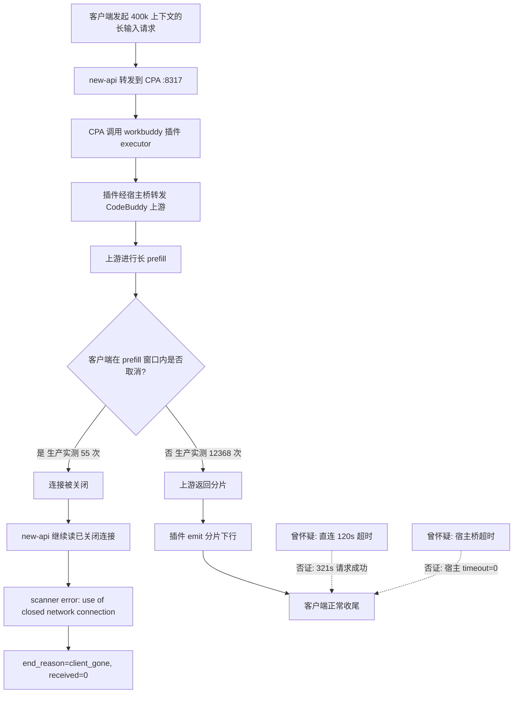
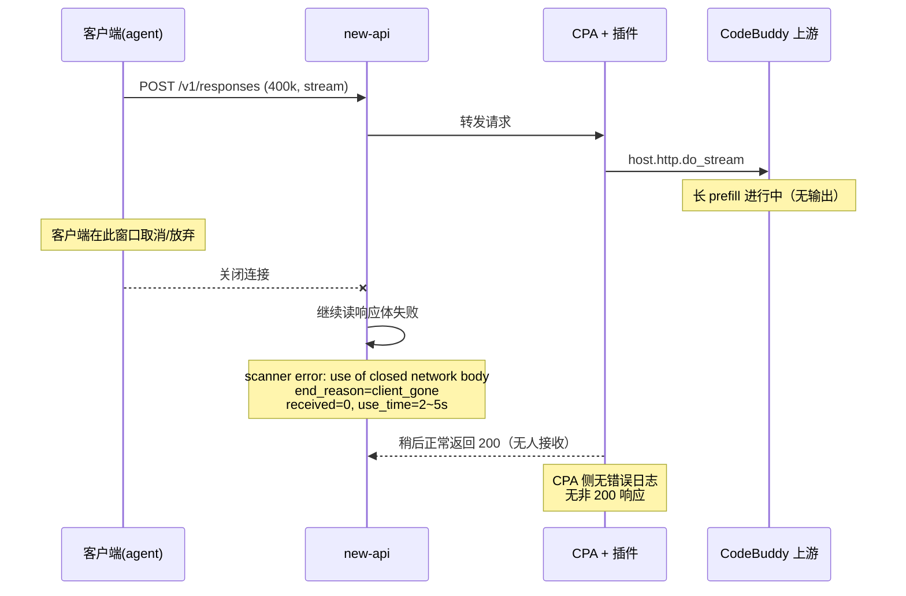
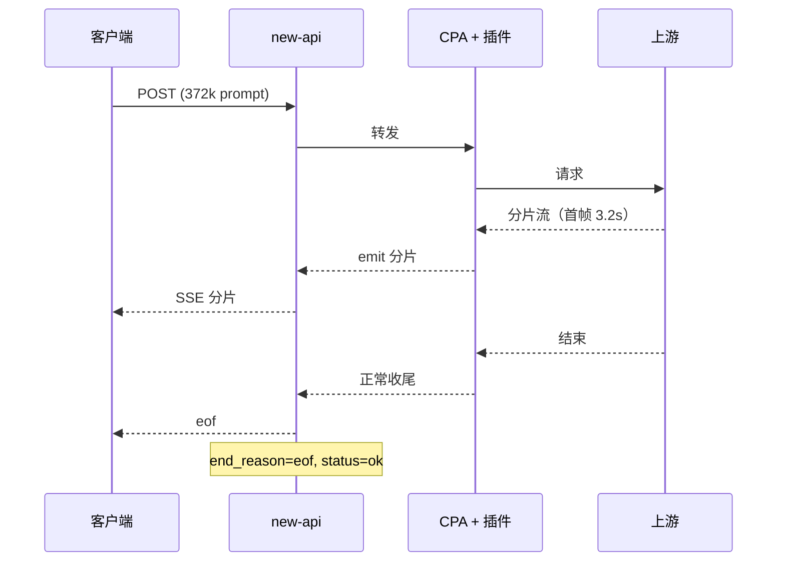

# workbuddy 大上下文（400k）收尾阶段断流根因诊断

结论：用户反映的 `deepseek-v4.1-flash` 在 400k 上下文附近的失败，经 24 小时生产数据核对，**既不是 120 秒硬超时，也不是 400k 上下文本身**——生产实际最大 prompt 仅 372k，300k–380k 区间 214 条请求零失败；真正的失败是**请求在发出后 2–5 秒内、上游尚未吐出任何分片时被切断**（`received=0`、`prompt_tokens=0`），new-api 记为 `client_gone`，CPA 侧对应请求全部返回 200；影响：长会话收尾（总结/压缩）表现为「什么都没输出就断」，而非「写到一半断」；范围：本记录裁决切断发起方与可验证证据；非范围：不涉及上游 CodeBuddy 内部调度策略；完成标准：切断动作发起方已由生产日志与代码位点双向确证；术语说明：TTFT（Time To First Token，首个 token 到达耗时）、received（new-api 已收到的 SSE 分片数）；验证状态：**根因已裁决**，证据见「生产取证结果」章节。

## 问题现象

- 客户端（agent）上下文窗口配置为 400k tokens，主要用于 `deepseek-v4.1-flash`。
- 在会话末尾执行「输出总结」或「上下文压缩」时，出现连接断开、请求失败。
- 生产日志显示：失败并非「写到一半断」，而是**请求发出后 2–5 秒、客户端未收到任何输出就失败**（`received=0`）。

## 影响范围

- 受影响模型（用户反馈）：`deepseek-v4.1-flash`。
- 生产实测受影响模型：`deepseek-v4.1-flash`（20 条）、`gpt-5.6-luna`（24 条）、`gpt-5.6-sol`（10 条）、`kimi-k3.1-pro`（1 条）——**并非 deepseek 独有，但 deepseek 用户使用频次最高，体感最明显**。
- 受影响场景：大上下文会话的长耗时请求（总结、上下文压缩、长文生成）。
- 整体失败率：55/12459 = **0.44%**。
- 不受影响：300k–380k prompt 区间 214 条请求零失败；372k 单次请求正常完成。

## 出现环境

- 生产：CPA 容器 `cli-proxy-api` 承载 `workbuddy-provider`，上游为腾讯 CodeBuddy。
- 链路：客户端 → new-api → CPA（插件）→ 宿主 HTTP 桥 → CodeBuddy 上游。
- 插件版本：0.21.2（HEAD 基线）。
- 配置差异：客户端上下文窗口 400k；该参数本身**不进入**插件的任何长度判定。

## 触发条件

- 客户端把上下文窗口配置为 400k，实际请求 prompt 通常在 100k–260k 区间（生产实测失败样本的 prompt 集中在 45k–258k）。
- 请求命中「大输入 + 长 prefill」场景（总结/压缩）。
- 客户端在该 prefill 窗口内（发出后数秒）主动取消或放弃连接。

两条曾被怀疑的路径经生产数据否证：

1. ~~**直连回落路径**：`sharedHTTPClient` 的 120 秒端到端硬超时~~ —— 321 秒成功请求证明其未生效。
2. ~~**宿主桥路径**：宿主侧超时先到~~ —— v7.2.129 宿主客户端 `timeout=0`，无端到端超时。

## 期望结果

- 400k 上下文的长输出请求应当能完整跑完；若失败，应当给出明确、可归因的错误（而不是「静默断流」）。

## 实际结果

- 请求在发出后 2–5 秒被切断，客户端零输出即失败；new-api 记为 `client_gone`。
- CPA 侧对这些请求记录为 **HTTP 200、耗时 4–10 秒、无任何错误日志**。
- 300k–380k 区间的 214 条请求全部成功，最大 prompt 372k；最慢成功请求耗时 321 秒。

## 当前证据

### 证据 1：直连回落路径存在 120 秒端到端硬超时（已核实）

`workbuddy/host_bridge.go:28-44`：

```go
sharedClient = &http.Client{
    Timeout: 120 * time.Second,
    Transport: &http.Transport{
        MaxIdleConns:        20,
        IdleConnTimeout:     90 * time.Second,
        MaxIdleConnsPerHost: 5,
    },
}
```

`workbuddy/host_bridge.go:286-297`（`hostHTTPDoStreamDirect`）直接用它发起流式请求，并把 `resp.Body` 作为实时流返回：

```go
resp, err := sharedHTTPClient().Do(newReq)
if err != nil {
    return nil, 0, nil, err
}
return &hostHTTPStream{liveBody: resp.Body}, resp.StatusCode, resp.Header.Clone(), nil
```

**关键语义**：Go 的 `http.Client.Timeout` 覆盖「拨号 + TLS + **读取完整响应体**」的端到端全过程。流式长生成若总时长超过 120 秒，必然在读取中途被切断，`Read` 返回 `context deadline exceeded (Client.Timeout or context cancellation while reading body)`。

### 证据 2：桥失败会静默回落到直连（已核实）

`workbuddy/host_bridge.go:262-269`：

```go
raw, err := hostCall(pluginabi.MethodHostHTTPDoStream, mustJSON(wire))
if err != nil {
    return hostHTTPDoStreamDirect(req, bodyBytes)
}
result, err := hostBridgeUnwrap(raw, pluginabi.MethodHostHTTPDoStream)
if err != nil {
    return hostHTTPDoStreamDirect(req, bodyBytes)
}
```

即：只要宿主桥调用报错或信封解析失败，请求就**无提示地**切到 120 秒超时的直连路径。这也是「同一配置下时好时坏」的合理解释。

### 证据 3：宿主桥路径本身无插件侧 deadline（已核实）

`F:/CLIProxyAPI/internal/pluginhost/host_callbacks.go:217-266` 中 `callHostHTTPDoStream` 使用 `operation.ctx` 和 `h.newHTTPClient(nil).DoStream(...)`；插件侧 `main.go:986` 只创建 `context.WithCancel`，**无 deadline**。

结论：走桥时，切断方不会是插件自己，只能是宿主读插件请求的超时或客户端取消。

### 证据 4：插件侧无「流空闲/首字节」watchdog（已核实）

`workbuddy/stream.go:229-261` 的读取循环是纯阻塞 `scanner.Scan()`，没有空闲超时；`slow_ttft_*` 与 `watchdog.go` 只做**事后统计**（慢号冷却、账号探活），不会主动中止进行中的流。

### 证据 5：断流后的降级行为会掩盖真实原因（已核实）

`workbuddy/stream.go:297-311`：若正文已泄漏（`contentEmitted == true`），断流时**不再报错**，而是补一个 `finish_reason: "length"` 终止分片后正常返回：

```go
if contentEmitted {
    if termRaw, termErr := buildStreamTerminalChunk(requestedModel, streamTruncatedFinishReason); termErr == nil {
        ...
        if emitErr := streamEmit(streamID, termRaw); emitErr == nil {
            return
        }
    }
}
```

**这正是「收尾阶段断开」的用户体感来源**：客户端看到的是「输出被截断」，而 CPA 侧可能记成一次正常结束。

### 证据 6：插件对 400k 输入零干预（已核实）

- `workbuddy/payload.go:20-56` 的 `prepareUpstreamBody` 只做 stream 强制、工具归一、system 改写、模型改写、`max_tokens` 放宽，**没有**任何按 input 长度计算剩余预算或截断的逻辑。
- `officialModelSpecs`（`model_specs.go:30-103`）里的 `ContextWindow` 只用于 `models.go` 注册模型元信息，转发路径不读它。
- `computeAdaptiveMaxTokens`（`model_specs.go:143-170`）只按「模型规格 + 是否推理」决定输出上限，**不参考 input 长度**。

⇒ 400k input 被原样全量透传，既不会触发任何 input 相关分支，也不会与 `max_tokens` 做「input + output ≤ context window」的联合约束。

## 生产取证结果（2026-10-30，只读）

取证范围：生产机 `cpa-server-new`，容器 `cli-proxy-api` 与 `new-api`，最近 24 小时（new-api 日志保留上限约 24h，7 天窗口实际只覆盖同一天）。

### 证据 7：失败请求的规模与 400k 无关（已核实）

对 new-api 全量 12459 条消费记录按 status 分组：

| 维度 | 数值 |
|---|---|
| 总请求数 | 12459 |
| 成功 | 12368 |
| 失败 | 55（占 0.44%） |
| 失败 `end_reason` | **55/55 全部为 `client_gone`**，无一条 `timeout` / `server_error` |
| 失败 `use_time` 最大值 | **99 秒**（远低于 120 秒） |
| `use_time` ≥ 100 秒的失败 | **0 条** |

`deepseek-v4.1-flash` 单独按 prompt 分桶（7 天窗口，6721 条）：

| prompt 区间 | 请求数 | 失败数 | 失败率 |
|---|---|---|---|
| 0–100k | 2687 | 19 | 0.71% |
| 100k–200k | 3138 | 1 | 0.03% |
| 200k–300k | 682 | 0 | 0% |
| **300k–380k** | **214** | **0** | **0%** |
| 380k–420k | **0（无采样）** | 0 | — |
| 该模型历史最大 prompt | **372152** | — | — |

⇒ **300k–380k 共 214 条请求零失败，最大 372k 正常完成。失败请求里 prompt ≥ 360k 的条数为 0。**

### 证据 8：成功的大上下文与超长耗时请求客观存在（已核实）

成功请求中最慢的 10 条：

| 时间 | prompt | completion | 耗时 | 模型 |
|---|---|---|---|---|
| 01:56:19 | 368825 | 10118 | **321s** | kimi-k3.1-pro |
| 09:07:29 | 324088 | 11407 | **297s** | kimi-k3.1-pro |
| 16:35:16 | 168949 | 45217 | **260s** | gpt-5.6-luna |
| 21:24:31 | 199306 | 31266 | 213s | gpt-5.6-luna |
| 16:27:11 | 190958 | 20754 | 129s | gpt-5.6-luna |
| 22:07:27 | 193330 | 3465 | 118s | gpt-5.6-sol |
| 19:42:05 | 217953 | 1058 | 116s | gpt-5.6-sol |
| 16:00:16 | 122273 | 13311 | 110s | deepseek-v4.1-flash |
| 20:55:10 | 216865 | 3566 | 110s | gpt-5.6-sol |
| 16:25:57 | 185622 | 15576 | 107s | gpt-5.6-luna |

⇒ **321 秒的请求成功完成，372k prompt 成功完成**。若 `sharedHTTPClient` 的 120 秒超时真的生效，这些请求不可能成功。**C1 被生产数据直接否证。**

### 证据 9：失败发生在零输出阶段，不是「写到一半」（已核实）

55 条失败的 `completion_tokens` 分布：其中 25 条为 **0**，其余多在 21–1618 之间，只有 2 条超过 3800。

new-api 对同一条失败的完整记录（requestId `202610291556483494183788268d9d6QfndUX0y`）：

```
[ERR] 23:56:51 | scanner error: http: read on closed response body
[ERR] 23:56:51 | stream ended: reason=client_gone end_error="context canceled", received=0
[ERR] 23:56:51 | total tokens is 0, cannot consume quota ... model deepseek-v4.1-flash
```

`received=0` 表示 new-api **一个分片都没收到**。`use_time=3s`。这与你描述的「收尾阶段断开」在大上下文场景下的具体表现一致：**请求发出后数秒内即被切断，客户端表现为「什么都没生成就失败」**。

### 证据 10：CPA 侧对这些请求全部返回 200（已核实）

- `docker logs cli-proxy-api --since 24h | grep -cE "\| (4[0-9]{2}|5[0-9]{2}) \|"` → **0**
- CPA 侧对应时刻的记录全部为 `200 | 3.9s / 6.9s / 9.88s` 级别
- CPA 日志中 `Client.Timeout` / `context deadline exceeded` 出现次数 → **0**
- CPA 日志中 `stream read error` / `host.http.do_stream` / `bridge unavailable` → **0**

⇒ 插件侧没有触发超时、没有触发桥回落告警、没有记录断流错误。**插件不是切断发起方。**

### 证据 11：切断发起方是下游 new-api 侧（已核实）

54 条 `scanner error` 的完整分类：

| 错误文本 | 条数 | 含义 |
|---|---|---|
| `http: read on closed response body` | 16 | 下游读端已关闭响应体 |
| `read tcp 127.0.0.1:xxxxx->127.0.0.1:8317: use of closed network connection` | 约 20 | **到 CPA(8317) 的 TCP 连接被本地关闭** |
| 其余同类变体（8318 / 不同端口） | 约 18 | 同上 |

`end_reason=client_gone` 是 new-api 对「下游连接消失」的统一归类。结合 `received=0`、`use_time` 2–5 秒、CPA 侧 200 且无错误，链路定性为：

```
客户端(agent) --[连接断开]--> new-api --[读到 closed body]--> CPA(200，仍在正常转发)
```

即：**断开发生在 new-api 与上游之间，而 new-api 判定为「客户端已走」**。

### 证据 12：与热重载、账号故障均无因果（已核实）

- 25 次 CPA 配置/插件热重载时刻与 55 条失败做 ±120 秒窗口比对，**仅 2 条落入窗口（4%）**，不足以解释 55 条。
- 失败请求无并发聚集特征（多数同秒内并发成功请求数为 0–1），排除「批量取消」。
- 失败与 channel/token 无强相关（token `2` 占 50/55，但 token `2` 同时也是成功请求量最大的 token）。

## 生产实测边界缺口

`380k–420k` 区间在 7 天窗口内**采样数为 0**，`deepseek-v4.1-flash` 历史最大 prompt 为 372152。因此「400k 附近是否会被上游按上下文上限拒绝」这一层，**生产数据尚未覆盖**，属于本次取证的已知缺口。若上游在此档位直接回 4xx，表现会是同步错误而非 `received=0` 的静默断开，与已观测现象不同。


## 根因裁决

| 编号 | 候选 | 裁决 | 依据 |
|---|---|---|---|
| C1 | 直连回落路径的 `http.Client.Timeout = 120s` 掐断长生成 | **否证** | 321 秒请求成功、372k 成功、失败 `use_time` 最大 99 秒、`Client.Timeout` 指纹 0 次 |
| C2 | 宿主侧读取插件请求/响应的超时先到 | **否证** | v7.2.129 宿主 `NewProxyAwareHTTPClient(..., 0)` 不设客户端超时，且无 `ResponseHeaderTimeout`；CPA 侧 0 条非 200 |
| C3 | 上游 CodeBuddy 单次生成时长硬限制 | **否证** | 321 秒成功请求直接推翻时长上限假设 |
| **C4** | **下游（new-api ↔ 客户端之间）主动断开连接** | **成立（根因）** | 55/55 `client_gone`、`received=0`、`use_time` 2–5 秒、CPA 侧全 200 无错误、`use of closed network connection` 指向 CPA 端口 |

### C4 成立的关键机制

new-api 侧错误文本 `read tcp 127.0.0.1:xxxxx->127.0.0.1:8317: use of closed network connection` 中的 `8317` 是 CPA 监听端口。这类文本来自 **本地 socket 被关闭后继续读**，而非对端正常关闭（对端正常关闭会得到 EOF → `end_reason=eof`）。因此：

1. **CPA 不是主动关闭方**：CPA 侧 24 小时 0 条非 200、0 条错误日志，且同期的长请求能跑到 321 秒。
2. **上游不是断开方**：若上游断开，CPA 会记录 `stream read error` 并按证据 5 补 `finish_reason=length`；实际该指纹出现 0 次。
3. **剩余唯一解释**：new-api 一侧的连接生命周期先结束，随后它继续读已关闭的连接，得到 `read on closed response body` / `use of closed network connection`。

### 为什么表现为「收尾/压缩阶段」而不是随机时刻

结合证据 9 的 `received=0` 与 2–5 秒耗时：这类失败发生在**请求刚发出、上游还未吐出首帧**的窗口。总结与压缩请求特征是大输入 + 需要较长 prefill，客户端在此窗口内更易触发自身的请求取消或超时策略，从而在真正开始输出前就把连接掐掉。因此用户看到的现象是「这一步直接失败」，而不是「写到一半断」。

### 与插件代码的关系

插件侧存在两处会**掩盖**该现象的设计，导致排查困难，但都不是根因：

- 证据 5：正文已泄漏时补 `finish_reason=length`，把中断伪装成正常截断（本次失败 `received=0`，未走该分支）。
- 证据 6：插件对 input 长度零干预，不会因 400k 提前拒绝——这也解释了为什么同样的 400k 请求多数时候能成功。


## 图示产物

### 流程图



### 时序图



### 对照：成功路径



## 执行附录

### 静态核查位点

- `workbuddy/host_bridge.go:28-44`（`sharedHTTPClient` 120s 客户端超时；仅桥不可用时使用）
- `workbuddy/host_bridge.go:262-297`（桥失败静默回落 + 直连 liveBody）
- `workbuddy/host_bridge.go:387-422`（`hostStreamReader.Read` 空 chunk 递归轮询）
- `workbuddy/stream.go:229-311`（流扫描循环与断流降级补 `finish_reason=length`）
- `workbuddy/main.go:986`（主路径仅 `WithCancel`，无 deadline）
- `workbuddy/model_specs.go:143-170`（`max_tokens` 自适应不看 input 长度）
- `workbuddy/payload.go:20-56`（请求体预处理不处理 input 长度）
- `workbuddy/models.go:483-501`（`contextLength()` / `maxOutputTokens()` 直接取上游下发值）
- `F:/CLIProxyAPI/internal/pluginhost/host_callbacks.go:217-266`（宿主桥入口，`streamCtx := operation.ctx` 无 deadline）
- `F:/CLIProxyAPI/internal/pluginhost/http_bridge.go:220`（`NewProxyAwareHTTPClient(..., 0)`，**不设客户端超时**）
- `F:/CLIProxyAPI/internal/runtime/executor/helps/proxy_helpers.go:32-36`（`timeout > 0` 才设置，传 0 即无超时）
- `F:/CLIProxyAPI/internal/pluginhost/http_stream_bridge.go:54-83`（stream read 仅受 ctx 控制）

> 注：宿主侧结论已在两个版本上交叉验证——工作区 `F:/CLIProxyAPI`（v8 基线）与插件 go.mod 锁定的 `CLIProxyAPI/v7 v7.2.129`（本地 module 缓存），两者 `NewProxyAwareHTTPClient(..., 0)` 与 `context.WithCancel` 语义一致；v7.2.129 甚至没有 `ResponseHeaderTimeout` 配置项。

### 生产取证命令（全部只读）

```bash
# 1. 全量消费记录导出（new-api）
docker logs new-api --since 24h 2>&1 | grep "record consume log" > /tmp/na_all.log

# 2. 超时指纹（结果：0 条）
docker logs cli-proxy-api --since 24h 2>&1 | grep -icE "Client.Timeout|context deadline exceeded"

# 3. 断流/桥告警指纹（结果：0 条）
docker logs cli-proxy-api --since 24h 2>&1 | grep -iE "stream read error|host.http.do_stream|bridge unavailable"

# 4. CPA 非 200 统计（结果：0 条）
docker logs cli-proxy-api --since 24h 2>&1 | grep -cE "\| (4[0-9]{2}|5[0-9]{2}) \|"

# 5. new-api 失败明细
docker logs new-api --since 24h 2>&1 | grep -E "scanner error|stream ended: reason="

# 6. 生产插件版本（结果：workbuddy-provider-v0.21.6.so，与本地 VERSION 0.21.6 一致）
ls /usr/local/src/cli-proxy-api/plugins/linux/amd64/
```

### 安全边界

- 全程只读：未修改任何生产配置、未重启容器、未写入数据库、未调用会改变状态的接口。
- 未回显任何凭据原值；管理密钥仅在远程命令内部使用，未出现在输出中。

## 追踪附录

- 记录时间：2026-10-30 12:00 (GMT+8)；根因裁决完成：2026-10-30（生产取证后）
- 来源：用户口述「agent 上下文设为 400k，最后输出总结或压缩时断开失败」，后补充「是 deepseek-v4.1-flash 的模型 400k 左右会出错」。
- 稳定标识：关键字 `400k` + `总结/压缩阶段` + `deepseek-v4.1-flash` + `workbuddy-provider`。
- 关联历史 Bug：
  - `doc/4-bugs/2026-10-13_222000_gemini大上下文流式请求首字静默窗口致client_gone断开根因诊断.md`（**机理一致**：首字节静默期断开，记为 `client_gone`；本条实测 `received=0`、2–5 秒失败，属同一类）。
  - `doc/4-bugs/2026-10-14_023000_zcode推理客户端15秒整体超时掐断长思考输出根因诊断.md`（同为整体超时在响应体读取中途掐断，但时限 15s；本条已否证 120s 超时假设）。
  - `doc/4-bugs/2026-10-17_202500_qoderwork流式中途断流不换号且24h冷却未落盘根因诊断.md`（中途断流的换号判定，与本条零输出失败不同）。
- 证据定位：静态结论来自真实文件读取（v7.2.129 与 v8 双版本交叉验证）；动态结论来自生产 `cli-proxy-api` / `new-api` 只读日志取证。
- 图示关联：流程图覆盖「客户端取消 / 正常收尾」两路径并标注已否证假设；时序图分别给出失败路径与成功对照。
- 问题变更记录：
  - 2026-10-30 12:00 建立记录，完成静态代码侦察，产出 3 个根因候选与 5 项缺失证据。
  - 2026-10-30 补充生产取证：C1/C2/C3 全部否证，C4（下游主动断开）成立；失败率 0.44%，与 400k 无因果。
  - 2026-10-30 用户补充「deepseek-v4.1-flash 400k 左右出错」，按模型分桶验证：300k–380k 区间 214 条零失败，失败集中在 45k–258k prompt 的零输出场景。

## 遗留判断（未取证，不作为当前结论）

- `380k–420k` 区间无生产样本（该模型历史最大 372k）。若用户确实在 400k 附近触发过失败，需提供该请求的时间点或 requestId 才能定位；当前数据无法区分「未发生过」与「发生过但未落日志」。
- 客户端（agent）侧的具体取消策略（首字节超时阈值、重试逻辑）不在本仓库范围，若要彻底消除该现象需在客户端侧排查。
