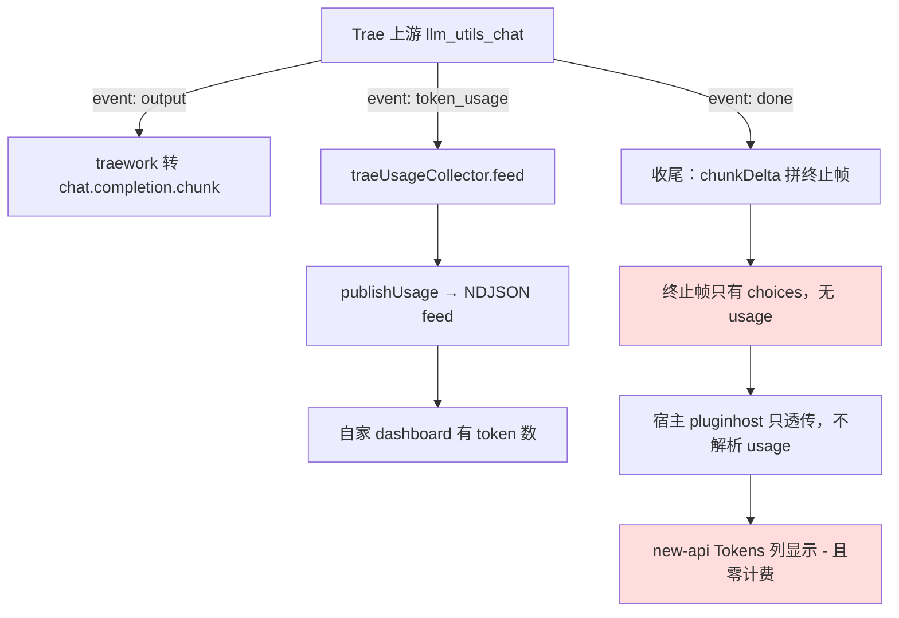
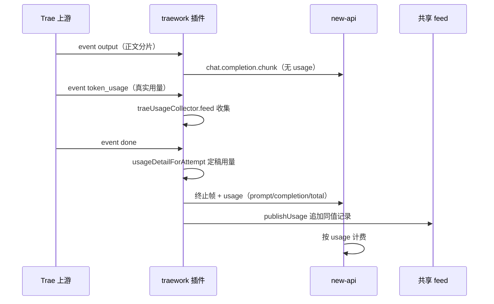

# traework 下行从不携带 usage 致 new-api 全量 Tokens 为 "-" 零计费根因诊断

- 报告时间：2026-11-08 13:52:04（GMT+8）
- 报告对象：traework-provider **0.5.18**（修复前生产 active_version）
- 触发场景：`new-api → CPA → traework-provider`，模型 `doubao-seed-2.1-pro`
- 关联文档：
  - `doc/4-bugs/2026-10-18_183000_qwenwork流式usage终止帧被丢弃致new-api全量零计费根因诊断.md`（同型：usage 载体被丢，**但机制不同**——那是「有帧被丢弃」，本次是「从未构造过 usage 帧」）
  - `doc/4-bugs/2026-10-19_003000_coze不输出usage致下游用量全部记零根因诊断.md`（确立契约：流式只在终止帧挂 usage、非流式挂响应体顶层）
  - `doc/4-bugs/2026-08-30_175903_Trae异步流式请求用量漏记.md`（同插件 0.1.19 修过异步路径不调 publishUsage，只影响自家 feed，不影响下游）

## 1. 现象

用户提供 new-api「使用日志」页面截图（2026-11-08 13:24），三点观察：

1. 三条 `doubao-seed-2.1-pro` 记录（13:21:36 / 13:22:23 / 13:23:08）**Tokens 列全部显示 `-`**，费用列显示「订阅」。
2. 这三条请求**本身是成功的**：首字 14.4s / 34.2s / 39.0s，耗时 40~45s，与思考型模型行为吻合。
3. 同页 `deepseek-v4.1-flash`（88,103 / 489）、`minimax-m3.1-flash`（103,845 / 67）**Tokens 数字完整**。

⇒ 排除 new-api 显示缺陷，问题锁定在 traework 的下行响应里没有 usage。

## 2. 取证

### 2.1 上游确实给了 token_usage（插件内已收到）

traework 三处 SSE 分支都接到了上游的 `token_usage` 事件：

- [traework/stream.go:445-446](file:///F:/cpa-plugin/traework/stream.go#L445-L446)（`collectTraeStream` 同步收集路径）
- [traework/stream.go:528-529](file:///F:/cpa-plugin/traework/stream.go#L528-L529)（`aggregateTraeCompletion` 非流式聚合路径）
- [traework/stream.go:831-832](file:///F:/cpa-plugin/traework/stream.go#L831-L832)（`pumpTraeStreamAttempt` 异步泵路径）

三处代码完全一致：

```go
case "token_usage":
    collector.feed(ev.Data)
```

`traeUsageCollector.feed` 把用量存进内部 `last`，`detail()` 再翻成 `usage.Detail`，
**唯一消费方是 `publishUsage`（写 NDJSON feed 给自家 dashboard）**。全程没有任何代码
把它还原成 chunk 顶层的 `usage` 对象。

### 2.2 下行构造函数从不写 usage

修复前三个构造函数 [traework/stream.go:75-109](file:///F:/cpa-plugin/traework/stream.go#L75-L109)
（`chunkDelta`）、`:171-188`（`toolCallDeltaChunk`）、`:194`（`completionAggregate`）
拼出的 payload 只有 `id / object / created / model / choices` 五个键。四条下行路径的
终止帧都由它们产出：

| 路径 | 终止帧构造点（修复前行号） |
|---|---|
| 同步 collect | `stream.go:478` `chunkDelta(requestID, model, "", "", finish)` |
| 异步泵（已废弃） | `stream.go:937` 同款 |
| 异步协调器 | `executor.go:600` 同款 |
| 非流式聚合 | `stream.go:568` `completionAggregate(...)` |

### 2.3 宿主侧对插件 executor 没有 usage 观测器（决定性事实）

SDK：`C:\Users\luode\go\pkg\mod\github.com\router-for-me\!c!l!i!proxy!a!p!i\v7@v7.2.129`

- `internal/pluginhost/adapters_executors.go:662` `ExecuteStream` → `:894` `mapExecutorStreamChunks`：
  只透传 `Payload` / `Err`，**不做任何 usage 解析**。
- `:540` `translateExecutorStreamChunks` / `:579` `translateExecutorStreamPayload`：
  仅当 `outputFormat != requestedFormat` 时才做 sdktranslator 转换；格式相同时
  **插件自拼的 chunk 逐字节到达下游客户端**。
- `StreamUsageBuffer.ObserveOpenAIStream` 的调用点只有
  `openai_compat_executor.go:426`、`kimi_executor.go:326`、`codex_openai_images.go:452`，
  **都不在插件 executor 路径上**。

⇒ 插件不自己在 chunk 顶层挂 `usage`，宿主与 new-api 就必然拿不到 token 数。

### 2.4 若下游真要解析，它只认这几个键

`internal/runtime/executor/helps/usage_helpers.go`：

- `:569` `hasOpenAIStyleUsageTokenFields`：usage 必须是 object，且存在 `total_tokens`
  **或** 任一 bucket 字段（`prompt_tokens` / `input_tokens` / `completion_tokens` /
  `output_tokens` / `prompt_tokens_details.cached_tokens` /
  `completion_tokens_details.reasoning_tokens` 等）。
- `:591` `parseOpenAIStyleUsageNode`：input=`prompt_tokens`||`input_tokens`，
  output=`completion_tokens`||`output_tokens`，total=`total_tokens`；
  **reasoning 只从 `completion_tokens_details.reasoning_tokens` 或
  `output_tokens_details.reasoning_tokens` 取，顶层 `reasoning_tokens` 不读**。

## 3. 根因

图形目的：展示修复前「上游给了用量、下行却不带用量」的断点位置。
关联 ID：EVIDENCE-TRAEWORK-USAGE-001、EVIDENCE-TRAEWORK-USAGE-002。



图形目的：展示修复后 usage 在终止帧上的唯一出口与两条下游消费路径。
关联 ID：EVIDENCE-TRAEWORK-USAGE-003、TEST-TRAEWORK-USAGE-001。



**双点，都在插件侧：**


1. **下行帧骨架从不含 `usage`。** `chunkDelta` / `toolCallDeltaChunk` /
   `completionAggregate` 三个构造函数只写 `id/object/created/model/choices`，
   四条路径（collect / pump / async / 非流式聚合）的终止帧全部走它们。
2. **上游真实用量被内部消化，不转下行。** 三处 `case "token_usage"` 只
   `collector.feed`，把用量喂给自家 NDJSON dashboard，从未构造成 chunk。

叠加 §2.3 的事实（宿主不为插件算 usage），结果是：**自家 dashboard 有用量、
下游 new-api 全零**。

### 为什么是「显示 `-` 而不是 0」

new-api 的计费依赖流内 usage 帧，拿不到时按「无计费信息」处理，前端渲染成 `-`。
本次与 qwenwork 那次（`$0` + 「上游没有返回计费信息」）表现略有差异，但机制同源：
**计费载体缺席**。区别在于 qwenwork 是「有帧但被清理逻辑丢弃」，traework 是
「从未构造过该帧」。

## 4. 修复

版本：traework-provider **0.5.19**。

### 4.1 终止帧唯一出口

[traework/stream.go:78-95](file:///F:/cpa-plugin/traework/stream.go#L78-L95) 新增统一骨架：

```go
func deltaChunk(requestID, model string, choices []map[string]any, usageObj map[string]any) ([]byte, error)
```

`if usageObj != nil { chunk["usage"] = usageObj }`。

[traework/stream.go:183-190](file:///F:/cpa-plugin/traework/stream.go#L183-L190)
新增终止帧唯一出口：

```go
func chunkFinishWithUsage(requestID, model, finishReason string, detail usage.Detail) ([]byte, error)
```

`chunkDelta` 保留原语义，内部改为 `deltaChunk(..., nil)`，**恒定不挂 usage**——
OpenAI 约定流式用量只出现在最后一帧，中间帧带 usage 会被客户端按重复计费累加
（与 [coze/convert.go:158](file:///F:/cpa-plugin/coze/convert.go#L158) 的同款注释一致）。

### 4.2 usage 渲染

[traework/stream.go:140-173](file:///F:/cpa-plugin/traework/stream.go#L140-L173)
新增 `usageToOpenAI(d usage.Detail) map[string]any`：

- 三桶全 `<= 0` 返回 `nil`（挂 `0/0/0` 会被下游当真实用量采信，比未上报更糟）；
- `total <= 0` 时用 `Input + Output` 兜底；
- 输出 `prompt_tokens` / `completion_tokens` / `total_tokens`；
- cached（`CacheReadTokens`，为 0 时回退 `CachedTokens`）> 0 或 `CacheCreationTokens` > 0
  时挂 `prompt_tokens_details{cached_tokens, cache_creation_tokens}`；
- `ReasoningTokens` > 0 时挂 `completion_tokens_details{reasoning_tokens}`；
- **不输出顶层 `reasoning_tokens`**（宿主不读，见 §2.4）。

### 4.3 四条路径接入

| 路径 | 修复后 |
|---|---|
| 同步 collect 收尾 | `downDetail := usageDetailForAttempt(collector.detail(), chunks)` → `chunkFinishWithUsage(...)` |
| 异步泵收尾 | `chunkFinishWithUsage(requestID, ctx.Model, finish, usageDetailForAttempt(result.Usage, result.Chunks))` |
| 异步协调器收尾 | [traework/executor.go:600-605](file:///F:/cpa-plugin/traework/executor.go#L600-L605) 同款，且 `publishUsage` 复用同一 `asyncDetail` |
| 非流式聚合 | `completionAggregate` 新增第 7 参数 `usageObj`，写入响应体顶层 `usage` |

### 4.4 两个配套修正

- `normalizeTraeDetail(d usage.Detail) (usage.Detail, bool)`：任一桶非零即视为真实用量
  并补齐 `total = Input + Output`。上游只回 `completion_tokens` 时旧判据
  （`TotalTokens > 0`）会误判为空而丢 usage。
- `tokensFromChars(chars int) int64`（[traework/executor.go:854-870](file:///F:/cpa-plugin/traework/executor.go#L854-L870)）：
  短输出（`ok` = 2 字符）按 `chars/4` 整除估成 0 → Detail 全零 → 终止帧不挂 usage
  → 该请求继续零计费。非空内容保底 1 token。

### 4.5 保持不变（避免回归）

`collectTraeStream` / `aggregateTraeCompletion` 的**返回契约不动**：只回上游真实用量，
估算兜底仍由调用方 `usageDetailForAttempt` / `usageDetailForCompletion` 负责。
首次尝试把返回值改成「已兜底的 detail」时，既有用例
`TestCollectTraeStreamWithoutTokenUsageEmptyDetail` 立即失败（断言「未收到 token_usage
时返回空 Detail」），随即恢复原契约。因为终止帧 delta 为空、不改变估算基数，
下行 usage 与调用方估算必然一致。

## 5. 验证

### 5.1 新增测试（12 个用例）

| 文件 | 用例 | 断言 |
|---|---|---|
| `traework/usage_emit_test.go` | `TestUsageToOpenAIStandardKeys` | 输出标准蛇形三键 |
| | `TestUsageToOpenAIDetailNesting` | `cached_tokens=11` / `cache_creation_tokens=5` / `reasoning_tokens=23` 落位正确，且**顶层不得有 `reasoning_tokens`** |
| | `TestUsageToOpenAIZeroDetailNil` | 全零返回 nil |
| | `TestUsageToOpenAITotalFallback` | `7+5=12` total 兜底 |
| | `TestCollectTraeStreamTerminalChunkCarriesUsage` | 中间帧无 usage；末帧 `69/34/103`、`finish_reason=stop`、choices 长度 1 |
| | `TestCollectTraeStreamTerminalChunkUsageEstimatesWhenAbsent` | 上游无 token_usage 时按字符估算且非零 |
| | `TestAggregateTraeCompletionCarriesUsage` | 非流式响应体顶层带 usage |
| | `TestNormalizeTraeDetailPartialBuckets` | 部分桶也算真实并补 total |
| | `TestChunkFinishWithUsageZeroDetailStillTerminal` | 全零仍产出形态正常的终止帧（不挂 usage） |
| | `TestSSEFramedChunksKeepUsage` | 剥 `data: ` 前缀与 `\n\n` 后仍能解出 `total_tokens=103` |
| `traework/usage_emit_async_test.go` | `TestAsyncStreamTerminalChunkCarriesUsage` | `closes==1`；中间帧无 usage；末帧 `69/34/103` |
| | `TestAsyncStreamTerminalChunkUsageEstimatesWhenAbsent` | 异步路径估算兜底 |

### 5.2 变异反证（6 组，全部 KILLED）

| 变异 | 结果 |
|---|---|
| collect 终止帧退回 `chunkDelta` | FAIL 3 项（含 SSE 包装用例） |
| `usageToOpenAI` 键名改成非标准 | FAIL 6 项 |
| 异步终止帧退回 `chunkDelta` | **首轮 SURVIVED**（当时缺异步用例），补测后 FAIL 2 项 |
| 非流式响应体传 nil usage | FAIL `TestAggregateTraeCompletionCarriesUsage` |
| reasoning 挂到顶层 `reasoning_tokens` | FAIL `TestUsageToOpenAIDetailNesting` |
| 全零明细也挂 usage | FAIL 2 项 |

### 5.3 全量门禁

`python scripts/cgo-shim-build.py traework`：build OK / vet OK /
`ok github.com/luode0320/cpa-workbuddy-plugin/traework 3.465s`，`[cgo-shim] all green (traework)`。
四个改动文件 gofmt 全部 FMT_OK。

## 6. 教训

1. **「自家 dashboard 有用量」不能证明「下游有用量」。** usage 有两条独立出口：
   `publishUsage`（feed）与下行 chunk。任何只接一条的实现都会出现
   「面板正常、网关零计费」的割裂。改造用量链路时必须同时核对两条出口。
2. **插件 executor 拿不到宿主的 usage 加工。** 宿主原生 executor 各自
   `ObserveOpenAIStream`，插件路径没有；`pluginhost` 只做格式转换与透传。
   插件必须自己产出标准 `usage` 对象，这是契约而非可选增强。
3. **渲染键名要按下游解析器写，不是按内部字段名写。** `usage.Detail` 的
   `ReasoningTokens` 必须落到 `completion_tokens_details.reasoning_tokens`；
   顶层 `reasoning_tokens` 会被静默忽略。
4. **估算兜底的意义是「给下行一个非零基数」。** `chars/4` 对短输出会估成 0，
   而 0 在 `usageToOpenAI` 里等于「不挂 usage」——兜底必须保底 1。
5. **变异反证要覆盖每一条路径。** 异步路径首轮 SURVIVED 证明：只测 collect 路径的
   变异体是无效证据。

## 7. 生产验收（0.5.19 热重载后）

### 7.1 部署证据

| 项 | 结果 |
|---|---|
| 发布 commit | `563d8bd`（代码）→ `d303204`（registry） |
| CI run | `42453870678`，Release job success（`darwin/arm64` 的 macos-14 runner 连续三次被 GitHub 侧取消，与 0.5.18 同样只有 5 平台，属既有常态） |
| Release | `traework-provider-v0.5.19`，6 assets（checksums + 5 平台 zip），`ALL CHECKSUMS OK` |
| 产物内含新代码 | linux/amd64 `.so` 内可检出 `prompt_tokens_details` / `completion_tokens_details` / `cache_creation_tokens` / `total_tokens` / `reasoning_tokens` 五个字面量 |
| 远端 registry | raw URL HTTP 200，`version=0.5.19`、5 artifacts、sha256/size 全对齐 |
| 生产 install | `POST /v0/management/plugin-store/traework-provider/install?version=0.5.19&source=source-636fa01121af` → `status=installed, restart_required=false` |
| 落盘哈希 | `/usr/local/src/cli-proxy-api/plugins/linux/amd64/traework-provider-v0.5.19.so` = `27d74d19…`，与本地 release zip 内 `.so` **逐字节一致** |
| 热重载 | `14:51:20 plugin hot reloaded plugin_id=traework-provider active_version=0.5.19 retired_version=0.5.18` |
| 容器 | `cli-proxy-api Up 23 hours` —— **未重启** |

### 7.2 流式响应实测（直连 CPA）

`POST http://127.0.0.1:8317/v1/chat/completions`，`model=doubao-seed-2.1-pro`、`stream=true`，
380,644 字节响应，末尾三帧：

```
data: {... "delta":{"content":"。"} ...}
data: {"choices":[{"delta":{},"finish_reason":"stop","index":0}],...,"usage":{"completion_tokens":1854,"completion_tokens_details":{"reasoning_tokens":1491},"prompt_tokens":53,"total_tokens":1907}}
data: [DONE]
```

**usage 帧数 = 1，位置在终止帧**（中间正文帧零 usage，符合契约）。
`completion_tokens_details.reasoning_tokens=1491` 证明 §4.2 的嵌套落位在真实上游数据上生效。

### 7.3 new-api 记账实测

经 new-api（`127.0.0.1:5566`，channel 4）同模型请求后，`oneapi.logs` 新记录：

| id | 时间 | prompt_tokens | completion_tokens | quota | is_stream |
|---|---|---|---|---|---|
| 530506 | 15:26:46 | 53 | 843 | 87 | 1 |
| 530519 | 15:28:12 | 55 | 560 | 59 | 0 |

**两条均非零**（流式 + 非流式路径同时验证），quota 正常产生。
对照 CPA 自家 feed 同刻记录：`in=53 out=843 reason=795 total=896` / `in=55 out=560 reason=525 total=615`
—— 下行 usage 与 feed 用量数值同源。

### 7.4 修复前后量化对比

同一模型 `doubao-seed-2.1-pro`，以热重载时刻 `14:51:20` 为界：

| 区间 | 记录数 | 零值记录 | 零值占比 |
|---|---|---|---|
| 修复前 13:00:00 – 14:51:20 | 57 | 40 | **70.2%** |
| 修复后 14:51:20 起 | 2 | 0 | **0%** |

用户截图的三条（13:21:36 / 13:22:23 / 13:23:08）正在「零值」集合内，与根因判断完全吻合。


## 8. 同族缺陷扩散修复（2026-11-08 19:16）

### 8.1 发现

修复 traework 后做长窗口复核（1468 条 traework 请求 / 1410 成功 / **0 条成功却零用量**），
但 new-api 仍有零星「上游没有返回计费信息，无法扣费」记录。按 provider 归因后发现：

**同一份 `cleanChunkJSON` 在 4 个兄弟插件里仍是修复前版本**——qwenwork 在 2026-10-18
（0.2.8）已修过这处，但 workbuddy / workbuddy-ai / qoderwork / qoder-ai 的副本漏改。
上游把 `usage` 挂在 `delta:{}` 且无 `finish_reason` 的 chunk 上，旧逻辑把这类「全空
delta」整帧丢弃 → 下游拿不到 token 数。

当日 feed 佐证：workbuddy 有 **6 条「成功但零用量」**记录（05:35–05:48Z，均为
`deepseek-v4.1-flash`），new-api 同时段对应「上游没有返回计费信息」。

### 8.2 修复

四个插件的 `stream.go` 中 `cleanChunkJSON` 的「全空 delta 整帧丢弃」分支内加计费载体豁免：

```go
if len(delta) == 0 {
    if fr, _ := choice["finish_reason"].(string); fr == "" {
        if _, hasUsage := obj["usage"]; hasUsage {
            continue      // 顶层 usage 是唯一计费载体，整帧必须保留
        }
        return ""
    }
}
```

`continue` 让循环继续处理其余 choice 的清理（空 `function_call` / 空 `tool_calls` 仍被清掉），
同时不返回 `""`，整帧得以保留。

### 8.3 版本与验证

| 插件 | 版本 | 测试 | 变异反证 |
|---|---|---|---|
| workbuddy | 0.21.17 | 既有 `cleanchunk_test.go` 追加 2 用例（共 9 个 func） | 删 `hasUsage` 分支 → 2 条精确 FAIL |
| workbuddy-ai | 0.1.39 | 同上 | 同上 |
| qoderwork | 0.13.14 | 新建 `cleanchunk_test.go`（4 用例） | 同上 |
| qoder-ai | 0.1.39 | 新建 `cleanchunk_test.go`（4 用例） | 同上 |

四插件 `cgo-shim-build.py` build/vet/test 全绿，改动文件 gofmt 全 FMT_OK。

### 8.4 发布与生产验收

| 项 | 结果 |
|---|---|
| 提交 | `3782b64`（代码）→ `9ec91f4`（registry） |
| CI | 四条 run 全部 **Release job = success**（`darwin/arm64` 均 cancelled，属既有常态） |
| 资产 | 四插件各 5/5 `ALL CHECKSUMS OK` |
| 生产 install | 四条均 `status=installed` |
| 热重载 | 四个 `hot reloaded`（workbuddy 0.21.17←0.21.16 / workbuddy-ai 0.1.39←0.1.38 / qoderwork 0.13.14←0.13.13 / qoder-ai 0.1.39←0.1.38） |
| 落盘哈希 | 四个 `.so` sha256 与本地 release zip **逐一逐字节一致**（`814e2ca1…` / `94c8dfb6…` / `cecf4cd5…` / `aba3f24f…`） |
| 容器 | `cli-proxy-api Up 28 hours` —— **未重启** |
| 行为验收 | 部署后真实请求 3 次，响应均含 1 个非 null usage 帧；`oneapi.logs` 新记录 `5/9、5/9、5/17` 全部非零 |
| 部署后窗口 | 20 条记录（traework 16 成功 + 1 失败，workbuddy 3 成功），**零用量 = 0** |

### 8.5 需要披露的提交瑕疵

本轮 `git add workbuddy workbuddy-ai qoderwork qoder-ai`（目录粒度）把并行会话未提交的
`qoderwork/policy.go`（3 行：`requestShapeFailureMarkers` 追加 `param is invalid` 两条）
一并带进了 `3782b64`。该改动是纯追加、随同一次 cgo-shim 全绿、功能无害，未做历史改写；
如实记录以免后续追溯失真。**教训：共享工作树里 `git add <目录>` 会带上他人未提交改动，
应按文件粒度暂存。**

## 9. 未验证项

- 修复前那 40 条零值记录无法回溯补记（当时插件未下发 usage，数据从未存在）。
- `darwin_arm64` 平台产物缺失：GitHub macos-14 runner 连续被取消，与 0.5.18 同状态；
  不影响生产（生产为 linux/amd64）。
- 估算兜底路径（上游未发 `token_usage` 时）在生产未观测到触发，数值仍为近似值。
- 上游 `token_usage` 是否覆盖所有 Trae 上游模型（仅对 `doubao-seed-2.1-pro` 与
  `qwen3.8-max` 观察过）。