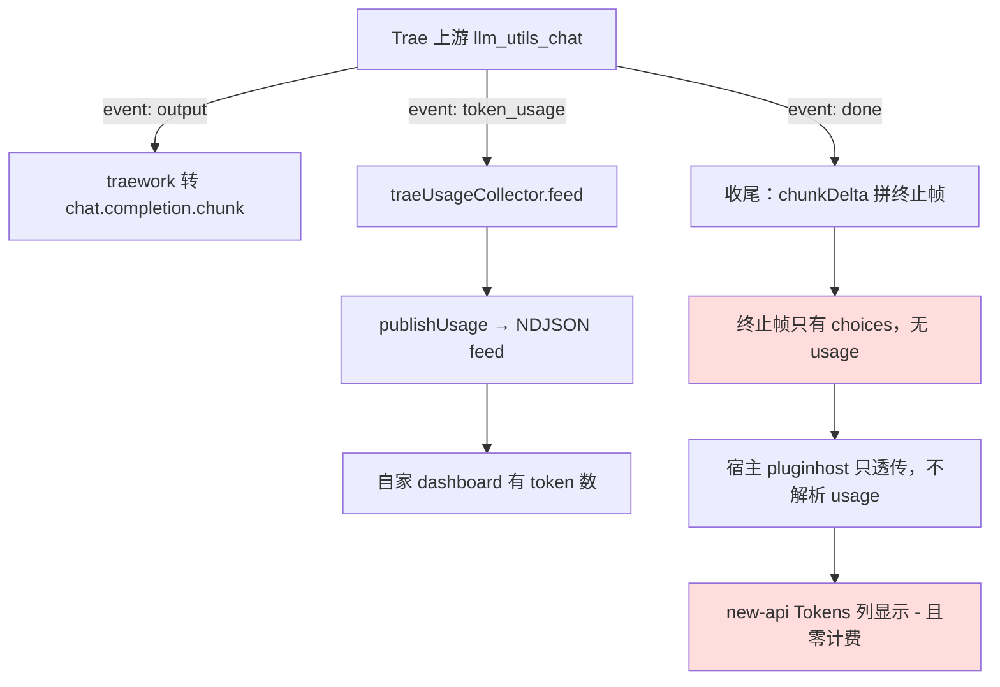
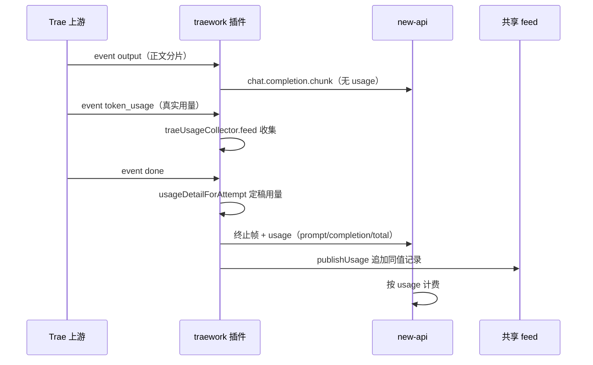

# traework 下行从不携带 usage 致 new-api 全量 Tokens 为 "-" 零计费根因诊断

- 报告时间：2026-11-08 13:52:04（GMT+8）
- 报告对象：traework-provider **0.5.18**（修复前生产 active_version）
- 触发场景：`new-api → CPA → traework-provider`，模型 `doubao-seed-2.1-pro`
- 关联文档：
  - `doc/4-bugs/2026-10-18_183000_qwenwork流式usage终止帧被丢弃致new-api全量零计费根因诊断.md`（同型：usage 载体被丢，**但机制不同**——那是「有帧被丢弃」，本次是「从未构造过 usage 帧」）
  - `doc/4-bugs/2026-10-19_003000_coze不输出usage致下游用量全部记零根因诊断.md`（确立契约：流式只在终止帧挂 usage、非流式挂响应体顶层）
  - `doc/4-bugs/2026-08-30_175903_Trae异步流式请求用量漏记.md`（同插件 0.1.19 修过异步路径不调 publishUsage，只影响自家 feed，不影响下游）

## 1. 现象

用户提供 new-api「使用日志」页面截图（2026-11-08 13:24），三点观察：

1. 三条 `doubao-seed-2.1-pro` 记录（13:21:36 / 13:22:23 / 13:23:08）**Tokens 列全部显示 `-`**，费用列显示「订阅」。
2. 这三条请求**本身是成功的**：首字 14.4s / 34.2s / 39.0s，耗时 40~45s，与思考型模型行为吻合。
3. 同页 `deepseek-v4.1-flash`（88,103 / 489）、`minimax-m3.1-flash`（103,845 / 67）**Tokens 数字完整**。

⇒ 排除 new-api 显示缺陷，问题锁定在 traework 的下行响应里没有 usage。

## 2. 取证

### 2.1 上游确实给了 token_usage（插件内已收到）

traework 三处 SSE 分支都接到了上游的 `token_usage` 事件：

- [traework/stream.go:445-446](file:///F:/cpa-plugin/traework/stream.go#L445-L446)（`collectTraeStream` 同步收集路径）
- [traework/stream.go:528-529](file:///F:/cpa-plugin/traework/stream.go#L528-L529)（`aggregateTraeCompletion` 非流式聚合路径）
- [traework/stream.go:831-832](file:///F:/cpa-plugin/traework/stream.go#L831-L832)（`pumpTraeStreamAttempt` 异步泵路径）

三处代码完全一致：

```go
case "token_usage":
    collector.feed(ev.Data)
```

`traeUsageCollector.feed` 把用量存进内部 `last`，`detail()` 再翻成 `usage.Detail`，
**唯一消费方是 `publishUsage`（写 NDJSON feed 给自家 dashboard）**。全程没有任何代码
把它还原成 chunk 顶层的 `usage` 对象。

### 2.2 下行构造函数从不写 usage

修复前三个构造函数 [traework/stream.go:75-109](file:///F:/cpa-plugin/traework/stream.go#L75-L109)
（`chunkDelta`）、`:171-188`（`toolCallDeltaChunk`）、`:194`（`completionAggregate`）
拼出的 payload 只有 `id / object / created / model / choices` 五个键。四条下行路径的
终止帧都由它们产出：

| 路径 | 终止帧构造点（修复前行号） |
|---|---|
| 同步 collect | `stream.go:478` `chunkDelta(requestID, model, "", "", finish)` |
| 异步泵（已废弃） | `stream.go:937` 同款 |
| 异步协调器 | `executor.go:600` 同款 |
| 非流式聚合 | `stream.go:568` `completionAggregate(...)` |

### 2.3 宿主侧对插件 executor 没有 usage 观测器（决定性事实）

SDK：`C:\Users\luode\go\pkg\mod\github.com\router-for-me\!c!l!i!proxy!a!p!i\v7@v7.2.129`

- `internal/pluginhost/adapters_executors.go:662` `ExecuteStream` → `:894` `mapExecutorStreamChunks`：
  只透传 `Payload` / `Err`，**不做任何 usage 解析**。
- `:540` `translateExecutorStreamChunks` / `:579` `translateExecutorStreamPayload`：
  仅当 `outputFormat != requestedFormat` 时才做 sdktranslator 转换；格式相同时
  **插件自拼的 chunk 逐字节到达下游客户端**。
- `StreamUsageBuffer.ObserveOpenAIStream` 的调用点只有
  `openai_compat_executor.go:426`、`kimi_executor.go:326`、`codex_openai_images.go:452`，
  **都不在插件 executor 路径上**。

⇒ 插件不自己在 chunk 顶层挂 `usage`，宿主与 new-api 就必然拿不到 token 数。

### 2.4 若下游真要解析，它只认这几个键

`internal/runtime/executor/helps/usage_helpers.go`：

- `:569` `hasOpenAIStyleUsageTokenFields`：usage 必须是 object，且存在 `total_tokens`
  **或** 任一 bucket 字段（`prompt_tokens` / `input_tokens` / `completion_tokens` /
  `output_tokens` / `prompt_tokens_details.cached_tokens` /
  `completion_tokens_details.reasoning_tokens` 等）。
- `:591` `parseOpenAIStyleUsageNode`：input=`prompt_tokens`||`input_tokens`，
  output=`completion_tokens`||`output_tokens`，total=`total_tokens`；
  **reasoning 只从 `completion_tokens_details.reasoning_tokens` 或
  `output_tokens_details.reasoning_tokens` 取，顶层 `reasoning_tokens` 不读**。

## 3. 根因

图形目的：展示修复前「上游给了用量、下行却不带用量」的断点位置。
关联 ID：EVIDENCE-TRAEWORK-USAGE-001、EVIDENCE-TRAEWORK-USAGE-002。



图形目的：展示修复后 usage 在终止帧上的唯一出口与两条下游消费路径。
关联 ID：EVIDENCE-TRAEWORK-USAGE-003、TEST-TRAEWORK-USAGE-001。



**双点，都在插件侧：**


1. **下行帧骨架从不含 `usage`。** `chunkDelta` / `toolCallDeltaChunk` /
   `completionAggregate` 三个构造函数只写 `id/object/created/model/choices`，
   四条路径（collect / pump / async / 非流式聚合）的终止帧全部走它们。
2. **上游真实用量被内部消化，不转下行。** 三处 `case "token_usage"` 只
   `collector.feed`，把用量喂给自家 NDJSON dashboard，从未构造成 chunk。

叠加 §2.3 的事实（宿主不为插件算 usage），结果是：**自家 dashboard 有用量、
下游 new-api 全零**。

### 为什么是「显示 `-` 而不是 0」

new-api 的计费依赖流内 usage 帧，拿不到时按「无计费信息」处理，前端渲染成 `-`。
本次与 qwenwork 那次（`$0` + 「上游没有返回计费信息」）表现略有差异，但机制同源：
**计费载体缺席**。区别在于 qwenwork 是「有帧但被清理逻辑丢弃」，traework 是
「从未构造过该帧」。

## 4. 修复

版本：traework-provider **0.5.19**。

### 4.1 终止帧唯一出口

[traework/stream.go:78-95](file:///F:/cpa-plugin/traework/stream.go#L78-L95) 新增统一骨架：

```go
func deltaChunk(requestID, model string, choices []map[string]any, usageObj map[string]any) ([]byte, error)
```

`if usageObj != nil { chunk["usage"] = usageObj }`。

[traework/stream.go:183-190](file:///F:/cpa-plugin/traework/stream.go#L183-L190)
新增终止帧唯一出口：

```go
func chunkFinishWithUsage(requestID, model, finishReason string, detail usage.Detail) ([]byte, error)
```

`chunkDelta` 保留原语义，内部改为 `deltaChunk(..., nil)`，**恒定不挂 usage**——
OpenAI 约定流式用量只出现在最后一帧，中间帧带 usage 会被客户端按重复计费累加
（与 [coze/convert.go:158](file:///F:/cpa-plugin/coze/convert.go#L158) 的同款注释一致）。

### 4.2 usage 渲染

[traework/stream.go:140-173](file:///F:/cpa-plugin/traework/stream.go#L140-L173)
新增 `usageToOpenAI(d usage.Detail) map[string]any`：

- 三桶全 `<= 0` 返回 `nil`（挂 `0/0/0` 会被下游当真实用量采信，比未上报更糟）；
- `total <= 0` 时用 `Input + Output` 兜底；
- 输出 `prompt_tokens` / `completion_tokens` / `total_tokens`；
- cached（`CacheReadTokens`，为 0 时回退 `CachedTokens`）> 0 或 `CacheCreationTokens` > 0
  时挂 `prompt_tokens_details{cached_tokens, cache_creation_tokens}`；
- `ReasoningTokens` > 0 时挂 `completion_tokens_details{reasoning_tokens}`；
- **不输出顶层 `reasoning_tokens`**（宿主不读，见 §2.4）。

### 4.3 四条路径接入

| 路径 | 修复后 |
|---|---|
| 同步 collect 收尾 | `downDetail := usageDetailForAttempt(collector.detail(), chunks)` → `chunkFinishWithUsage(...)` |
| 异步泵收尾 | `chunkFinishWithUsage(requestID, ctx.Model, finish, usageDetailForAttempt(result.Usage, result.Chunks))` |
| 异步协调器收尾 | [traework/executor.go:600-605](file:///F:/cpa-plugin/traework/executor.go#L600-L605) 同款，且 `publishUsage` 复用同一 `asyncDetail` |
| 非流式聚合 | `completionAggregate` 新增第 7 参数 `usageObj`，写入响应体顶层 `usage` |

### 4.4 两个配套修正

- `normalizeTraeDetail(d usage.Detail) (usage.Detail, bool)`：任一桶非零即视为真实用量
  并补齐 `total = Input + Output`。上游只回 `completion_tokens` 时旧判据
  （`TotalTokens > 0`）会误判为空而丢 usage。
- `tokensFromChars(chars int) int64`（[traework/executor.go:854-870](file:///F:/cpa-plugin/traework/executor.go#L854-L870)）：
  短输出（`ok` = 2 字符）按 `chars/4` 整除估成 0 → Detail 全零 → 终止帧不挂 usage
  → 该请求继续零计费。非空内容保底 1 token。

### 4.5 保持不变（避免回归）

`collectTraeStream` / `aggregateTraeCompletion` 的**返回契约不动**：只回上游真实用量，
估算兜底仍由调用方 `usageDetailForAttempt` / `usageDetailForCompletion` 负责。
首次尝试把返回值改成「已兜底的 detail」时，既有用例
`TestCollectTraeStreamWithoutTokenUsageEmptyDetail` 立即失败（断言「未收到 token_usage
时返回空 Detail」），随即恢复原契约。因为终止帧 delta 为空、不改变估算基数，
下行 usage 与调用方估算必然一致。

## 5. 验证

### 5.1 新增测试（12 个用例）

| 文件 | 用例 | 断言 |
|---|---|---|
| `traework/usage_emit_test.go` | `TestUsageToOpenAIStandardKeys` | 输出标准蛇形三键 |
| | `TestUsageToOpenAIDetailNesting` | `cached_tokens=11` / `cache_creation_tokens=5` / `reasoning_tokens=23` 落位正确，且**顶层不得有 `reasoning_tokens`** |
| | `TestUsageToOpenAIZeroDetailNil` | 全零返回 nil |
| | `TestUsageToOpenAITotalFallback` | `7+5=12` total 兜底 |
| | `TestCollectTraeStreamTerminalChunkCarriesUsage` | 中间帧无 usage；末帧 `69/34/103`、`finish_reason=stop`、choices 长度 1 |
| | `TestCollectTraeStreamTerminalChunkUsageEstimatesWhenAbsent` | 上游无 token_usage 时按字符估算且非零 |
| | `TestAggregateTraeCompletionCarriesUsage` | 非流式响应体顶层带 usage |
| | `TestNormalizeTraeDetailPartialBuckets` | 部分桶也算真实并补 total |
| | `TestChunkFinishWithUsageZeroDetailStillTerminal` | 全零仍产出形态正常的终止帧（不挂 usage） |
| | `TestSSEFramedChunksKeepUsage` | 剥 `data: ` 前缀与 `\n\n` 后仍能解出 `total_tokens=103` |
| `traework/usage_emit_async_test.go` | `TestAsyncStreamTerminalChunkCarriesUsage` | `closes==1`；中间帧无 usage；末帧 `69/34/103` |
| | `TestAsyncStreamTerminalChunkUsageEstimatesWhenAbsent` | 异步路径估算兜底 |

### 5.2 变异反证（6 组，全部 KILLED）

| 变异 | 结果 |
|---|---|
| collect 终止帧退回 `chunkDelta` | FAIL 3 项（含 SSE 包装用例） |
| `usageToOpenAI` 键名改成非标准 | FAIL 6 项 |
| 异步终止帧退回 `chunkDelta` | **首轮 SURVIVED**（当时缺异步用例），补测后 FAIL 2 项 |
| 非流式响应体传 nil usage | FAIL `TestAggregateTraeCompletionCarriesUsage` |
| reasoning 挂到顶层 `reasoning_tokens` | FAIL `TestUsageToOpenAIDetailNesting` |
| 全零明细也挂 usage | FAIL 2 项 |

### 5.3 全量门禁

`python scripts/cgo-shim-build.py traework`：build OK / vet OK /
`ok github.com/luode0320/cpa-workbuddy-plugin/traework 3.465s`，`[cgo-shim] all green (traework)`。
四个改动文件 gofmt 全部 FMT_OK。

## 6. 教训

1. **「自家 dashboard 有用量」不能证明「下游有用量」。** usage 有两条独立出口：
   `publishUsage`（feed）与下行 chunk。任何只接一条的实现都会出现
   「面板正常、网关零计费」的割裂。改造用量链路时必须同时核对两条出口。
2. **插件 executor 拿不到宿主的 usage 加工。** 宿主原生 executor 各自
   `ObserveOpenAIStream`，插件路径没有；`pluginhost` 只做格式转换与透传。
   插件必须自己产出标准 `usage` 对象，这是契约而非可选增强。
3. **渲染键名要按下游解析器写，不是按内部字段名写。** `usage.Detail` 的
   `ReasoningTokens` 必须落到 `completion_tokens_details.reasoning_tokens`；
   顶层 `reasoning_tokens` 会被静默忽略。
4. **估算兜底的意义是「给下行一个非零基数」。** `chars/4` 对短输出会估成 0，
   而 0 在 `usageToOpenAI` 里等于「不挂 usage」——兜底必须保底 1。
5. **变异反证要覆盖每一条路径。** 异步路径首轮 SURVIVED 证明：只测 collect 路径的
   变异体是无效证据。

## 7. 未验证项

- new-api 侧对该 usage 帧的实际记账结果（发布热重载后需抓生产日志确认；
  本机 new-api 无等价环境）。
- 上游 `token_usage` 是否覆盖所有 Trae 上游模型（仅对 `doubao-seed-2.1-pro` 与
  `qwen3.8-max` 观察过）；未覆盖时走字符估算，数值是近似值而非真实计费依据。
