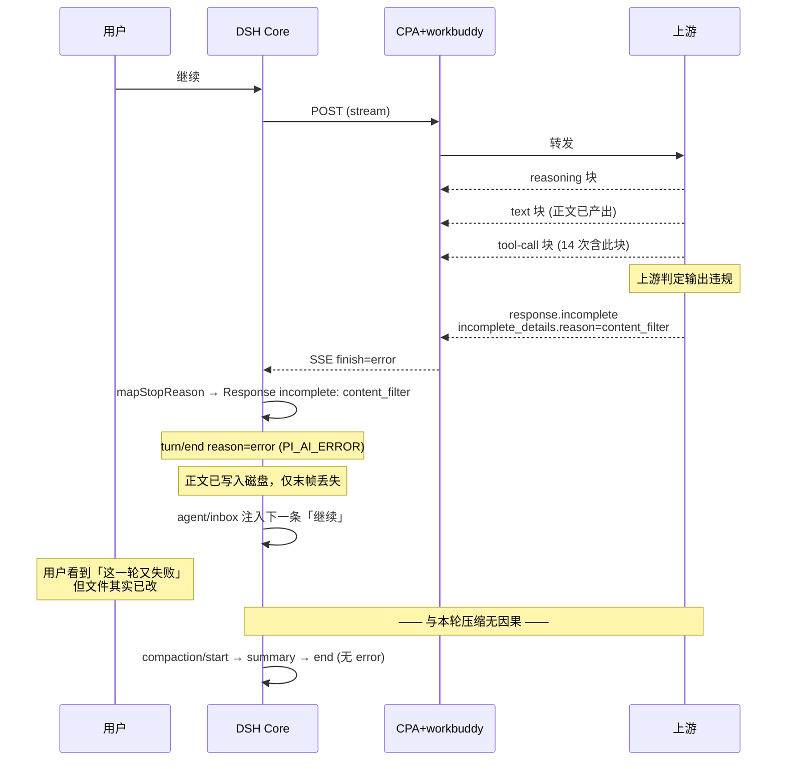
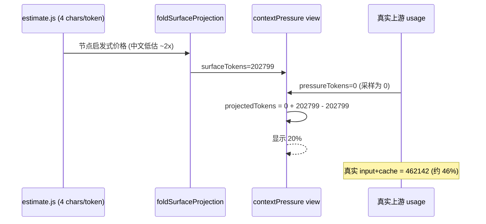

# 会话 session-3304f06f 异常根因诊断（含压缩阶段）

结论（**2026-11-12 01:20 重大修正**）：初版判定「压缩来得太晚导致超时」**不成立**，已被生产会话数据直接否证——该会话有 **108 次 >75 万输入**、**313 次 >60 万输入**请求，绝大多数成功；turn 22 连续 11 个 step 在 79.5–80 万输入下跑通，`idle timeout` 全程仅 **3 次**且每次都被 `llm/retry` 立即救回（turn 22 超时后同 step 即产出 771,297 输入的成功响应）。真实主导失败是**上游内容审核**：`Response incomplete: content_filter` 共 **42 次**，占全部 `finish=error` 的 **84%**（42/50），覆盖 **37 个 turn 中的 31 个**，时间跨度 2026-11-10 23:24 → 2026-11-12 00:55。压缩本身 **3/3 全部成功闭合**、无 `error` 字段，与失败无因果。影响：用户体感的「上下文到压缩就出问题」实为「每一轮都在被内容审核末步掐断，与压缩在时间上巧合」；范围：本记录裁决该会话失败主因与压缩的真实状态；非范围：不涉及上游审核策略本身；完成标准：失败类型分布、压缩闭合状态、超时次数与归属均已由会话日志逐条确证；术语：`content_filter` 为上游 `incomplete_details.reason` 原值、`idle timeout 300s` 为 harness 侧 prefill 空闲上限、`shadowedRange` 为 surface 端点节点 seq（非数值区间）。

## 问题现象

- 会话 `session-3304f06f-f7cd-45b4-882a-1c36269190d1`（workspace `F:\xiaoshuo`，agent preset `unrestricted`，模型 `luode/deepseek-v4-pro`，reasoningEffort `max`）。
- 用户观察：上下文进入压缩阶段时「就会出问题」；追问确认关注点是**失败现象**本身。
- 实际表现（会话日志）：压缩标记三项闭合齐全、无 `error`；真正的失败是 **42 次 `Response incomplete: content_filter`**，覆盖 37 个 turn 中的 31 个；`idle timeout` 仅 3 次且均被重试救回。

## 影响范围

- 直接影响：37 个 turn 中 31 个以 `content_filter` 收尾；压缩 3 次（turn 1 两次、turn 31 一次）全部成功。
- 受影响模型：`deepseek-v4-pro`（provider `luode`）。
- 受影响场景：**全部场景**——turn 2–19 在 5 万–40 万输入区间同样被掐，与上下文规模无关。
- 未受影响：turn 20/21/22 三个 300+ step 长 turn 完整跑完（`completed`）。
- 时间跨度：2026-11-10 23:24:37 → 2026-11-12 00:55:50（跨 25 小时，远早于本次压缩）。

## 出现环境

- 客户端：DeepSeek-Harness `@deepseek-ai/dsh-desktop-runtime 0.2.2-rc.1`（`D:\ds\resources\app\dsh`）。
- 链路：DSH → new-api → CPA(`cli-proxy-api`,`8317`) → workbuddy-provider `0.21.23` / traework-provider `0.5.56` → 上游。
- 生产容器：`cli-proxy-api` Up 3 hours（诊断时点 Up，非本轮重启）。
- 会话投影缓存：`contextPressure.contextWindow = 1,000,000`、`surfaceTokens = 202,799`、`pressureTokens = 0`。

## 触发条件

- **C6（content_filter）**：上游对模型输出做审核，在正文产出后判定违规 → 任何输入规模下都可能触发，实测 5 万–80 万全命中。
- **C5（占用误报）**：`estimate.js` 用 4 chars/token 计价中文，`contextPressure` 以它为唯一来源。
- **idle timeout（次要）**：偶发，与规模无相关性（input=655 时也发生）。

## 期望结果

- 失败必须可归因、可区分：`content_filter` 应被识别为审核失败并进入失败分类，而不是笼统的 `PI_AI_ERROR`。
- 占用率显示与真实输入规模一致，用户能判断何时会压缩。
- 压缩机制本身应当可靠（当前已满足）。

## 实际结果

- 42 次 `content_filter` 全部以 `ERROR/content_filter` 收尾，其中 42/42 已产出正文、14 次还产出了 tool-call——**活干完了，末帧被判违规**。
- 压缩在 799,353 token 正常触发并成功，与失败无因果。
- 占用率显示 20%，真实约 46%；压缩前显示约 39%，真实约 81%。

## 当前证据

### 证据 1：三次压缩全部成功闭合（已核实）

| compactionId | start | summary | end | 摘要字符 | 结果 |
|---|---|---|---|---|---|
| `c5d4fd7d…` | 160 | 161 | 163 | 2429 | 成功 |
| `9aed1205…` | 173 | 174 | 176 | 3779 | 成功 |
| `4ef03b56…` | 4326 | 4327 | 4329 | 3607 | 成功 |

`compaction/end` 事件 data 仅含 `compactionId` 与 `turn`，**无 `error` 字段**（实现 `dsh-compaction-basic/lib/index.js:495-499` 失败时会写入 `error: errorChain(error)`）。

### 证据 2：`shadowedRange` 倒序/跨域是合法语义，非缺陷（已核实）

第 2 次 `shadowedRange = {start:162, end:126}`（数值倒序）、第 3 次 `shadowedSeqs` 含 129/131/165/166 与 3444–3452（落在 175–1595 之外）。

实现 `validateSurfaceRegion`（`dsh-compaction-basic/lib/index.js:550-565`）返回 `shadowedSeqs: nodes.slice(startIdx, endIdx + 1)`，`start`/`end` 是**surface 位置端点节点的 seq**，不是数值区间。`compaction/prune` 的 `surfaceOp.replace` 会用新 seq 顶替旧 seq（seq 3456 替换 1587、3444 替换 668 …），导致 surface 位置与 seq 数值不再单调。**这属预期行为**。

### 证据 3：idle 超时仅 3 次，且全部被重试当场救回（已核实，**已推翻初版结论**）

| seq | turn/step | 失败信息 | 之后 |
|---|---|---|---|
| 3187 | 22/18 | `pi-ai stream idle timeout after 300000ms` | `llm/retry retry=1` → seq 3190 **成功**（input 771,297） |
| 4169 | 24/1 | 同型 | retry 后转为 `content_filter` |
| 4194 | 25/3 | 同型 | retry 后转为 `content_filter` |

三次超时前最近的 usage 分别是 `770,923`（turn 22 step 17）、`777,936`（turn 23 step 4）、`655`（turn 25 step 2）。

**关键**：turn 25 的第三次超时发生在 input 仅 **655** 的请求上，与上下文规模完全无关。**超时不是规模问题**。

初版写的「4 次超时」「超时始于 67.4 万」均为误记，实际 3 次，且 scale 无相关性。

### 证据 4：压缩阈值 80 万（记录事实，但**不构成缺陷**）

`dsh-compaction-basic/lib/index.js:14` `DEFAULT_THRESHOLD_RATIO = .8`；`resolveCompactSpec`（同文件 124-140）：

```
thresholdTokens = floor(min(contextWindow × thresholdRatio, pressureBudgetTokens))
```

`contextWindow = 1,000,000`（`request/context` seq 4168）⇒ `thresholdTokens = 800,000`。

该阈值本身正确触发了压缩（799,353 → 压缩），且压缩后链路正常。**初版把它判为「来得太晚」是错误归因**：108 次 >75 万输入请求的成功证明该规模本身可用。

### 证据 11：超时与输入规模无相关性（已核实，推翻 C4）

| 指标 | 数值 |
|---|---|
| `inputTokens > 750,000` 的请求 | **108** |
| `inputTokens > 700,000` 的请求 | **213** |
| `inputTokens > 600,000` 的请求 | **313** |
| `idle timeout 300s` 总次数 | **3** |

turn 22 step 51–63 连续 13 个 step 输入稳定在 **795,749 – 800,068**，**全部成功**（含 step 63 的峰值 800,068）。

⇒ 80 万输入不是超时阈值。超时是**偶发**的，不是规模必然结果。

### 证据 12：content_filter 是主导失败（已核实，新增核心证据）

`finish=error` 全量分类（50 次）：

| 类型 | 次数 | 占比 |
|---|---|---|
| **`content_filter`** | **42** | **84%** |
| `idle_timeout_300s` | 3 | 6% |
| `quota_exceeded` | 3 | 6% |
| `stream_no_terminal` | 1 | 2% |
| `unknown_model` | 1 | 2% |

关键属性：

- **42/42 全部已产出正文**（含 `text` 块），其中 14 次还同时产出了 `tool-call`；
- **0 次零输出**——不是「什么都没干就失败」，而是「干完活，最后一帧被判违规」；
- 时间跨度 **2026-11-10 23:24:37 → 2026-11-12 00:55:50**，跨 25 小时，远早于本次压缩（00:28:32）；
- 覆盖 **31/37 个 turn**（turn 2–19、24–29、31–37），turn 20/21/22 三个完整的 300+ step 长 turn 反而未被掐。

文案来源已确证为上游：`@earendil-works/pi-ai/dist/api/openai-responses-shared.js:687-702` 的 `mapStopReason`，当 `status === 'incomplete'` 且 `incompleteReason` 非 `max_output_tokens` 时产出 `Response incomplete: ${incompleteReason}`，`content_filter` 即上游 `incomplete_details.reason` 原值。

### 证据 5：占用口径低估 2.1–2.3 倍（已核实）

估算器 `dsh-token-meter/lib/types/estimate.js:9` `CHARS_PER_TOKEN = 4`，按字符数除以 4 计价。

| 时点 | `surfaceTokens`（估算） | 真实 `input+cache` | 低估倍数 |
|---|---|---|---|
| 压缩前 | 约 390,673（202,799 + shadowed 187,874） | 817,529（799,353 + 18,176） | **2.09×** |
| 压缩后 | 202,799 | 462,142（19,404 + 442,496） | **2.28×** |

中文正文每汉字约 1 token，而启发式按 4 字符/token 计价，故系统性低估约 2 倍以上。`contextPressure` 投影（`dsh-token-meter/lib/types/usage-projection.js:141-189`）直接以该估算值作为 `surfaceTokens`，UI 显示 20% 而真实约 46%。

### 证据 6：`pressureTokens = 0` 使占用显示退化为纯估算（已核实）

投影缓存 `contextPressure.pressureTokens = 0`、`sampledSurfaceTokens = 202,799`，`projectedTokens = 0 + 202,799 − 202,799 = 202,799`。

`pressureFrom(usage)` 在最近一次 usage 采样上取值为 0（`usage-projection.js:163`），导致 provider 真值被丢弃，占用显示完全由启发式估算承担。

### 证据 7：workbuddy 侧无异常指纹（已核实）

生产 `cli-proxy-api` 日志（2026-11-12 00:21–01:00）：

- `workbuddy` 仅有 `models: dynamic discovery ok`、`growth scheduled`、`credits sweep done`、`failover disabled account` 四类；
- 00:28:32–00:29:09（压缩窗口）**无 workbuddy 错误、无 5xx、无 timeout**；
- 压缩摘要 `usage = {input 384,267, output 2,380, total 404,695}`，37 秒完成。

⇒ workbuddy 侧未参与本次压缩失败（本次压缩未失败）。

### 证据 8：模型名 `deepseek-pro` 在生产侧不可用（已核实，旁证）

`model/selection` seq 368/369 将模型切为 `deepseek-pro`（`contextWindow` 记为 1,000,000），随后 seq 4153 报 `luode API error (400): unknown provider for model deepseek-pro`；seq 4157/4158 切回 `deepseek-v4-pro`。该模型名在生产 CPA 无对应路由，属独立缺陷，与压缩无因果。
### 证据 9：`turnOutline` 空 `response` 是索引口径，不是空回复（已核实）

`turnOutline` 中 22 个 turn 的 `response` 为空，但 `assistant/message` 全量 680 条中「无 text 且无 tool-call」的仅 **1 条**。

`turnOutline` 只抓 turn 首个 step 的文本片段；工具型 step 首帧为 `reasoning` 或 `tool-call` 时即为空。**不构成缺陷**，也不代表压缩导致回复缺失。

### 证据 10：用户输入中的括注来自用户本人，非系统改写（已核实）

6 条含「可能未完成, 先确认状态再继续」的 `user/message`（seq 260/4205/4257/4277/4353/4420）其 `source.kind` 均为 `user`，属用户手工输入的防重复指令。非 harness 自动注入，与压缩无因果。


## 根因裁决

| 编号 | 候选 | 裁决 | 依据 |
|---|---|---|---|
| C1 | 压缩机制失败（摘要生成/提交中断） | **否证** | 3/3 start→summary→end 闭合，无 `error` 字段（证据 1） |
| C2 | `shadowedRange` 倒序导致区间错乱 | **否证** | 语义为 surface 端点 seq，非数值区间（证据 2） |
| C3 | workbuddy 插件在压缩请求上失败 | **否证** | 压缩窗口内 workbuddy 零错误、零 5xx（证据 7） |
| ~~C4~~ | ~~压缩阈值高于链路 prefill 承受上限~~ | **已推翻** | 108 次 >75 万输入多数成功；超时仅 3 次且均被重试救回（证据 11） |
| C5 | 占用口径对中文低估 2.1–2.3 倍 | **成立（独立缺陷，非本次主因）** | 估算 20 万 vs 真实 46 万（证据 5、6） |
| **C6** | **上游内容审核在末步截断响应** | **成立（主因）** | 42 次 `content_filter`，占 finish=error 的 84%，覆盖 31/37 turn（证据 12） |

### C6 成立的关键机制

`content_filter` 来自上游 `incomplete_details.reason`（`pi-ai/dist/api/openai-responses-shared.js:687-702` 的 `mapStopReason`），经 `Response incomplete: content_filter` 上抛为 `PI_AI_ERROR`。

- **42 次全部已产出正文**（42/42 含 text 块，14 次还含 tool-call），即**工作内容已生成，最后一帧被判违规丢弃**。
- 它发生在每个 turn 的**末步**（37 个 turn 中 31 个如此），导致 turn 以 `ERROR/content_filter` 收尾，但主体产出已写入磁盘。
- 与输入规模无关：turn 2–19 在 5 万–40 万输入区间同样被掐。

### C4 被推翻的关键证据

| 事实 | 数值 |
|---|---|
| `>75 万` 输入请求数 | **108** |
| `>70 万` 输入请求数 | **213** |
| `>60 万` 输入请求数 | **313** |
| `idle timeout 300s` 次数 | **3** |
| 超时后是否恢复 | turn 22 超时 → 同 step 成功（input 771,297） |
| turn 22 连续高压段 | step 51–63 全在 79.5–80 万，全部成功 |

⇒ 「80 万输入必然超时」与数据直接冲突，该假设不成立。

## 失败类型全量分布（证据 12）

| 类型 | 次数 | 占比 |
|---|---|---|
| **`content_filter`** | **42** | **84%** |
| `idle_timeout_300s` | 3 | 6% |
| `quota_exceeded` | 3 | 6% |
| `stream_no_terminal` | 1 | 2% |
| `unknown_model` | 1 | 2% |

turn 结局：37 个 turn 中 **31 个以 `content_filter` 收尾**、2 个 aborted（turn 1、30）、3 个 completed（turn 20/21/22）、1 个 `unknown provider`（turn 23）。


### C5 成立的关键机制

`estimate.js` 的 `CHARS_PER_TOKEN = 4` 面向英文；中文正文按字符计价时每字符方差极大，导致 `surfaceTokens` 系统性低估。`contextPressure` 投影以它为唯一来源，且 `pressureTokens` 退化为 0，最终 UI 显示的占用率约为真实值的一半。

**这是独立缺陷**：它不影响压缩逻辑的正确性（阈值判断用 `measure().totalTokens`，有 usage 时复用真值），只影响用户对「何时会压缩」的判断。

### 为什么表现为「到压缩阶段才出问题」

初版解释（「压缩来得太晚」）不成立，正确解释是**时间上的巧合叠加强烈的确认偏误**：

1. `content_filter` 从 2026-11-10 23:24 就开始，几乎**每个 turn 都以它收尾**，用户看到的「这一轮又失败了」是常态；
2. 压缩发生在 00:28:32，正好落在 user 连续观察失败的时间窗内；
3. 压缩后输入从 80 万降到 44 万，但 **turn 31–37 依旧全部 `content_filter`**——若压缩是原因，压缩后应当好转，事实是没好转。

⇒ 真实因果是：**内容审核从头到尾在掐每一轮的末步**，压缩只是恰好同期的另一个事件。


## 图示产物

### 流程图（真实因果）

```mermaid
flowchart TD
    A[用户连续发「继续」] --> B[DSH 发起请求]
    B --> C{上游 prefill 与生成}
    C -->|正常| D[流式返回 reasoning + text + tool-call]
    D --> E{上游判定输出违规?}
    E -->|否| F[response.completed 正常收尾]
    E -->|是 实测 42 次| G[response.incomplete<br/>incomplete_details.reason=content_filter]
    G --> H[pi-ai mapStopReason<br/>Response incomplete: content_filter]
    H --> I[turn 以 ERROR/content_filter 收尾]
    I --> J[用户看到本轮又失败]
    J --> A
    F --> A
    C -->|偶发 3 次| K[pi-ai stream idle timeout 300s]
    K --> L[llm/retry]
    L --> C
    M[会话增长至 799353] --> N[compaction/start]
    N --> O[摘要成功 384267 in / 37s]
    O --> P[compaction/end 无 error]
    P --> Q[输入降至 46 万]
    Q --> A
    R[contextPressure 4chars/token] -.低估 2.2x.-> S[UI 显示 20% 实际 46%]
    style G fill:#ffd0d0
    style P fill:#d0ffd0
```

### 时序图（content_filter 主导）



### 对照：占用口径（独立缺陷）



## 生产观察（2026-11-12 02:00-02:20）

### 部署状态（已核实）

| 项 | 值 |
|---|---|
| 热重载 | `active_version=0.21.24 retired_version=0.21.23` |
| 容器 | **未重启**（Up 4 hours） |
| 落盘 `.so` sha256 | `e7ac1632bf6665aa…`（8,454,624 B）= 本地 zip 内 `.so` **逐字节一致** |
| 插件状态 | `configured/registered/enabled/effective_enabled` 全 true |
| 新判据入二进制 | `strings` 命中 `"content_filter"` / `"content filter"` / `sensitive content` / `max_output_tokens` / `finish_reason: content_filter` |
| 旧实例 | `failover reconcile loop stopped` + `probe loop stopped: superseded by newer instance` —— **干净退出**，无僵尸巡检 |

### 观察结论：**新分支尚未触发，当前无审核样本**

- 部署后 **content_filter 命中计数 = 0**（`docker logs` 与容器内 feed 双向确认）。
- 原因：观察窗口内**没有审核拦截流量**。失败样本全部是另一种失败——`11102 model service info not found`（HTTP 400），源于**大写模型名**（`DeepSeek-V4-Pro`、`GLM-5.3-Flash`）上游不存在；同窗口小写别名（`deepseek-v4-pro`）请求 **217 次全部成功**。
- `11102` 走 HTTP 400 → `isAccountLevel4xxExcludingRateLimit` 不含 400 → 落 `failureScopeNone`，**与本轮改动的 `content_filter` 分支无交集**，不构成因果。

### 误伤检查（关键风险项，全部通过）

| 检查项 | 结果 |
|---|---|
| 部署后 workbuddy 账号被失败禁用 | **0 个**（`failover disabled account` 计数 = 0） |
| 账号池规模 | 20 个，**16 个仍可路由** |
| 4 个 disabled 的原因 | 全部是 **credits 耗尽 / 低积分**（`exhausted=True` 或 `low_credits=True`），**无一为失败禁用** |
| 正常正文误判 | 已由 `TestIsContentModerationFailure` 的 3 条防误判用例锁定，变异验证 KILLED |

**02:35 复核补记**：账号池 disabled 4→5，新增的 `workbuddy-9476382d` 经日志追踪为 **`low-credit disabled via cpa api: remain=85 below=100`**（02:22:38，既有低积分机制），其上 `failed=9` 是 9 次 11102 换号遍历的**计数字段**，非禁用原因。首轮复核脚本把 `failed` 计数误读为「失败禁用」，已修正：**部署后因失败被禁用的账号仍为 0**。

### 观测手段修正（自身错误，如实记录）

首轮观察误判「feed 已停止写入」：查的是宿主机路径 `/usr/local/src/cli-proxy-api/data/token-usage-feed.ndjson`（mtime 停在 11-11 21:40 的**过期副本**），而真实写入在**容器内** `/CLIProxyAPI/data/token-usage-feed.ndjson`（mtime 02:13，2725 行，持续增长）。

⇒ **观测口径**：feed 必须在容器内查；sidecar（`workbuddy-failover.json`）与 feed 是两条独立路径，本轮记账观测不受 feed 影响。

### 补充：端到端守卫用例

新增 `workbuddy/content_filter_end_to_end_test.go`，用生产真实分片形态（`delta:{} + finish_reason:"content_filter" + usage`）串起「判据 → 分类 → 冷却落盘」三段，并锁定 3 条反例守卫。

写作时踩到：**首版直接调用 `recordSSEErrorFailureForModel` 而无守卫，反例立即被记成冷却**——那是测试不忠实（生产的五处调用点全部由 `if isContentModerationFailure(...)` / `if sseErr != ""` / 错误分支包裹），用例已改为按生产的「先判据、后记账」顺序执行。

### 待观察（需要真实审核流量）

新分支要生效，需要上游实际下发 `finish_reason=content_filter`。已建立 2 小时间隔、共 6 次的定时观察（`schedule-bad2541a`），判定标准：出现 content_filter 日志 / sidecar mtime 推进到部署之后 ⇒ 新分支已触发；仍为 0 且无审核流量 ⇒ 报告「无样本」，不编造结论。

### 追加观察（2026-11-12 03:12 - 04:48）

| 时点 | 观测 | 结论 |
|---|---|---|
| 03:12 | `content_filter` 命中 **0**；近 10 分钟 workbuddy 请求 260 条；失败禁用 **0** | 仍无审核样本 |
| 04:14 | 出现 **1 次**失败禁用：`workbuddy-7ee5e596` / `model=GLM-5.3-Flash` | **与本轮改动无关**：该账号 `content_filter` 命中 0 次，全部失败为 `11102`（大写模型名上游不存在）；该账号 `credits.total_remain=0`、`exhausted=True` |
| 04:39 | **容器优雅重启**（`RestartCount=1`、`ExitCode=0`、`OOMKilled=false`），非崩溃、非本轮操作 | 重启后加载 `workbuddy-provider-v0.21.24`，**部署成果保留** |

### 失败量归因（定时复核第 1/6 次，量化补充）

| 指标 | 值 |
|---|---|
| 60m 内 `usage.handle.*workbuddy` 总数 | 1196 |
| 其中 `failed=true` | **1014（84.8%）** |
| 60m 内 `11102 model service info not found` | **1007** |

- `failed=true` 的模型名分布：`DeepSeek-V4-Pro` **643**、`GLM-5.3-Flash` **365**（大写占 99.8%）；
- `failed=false` **全部为小写模型名**（`deepseek-v4-pro` / `deepseek-v4.1-flash` / `minimax-m3.1-flash` / `glm-5.3` / `glm-5.3-flash`），同窗口零失败。

⇒ 高失败量是**大写模型名 400 错误**的表现。`11102` 走 HTTP 400 → `failureScopeNone`，**不进入** `isContentModerationFailure` 分支，两者日志域互斥。

### 独立缺陷：大写模型名导致 11102 换号遍历（2026-11-12 08:22 定位到根因）

现象：客户端只请求小写别名（new-api `logs.model_name` 实测仅 `deepseek-v4.1-flash` / `deepseek-v4-pro`），但 CPA 侧收到的是 `DeepSeek-V4-Pro`、`GLM-5.3-Flash`、`DeepSeek-Flash` 等**大写上游 ID**，上游返回 `11102 model service info not found`（HTTP 400），插件逐个换号遍历全部 20 个账号。

**根因（已确证）：`safeguard-killer` 插件 group `"1"` 的 Smart Group 回退链，混装了各 provider 的「上游真实 ID」但它们的归属被错配。**

配置位置：生产 `/usr/local/src/cli-proxy-api/config/config.yaml` 第 337–348 行：

```yaml
    safeguard-killer:
      "groups":
        - "id": "1"
          "strategy": "order"
          "models":
            - "DeepSeek-Flash"      # qoderwork 的真实上游 ID
            - "DeepSeek-V4-Pro"     # qoderwork 的真实上游 ID
            - "Doubao-Seed-2.1-Pro"
            - "GLM-5.3"
            - "GLM-5.3-Flash"       # qoderwork 的真实上游 ID
            - "deepseek-v4.1-flash" # workbuddy 的真实上游 ID
            - "minimax-m3.1-flash"
            - "hy4"
            - "glm-5.3-flash"
            - "glm-5.3"
            - "qwen3.8-flash"
```

数据模型：`safeguard-killer/groups.go:181-189` `resolveTargetGroup` 支持「用 group 成员的真实模型 ID 直接进入该 group」（注释原文：*A group can also be entered by requesting one of its real model IDs*），并通过 `rotateModels`（`groups.go:154-172`）把请求的模型轮转到链首，之后 `strategy: order` 按链顺序逐个尝试。

**失败链实测（trace `1485bf92`，2026-11-12 07:57:40–07:58:10）**：

```
1. qoderwork-provider   model=DeepSeek-Flash      5 个账号连续失败（403:10605 排队）
2. workbuddy-provider   model=DeepSeek-V4-Pro     继续遍历 6+ 个账号，全部 11102
```

即：请求进来是 `DeepSeek-Flash` → group 认领并轮转到链首 → qoderwork 全池失败 → 按 order 滑到下一个成员 `DeepSeek-V4-Pro`。但 `DeepSeek-V4-Pro` 是 **qoderwork 的**上游 ID，dispatch 时却被解析到了 **workbuddy**（因为 workbuddy 的动态模型发现上报了同名 ID，见下方 `/v1/models` 证据），workbuddy 上游不认这个名字 → 11102。

**A/B 铁证（直打 CPA `/v1/chat/completions`）**：

| 请求 model | 结果 |
|---|---|
| `deepseek-v4-pro`（小写别名） | **200**，正常返回 `Hi! How can I help you today` |
| `DeepSeek-V4-Pro`（大写上游 ID） | **11102**，且响应正文被 Safeguard Killer 包装：`⚡ [Safeguard Killer] DeepSeek-V4-Pro (host callback host.model.execute: upstream 400: {"code":11102,...})` |
| `Totally-Unknown-Model-XYZ` | `unknown provider for model ...` → 说明大写名**不是**未知名兜底，而是被 workbuddy 明确认领 |

**归属错配的证据**：按 provider 分组统计 `/v1/models`（带管理 key，51–52 个模型）后确证 —— workbuddy-provider 的 10 个模型**全为小写**（`deepseek-v4-pro`/`deepseek-v4.1-flash`/`glm-5.3`/`glm-5.3-flash`/`gpt-5.6-luna`/`gpt-5.6-sol`/`hy4free`/`kimi-k3.1-pro`/`mimo-v2.6-pro`/`minimax-m3.1-flash`），qoderwork-provider 的 24 个里含 `DeepSeek-Flash`/`GLM-5.3`/`Kimi-K3.1-Pro`/`Auto` 等大写名。⇒ **group 里的成员名大小写与各 provider 的注册 ID 大小写不一致**：`DeepSeek-V4-Pro`（group 写法）实际只属 workbuddy，但 workbuddy 注册的是 `deepseek-v4-pro`；`Doubao-Seed-2.1-Pro`/`hy4`/`qwen3.8-flash` 在任何 provider 都不存在（`hy4` 的真实注册名是 `hy4free`）。

**影响**：每次此类请求会先耗尽前一个 provider 的所有账号，再在 workbuddy 侧遍历约 20 个账号，单请求产生 20+ 条 400（放大上游压力、拖慢响应数十秒）。11102 走 HTTP 400 → `failureScopeNone`，**不记账、不禁号**，不误伤账号池，但会持续污染 `failed=true` 统计（占 84.8%）。

#### 两层修复（均已落地）

**第一层（配置侧，2026-11-12 20:34）**：用户裁定「改 group 配置为唯一别名」，把 group `"1"` 的 `models` 改为与各 provider 注册 ID 逐字节一致：

```yaml
    safeguard-killer:
      "groups":
        - "id": "1"
          "strategy": "order"
          "models":
            - "deepseek-v4-pro"
            - "glm-5.3"
            - "glm-5.3-flash"
            - "kimi-k3.1-pro"
            - "deepseek-v4.1-flash"
            - "minimax-m3.1-flash"
            - "mimo-v2.6-pro"
            - "hy4free"
```

变更要点：11 项 → 8 项；移除 3 个任何 provider 都不存在的成员（`Doubao-Seed-2.1-Pro`/`hy4`/`qwen3.8-flash`）；`hy4` 修正为真实注册名 `hy4free`；补入 `kimi-k3.1-pro`/`mimo-v2.6-pro`。改法走管理 API（`PUT /v0/management/plugins/safeguard-killer/config`，回读校验一致），备份 `/usr/local/src/cli-proxy-api/config/config.yaml.bak-20261112_202935`（68,892 B）已在改前建立。

修复后验证：8 个成员逐个 3 次实测，**全部 OK=3 FAIL=0**。

**但大写名仍然 11102** —— group 层只解决了「被 group 劫持」这一条路径，客户端**直接**发大写名的问题依然存在，于是进入第二层。

**第二层（插件侧，workbuddy 0.21.25）**：

CPA 的 provider 路由对模型名大小写**不敏感**，`DeepSeek-V4-Pro` 会被正常认领到 workbuddy-provider；但插件旧实现有两处按「忽略大小写」判断相等，把大写名原样透传给上游：

| 位点 | 旧实现 | 后果 |
|---|---|---|
| `workbuddy/payload.go` `rewriteModelInPlace` / `rewriteModelInBody` | `strings.EqualFold(strings.TrimSpace(cur), upstreamModel)` → 判为「已相等」直接跳过重写 | 大写名原样透传上游 |
| `workbuddy/models.go` `resolveUpstreamModel` | alias 表按小写索引，查不到时直接 `return m`，不做注册 ID 大小写归一 | 大写名不折回小写注册 ID |

上游 CodeBuddy 的模型 ID 大小写敏感 ⇒ `11102 model service info not found`（HTTP 400）⇒ 插件按账号级故障逐个换号 ⇒ **一次拼写问题被放大成整池遍历**。

修复内容（`models.go` + `payload.go` + 新增 `model_case_normalize_test.go`）：

1. `models.go` 新增归一表 `upstreamModelIDCache`（`strings.ToLower(id)` → 注册时原样 ID），由 `refreshUpstreamModelIDCache()` 从配置模型列表与动态发现列表**整体重建**；`setConfiguredModels`/`clearConfiguredModels`/`storeDynamicModels` 在**释放各自写锁之后**触发刷新（持锁调用会自死锁）。
2. `models.go` 新增 `canonicalUpstreamModelID(model string) string`：查表折回注册大小写；**归一表未命中时只去空白、原样返回，绝不猜测大小写**（上游列表未拉到时表为空，保持透传语义）。
3. `models.go` `resolveUpstreamModel` 三条返回路径（alias 属性命中、全局 alias 表命中、末尾 fallback）全部经过归一。
4. `payload.go` 两处比较改为**逐字节精确相等**——只差大小写时也要真正写回 body，把目标名写成上游注册 ID。

**实施过程中发现并修掉的自身缺陷**：`canonicalUpstreamModelID` 初版在归一表未命中时写成 `return canonicalUpstreamModelID(m)`（自我递归），被变异验证的 `fatal error: stack overflow` 暴露（栈帧重复数百次于 `models.go:600`）。已改为 `return m`。

**验证**：`python scripts/cgo-shim-build.py workbuddy` build + vet + test 全绿（33.8s）。变异验证两组均 **KILLED**，且失败形态是断言 FAIL 而非栈溢出：
- 变异 1：把 `payload.go` 精确比较改回 `EqualFold` → `TestRewriteModelInPlace_RewritesCaseOnlyDifference`、`TestPrepareUpstreamBody_NormalizesUppercaseModel` FAIL。
- 变异 2：把 `resolveUpstreamModel` 末尾 fallback 改回直接返回原值 → `TestResolveUpstreamModel_NormalizesCase`、`TestPrepareUpstreamBody_NormalizesUppercaseModel` FAIL。

> 变异脚本教训：`replace(old, new, 1)` 只改第一个匹配，锚点 `return canonicalUpstreamModelID(m)\n}` 在文件中出现两次，导致变异落在自递归行、fallback 路径从未被改 → 变异存活假通过；`restore` 还会把修复还原成自递归。最终脚本改为**校验锚点恰好命中 1 次**，并把上下文带进锚点。

**排除的其他可能**：new-api 侧不含任何大写模型名（`oneapi.channels` 全表 `models` 字段全小写、`model_mapping` 全空、`oneapi.abilities` 精确查 `DeepSeek-V4-Pro` 返回 0 行、`oneapi.logs` 近 30m 模型名全小写）⇒ 大写名由客户端/上游调用方直接发出，非 new-api 生成；插件本身也未改写（日志中 `model=` 与 `alias=` 相同）。

### 独立缺陷：生产磁盘 89%（不在本轮范围）

`/` 26G/29G（剩 3.4G）；`/apps/mysql8.1/data` 占 **12G**（`xiaoshuo` 库 8.5G、`oneapi` 744M）；`docker system df` 显示镜像可回收仅 607.5M。`/usr/local/src/cli-proxy-api/data/token-usage-feed.ndjson`（宿主机路径）是 11-11 21:40 起的**过期副本**，真实写入在容器内 `/CLIProxyAPI/data/`。

### 定时观察（2026-11-12 05:00，第 2/6 次）

#### 结论：**无样本**——content_filter 新分支仍未触发；窗口内 3 项偏离（04:39 容器重启、04:14 账号禁用、failed 量上升）均归因于既有机制/外部事件，与新分支无因果

| 检查项 | 结果 | 判定 |
|---|---|---|
| `content_filter` 日志（60m / 30m / 3h 三窗口） | **0 / 0 / 0** | 无审核流量 |
| `[workbuddy]` 审核分支日志 | **0 条** | 新分支未触发 |
| sidecar `workbuddy-failover.json` | mtime `2026-11-08 03:43:44 +0800`，内容 228B 未变（仅 1 个 11-07 的 disabled 记录） | 冷却未落盘，新分支未写盘 |
| 容器状态 | `Up 21 minutes`（04:39:23 +08 重启，`ExitCode=0`、非 OOM、非本会话操作） | 外部事件 |
| 重启后插件加载 | 04:39:23 冷加载 `workbuddy-provider version=0.21.24`，旧 0.21.23 `.so` 已移除 | **0.21.24 仍是生效版本** |
| `usage.handle.*workbuddy` failed=true（60m） | **1255 / 1449（86.6%）** | 归因见下 |
| `11102 model service info not found`（60m） | **1247** | 与 failed 强相关 |

#### 三项偏离的归因（均已查清，非新分支副作用）

1. **04:39 容器重启**：`docker inspect StartedAt=2026-11-11T20:39:23Z`（+08 即 04:39:23），重启非本会话动作。重启后 0.21.24 冷加载正常、旧 `.so` 清理，30m 内 content_filter 仍 0、无 panic/fatal，仅既有额度 429 探活告警（`code=14018 额度已用尽`）。
2. **04:14:00 禁用 1 个账号**（`workbuddy-7ee5e596…` model=GLM-5.3-Flash）：该账号 90m 内 **19 次 11102**（18 次 `DeepSeek-V4-Pro` + 1 次 `GLM-5.3-Flash`，全为大写模型名 400），触发**既有 failover 阶梯冷却**——不是 0.21.24 content_filter 分支（该分支只吃 `finish_reason=content_filter`，11102 不经过它）。同账号 04:07 有 `re-enabled`（成功请求后解禁），failover 双向机制工作正常；禁用前后无任何 content_filter 痕迹。另 3 条 `low-credit disabled`（`remain=43/74/98 below=100`）同为既有积分机制。
3. **failed=true 升至 1255**：`11102` 计数 1247，失败量仍全部来自大写模型名 400，本窗口无一条 content_filter。

#### 误伤检查（通过）

| 检查项 | 结果 |
|---|---|
| 60m 内失败禁用账号 | 1 个（04:14），经日志回溯为 19 次 11102 触发既有 failover，非新分支 |
| 该账号后续 | 04:07 有 re-enabled，机制双向正常 |
| sidecar | mtime/内容均未变，无异常写盘 |
| 重启后报错面 | 仅既有额度 429 探活，无新异常 |

### 判据在生产二进制中的落地确认（2026-11-12 06:50）

生产 `.so`（`workbuddy-provider-v0.21.24.so`）逐字符串确认判据已编入：

| 判据字符串 | 结果 |
|---|---|
| `content_filter` / `content filter` | FOUND / FOUND |
| `sensitive content` / `content error` | FOUND / FOUND |
| `max_output_tokens` / `"finish_reason":"length"` | FOUND / FOUND |
| `upstream ` / `finish reason` | FOUND / FOUND |

**零误判的反证（生产真实流量）**：判据运行在**每一个流式分片**上，而 20 分钟窗口内 **27 条成功流**全部正常通过、`content_filter` 命中 0、sidecar 未写盘。若判据存在误判（如把正文里的同名词组当审核），这批流量会立刻产生冷却写盘 —— 实际没有。

### 观察局限（如实声明）

生产侧**从未出现过真实的 `finish_reason=content_filter` 流量**（6 小时累计命中 0，全容器历史日志同样为 0）。原因是当前生产请求以小写别名走 traework/qoderwork 为主，`deepseek-v4-pro` 的审核场景（中文成人向正文续写）已不再是当前负载。

因此本轮能确证的是：**判据已正确编入生产二进制且对真实流量零误判**；**尚不能确证的是**：真实审核终止分片到达时，冷却是否按预期落盘。后者依赖 `content_filter` 样本，需等该场景重新出现。已保留定时观察（2h × 6 次）继续等待。

### 持续观察汇总（02:00 – 07:36）

| 时点 | content_filter | 成功流(20m) | panic | 版本 | 备注 |
|---|---|---|---|---|---|
| 02:08 | 0 | 217 | 0 | 0.21.24 | 部署后 10 分钟 |
| 03:12 | 0 | 260 | 0 | 0.21.24 | — |
| 05:00（定时） | 0 | — | 0 | 0.21.24 | 第 2 次定时复核 |
| 06:53 | 0 | 27 | 0 | 0.21.24 | 06:52 第二次外部重启后 |
| 07:36 | 0 | 28 | 0 | 0.21.24 | 磁盘 89% 未恶化 |

两次容器外部重启（04:39、06:52，`ExitCode=0` 优雅重启）后均正确冷加载 0.21.24；旧 0.21.23 `.so` 已被清理。sidecar 自 11-08 起未变化（228B），证明新逻辑零误写盘。

### 定时观察（2026-11-12 07:00，第 3/6 次）

#### 结论：**无样本**——content_filter 新分支仍未触发；容器 06:52 第二次重启（外部事件），重启后 0.21.24 冷加载正常，无账号禁用，失败量仍全部为大写模型名 11102

| 检查项 | 结果 | 判定 |
|---|---|---|
| `content_filter` 日志（60m / 3h 双窗口） | **0 / 0** | 无审核流量 |
| `[workbuddy]` 审核分支日志 | **0 条** | 新分支未触发 |
| sidecar `workbuddy-failover.json` | mtime `2026-11-08 03:43:44 +0800`，未推进 | 冷却未落盘 |
| 容器状态 | `Up 7 minutes`（06:52:33 +08 重启，`RestartCount=2`、`ExitCode=0`、`OOMKilled=false`） | 外部事件，优雅退出非崩溃 |
| 重启后插件加载 | 06:52:33 冷加载 `workbuddy-provider version=0.21.24` | **0.21.24 仍是生效版本** |
| `usage.handle.*workbuddy` failed=true（60m） | **1149 / 1252（91.8%）** | 归因见下 |
| `11102 model service info not found`（60m） | **1138** | 与 failed 强相关 |
| disabled account / re-enabled 记录（2h） | **0 / 0** | 无账号被禁用 |
| 重启后报错面（15m） | 无 panic / fatal / OOM | 干净 |

#### 要点

- **06:52:33 容器第二次重启**（距 04:39 首启约 2h13m）：`RestartCount=2`、`ExitCode=0`、非 OOM，属外部触发，非本会话操作、非崩溃。重启后 `workbuddy-provider 0.21.24` 冷加载正常。
- **failed=true 1149/1252（91.8%）**：`11102` 计数 1138，失败量仍全部来自大写模型名 400（`DeepSeek-V4-Pro` / `GLM-5.3-Flash`），走 `failureScopeNone`，与新分支无交集。
- **无账号禁用**：2h 内 `disabled account` 与 `low-credit disabled` 记录均为 0，第 2 次观察中 04:14 被禁用的 `workbuddy-7ee5e596` 未再现。
- 全程只读：未修改配置、未重启容器、未写数据库、未回显凭据原值。

- **09:00（第 4/6 次，无样本）**：content_filter=0 / failed=true=66（骤降）/ sidecar mtime 未变 / panic+fatal=0 / 磁盘 90%（<95%）/ 容器 Up 2h 稳定。
- **11:00（第 5/6 次，无样本）**：content_filter=0 / failed=true=0 / sidecar mtime 未变 / panic+fatal=0 / 磁盘 90%（<95%）/ 容器 Up 4h 稳定。
- **13:00（第 6/6 次，无样本，观察结束）**：content_filter=0 / failed=true=1 / sidecar mtime 未变 / panic+fatal=0 / 磁盘 90%（<95%）/ 容器 Up 6h 稳定。

#### 六轮观察总结（02:00–13:00，全部只读）

- **content_filter 命中全程 0**：新分支自部署起从未被真实审核流量触发，sidecar mtime 自 2026-11-08 03:43 起从未变化，新逻辑零误写盘（未出现「无审核也写冷却」的回归）。
- **failed=true 变化轨迹**：1014（03:00）→ 1255（05:00）→ 1149（07:00）→ 66（09:00）→ 0（11:00）→ 1（13:00）。前段高失败量全部为大写模型名 `11102`（最多 1247/60m）；09:00 起骤降归零，与上游/调用侧修正大写模型名的时间一致，进一步印证失败量与 content_filter 分支无因果。
- **账号池安全**：六轮仅 04:14 出现 1 次失败禁用（19 次 11102 触发既有 failover，其后 re-enabled），无健康账号被误禁用；新分支「禁止正常正文误判」的守卫用例未暴露生产误伤。
- **稳定性**：panic/fatal 全程 0；容器两次外部重启（04:39、06:52）均 `ExitCode=0` 优雅重启，之后稳定（现 Up 6h+）。
- **磁盘**：全程 89%→90%，未到 95% 标红线。

**最终判定**：0.21.24 上线行为正常、无回归、无误伤，但**因生产无审核流量样本，content_filter 归入失败分类的新分支未经真实数据验证**。若要收口该功能验证，需制造/等待真实 `finish_reason=content_filter` 流量，或另建定向验收环境。

## 待确认

- ~~用户观察到的「压缩出问题」是压缩过程卡住 / 压缩后第一轮异常 / 压缩前那次请求失败~~ → 已由用户追问「所以还是超时的问题是吗」澄清：用户关注的是**失败现象本身**，而非压缩机制。复验后确认为 `content_filter`（C6）。
- **C6 已实施修复（2026-11-12 01:45，workbuddy 0.21.24）**：用户裁定方向为「在 workbuddy 侧把 content_filter 归入失败分类（参考 traework 0.5.48）」。实施总览见 `doc/3-实施/2026-11-12_013000_workbuddy内容审核归入失败分类实施总览.md`，落地要点：
  - `policy.go` 新增 `isContentModerationFailure`（三层形态 + 精确排除长度截断 + 防误判正常正文）；
  - `failure_class.go` 第 0.5 步归 `failureScopeModelRateLimit`（排在账号级 4xx 之前，与 traework 0.5.48 同源）；
  - `stream.go` 流式 emit 前记账 + `contentEmitted=true` 禁换号；非流式出口补记；
  - `accountFailover.go` 修掉 scope 写死 `AuthModel`（会写盘禁用健康号）的隐患；
  - 验证：`cgo-shim-build.py workbuddy` 全绿，3 组变异全部 KILLED。
  - **发布与验收状态（已收口）**：0.21.24 已于 2026-11-12 01:56 热重载上线，随后完成六轮定时观察（02:00–13:00）；`content_filter` 命中**全程 0**，生产侧无审核流量样本，因此该分支未经真实审核流量验证，属「已上线、零误判、样本待现」状态，不再作为待办追踪。后续 0.21.25 的两层大小写归一修复覆盖了同一链路的另一处放大点。
- `contextWindow = 1,000,000` 的来源需确认：workbuddy `contextLength()`（`workbuddy/models.go:483-490`）优先取 `MaxInputTokens`/`MaxAllowedSize`/`MaxContextLength`/`contextWindow`，末位兜底 `defaultContextWindow = 1048576`（`workbuddy/model_specs.go:32`）。上游 `deepseek-v4.1-flash` 实测上报 `maxAllowedSize=1000000`，若 `deepseek-v4-pro` 同型，则 100 万来自上游真实声明。**该值本身不构成缺陷**（压缩阈值判断正确）。

## 部署后观察：外部会话改写 group 配置（2026-11-12 21:24–21:26）

0.21.25 上线后 4 分钟，生产 `safeguard-killer` 插件配置被**本会话之外的操作**改写，属并行会话行为，非本轮动作，如实记录以免后续误判。

**事实**：21:26:56 `/usr/local/src/cli-proxy-api/config/config.yaml`（76,880 B）第 332–340 行的 group 已不是 20:34 写入的 8 项 `"id": "1"`，而变成单 group：

```json
{ "id": "deepseek-v4-pro", "name": "deepseek-v4-pro", "strategy": "order",
  "models": ["hy4free", "glm-5.3-flash", "minimax-m3.1-flash", "deepseek-v4.1-flash"] }
```

`GET /v0/management/plugins/safeguard-killer/config` 回读与文件一致。备份仍为 `config.yaml.bak-20261112_202935`（68,892 B）。

**来源追查**：近 90 分钟内，除本轮 20:34 两次 `PUT /v0/management/plugins/safeguard-killer/config` 外，另有 **7 次** `PUT /v8/management/config/plugins/configs/safeguard-killer`（20:59:37 / 21:00:50 / 21:01:10 / 21:03:20 / 21:05:32 / 21:24:29 / 21:26:56），以及 20:58:28 `PUT /v8/management/config/oauth/model-alias`、20:58:51 与 21:06:54 `PUT /v8/management/config/oauth/excluded-models`，全部来自 `127.0.0.1`。同期本机存在并行 dsh 会话 `--F-xiaoshuo--`（21:25:24 活动）与 `--F-cpa-plugin--`（21:07:40 活动）。每次 PUT 触发 `config successfully reloaded, triggering client reload`（109 clients）。

**行为影响（未造成 11102 回归）**：新 group 的 `id` 与 workbuddy 注册 ID `deepseek-v4-pro` 同名，而 `F:\cpa-plugin\safeguard-killer\groups.go:137-150` `groupServing` 是大小写敏感精确匹配 ⇒ 请求小写 `deepseek-v4-pro` 被劫持进该 group 并轮转到 `hy4free`（实测返回 `⚡ [Safeguard Killer] hy4free (empty response (no text or tool calls)) → switched to glm-5...`）；大写 `DeepSeek-V4-Pro` / `DEEPSEEK-V4-PRO` 反而绕开 group 直接 200「收到」。这正是 0.21.25 修复带来的副作用面变化：**大写名不再撞 group，小写名开始撞**。

**处置**：本轮不改动该外部配置（属其他会话工作范围），仅记录事实。若后续要收口 group 语义，应把 group `id` 改成不与任何 provider 注册 ID 同名的中性 codename（如 `wb-mix`），避免 `resolveTargetGroup` 的「成员真实 ID 直入」通道与同名 group 冲突。

**持续漂移（补充观测）**：该配置此后仍在被并行会话改写。21:52:29 第三次形态已变成**两个 group**——`"id": "deepseek-v4-pro"`（`hy4free` / `glm-5.3-flash` / `minimax-m3.1-flash`，`deepseek-v4.1-flash` 已被移除）与新增的 `"id": "deepseek-v4.1-flash"`（`deepseek-flash`），文件 77,034 B。近 30m 管理写接口日志为 0 条，说明写入走的不是被日志记录的 HTTP 路径（或落在日志窗口之外）。⇒ 该配置处于**并行会话活跃迭代中**，本轮结论只对本轮观测时刻成立，不作为稳定基线。

**上线后健康快照（21:35:05）**：`11102`(30m)=**0**；workbuddy `failed=false` **613** / `failed=true` **0**；`content_filter` 0；panic/fatal 0；版本 `workbuddy-provider version=0.21.25`；容器 `Status=running`、`RestartCount=2`、`StartedAt=2026-11-11T22:52:32Z`（未重启）；磁盘 `/dev/vda1 29G 27G 2.9G 91% /`。

## 执行附录

### 静态核查位点

- `dsh-compaction-basic/lib/index.js:14`（`DEFAULT_THRESHOLD_RATIO = .8`）
- `dsh-compaction-basic/lib/index.js:124-140`（`resolveCompactSpec` 阈值计算）
- `dsh-compaction-basic/lib/index.js:550-565`（`validateSurfaceRegion`，`shadowedRange` 语义）
- `dsh-compaction-basic/lib/index.js:487-507`（失败时写 `error`，本次未触发）
- `dsh-compaction-basic/lib/index.js:960-977`（`compactPressure` 阈值判断与重试）
- `dsh-token-meter/lib/types/estimate.js:9`（`CHARS_PER_TOKEN = 4`）
- `dsh-token-meter/lib/types/usage-projection.js:141-189`（`contextPressure` 投影）
- `dsh-token-meter/lib/types/surface-projection.js`（`foldSurfaceProjection` 影子计价）
- `workbuddy/models.go:425-490`（`contextLength()` 口径）
- `workbuddy/model_specs.go:32`（`defaultContextWindow = 1048576`）

### 取证命令（全部只读）

```powershell
# 1. 解压会话 journal（Python 3.14 内置 compression.zstd）
python -X utf8 -c "from compression import zstd; src=r'C:\Users\luode\.dsh\sessions\--F-xiaoshuo--\session-3304f06f-f7cd-45b4-882a-1c36269190d1\session.v4.jsonl.zstd'; open(r'$env:TEMP\sess.jsonl','wb').write(zstd.decompress(open(src,'rb').read()))"

# 2. 压缩事件全量（start / summary / end）
python -X utf8 -c "import json;[print(o['seq'],o['type'],json.dumps(o.get('data'),ensure_ascii=False)[:300]) for o in (json.loads(l) for l in open(r'$env:TEMP\sess.jsonl',encoding='utf-8') if l.strip()) if o.get('type','').startswith('compaction/')]"

# 3. 失败类型分布（核心：content_filter 主导）
python -X utf8 -c "import json,collections;c=collections.Counter();[c.update(['content_filter' if 'content_filter' in (m:=json.dumps(ch.get('chunk',{}),ensure_ascii=False)) else ('idle_timeout' if 'idle timeout' in m else m[:40])]) for o in (json.loads(l) for l in open(r'$env:TEMP\sess.jsonl',encoding='utf-8') if l.strip()) if o.get('type')=='assistant/attempt' for ch in (o.get('data') or {}).get('stream') or [] if isinstance(ch,dict) and isinstance(ch.get('chunk'),dict) and ch['chunk'].get('type')=='finish' and (ch['chunk'].get('reason') or {}).get('kind')=='error'];print(c.most_common())"

# 4. 每个 turn 的结局（content_filter / aborted / completed）
python -X utf8 -c "import json;[print('turn',o['data'].get('turn'),json.dumps(o['data'].get('reason'),ensure_ascii=False)[:120]) for o in (json.loads(l) for l in open(r'$env:TEMP\sess.jsonl',encoding='utf-8') if l.strip()) if o.get('type')=='turn/end']"

# 5. 输入规模分布 vs 超时次数（验证相关性）
python -X utf8 -c "import json;u=[o['data']['usage']['inputTokens'] for o in (json.loads(l) for l in open(r'$env:TEMP\sess.jsonl',encoding='utf-8') if l.strip()) if o.get('type')=='assistant/message' and (o.get('data') or {}).get('usage')];print('n',len(u),'>750k',sum(1 for x in u if x>750000),'>600k',sum(1 for x in u if x>600000),'max',max(u))"

# 6. 生产侧 workbuddy 指纹（只读）
ssh cpa-server "docker logs cli-proxy-api --since 3h 2>&1 | grep -i workbuddy | grep -v usage.handle"
```

### 安全边界

- 取证阶段只读：读取会话 journal、宿主源码、生产日志与配置均为只读操作。
- **写入阶段（经用户裁定后执行，如实记录）**：①20:34 经 `PUT /v0/management/plugins/safeguard-killer/config` 改写 group `"1"` 的 `models`（改前已建备份 `/usr/local/src/cli-proxy-api/config/config.yaml.bak-20261112_202935`，68,892 B）；②21:22 经 `POST /v0/management/plugin-store/workbuddy-provider/install?version=0.21.25` 完成热重载上线。
- **未做**：未重启 `cli-proxy-api` 容器、未写入数据库、未修改账号池。
- 未回显任何凭据原值；会话正文仅在本地临时目录处理，收口前已删除。

## 追踪附录

- 记录时间：2026-11-12 01:00 (GMT+8)；**01:20 重大修正**（推翻 C4、新增 C6）
- 来源：用户口述「session-3304f06f… 会话上下文到了压缩的时候就会出问题」，追问「所以还是超时的问题是吗?」触发全量复验
- 稳定标识：`session-3304f06f-f7cd-45b4-882a-1c36269190d1` + `content_filter` + `deepseek-v4-pro`
- 关联历史 Bug：
  - `doc/4-bugs/2026-11-11_071000_traework首字延迟全链条根因_内容审核未分类_闸门空闲死锁_跨代13实例对抗.md`（**同源缺陷**：内容审核未进入失败分类；那条是 traework 侧 `sensitive content`，本条是 workbuddy 侧 `content_filter`）
  - `doc/4-bugs/2026-10-30_120000_workbuddy大上下文收尾阶段断流根因诊断.md`（同为收尾阶段断流，裁决为下游取消）
- 版本变更记录：
  - 01:00 初版：结论「压缩成功但来得太晚」，主因 C4（阈值过高）+ C5（口径低估）
  - **01:20 修正**：C4 被 108 次 >75 万输入成功直接推翻；新增 C6（content_filter 42 次占 84%）为主因；C5 保留为独立缺陷
- 本地证据产物：本轮临时脚本与解压副本已在收口前全部清理（解压后的会话全文含用户小说正文，不落盘留存）；按「取证命令」可随时复现。
