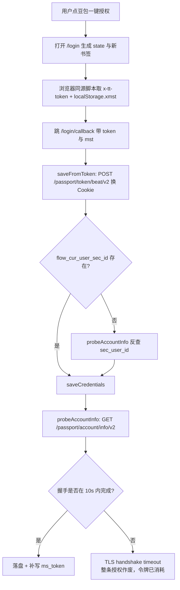
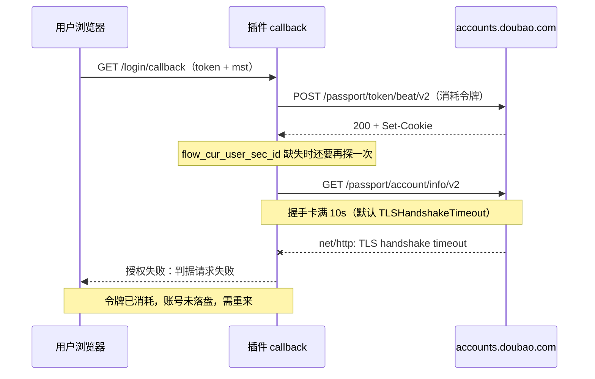

# doubao 授权回调 TLS 握手超时：三处 HTTP 入口共用默认 Transport 被 10s 硬上限判死

结论：**报错看起来像「网络不通」，实际是插件自己的传输层配置把 10 秒当成了生死线。** 判据端点 `accounts.doubao.com` 有 15 个 CDN 节点，日常握手在几十毫秒完成，但存在节点级偶发黑洞；插件三处 HTTP 入口都写 `&http.Client{Timeout: …}` 字面量（Transport 为空），全部落到 `http.DefaultTransport`，其 `TLSHandshakeTimeout` 固定 10s 且无法调整，判据请求又没有重试，于是单次握手卡满 10s 就把整条授权判死——而一次性 `x-tt-token` 在此期间已被消耗，用户只能重来。影响：书签授权链路（`/login/callback`）在抖动窗口内 100% 失败，且失败后账号文件一个字节都不落盘；范围：只改传输层与重试策略，不动请求内容、判据逻辑与落盘路径；非范围：不改签名链路、不改面板、不改上游业务分支；完成标准：判据 GET 在传输层失败时重试至多 3 次、令牌 POST 仅在请求未送出时重试、握手超时放宽到 20s，并有单测钉死这三条。

## 问题现象

- 用户侧触发路径：点面板「豆包一键授权」→ 跳到 `https://cpa.luode.vip/v0/resource/plugins/doubao-provider/login/callback`。
- 页面表现：标题「授权失败」，正文「接收失败」，下方红框给出原始错误：

  ```text
  判据请求失败：Get "https://accounts.doubao.com/passport/account/info/v2/?account_sdk_source=web&aid=497858&device_platform=web&doubao_from=inject_html&language=zh&pc_version=3.41.4&pkg_type=release_version&real_aid=497858&region=CN&sdk_version=2.2.10&sys_region=CN&use-olympus-account=1&version_code=20800": net/http: TLS handshake timeout
  ```

- 与「ms_token 未采集」的联系：两者都是同一条授权链路的产物，但这一轮**失败在更前面**——账号文件 `updated_at` 全部未变、`ms_token len=0`，说明令牌兑换后连账号都没写进去。

## 影响范围

- 受影响：书签授权与一次性脚本授权（都经 `handleLoginCallback` → `saveFromToken` → `saveCredentials` → `probeAccountInfo`）。
- 同样受益的旁路：面板「导入凭证」（`/import`）与手动粘贴 Cookie（`X-Doubao-Cookie`）也走 `saveCredentials`，同样吃本次修复。
- 不受影响：已落盘账号的对话链路（走 `newUpstreamClient`，本轮只换 Transport 不改行为）、签到、模型目录。
- 失败代价：`x-tt-token` 只能兑换一次，判据阶段失败即整条授权作废，用户必须重新点一次书签。

## 出现环境

- 插件：doubao-provider 0.1.17（生产热重载于 2026-11-15 12:56:08）。
- 生产：容器 `cli-proxy-api`（host 网络，端口 8317），凭据目录 `/usr/local/src/cli-proxy-api/auths/`。
- 复现时间：2026-11-15 13:10:45（发起）→ 13:11:04（回调耗时 10.128s 后失败）。

## 流程图



## 时序图



## 附录：证据

### 生产日志时间线

```text
[2026-11-15 13:10:45] 200 | 1ms     | GET "/v0/resource/plugins/doubao-provider/login?state=97ab8314-…"
[2026-11-15 13:10:54] 200 | 1ms     | GET "/v0/resource/plugins/doubao-provider/login/callback"      ← 接收页
[2026-11-15 13:11:04] 200 | 10.128s | GET "/v0/resource/plugins/doubao-provider/login/callback"      ← 判据耗尽
```

- `docker logs cli-proxy-api --since 20m | grep -i ms_token` → 空：没走到 ms_token 分支。
- 12 个账号文件 `ms_token len=0`，`updated_at` 最新仍是 `2026-11-15T12:16:27+08:00`。

### 排除链路故障的实测

| 检查项 | 位置 | 结果 |
| --- | --- | --- |
| 判据端点直连 6 次 | 宿主机 | 全 200，`tls` 0.085~1.19s，`remote_ip` 在 4 节点轮换 |
| DNS 解析 5 轮 | 宿主 / 容器 | 5~7ms |
| `openssl s_client` 握手 | 容器 | `TLSv1.3`，`real 0m0.098s` |
| 15 个 A 记录逐个 `tcp`+`tls` | 容器 | `BAD_COUNT=0/15`，最慢 `120.221.208.214 tcp=3.091s` |
| 同款默认 Transport 串行 40 次 | 容器 | `ok=40 err=0`，仅 `#10 3.108s` |
| 同款并发 10 路×4 轮 | 容器 | `ok=40 err=0` |

## 根因定位

三处 HTTP 入口的构造方式一致，都把 `Transport` 留空：

| 文件 | 函数 | 原写法 |
| --- | --- | --- |
| `doubao/credentials.go` | `probeAccountInfoAgainst` | `client := &http.Client{Timeout: timeout}` |
| `doubao/tokenbeat.go` | `doTokenBeat` | `client := &http.Client{Timeout: timeout}` |
| `doubao/completion.go` | `newUpstreamClient` | `return &http.Client{Jar: jar, Timeout: timeout}, jar` |

`http.Client.Transport` 为空时使用 `http.DefaultTransport`，其 `TLSHandshakeTimeout` 是硬编码的 10s。全仓 `grep 'DialContext|net\.Dialer|Resolver|TLSHandshakeTimeout|ForceAttemptHTTP2|DefaultTransport'` 在 `doubao/*.go` **零命中**——没有任何一处调整过传输层参数，也没有任何重试。

因此：单次 TLS 握手只要超过 10s 就返回 `net/http: TLS handshake timeout`，`probeAccountInfoAgainst` 直接 `return nil, fmt.Errorf("判据请求失败：%w", errDo)`，`saveCredentials` 与 `saveFromToken` 逐层上抛，`handleLoginCallback` 判为授权失败。生产观测到的 `10.128s` 就是这次判定本身耗时（10s 上限 + 收尾开销），不是网络往返。

## 修复

见 `doubao/transport.go`（新增）与三处调用点改造：共享 `*http.Transport`（独立实例、握手超时 20s、显式拨号超时）、`doIdempotent`（判据 GET 重试 3 次）、`doUnsentSafe`（令牌 POST 仅在请求未送出时重试）。回归防护见 `doubao/transport_test.go` 六个用例，哨兵把握手超时改回 10s 后 `TestSharedTransportHandshakeTimeoutWidened` 如实 FAIL。
