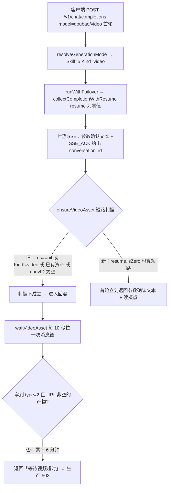
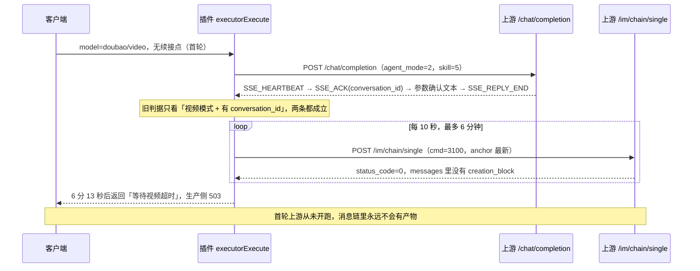

# doubao 视频首轮误入异步回灌：判据用「视频模式」代替「确认轮」导致白等 6 分钟

结论：**首轮视频请求同时满足「视频模式」与「已有 `conversation_id`」，而 `ensureVideoAsset` 的短路判据只看前者，于是首轮就进了产物轮询，把一次本该秒级返回的参数确认拖成 6 分 13 秒后超时 503。** 真正决定「这一轮会不会产生产物」的不是模型，而是**这一轮是不是确认轮**——首轮的 SSE 只是一段「请确认参数」的文本，上游根本没有开跑，消息链里永远不会有产物。影响：生产 `doubao/video` 的非流式首轮 100% 失败，且每次失败都要占满 `video_poll_timeout`（6 分钟）并消耗一次上游执行时长；范围：只改回灌入口的短路判据与其入参，不动两段式的请求构造、不动消息链解析、不动流式帧格式；非范围：不改首轮确认文本、不改 `chat_ability` 注入、不改轮询节奏本身；完成标准：续接点为零时 `ensureVideoAsset` 必须立刻返回，并有回归用例钉死「视频模式 + 有会话 id + 空续接点 ⇒ 不回灌」，且该用例在去掉判据后必须失败。

## 问题现象

- 触发路径：客户端 `POST /v1/chat/completions`，`model=doubao/video`，`stream=false`，单条 user 消息（首轮，不带续接点）。
- 第 1 次请求：`Invoke-RestMethod` 拿回耗时 **374.3 秒**，响应体里 `conversation_id` / `section_id` / `message_index` 全为空串，`media` 为 `null`，按 `choices[0]` 取值时报「不能为空数组建立索引」。
- 第 2 次请求：直接 **503 Service Unavailable**（上游执行已失败并进入退避）。
- 生产日志给出定性（`docker logs cli-proxy-api`）：

  ```text
  [token-usage-tracker] usage.handle: recorded provider=doubao-provider model=doubao/video alias=doubao/video source=Ld@588588 failed=true
  [2026-11-17 02:33:23] [warn] [conductor_execution.go:1968] upstream execution failed: provider=doubao-provider model=doubao/video auth=provider=doubao-provider auth_file=doubao-adcd31d29873b4c8.json duration=6m13.844s err=等待视频超时（6m0s）：上游仍未产出成品，稍后可用同一 conversation_id 重试
  ```

- 同批次对照：`doubao/image` 同一时刻 **11.5 秒**正常出图（`media[0].model="Seedream 5.0 Flash"`，1728×2304），说明账号、签名、Cookie、传输层都正常，问题只在视频这条分支。

## 影响范围

- 直接受影响：生产 `doubao/video` 的非流式首轮（`executorExecute` 路径）。每一次首轮都必然等满 `videoPollTimeout` 才失败。
- 同样受影响：流式首轮（`collectStreamResponse` 与 `pumpCompletionStream` 两处共用同一判据），表现一致。
- 不受影响：`doubao/image`（`mode.Kind == "image"` 命中第一条短路）；视频确认轮（有续接点，本就该回灌）。
- 失败代价：一次首轮占满 6 分钟上游执行时长（`duration=6m13.844s`），期间该账号的连接与额度上下文都被占着；连续重试会把上游执行队列拖到 503。

## 出现环境

- 插件：doubao-provider **0.1.26**（生产热重载于 2026-11-17 02:25:37，`retired_version=0.1.25`）。
- 生产：容器 `cli-proxy-api`（host 网络，端口 8317）；账号 `doubao-adcd31d29873b4c8`（欧皇小德子）。
- 复现时间：2026-11-17 02:27:09（发起）→ 02:33:23（失败）。
- 交付形态：非流式（`stream=false`）；同一缺陷在流式路径同样成立。

## 流程图



## 时序图



## 附录：证据

- 生产失败原文（见「问题现象」两条日志）。`duration=6m13.844s` 与 `videoPollTimeout(6m) + 一次收尾` 完全吻合，说明它确实在轮询而非在等模型。
- 真机对照（同一版插件、同一账号，2026-11-17 01:42 手工探针 `TestZZVideoE2E`）：三段式调用（首轮 → 确认轮 → 等产物）里首轮 **5.08 秒**返回、`assets=0`，确认轮 **7.87 秒**返回、`assets=0`，产物靠 `waitVideoAsset` 在 **2 分 13.8 秒**后出现。首轮本身从来不产生产物，这一点在真机上早已可见，只是当时没有把「首轮」这个条件写进判据。
- 流式真机对照（`TestZZStreamVideoE2E`，2026-11-17 01:52）：首轮 `assets=0`、确认轮 `chunks=3`、产物同样来自回灌。
- 上游行为证据：首轮 SSE 里没有任何 `block_type=2074` 的创作块；消息链在首轮之后拉取时 `messages` 里只有文本块。图片则相反——同一 SSE 内 `block_type=2074` 直接到齐。

## 根因定位

- 缺陷代码（0.1.26 的 `F:\cpa-plugin\doubao\video_chain.go`）：

  ```go
  func ensureVideoAsset(sa *StoredAuth, mode generationMode, res *completionResult) error {
      if res == nil || mode.Kind != "video" || len(res.Assets) > 0 || res.ConversationID == "" {
          return nil
      }
      // …进入 waitVideoAsset
  }
  ```

- 四条短路条件全部与「这一轮会不会产生产物」无关：
  1. `mode.Kind != "video"` —— 首轮也是 video，**不短路**；
  2. `len(res.Assets) > 0` —— 首轮没有资产，**不短路**；
  3. `res.ConversationID == ""` —— 首轮 `SSE_ACK` 就把 `conversation_id` 给了，**不短路**；
  4. `res == nil` —— 不成立。
- 缺失的条件是「这次请求有没有带续接点」。上游的两段式语义是：**首轮只确认参数，第二轮（带 `conversation_id` + `last_section_id` + `last_message_index`）才真正开跑**。插件内部其实已经有这个信号（`resumePoint`，TASK-009 引入并在三条执行路径上贯通），但回灌入口没有用它。
- 为什么测试没拦住：`TestEnsureVideoAssetSkipsNonVideoModes` 只验了「生图模式」「已有产物」「无会话 id」三条，**恰好没有一条覆盖「视频模式 + 有会话 id + 无续接点」这个首轮组合**。缺的不是断言强度，而是场景本身。

## 修复

### 1. 判据从「视频模式」改为「确认轮」

`F:\cpa-plugin\doubao\video_chain.go`：

```go
func ensureVideoAsset(sa *StoredAuth, mode generationMode, resume resumePoint, res *completionResult) error {
	if res == nil || mode.Kind != "video" || resume.isZero() || len(res.Assets) > 0 || res.ConversationID == "" {
		return nil
	}
	// …
}
```

函数头注释把事故写进去，避免后人再把条件改回去：

> 只有确认轮才可能产生产物：首轮的 SSE 只是一段「请确认参数」的文本，上游根本没有开跑，此时去轮询消息链只会白等满 `videoPollTimeout` 再报超时（2026-11-17 02:33 生产实测：首轮等满 6 分钟回 503）。所以判据是「这一次是不是确认轮」，而不是「是不是视频模式」—— 两者在首轮同时成立，只看模式必然误入。

### 2. 三处调用点同步传入续接点

- `F:\cpa-plugin\doubao\executor.go`：`ensureVideoAsset(sa, mode, chat.resumePointOf(), res)`，并补注释「续接点要一起传进去：首轮与视频模式同时成立，只有『这一次是确认轮』才该等产物」。
- `F:\cpa-plugin\doubao\executor_stream.go`：`collectStreamResponse` 与 `pumpCompletionStream` 两处改为 `ensureVideoAsset(sa, mode, resume, res)`（`resume` 已在函数入参里）。

### 3. 回归用例

`F:\cpa-plugin\doubao\video_chain_test.go` 新增夹具与用例：

- `videoConfirmResume() resumePoint` → `{ConversationID: "38454121040780034", SectionID: "38454121040780290", MessageIndex: 5}`。
- `TestEnsureVideoAssetSkipsFirstRound`：**视频模式 + 有 `conversation_id` + 空续接点 ⇒ 必须立刻返回且不得塞资产**。用例里的 httptest 永远回「还没有产物」，且把轮询节奏压到 `5ms / 20ms`，所以只要有人误入回灌就会在 20 毫秒内以「等待视频超时」失败，而不是挂满 6 分钟。
- `TestEnsureVideoAssetSkipsOtherModes`：合并原来的三条短路（生图 / 已有产物 / 无会话 id），改用 `videoConfirmResume()` 作为续接点。
- `TestEnsureVideoAssetAppendsFetchedAsset`：主路径改用 `videoConfirmResume()`。

### 4. 哨兵验证

把 `resume.isZero()` 从判据里删掉后重跑门禁：

```text
--- FAIL: TestEnsureVideoAssetSkipsFirstRound (0.02s)
    video_chain_test.go:387: 首轮不该回灌，却报了错：等待视频超时（20ms）：上游仍未产出成品，稍后可用同一 conversation_id 重试
FAIL	github.com/luode0320/cpa-workbuddy-plugin/doubao	3.870s
```

恢复后 `[cgo-shim] all green (doubao)`。哨兵之所以能秒级失败，正是第 3 条里把轮询节奏变量化的收益——这条经验在 0.1.26 的 TASK-012 就已经付出过一次代价（那次哨兵挂满 6 分钟被强制 kill）。

### 5. 版本与门禁

- `VERSION` → `0.1.27`（6 B，`hex=302e312e3237`，无尾换行）；`main.go:67` `version = "0.1.27"`。
- `cd F:\cpa-plugin; python scripts/cgo-shim-build.py doubao` → `all green (doubao)`。
- `gofmt -l`（转 LF 副本 `$env:TEMP\fmtchk0127`）→ `FMT_OK`。
- 编码体检 7 文件全部 `lone=0 / bom=False / ctrl=0`：`video_chain.go` 13901/330、`video_chain_test.go` 19876/470、`executor.go` 8513/221、`executor_stream.go` 5449/129、`main.go` 13263/406、`CHANGELOG.md` 73345/668、`VERSION` 6。
