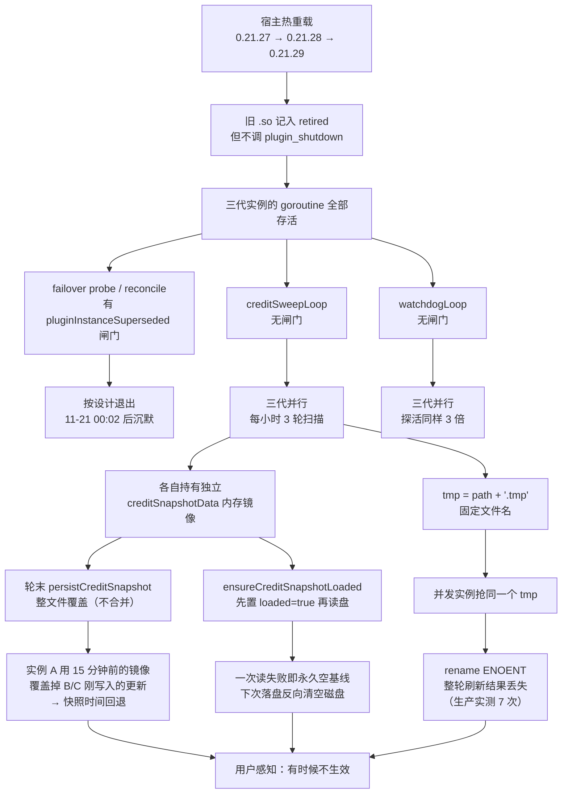

# workbuddy 积分定时持久化刷新偶发不生效：多实例并行覆盖写盘

- 时间：2026-11-22 17:26 诊断（同日 17:08 ~ 17:25 生产取证）
- 版本：workbuddy-provider 0.21.29（故障版本，VERSION 见 `workbuddy/VERSION`）
- 环境：生产 45.207.222.65（`cpa-server`），容器 `cli-proxy-api`（Up 6 days）
- 发现渠道：用户报告「WorkBuddy 的定时积分持久化刷新好像有时候不生效」
- 结论：**不是"有时候"，而是三份并行的每小时扫描互相覆盖对方的落盘结果**。根因是积分扫描循环没有实例守卫，配合「固定临时文件名 + 整文件覆盖」的写盘方式，形成 last-writer-wins 竞态；另有两条放大器（加载失败不重试、陈旧条目被 stale-while-error 永久保留）。

## 1. 现象拆解

用户感知是「有时候不生效」。生产实测把它拆成三种可区分的表现：

| 表现 | 真实成因 | 本次是否实证 |
| --- | --- | --- |
| 某些账号快照时间停在几小时前 | 被另一实例的旧内存镜像整文件覆盖回去 | 实证（见 2.4） |
| 某一小时的刷新整轮丢失 | 固定临时文件名被并发实例抢走，rename 报 ENOENT | 实证（见 2.5） |
| 个别账号长期不更新（天级） | 该账号上游 401，stale-while-error 保留旧条目 | 实证（见 2.6） |
| 面板「最近一轮统计」重启后为空 | `lastCreditsSweep` 仅内存态 | 代码事实（`credits_sweep.go:52`） |

## 2. 证据链（生产实测）

### 2.1 决定性证据一：进程内同时映射三代 .so

```text
# docker exec cli-proxy-api sh -c 'grep workbuddy /proc/1/maps' | cut -d' ' -f6 | sort -u
/CLIProxyAPI/plugins/linux/amd64/workbuddy-provider-v0.21.27.so (deleted)
/CLIProxyAPI/plugins/linux/amd64/workbuddy-provider-v0.21.28.so (deleted)
/CLIProxyAPI/plugins/linux/amd64/workbuddy-provider-v0.21.29.so
/CLIProxyAPI/plugins/linux/amd64/workbuddy-token-usage-v0.2.8.so
```

宿主热重载（`2026-11-20 01:17:52` → 0.21.28，`2026-11-20 02:02:12` → 0.21.29）只把旧 `.so` 记入 retired、**不调用 `plugin_shutdown`**，旧实例的 goroutine 全部继续运行。0.21.27 / 0.21.28 的代码段仍以 `(deleted)` 形式驻留内存，说明它们是活着的调用上下文，不是残留页面。

### 2.2 决定性证据二：每小时跑满三轮，不是一轮

```text
2026/11/22 16:06:18 [workbuddy] credits sweep done: total=43 refreshed=42 failed=1 disabled=12 preserved=20 in 27s
2026/11/22 16:21:08 [workbuddy] credits sweep done: total=43 refreshed=42 failed=1 disabled=12 preserved=20 in 26s
2026/11/22 16:43:56 [workbuddy] credits sweep done: total=43 refreshed=42 failed=1 disabled=13 preserved=19 in 25s
2026/11/22 17:06:17 [workbuddy] credits sweep done: total=43 refreshed=42 failed=1 disabled=15 preserved=17 in 25s
2026/11/22 17:21:09 [workbuddy] credits sweep done: total=43 refreshed=42 failed=1 disabled=15 preserved=17 in 27s
```

`creditsSweepInterval = time.Hour`（`workbuddy/credits_sweep.go:24`），单实例每小时只可能产出 1 轮。实测每小时固定出现 **3 个相位**：`HH:06` / `HH:21` / `HH:43`，三个相位互不相同且各自保持 1 小时周期 —— 这就是三个 `creditSweepLoop` 实例各自的 ticker 相位（首轮抖动 `schedulerJitterFn` 上限 5 分钟，热重载后错开）。全量日志累计 548 轮，即 3 实例 × 约 183 小时，与实际运行时长吻合。

同一时段 `active ping` 也是 3 倍：`16` 点 32 条、`17` 点 32 条，而单实例在 10 分钟 tick + 4 小时节流下每小时只该约 11 条。

### 2.3 决定性证据三：守卫只铺了 failover，没铺积分与探活

`grep -rn "pluginInstanceSuperseded" workbuddy/*.go` 只有三处真实调用：

| 调用点 | 循环 | 是否有守卫 |
| --- | --- | --- |
| `workbuddy/failover_disable.go:1012` | runFailoverProbeTick 逐账号 | 有 |
| `workbuddy/failover_disable.go:1231` | failoverReconcileLoop | 有 |
| `workbuddy/failover_disable.go:1259` | failoverProbeLoop | 有 |
| `workbuddy/credits_sweep.go:182` | **creditSweepLoop** | **无** |
| `workbuddy/watchdog.go:158` | **watchdogLoop** | **无** |

生产日志与之严格对齐 —— `superseded` 只出现在 failover 两类循环，且 `2026-11-21 00:02:12` 之后再无一条：

```text
2026/11/20 02:03:52 [workbuddy] failover reconcile loop stopped: superseded by newer instance
2026/11/20 02:07:52 [workbuddy] failover probe loop stopped: superseded by newer instance
2026/11/20 23:56:13 [workbuddy] failover reconcile loop stopped: superseded by newer instance
2026/11/21 00:02:12 [workbuddy] failover probe loop stopped: superseded by newer instance
```

即：旧代的 failover 循环按设计退出了，旧代的 **creditSweepLoop / watchdogLoop 全部活着**。缺守卫在这里反而让它们"幸存"，代价是三份定时扫描长期并行。

### 2.4 覆盖写盘的实证：updated_at 比内容新 15 分钟

抓取容器内 `/CLIProxyAPI/data/workbuddy-credits.json`（471,031 B）解析：

```text
version=1  updated_at=2026-11-22T09:21:09.772853583Z   (CST 17:21:09)
账号 43 条，fetched_at 分布：
  2026-11-22T09:05:52 ~ 09:06:17Z  42 条   (CST 17:05:52 ~ 17:06:17)
  2026-11-18T08:43:31Z              1 条   (CST 11-18 16:43，4 天未更新)
```

文件在 `17:21:09.785` 被重写，但 **42 条账号的 `fetched_at` 全部停在 17:06:17 那一轮**。`persistCreditSnapshot`（`credits_snapshot.go:277`）落的是调用方进程的内存镜像，只有一种解释能同时满足「刚写过盘」与「内容是 15 分钟前的」：**这次写盘的实例，其 `creditSnapshotData` 是 17:06 那一轮的内容**，即另一实例把整文件按自己的旧镜像覆盖了。

### 2.5 固定临时文件名导致的 rename 竞争（7 次落盘直接丢失）

`credits_snapshot.go:302`：

```go
tmp := path + ".tmp"          // 固定名，无 pid / 无随机后缀
if err := os.WriteFile(tmp, raw, 0o644); err != nil { ... }
return os.Rename(tmp, path)
```

三个实例并发时，`tmp` 是同一个路径：A 写完 tmp、B 又写 tmp（覆盖 A 的内容）、A rename 成功（拿到的是 B 的内容）、B rename 时 tmp 已不存在 → ENOENT。生产日志实证 7 次：

```text
2026/11/20 02:07:36 [workbuddy] credits snapshot persist failed: rename /CLIProxyAPI/data/workbuddy-credits.json.tmp /CLIProxyAPI/data/workbuddy-credits.json: no such file or directory
...（同一秒内 7 条，02:07:36 ~ 02:07:37）
```

这 7 次分属不同实例的一轮扫描 —— **那一轮的所有刷新结果全部丢失**，只剩内存，直到下一轮成功落盘才补上。

### 2.6 放大器：加载失败不重试 + stale-while-error 保留陈旧条目

`ensureCreditSnapshotLoaded`（`credits_snapshot.go:151`）第 3 步：

```go
creditSnapshotLoaded = true                 // 先置位
raw, err := os.ReadFile(creditSnapshotPath())
if err != nil || len(raw) == 0 { return }   // 读失败：loaded 已为 true，进程内永不重试
if err := json.Unmarshal(raw, &file); err != nil { return }
if file.Version != creditsSnapshotVersion { return }
```

一次读失败 / JSON 解析失败 / 版本不匹配之后，该实例会以**空镜像**作为写盘基线，下一次 `persistCreditSnapshot` 把磁盘替换成"只有它本轮扫到的条目"。这是反向清空，且不可自愈（进程内 `loaded` 恒 true）。

另一路：`runCreditSweep` 对单账号失败只 `report.Failed++` 并 `continue`（`credits_sweep.go:102`），保留上一轮快照。证据里的 `07f19801-ce5d-476b-b824-ecb370096f4d` 停在 `2026-11-18T08:43:31Z`，与每轮 `failed=1` 精确对应 —— 该账号上游返回 401，快照永远停在 4 天前，面板照旧展示这个时间。

### 2.7 关键时序：实例标记是孤儿，且 11-21 13:05 后没有再热重载

```text
/tmp/cpa-workbuddy-provider-instance  mtime 2026-11-21 13:05  内容 dn0mlpa0gx1h-1930
容器内当前时间 2026-11-22 17:08
ls /proc/1930 → No such file or directory
```

标记里的 pid `1930` 已不存在（与 `doc/4-bugs/2026-11-21_121100_traework孤儿实例标记压死全部常驻循环...md` 记录的同一次 `docker exec ... ./CLIProxyAPI --version` 事故是同一个进程）。由此可得两点：

1. `pluginInstanceSuperseded()` 自 11-21 13:05 起对所有实例恒为 true —— 但 `creditSweepLoop` / `watchdogLoop` 根本不调用它，所以不受影响，继续每小时跑；
2. 11-21 13:05 之后没有新实例 claim（标记未被改写），说明当前并行的三代实例是 11-20 两次热重载的产物，已并行运行约 40 小时。

## 3. 根因

### 3.1 根因链



### 3.2 四条缺陷定性

| 编号 | 缺陷 | 位置 | 严重度 |
| --- | --- | --- | --- |
| D1 | 积分扫描循环与探活循环没有实例守卫，热重载后旧实例继续跑 | `workbuddy/credits_sweep.go:182`、`workbuddy/watchdog.go:158` | P0（根因） |
| D2 | 实例守卫本身缺「持有者存活」判据，孤儿标记会让守卫恒真（当前被 D1 掩盖：没铺守卫反而没停摆，但一旦补守卫就会立刻复现 traework 11-21 事故） | `workbuddy/instance_guard.go:50` | P0（补 D1 前必须先修） |
| D3 | 落盘用固定临时文件名 + 整文件覆盖，多实例 last-writer-wins | `workbuddy/credits_snapshot.go:302`、`:282-290` | P0（覆盖丢失来源） |
| D4 | `ensureCreditSnapshotLoaded` 先置 loaded 后读盘，失败永不重试 | `workbuddy/credits_snapshot.go:166` | P1（放大器） |

### 3.3 非缺陷但需澄清的两点

- `failed=1` 的账号（`07f19801`）不是刷新不生效，是上游 401；`stale-while-error` 是刻意设计（`credits_sweep.go:71-73` 注释），不应改成"失败写 0"（0 分会触发硬禁用）。
- `GET /credits` 无 `auth_index` 的全量分支（`credits_handler.go:533-548`）只返回数据、**不写快照**，与单卡分支（`:509-518`）不一致。这是独立小缺陷，不是定时刷新失效的原因，但会让"手动刷一轮全量"不留下任何痕迹。

## 4. 修复方案

### 4.1 修 D2：实例守卫补孤儿标记接管（先做，其他修复依赖它）

照搬 traework 0.5.58 已验证的实现（`traework/instance_guard.go:37-108`、`traework/instance_pid_unix.go`、`traework/instance_pid_windows.go`）：

1. 新增 `workbuddy/instance_pid_unix.go`（`//go:build !windows`）：`syscall.Kill(pid, 0)`，`EPERM` 也算存活；
2. 新增 `workbuddy/instance_pid_windows.go`（`//go:build windows`）：`os.FindProcess` + `Release`；
3. `workbuddy/instance_guard.go` 增 `orphanOwnerMarker(owner string) bool`：空串判孤儿；解析不出 pid 或 `pid == os.Getpid()` **一律不判孤儿**（`workbuddy/instance_guard_test.go:35` 写入的是纯文本 `"newer-instance"`，把它判成孤儿会直接打挂该用例，与 traework 3.3 节踩坑同形）；
4. `pluginInstanceSuperseded()` 在 `owner != instanceGuardID` 之后先判孤儿，为真则改写标记、打日志 `[workbuddy] taking over orphan instance marker (previous %s no longer alive)`，并 `return false` 放行；
5. 同时新增 `retireIfSuperseded(loop string) bool` 作为统一闸门，日志格式与 failover 现有三条保持一致。

### 4.2 修 D1：给积分扫描与探活补闸门

- `creditSweepLoop`（`credits_sweep.go:191`）：`for range ticker.C` 内首行 `if retireIfSuperseded("credits sweep loop") { return }`；
- `watchdogLoop`（`watchdog.go:181`）：`for` 内 `flushCounters()` 之前同样加闸门，循环名 `"watchdog loop"`；
- 首轮（进入 ticker 之前）也各判一次，避免旧实例在新实例已登记的情况下还要多跑一轮。

### 4.3 修 D3：落盘唯一化 + 合并写

1. `tmp` 改为 `fmt.Sprintf("%s.%d.%d.tmp", path, os.Getpid(), time.Now().UnixNano())`，避免跨实例抢同一临时文件；
2. `persistCreditSnapshot` 在复制内存前先重读磁盘并做一次 **键级合并**（磁盘有、内存无的条目保留），把"整文件覆盖"降级为"合并覆盖"。这是多实例并存期间的兜底，实例守卫修好后价值下降但仍是正确性提升；
3. `os.Rename` 失败时补一次重试（`ErrNotExist` 场景），并在日志里带上实例标识，便于排障区分是哪一代写的。

### 4.4 修 D4：加载失败可重试

`ensureCreditSnapshotLoaded` 改为「读盘成功且版本匹配后才置 `creditSnapshotLoaded = true`」；失败路径记录 `creditSnapshotLoadErr` 并允许下次调用重试（可加最小重试间隔避免每次读盘）。`persistCreditSnapshot` 在写盘前若 `creditSnapshotLoadErr != nil` 应先重试一次，仍失败则**放弃本次落盘并打日志**，绝不拿空镜像覆盖磁盘。

### 4.5 附带修：全量 `/credits` 分支补写快照

`credits_handler.go:533-548` 循环内补 `recordCreditSnapshot` + 循环后 `persistCreditSnapshot`，与单卡分支同口径。

## 5. 版本与测试

- 版本：`workbuddy/VERSION` 0.21.29 → **0.21.30**
- 本地验证入口（Windows 无 CGO）：`python scripts/cgo-shim-build.py workbuddy`（build + vet + test 全绿才算过）

必须新增的用例：

| 用例 | 断言 |
| --- | --- |
| `TestPluginInstanceSupersededTakesOverOrphanMarker` | 写入死 pid 标记 → 返回 false 且标记被接管 |
| `TestOrphanOwnerMarkerKeepsUnknownMarkersAuthoritative` | `newer-instance` / 无 pid 后缀 / 自身 pid 都不得判孤儿 |
| `TestCreditSweepLoopRetiresWhenSuperseded` | 标记被活 pid 覆盖后循环退出并打 stopped 日志 |
| `TestPersistCreditSnapshotUniqueTempName` | 两次并发 persist 不产生同一个 tmp 名 |
| `TestEnsureCreditSnapshotLoadedRetriesAfterFailure` | 首次读失败后修复文件，第二次调用能读到 |
| `TestPersistCreditSnapshotMergesDiskEntries` | 磁盘有 A/B、内存只有 A，落盘后 B 仍在 |

注意既有约束：`TestRunCreditSweepSerialAndPersists`（`credits_sweep_test.go:200`）与 `TestRunCreditSweepPersistsOnceForMultipleAccounts`（`:208`）把「轮末只落盘一次」钉死。4.3 不改变落盘次数，这两条应继续通过；4.4 的「写盘前重试」也不增加 `creditsSweepPersistFn` 调用次数。

## 6. 生产验收标准

1. `docker logs cli-proxy-api | grep 'credits sweep done'` 每小时**恰好 1 轮**（当前是 3 轮）；
2. `grep 'credits sweep loop stopped: superseded' | wc -l` 在热重载后出现 2 条（旧代 0.21.28 / 0.21.27 各一条）；
3. `grep 'taking over orphan instance marker'` 出现 1 条（当前孤儿标记 `dn0mlpa0gx1h-1930`）；
4. `grep -c 'credits snapshot persist failed'` 在观测窗口内为 0；
5. 快照文件 `updated_at` 与全部账号 `fetched_at` 落在同一轮内（差值 < 1 分钟），不再出现 15 分钟级错位；
6. `/proc/1/maps` 在下次热重载后仍会出现多代 `.so`（宿主行为不变），但只有最新一代有 `credits sweep` 日志。

## 7. 影响面

- 受影响：积分快照的落盘正确性 —— 部分账号刷新结果被覆盖、个别轮次整轮丢失；
- 未受影响：推理转发（与积分扫描无耦合）、账号禁用/解禁判定（`gradeCreditsForAuth` 用本轮拉到的 `cr`，不读快照）、面板渲染逻辑本身；
- 潜在风险：多实例叠加使上游 billing 接口承受 3 倍请求（每小时 3 × 43 次），长期有被上游限流的风险。

## 8. 教训

1. **守卫要么铺满，要么不铺**。`workbuddy` 只给 failover 铺了闸门，结果旧代的积分扫描与探活靠"没有闸门"活了下来 —— 定时任务数量随热重载次数线性放大，而这类问题不会报错，只会让数据看起来"有时候不准"。
2. **写盘必须假设"有第二个写者"**。固定 `path + ".tmp"` 在单实例下完全正确，一旦有第二个进程就退化成竞争；临时文件名必须带 pid 或随机后缀。
3. **"先置标志再做事"在加载路径上是反模式**。标志位是"已完成"的承诺，不是"开始做"的标记；置位后失败等于把一次可重试的 IO 错误升级成进程级永久错误。
4. **覆盖式落盘要配合并兜底**。整文件覆盖天然假设"我的内存是完整真相"，多写者场景下这个假设不成立。
5. **同一套守卫在多插件之间不同步，会制造"看起来更安全、实际更脆弱"的假象**。traework 铺满十处，workbuddy 只铺两处，本次事故正是这个差集。

## 9. 实施结果（0.21.30，2026-11-22 18:20）

按用户裁定「选项 A」实施 4.1~4.4 全部四项，4.5 不纳入本轮（理由见 9.3）。

### 9.1 四项缺陷落地对照

| 缺陷 | 方案 | 落地实现 | 新增用例 |
| --- | --- | --- | --- |
| D2 | 4.1 孤儿标记接管 | `instance_guard.go` 新增 `orphanOwnerMarker()`（标记尾部 pid + `processAlive`）、`claimPluginInstance` 登记前接管、`pluginInstanceSuperseded` 遇孤儿标记就地改写；新增 `instance_pid_unix.go` / `instance_pid_windows.go` | `TestOrphanOwnerMarkerKeepsUnknownMarkersAuthoritative` / `TestPluginInstanceSupersededTakesOverOrphanMarker` / `TestOrphanOwnerMarkerNotClaimedByLiveOwner` |
| D1 | 4.2 补闸门 | 新增统一闸门 `retireIfSuperseded(loop)`；`credits_sweep.go` 抽出 `creditSweepTickOnce()` 并让首轮与每轮 ticker 都过闸门；`watchdog.go` 首轮前与每轮 `flushCounters()` 前各过一次 | `TestCreditSweepTickOnceRetiresWhenSuperseded` / `TestCreditSweepTickOnceRunsWhenOwner` |
| D3 | 4.3 落盘唯一化 + 合并写 | `persistCreditSnapshot` 临时名改 `fmt.Sprintf("%s.%d.%d.tmp", path, os.Getpid(), time.Now().UnixNano())`；写前 `os.ReadFile` 做键级合并（磁盘条目一律保留、内存优先）；rename 失败清临时文件并仅在 `errors.Is(err, os.ErrNotExist)` 时重试一次 | `TestPersistCreditSnapshotUniqueTempName` / `TestPersistCreditSnapshotMergesDiskEntries` |
| D4 | 4.4 加载失败可重试 | `ensureCreditSnapshotLoaded` 读完拿到确定结论才置位；真实 IO 错误记 `creditSnapshotLoadErr` 且不置位；`persistCreditSnapshot` 见未消解载入错误先重试一次、仍失败则放弃落盘并返回错误 | `TestEnsureCreditSnapshotLoadedRetriesAfterFailure` |

### 9.2 方案与实现的偏差（记录，均为收紧而非放宽）

1. **多了一条「载入不倒灌」**：`ensureCreditSnapshotLoaded` 装载时同键已存在则跳过。原方案只说「读成功才置位」，实现时发现无条件赋值会把磁盘旧值盖在本轮刚拉到的积分上——`TestPersistCreditSnapshotMergesDiskEntries` 首轮因此失败（got `{Remain:100}`，期望 111），补上「内存优先」后才过。
2. **rename 重试限定 `ErrNotExist`**：原方案写「rename 失败重试一次」，实现收紧为只在目标目录被并发替换的场景重试，其它错误（权限、只读挂载）直接上抛，避免把不可恢复错误伪装成偶发。
3. **落盘前拒写而非静默降级**：原方案 4.4 的措辞是「放弃本次落盘并打日志」，实现改为 `return fmt.Errorf("load existing snapshot: %w", err)`，由调用方现有的 `log.Printf("... credits snapshot persist failed: %v")` 统一记录，不新增第二条日志路径。

### 9.3 4.5 未纳入本轮

4.5（全量 `/credits` 分支补写快照）定位在 `credits_handler.go` 的 all-accounts 分支（`:532-548`），与本轮四个缺陷的根因链无依赖关系：它的问题是「全量读取不落快照」，即使不修也不会造成多实例覆盖。选项 A 的原始定义是「实施 4.1~4.4 全部四项」，故本轮不扩面。后续若要修，落点是 `:539` 的 `fetchUserResource` 之后补 `recordCreditSnapshot`，循环结束后补一次 `persistCreditSnapshot`——注意这会让面板每次全量读取都写一次盘，需要先确认是否要加节流。

### 9.4 验证

- `python scripts/cgo-shim-build.py workbuddy` → build / vet / test 全绿（`ok ... 34.553s`）。
- 三条哨兵（闸门恒假、合并段失效、载入失败仍置位）各自打挂对应用例，从快照恢复后复跑全绿。
- 既有约束未破：`TestRunCreditSweepSerialAndPersists` / `TestRunCreditSweepPersistsOnceForMultipleAccounts` 的「轮末只落盘一次」仍通过（本轮未改变 `creditsSweepPersistFn` 调用次数）。
- 6-review：`doc/6-review/2026-11-22_181500_workbuddy积分定时刷新多实例覆盖修复_6-review.md`，判定 `STYLE: PASS`。

### 9.5 生产验收（待发布后执行）

第 6 节的 6 条验收标准在 0.21.30 热重载后逐条核对，其中第 2 条（旧代 stopped 日志出现 2 条）依赖「热重载时旧实例仍在跑」这个前提——若容器期间重启过，旧实例已随进程消失，该条按「不适用」记录，改由第 1 条（每小时恰好 1 轮）承担主要判据。
