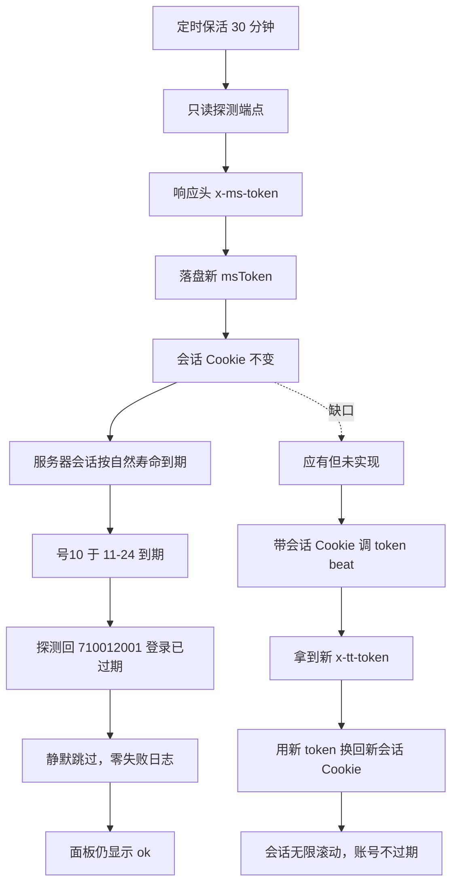
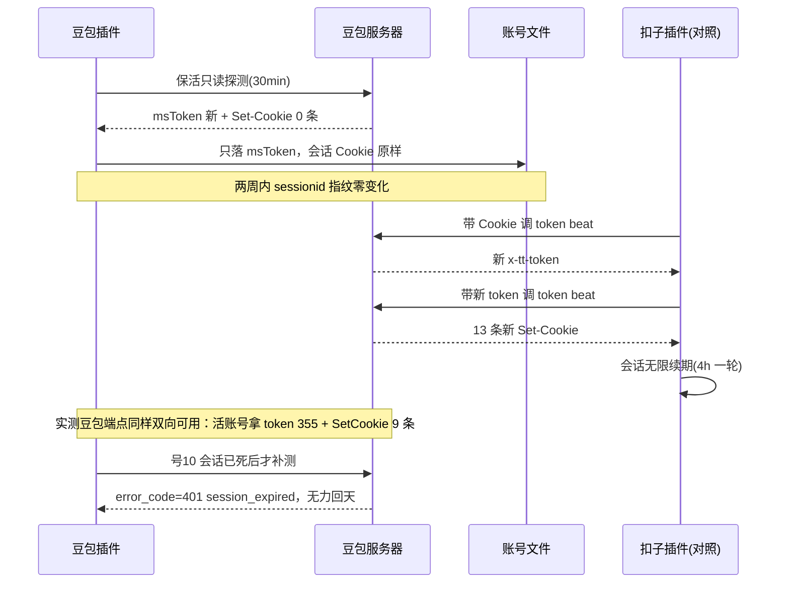

# Bug：豆包账号会话 Cookie 从不续期，导致账号陆续过期（号10 首发）

结论：号10 会话过期不是外部偶然，而是豆包插件的自动续期只换了临时通行码 msToken，从未续期真正决定登录生死的会话 Cookie；四个账号的会话 Cookie 从导入起一个字节都没变过，号10 只是最先到期的，其余账号会陆续重蹈覆辙。这是明确的插件设计缺陷，不是号10 的个案故障。影响：全部豆包账号都在倒计时，会话一到期就必须用户手工重新授权；号10 已于 11-24 到期，其余三个目前仍活但随时可能步其后尘。范围：确认停续机制、缺陷性质、根因，以及可行的修复路线。非范围：本次不改生产数据与插件代码，只输出定位结论和修复方案。变化：用户原以为加了自动续期账号就不会过期，实际自动续期漏掉了最关键的会话 Cookie，等于没防住账号死亡。完成标准：根因有代码、日志和生产实测三重证据，缺陷性质明确，修复路线经验证可行。术语说明：msToken 是接口签名用的临时通行码；会话 Cookie 是服务器认人的登录凭证，它过期账号就死了；令牌换发是豆包提供的一个接口，拿当前会话 Cookie 就能换一批新的会话 Cookie，从而无限续命。验证状态：已日志定位、代码对照（同网关的扣子插件实现正确）、生产实测三重启发闭环，结论可复现。

## 问题现象

- 生产四个豆包账号中，三个账号的 msToken 在 2026-11-26 23:33 正常换新，「号10」账号的 msToken 停在 2026-11-24 20:43，之后两天没有任何续期记录。
- 号10 账号文件本身没有损坏，msToken 仍是合法长度；账号池查询里它仍然显示为可用状态。

## 影响范围

- 只影响号10 一个账号，其余三个账号续期链路正常。
- 号10 实际已经不能正常调用豆包，继续请求会拿到登录失效的报错。

## 出现环境

- 线上生产，CLIProxyAPI 容器，豆包插件版本 0.1.39。
- 账号为 Cookie 授权导入模式，号10 的凭据导入时间早于其余账号。

## 触发条件

- 根因触发：只要账号启用，插件就只续 msToken、不续会话 Cookie，会话 Cookie 保持导入时的原值不动。
- 结果触发：豆包服务器端的会话走到自然有效期或被回收时，账号即告失效，此时任何 msToken 续期都已无济于事。

## 期望结果

- 插件应定期用当前会话 Cookie 去换一批新的会话 Cookie，让登录态像扣子插件那样无限滚动，账号不因时间推移而自然过期。
- 若某个账号会话确实失效且在可用凭据下换不回来，面板应显示「需重新授权」，而不是继续显示正常。

## 实际结果

- 自动续期只换了 msToken：四个账号的会话主 Cookie（sessionid / sid_guard / sid_tt）值指纹从导入起从未变化，cookie_header 与 cookies 快照完全一致。
- `tokenbeat.go` 明确写着「本插件只用第二个方向——首次授权换 Cookie。续期仍走既有 Cookie 滚动，不在此处引入双向循环」；但生产实测保活端点零 Set-Cookie，所谓「既有 Cookie 滚动」对会话 Cookie 从未真正发生。
- 号10 的会话在 11-24 到期后，保活探测拿到「登录已过期」，插件静默跳过、零失败日志；面板因只看本地 Cookie 快照（且会话 Cookie 的 Expires 全是零值）永远显示 ok。
- 对照：同一 passport 网关的扣子插件实现了完整的「Cookie → 新 token → 新 Cookie」双向续期（默认 4 小时一轮 + 失败退避 + 浏览器降级），会话可无限滚动。

## 当前证据

- 生产日志：号10 最后一次 msToken 换新在 2026-11-24 20:43，其余三个账号持续到 2026-11-27 00:31；号10 停续期间没有任何保活失败日志。
- 生产实测（保活端点 `/samantha/user/preference/get`）：号10 返回业务码 710012001「登录已过期」；正常账号返回业务码 0；两者响应头都带合法新 msToken，但 Set-Cookie 数均为 0。
- 生产实测（判据端点 `/passport/account/info/v2/`）：号10 返回「会话过期」且用户标识为空，正常账号返回有效数据。
- 生产实测（token beat 正向 `/passport/token/beat/v2/`，用当前会话 Cookie 调用）：活账号欧皇小德子返回 `message=success`、`x-tt-token` 长度 355、Set-Cookie 9 条；用户358840 返回 success + token 355；号10 返回 `error_code=401 session_expired`。证明「会话 Cookie → 新会话 Cookie」的双向续期在豆包端点上成立且可行。
- 代码证据：`doubao/tokenbeat.go` 只实现 token→Cookie 单向；`doubao/keepalive.go` 的 `refreshMsTokenByProbe` 只落 msToken；会话 Cookie 的 Expires 全为零值导致 `hasLiveSession()` 恒真、面板永远显示 ok。
- 对照证据：`coze/credentials.go` 的 `renewSession` + `coze/renew_loop.go`（默认 4 小时、退避、浏览器降级）实现了同网关的完整双向续期。

## 当前缺失项

- 号10 会话在 11-24 的确切到期时刻未保留当时日志；不影响缺陷定性（即使知道时刻，缺少会话续期机制仍会让其余账号陆续到期）。

## 图示产物（必填，直接写入本文档正文）

### 自动续期的实际覆盖范围（缺陷根因）

### 缺陷定位与修复验证时序

## 执行附录

- 生产主机：45.207.222.65，管理 API 端口 8317，容器 cli-proxy-api。
- 账号目录：`/usr/local/src/cli-proxy-api/auths/`。
- 号10 账号文件：`doubao-20fcbcfb49f40321.json`，updated_at 停在 `2026-11-24T20:43:07+08:00`，ms_token 长度 104。
- 对照账号：欧皇小德子 `doubao-adcd31d29873b4c8.json`，updated_at `2026-11-26T23:33:35+08:00`，ms_token 长度 104。
- 保活探测端点：`POST https://www.doubao.com/samantha/user/preference/get`，请求体 `{}`，带账号 Cookie 与网页端参数集。
- 号10 探测响应：`{"code":710012001,"msg":"登录已过期，请重新登录","message":"login invalid","error":{"code":710012001,"message":"登录已过期，请重新登录","locale":"zh"}}`，响应头 x-ms-token 长度 104 且与旧值不同。
- 对照账号探测响应：`{"code":0,"msg":"","data":{...}}`。
- 账号信息判据端点：`GET https://accounts.doubao.com/passport/account/info/v2/`，号10 返回 `{"data":{"description":"会话过期，请重新登录","error_code":13,"name":"account_info_error",...},"message":"error"}`。
- 相关代码：保活探测 `doubao/keepalive.go` 的 `refreshMsTokenByProbe`（只落 msToken）；`doubao/tokenbeat.go:32`（明确只用单向、不做会话续期）；面板状态 `doubao/management.go` 的 `authStateOf`（只看本地 Cookie 快照且会话 Cookie Expires 全为零值）。
- 对照代码：`coze/credentials.go` 的 `renewSession`（Cookie→token→Cookie 双向换发）、`coze/renew_loop.go`（默认 4 小时 + 退避 + 浏览器降级）。
- 日志打点：`[doubao] ms_token kept alive for <账号ID> (len=104)`；保活失败/跳过打点在号10 停续期间为 0 条。
- 会话 Cookie 指纹（MD5 前 10 位）：号10、用户358840、欧皇小德子、用户825285 四账号的 cookies 快照与 cookie_header 中 sessionid/sid_guard 指纹完全一致，证明从未滚动。

## 追踪附录

- 问题来源：用户 2026-11-26 检查豆包生产账号续期情况；2026-11-27 明确纠正初判「不是 bug」——既然加了自动续期，账号仍过期就说明续期有缺陷，且会导致全部账号陆续过期。
- 稳定标识：号10 auth_id `doubao-20fcbcfb49f40321`。
- 证据定位：容器 json.log（直读，绕开 docker logs --since 的 stale 缓冲）；生产账号文件 updated_at 与会话 Cookie 指纹；三个端点（保活 / 账号信息 / token beat）生产实测响应；coze 插件同网关对照代码。
- 是否缺陷的裁定：**是设计缺陷**。自动续期只覆盖 msToken、未覆盖会话 Cookie，而保活端点零 Set-Cookie，导致会话 Cookie 从导入起从不滚动，所有账号按各自会话寿命陆续到期。号10 只是首发，不是个案。
- 修复路线（已验证可行，待用户确认实施）：移植 coze 的双向续期到 doubao —— ① `doTokenBeat` 增加「带 Cookie 调、读响应头 x-tt-token」方向（`coze/credentials.go:119` 同款）；② 新增 `renewSession`：带 Cookie 换新 token → 带新 token 换回新会话 Cookie，用 `rotatedSessionCookies` 口径校验确实换到会话主项才落盘；③ 接入定时任务（复用 keepalive 循环或独立 4 小时轮）+ 失败退避，避免频繁打 token beat；④ 会话真失效（401 session_expired）时面板标记「需重新授权」并告警；⑤ 号10 已过期救不回，需用户重新授权一次，之后新机制才能保住它。
- 问题变更记录：2026-11-27 初判「非 bug / 可观测性缺口」；同日经用户纠正并补充 token beat 双向契约实测后，改判为「设计缺陷 + 明确修复路线」，本文件已同步更正。未修改生产数据与代码。

## 修复建议

结论：把扣子插件那套已验证的「会话双向续期」移植到豆包插件，让账号的登录会话像扣子一样定时自动换新，从源头堵住账号自然过期；用户已明确要求修复，可直接进入编码。影响：全部豆包账号不再因时间推移陆续失效；号10 已经过期救不回，需用户重新授权一次后才能纳入新机制保护。范围：令牌端点双向换发、会话换发判据、Cookie 叠加合并写回、定时任务与失败退避、会话真失效时的面板标记与告警。非范围：不实现浏览器自动登录（会话彻底失效后仍需用户重新授权一次）；不改号10 现有凭据内容；不碰其它插件。变化：修复后账号会话每轮自动滚动，用户不再需要周期性手动重新授权；账号真正失效时面板会明确提示「需重新授权」。完成标准：本地单测全绿且哨兵反证有效；生产热重载后日志出现会话续期成功打点、会话 Cookie 指纹随轮次变化；号10 重新授权后能被新机制保住。术语说明：双向换发是用当前会话 Cookie 换一个一次性令牌、再用令牌换回一批新会话 Cookie；换发判据是确认会话主 Cookie 的值真的变了，而不是只看上游下发了多少 Cookie。验证状态：根因已三重证据闭环，豆包端点双向契约已生产实测成立（活账号拿令牌 355 + 9 条 Set-Cookie），扣子同网关实现已逐函数读完，方案可行。

### 先说结论

- 推荐怎么处理：移植扣子 `renewSession` 全套到豆包，复用豆包已有的 `durableJar` 承载 Cookie 叠加写回，不整份照搬扣子的 `cookieStore`。
- 是否可以进入修复：可以。用户已明确要求「修复」，根因稳定，方案无二义，且不涉及对外契约变更。

### 为什么要处理

- 问题影响：不修则全部账号按各自会话寿命陆续过期，最终整池失效，只能靠人工反复重新授权维持。
- 不处理会怎样：号10 已是首发，其余三个账号只是时间问题；越晚修，需要用户重新授权的账号越多。

### 本次范围

- 要修复什么：会话 Cookie 从不滚动这一根因，在主链路补齐「Cookie→token→Cookie」换发 + 写回 + 定时驱动。
- 本次不修复什么：不实现无凭据自动登录；不抢救已过期的号10；不改面板视觉样式（仅补状态语义）。

### 怎样算完成

- 用户可观察到的结果：账号长期不再自然过期；失效账号在面板显示「需重新授权」而非「ok」。
- 关键风险是否消除：会话 Cookie 从导入后零变化的根因被消除，且写回有防覆盖闸门，不会因热重载旧实例覆盖新凭据。

### 审查和验收是否适用

- 结论：受限适用。
- 原因：本仓库规则要求真实测试后做 `6-review` 风格回归，生产生效需热重载取证；号10 的真实续期需用户先重新授权才能端到端验证。
- 依据：`code-change-finalization-gate-rules`、`6-review`、生产热重载验收铁律（见 PROJECT_MEMORY）。
- 受限时的替代验证和通过标准：先用活账号（欧皇小德子等三个）在生产验证会话 Cookie 指纹随续期轮次变化；号10 待用户重新授权后补验。

### 执行附录

- 主修复方案：新增 `doubao/renew.go` 实现双向换发（改造 `doTokenBeat` 支持带 Cookie 换 token）、`rotatedSessionCookies`（会话主项值变化判据）、`mergeSessionCookies`（基于 durableJar 叠加合并）、`applyRenewal`（活跃实例 + 外部替换双闸门后写回）；新增 `doubao/renew_loop.go` 定时轮（默认 4 小时 + 启动即跑一轮 + 失败退避）；在 `main.go` 接入定时器、`Config` 增加 `renew_interval_seconds`；在 `management.go`/`authStateOf` 增加会话失效标记与面板状态。
- 备选方案和不采用原因：仅把 keepalive 间隔调小——不采用，保活端点零 Set-Cookie，调再快也不换会话；用浏览器定期重登——不采用，成本高且需内嵌浏览器，与既有认证路线冲突。
- 影响模块、接口、页面或数据：`doubao/tokenbeat.go`、`doubao/cookiejar.go`、`doubao/authfile.go`、`doubao/main.go`、`doubao/management.go`、`doubao/keepalive.go`，新增 `renew.go` / `renew_loop.go` 及对应测试。
- 验证环境、样本、命令和清理方式：本地 `python scripts/cgo-shim-build.py doubao`（build+vet+test 全绿 + 哨兵反证）；生产用活账号会话指纹前后对比；临时脚本用完即删。
- 回滚和停止条件：本地门禁 FAIL 不进入发布；生产热重载后无续期打点或会话指纹不变则回滚版本并停轮；号10 未重新授权前不对其做续期写盘。

### 追踪附录

- 风险分级：高——涉及账号凭据写盘、共享 Cookie 逻辑、热重载后旧实例覆盖风险（对应 `regression-risk` 路由）。
- 高风险验证重点：换发判据必须锚定会话主项值变化（死会话会下发 9 条埋点 Cookie 但无会话主项）；Cookie 必须叠加合并不能整份替换；写回必须过活跃实例 + 外部替换双闸门；定时器必须有实例守卫，避免热重载多实例叠加。
- 文件位置：`coze/credentials.go:119/265/283/345/439`、`coze/cpa_active_guard.go:118`、`coze/renew_loop.go`；`doubao/tokenbeat.go:119`、`doubao/cookiejar.go:198/400`、`doubao/main.go:464`。
- 确认结论：用户已明确「修复」，进入编码实施；号10 重新授权为唯一需用户配合动作，在收尾交接时说明。
