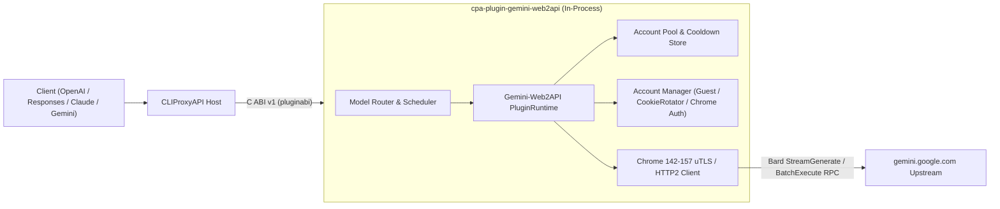

# cpa-plugin-gemini-web2api (Gemini-Web2API for CLIProxyAPI)

<p align="center">
  <strong>简体中文</strong> | <a href="./README_EN.md">English</a>
</p>

<p align="center">
  <a href="https://github.com/Mag1cFall/Gemini-Web2API"></a>
  <a href="https://github.com/router-for-me/CLIProxyAPI"></a>
  <a href="./LICENSE"></a>
</p>

> **项目说明与致谢（Upstream Attribution）**  
> 本项目是将 **[Mag1cFall/Gemini-Web2API](https://github.com/Mag1cFall/Gemini-Web2API)** 完整移植为 **[CLIProxyAPI](https://github.com/router-for-me/CLIProxyAPI)** 原生动态库插件（Native C ABI v1 / Schema v10）的开源项目。  
> 核心协议栈（`gemini.google.com` Bard/StreamGenerate 批量 RPC、Chrome 142–157 TLS/HTTP2 指纹伪装、Cookie 自动轮换保活、免登录访客会话池、多账号轮询/填充负载均衡与多协议转换）均源自 **[Mag1cFall/Gemini-Web2API](https://github.com/Mag1cFall/Gemini-Web2API)**，遵循 [MIT License](./LICENSE)。

---

## 核心特性

- **纯 Go 原生编译 · 零外部运行时依赖**：基于 `Mag1cFall/fhttp` 与 `bogdanfinn/tls-client` 按真实市场份额分配并模拟 Chrome 142–157 TLS/HTTP2 指纹（含 `x-sec-ch-ua-not-a-border`、`Sec-CH-UA` 与平台指纹），直接编译为原生共享库（`.dylib` / `.so` / `.dll`），无需 Python、Node.js、Playwright 或无头浏览器。
- **全功能 Google Gemini Web 模型与能力接入**：
  - **核心对话与推理模型**：支持 `gemini-default`、`gemini-3.8-flash`、`gemini-3.5-flash-lite`、`gemini-4-carbon`、`gemini-4-argon`（含自动跟踪官网模型改名、`google/` 与 `models/` 前缀兼容及自定义模型映射），支持思维链（Thinking Levels）控制。
  - **专属功能变体与多模态**：支持 `gemini-3.1-flash-image`（绘图生成/编辑）、`gemini-video`（Veo 视频生成）、`gemini-music`（Lyria 音乐）、`gemini-canvas`、`gemini-deep-research`（深度研究）、`gemini-guided-learning` 以及语音 TTS/STT（`/v1/audio/*`）。
  - **扩展协议与上下文能力**：支持 Interactions API（`/v1/interactions`、`/v1beta/interactions`）、Gemini Context Caching（`/v1/cachedContents`、`/v1beta/cachedContents`）、OpenAI Responses API 与 MCP 协议端点。
- **免登录访客会话 + 多源 Google 账号池**：
  - 支持**免登录访客（Guest）会话**开箱即用；
  - 支持**本机 Chrome 独立无痕窗口一键登录**与**Cookie / Playwright StorageState 粘贴导入**；
  - 内置后台 Cookie 自动轮换（`RotateCookies`）保活。
- **四协议原生输入输出**：同时支持 `chat-completions`（OpenAI Chat）、`responses`（OpenAI Responses）、`anthropic`（Claude Messages）与 `gemini`（Google Gemini Native）请求/流式响应。
- **全套 CLIProxyAPI 插件能力接入（9 大能力）**：
  1. `auth_provider`：支持在 ECPA / CPA 控制台直接点击 **「开始登录」** 一键拉起本机独立 Chrome 窗口完成登录与自动轮询（`auth.login_start` / `auth.login_poll`），并 1 对 1 自动同步至 `~/.cli-proxy-api/gemini-web2api-<id>.json`。
  2. `model_provider`：静态目录 + 按账户/访客动态发现模型目录與能力（1M 上下文窗口）。
  3. `model_router`：支持 `gemini-web/<model>` 前缀、自定义 `model_mapping` 别名及无前缀模型名自动路由。
  4. `scheduler`：复用 Gemini-Web2API 原生 `AccountPool`（支持 `round-robin` 轮询与 `fill-first` 填充策略）、按账号并发限制与按模型冷却感知调度。
  5. `executor`：同步/流式生成、客户端工具桥接（XML / Native Function Call）、本地 SentencePiece Token 计数与多模态文件上传。
  6. `request_lifecycle_plugin`：跟踪请求完成度与状态码。
  7. `quota_provider`：在 CPA 控制台实时展示账户订阅等级（Free / Plus / Pro / Ultra）、状态与按模型冷却恢复倒计时，支持一键重置冷却。
  8. `command_line_plugin`：扩展 `--gemini-web2api-status` 与 `--gemini-web2api-login` 命令行参数。
  9. `management_api` + 内置控制台面板（`/v0/resource/plugins/gemini-web2api/panel`，控制台左侧显示名 **Gemini Web**）：提供服务启停、访客会话启停/重建、一键授权、Cookie/StorageState 账户导入与冷却清理。面板为 workbuddy 同款视觉：顶部运行概览卡常驻、下方账户卡网格、筛选标签与搜索。运行日志不占面板，需要时走管理 API `/v0/management/gemini-web2api/logs`。

---

## 架构概览



---

## 安装方式

### 方式一：通过 CLIProxyAPI 插件商店安装（推荐）
在 CLIProxyAPI 管理中心（或 EasyCLIProxyAPI 桌面端）进入 **插件（Plugins） -> 插件商店（Store）**，搜索 **`Gemini-Web2API`**（ID: `gemini-web2api`）点击一键安装。

### 方式二：从 GitHub Releases 下载预编译包
1. 前往 [Releases](https://github.com/jianli9158/cpa-plugin-gemini-web2api/releases) 下载对应平台的压缩包：
   - macOS Apple Silicon: `gemini-web2api_1.0.9_darwin_arm64.zip`
   - macOS Intel: `gemini-web2api_1.0.9_darwin_amd64.zip`
   - Linux x86_64: `gemini-web2api_1.0.9_linux_amd64.zip`
   - Linux ARM64: `gemini-web2api_1.0.9_linux_arm64.zip`
   - Windows x86_64: `gemini-web2api_1.0.9_windows_amd64.zip`
2. 解压出动态库文件（`gemini-web2api.dylib` / `gemini-web2api.so` / `gemini-web2api.dll`），放入 CLIProxyAPI 的插件目录：
   ```text
   plugins/<goos>/<goarch>/gemini-web2api.{dylib,so,dll}
   ```

### 方式三：从源码构建
#### 环境要求
- Go 1.26+（需开启 `CGO_ENABLED=1`）
- C 编译器（macOS: Xcode Command Line Tools；Linux: GCC/Clang；Windows: MinGW-w64 / LLVM-MinGW）

#### 构建命令
```bash
git clone https://github.com/jianli9158/cpa-plugin-gemini-web2api.git
cd cpa-plugin-gemini-web2api

# 编译动态库到 dist/plugins/<goos>/<goarch>/
make build

# 运行完整单元测试与 dlopen C ABI 集成测试
make test
```

---

## 配置说明 (`config.yaml`)

在 CLIProxyAPI 的 `config.yaml` 中启用插件：

```yaml
plugins:
  enabled: true
  dir: "plugins"
  configs:
    gemini-web2api:
      enabled: true
      data_dir: "~/.gemini-web2api"
      guest_enabled: true
      continue_session: false
      per_account_concurrency: 2
      routing_strategy: "round-robin"
      account_order: ""
      model_accounts: ""
      first_event_hedge: "auto"
      first_event_hedge_models: "gemini-4-carbon,gemini-4-argon"
      account_cooldown: "2m"
      session_ttl: "30m"
      init_timeout: "20s"
      model_prefix: "gemini-web/"
      route_unprefixed_models: true
      sync_auth_files: true
```

| 配置项 | 类型 | 默认值 | 说明 |
| :--- | :---: | :---: | :--- |
| `data_dir` | `string` | `"~/.gemini-web2api"` | 插件内部账户凭证、冷却状态与请求历史数据库存储路径 |
| `guest_enabled` | `bool` | `true` | 是否开启免登录访客（`guest`）匿名会话 |
| `proxy` | `string` | `""` | 访问 `gemini.google.com` 的上游代理（支持 `http://`、`https://`、`socks5://`） |
| `continue_session` | `bool` | `false` | 是否跨后续请求恢复并续接持久化网页会话（`false` 时每次新建网页会话） |
| `per_account_concurrency` | `int` | `2` | 单 Google 账号最大并发请求数 |
| `routing_strategy` | `string` | `"round-robin"` | 多账号路由策略（`round-robin` 轮询 / `fill-first` 优先占满） |
| `account_order` | `string` | `""` | `fill-first` 模式下逗号分隔的账号优先级顺序 |
| `model_accounts` | `string` | `""` | 按模型限定可用账号（如 `gemini-4-carbon:acc1|acc2`） |
| `first_event_hedge` | `string` | `"auto"` | 首事件备用请求方式（`auto` / `off` / 毫秒或秒数如 `15s`） |
| `first_event_hedge_models` | `string` | `"gemini-4-carbon,gemini-4-argon"` | 启用首事件备用请求的模型列表 |
| `account_cooldown` | `string` | `"2m"` | 账号触发限流或异常后的默认冷却时长 |
| `session_ttl` | `string` | `"30m"` | 多轮对话上下文绑定同一账号的保持时长 |
| `init_timeout` | `string` | `"20s"` | 单个账号初始化探测超时时长 |
| `model_mapping` | `map[string]string` | `{}` | 自定义模型别名映射（如 `{"my-gemini": "gemini-4-carbon"}`） |
| `model_prefix` | `string` | `"gemini-web/"` | 模型路由前缀（如 `gemini-web/gemini-4-carbon`） |
| `route_unprefixed_models` | `bool` | `true` | 是否直接路由无前缀 Gemini Web 模型（如 `gemini-4-carbon`、`gemini-3.1-flash-image`） |
| `sync_auth_files` | `bool` | `true` | 导入/删除账号时自动在 `~/.cli-proxy-api/` 下 1 对 1 同步/清理 `gemini-web2api-<id>.json` |

---

## 账号登录与导入指南

启动 CLIProxyAPI 后，插件会**随服务自动启动**（若开启 `guest_enabled` 且未导入账号，还会自动初始化免登录访客会话）。支持以下四种方式管理账号：

### 方式一：一键授权（浏览器授权助手扩展回传，推荐，适用于远程服务器）

生产容器是无桌面浏览器的 Linux 镜像，插件因此提供了一条**不需要在本机装 Chrome、也不需要手工抓包**的授权通道：

1. 在 CPA 控制台点击 **`Gemini-Web2API`** 的 **「开始登录」**，或在插件内置面板点 **「一键授权」**，插件会打开桥接页 `/v0/resource/plugins/gemini-web2api/login`。
2. 桥接页已把**配对码**（形如 `cpa|https://你的CPA域名|<state>`）自动复制到剪贴板。
3. 下载同一页面上的 `gemini-web2api-auth-helper.zip`，解压后在 `chrome://extensions` 打开开发者模式，用 **「加载已解压的扩展程序」** 选中解压目录。
4. 在**已登录 `gemini.google.com` 的浏览器窗口**里点开扩展图标，配对码会自动填好（也可手动粘贴），点 **「读取 Cookie 并推送」**。
5. 扩展用 `chrome.cookies` API 读取 HttpOnly 的 `SAPISID` / `__Secure-1PSID` 等会话 Cookie，GET 回传到 `/v0/resource/plugins/gemini-web2api/login/submit`；桥接页每 1.5 秒轮询 `/login/poll`，成功后提示账号 ID 与邮箱。

> 为什么要用扩展：`SAPISID` 与 `__Secure-1PSID` 都是 **HttpOnly**，页面 JS 的 `document.cookie` 读不到，只有浏览器扩展的 `chrome.cookies` API 能取；扩展又跑在用户已登录的真实浏览器里，天然带真实指纹与住宅 IP，比服务端伪造更稳。
>
> 提交端点为什么是 GET：宿主 `pluginhost/management.go` 的 `ServeResourceHTTP` 只放行 GET，且资源路由不向插件传递请求体，而资源路由是唯一免管理密钥、可浏览器直达的通道。

### 方式二：本机 Chrome 独立无痕窗口登录（需运行插件的机器装有 Chrome）

1. 在内置管理面板（`/v0/resource/plugins/gemini-web2api/panel`）点击 **「启动本机 Chrome 无痕登录」**。
2. 插件会在隔离临时目录拉起本机 Chrome / Edge / Brave 窗口，登录 `gemini.google.com` 后自动提取凭证并关闭窗口。

服务器部署时镜像里没有浏览器，这条路径会被自动跳过（`FindLocalChromeBinary()` 返回空），请改用方式一或方式三。

### 方式三：手动粘贴 Cookie / StorageState 导入

在插件内置管理面板中粘贴包含 `SAPISID` 与 `__Secure-1PSID` 的浏览器请求头 Cookie 字符串、Cookie-Editor JSON 数组、Netscape `cookies.txt` 或 Playwright `storage-state.json` 内容，点击 **「导入 Cookie / StorageState 账户」**。

### 方式四：免登录访客会话（Guest Session）

开启 `guest_enabled: true` 时，插件会自动维护一个免登录访客会话（`guest`），也可在内置管理面板随时点击 **「重启访客」** 或 **「停止访客」**。
---

## 调用示例

```bash
# 调用 Gemini 4 Carbon 对话模型
curl http://127.0.0.1:8317/v1/chat/completions \
  -H "Authorization: Bearer YOUR_CPA_API_KEY" \
  -H "Content-Type: application/json" \
  -d '{
    "model": "gemini-4-carbon",
    "messages": [{"role": "user", "content": "Hello!"}],
    "stream": true
  }'

# 使用 gemini-web/ 前缀显式指定路由到 Gemini-Web2API 插件
curl http://127.0.0.1:8317/v1/chat/completions \
  -H "Authorization: Bearer YOUR_CPA_API_KEY" \
  -H "Content-Type: application/json" \
  -d '{
    "model": "gemini-web/gemini-3.8-flash",
    "messages": [{"role": "user", "content": "Explain quantum entanglement"}],
    "stream": true
  }'
```

---

## 开源协议 (License)

本项目基于 **[MIT License](./LICENSE)** 开源：
- 原项目版权归属于 **[Mag1cFall/Gemini-Web2API](https://github.com/Mag1cFall/Gemini-Web2API)** (`Copyright (c) 2026 Mag1cFall`)。
- CLIProxyAPI 插件适配层版权归属于 `Copyright (c) 2026 jianli9158`。
